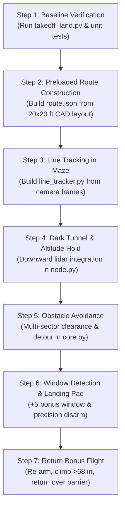

# DroneHacks Autonomous Drone Stack: Full Codebase Walkthrough & Development Roadmap

This guide walks through every component of the DroneHacks companion codebase, explains how the pieces interact, and categorizes every file into **Untouched Core** vs. **Primary Modification Targets** vs. **New Modules to Add**.

---

## 1. System Architecture & The Big Picture

```
                                 [ SIMULATION / HARDWARE BOUNDARY ]
  +------------------------------------------------------------------------------------+
  |  PX4 Autopilot (SITL or Pixhawk 6C)                                                |
  |  - Attitude & Rate Controllers (Fast Inner Loops)                                  |
  |  - EKF2 Estimator (fuses IMU + External Vision Odometry)                          |
  |  - Failsafes, Arming Logic & Land Detector                                         |
  +-----------------------------------+------------------------------------------------+
                                      | Micro XRCE-DDS Bridge (Topic Translation)
                                      v
  +------------------------------------------------------------------------------------+
  |  ROS 2 Jazzy Companion Container (Jetson Orin Nano / Linux Companion)             |
  |                                                                                    |
  |  [SUBSYSTEM 1: PERCEPTION & VIO] (onboard/)                                        |
  |  - cuVSLAM Wrapper (NVIDIA visual-inertial SLAM)                                   |
  |  - EV Bridge (transforms & gates odometry -> /fmu/in/vehicle_visual_odometry)      |
  |  - Health & TF Monitoring (/estimator/healthy)                                     |
  |                                                                                    |
  |  [SUBSYSTEM 2: AUTONOMY & FLIGHT CONTROL] (refnav/ + main.py)                      |
  |  - main.py: Entrypoint & argument builder                                          |
  |  - refnav/node.py: ROS 2 node, topic subscriptions, setpoint publisher             |
  |  - refnav/core.py: Pure state machine (arm, climb, waypoint navigation, land)     |
  |  - refnav/depth.py: Pinhole camera depth projection & forward clearance math       |
  +------------------------------------------------------------------------------------+
```

### The Key Separation of Concerns
1. **The Autopilot is Separate:** Your Python code **does not** run motor control loops. PX4 handles low-level attitude, rates, and motor outputs. Your code runs in **Offboard Mode**, sending target positions (`TrajectorySetpoint`) and vehicle commands (`VehicleCommand`) at 20 Hz.
2. **Pure Flight Logic (`core.py`):** The navigation decisions are isolated from ROS 2. `core.py` contains **zero ROS imports**, reads no system clocks directly, and does no disk I/O. It accepts time and telemetry through function arguments, making it 100% testable in pure Python unit tests (`test_refnav_core.py`) with a fake simulated drone.
3. **Visual Odometry Feeds PX4 (`onboard/`):** Because GNSS/GPS is strictly prohibited indoors (Rule 6.1), PX4 cannot navigate without a continuous external position fix. `cuVSLAM` consumes stereo camera images and IMU, and `ev_bridge.py` feeds `vehicle_visual_odometry` into PX4's EKF2.

---

## 2. File-by-File Codebase Walkthrough

### Root Flight & Entrypoint Files

| File | Role | Details |
| :--- | :--- | :--- |
| [`main.py`](file:///c:/Users/jacob/Documents/antigravity/Dronehacks_stuff/main.py) | **Execution Entrypoint** | Configures `HEIGHT_M` (1.2m) and `HOVER_S` (5.0s), validates that the local `refnav` package exists, parses arguments via `refnav.launch`, and launches `refnav.node.main()`. Plain `python3 main.py` runs standard ROS directly. |
| [`flight.yaml`](file:///c:/Users/jacob/Documents/antigravity/Dronehacks_stuff/flight.yaml) | **Static ROS Parameters** | Declares standard ROS 2 parameter overrides: `depth_topic`, `health_topic`, `base_frame`, `status_topic`, and clock settings (`use_sim_time: false` by default for hardware; overridden in sim). |
| [`route.json`](file:///c:/Users/jacob/Documents/antigravity/Dronehacks_stuff/route.json) | **Pre-planned Route** | JSON defining the flight legs `[ [forward_m, left_m], ... ]`. Currently empty `{"route": [], "params": {}}`. |
| [`FLIGHT_CODE.md`](file:///c:/Users/jacob/Documents/antigravity/Dronehacks_stuff/FLIGHT_CODE.md) | **Architecture Guide** | Explains coordinate systems (NED: North-East-Down, where negative Z is climb), Offboard mode streaming contracts, and unit testing guidelines. |

---

### Autonomy & Navigation Package (`refnav/`)

| File | Lines | Responsibility & Working Mechanism |
| :--- | :--- | :--- |
| [`refnav/core.py`](file:///c:/Users/jacob/Documents/antigravity/Dronehacks_stuff/refnav/core.py) | 515 | **The Flight Brain (Pure Logic State Machine)**<br>• Defines `Params` (speed, climb rate, tolerances, obstacle stop distances, timeout thresholds).<br>• Implements the mission state machine: `wait` -> `arm` -> `climb` -> `hover` -> `turn` -> `check` -> `go` -> `hold` -> `land` -> `done`.<br>• **Safety Gates:** Fails closed if estimator is unhealthy, depth is stale, or PX4 drops out of Offboard.<br>• **Current Limitation:** In `_go()` and `_check()`, if clearance is less than `stop_m` (0.9 m), it immediately aborts the mission and lands (`route blocked`). It has **no local obstacle avoidance** yet. |
| [`refnav/node.py`](file:///c:/Users/jacob/Documents/antigravity/Dronehacks_stuff/refnav/node.py) | 303 | **The ROS 2 Communication Harness**<br>• Wraps `core.Mission` in an `rclpy.node.Node`.<br>• Subscribes to PX4 telemetry: `/fmu/out/vehicle_local_position_v1`, `/fmu/out/vehicle_attitude`, `/fmu/out/vehicle_status_v1`, `/fmu/out/vehicle_land_detected`, `/fmu/out/estimator_status_flags`.<br>• Subscribes to perception: `/camera/depth/image_raw`, `/camera/depth/camera_info`, and `/estimator/healthy`.<br>• Runs a 20 Hz timer (`_tick`): feeds timestamps and vehicle telemetry to `mission.step()`, streams `/fmu/in/offboard_control_mode` and `/fmu/in/trajectory_setpoint`, and issues `/fmu/in/vehicle_command` for arming/mode changes.<br>• Publishes diagnostic telemetry to `/refnav/status`. |
| [`refnav/depth.py`](file:///c:/Users/jacob/Documents/antigravity/Dronehacks_stuff/refnav/depth.py) | 137 | **Pure Geometry & Depth Processing**<br>• Unpacks raw depth images (32FC1 float or 16UC1 mm) using NumPy.<br>• Corrects camera tilt using PX4 vehicle attitude quaternion (`level_rotation()`) into the level heading frame.<br>• `corridor_coverage()`: Checks if enough valid depth pixels exist in the forward corridor.<br>• `clearance()`: Returns distance to the nearest obstacle within `±corridor_half_m` (0.6 m) and `±band_m` (0.4 m) vertical height. |
| [`refnav/launch.py`](file:///c:/Users/jacob/Documents/antigravity/Dronehacks_stuff/refnav/launch.py) | 15 | Builds standard ROS 2 CLI arguments, merges `flight.yaml` with `/etc/flyx/mission.yaml`, and declares runtime parameters. |
| [`refnav/gps.py`](file:///c:/Users/jacob/Documents/antigravity/Dronehacks_stuff/refnav/gps.py) | 36 | Utility to wait for a 3D GPS fix. Used only for outdoor tutorial lessons. |

---

### Perception & State Estimation Package (`onboard/`)

| File / Folder | Role | Why It Exists |
| :--- | :--- | :--- |
| [`onboard/services.py`](file:///c:/Users/jacob/Documents/antigravity/Dronehacks_stuff/onboard/services.py) | **Service Process Manager** | Starts, stops, and queries daemon processes listed in `onboard/config/services.json` (such as cuVSLAM and EV bridge). Generates logs in `.onboard/`. |
| `onboard/slam/` | **cuVSLAM ROS Wrapper** | `cuvslam_lib_node.py` wraps NVIDIA's closed cuVSLAM library, subscribes to `/stereo/left/image`, `/stereo/right/image`, and `/imu`, and publishes `/visual_slam/tracking/odometry`. `pose_cov.py` handles covariance. |
| `onboard/vio/` | **External Vision Bridge** | `ev_bridge.py` validates odometry timestamps, transforms coordinate frames (optical/body FLU -> PX4 FRD/NED via `frames.py`), and publishes to `/fmu/in/vehicle_visual_odometry`. Publishes `/estimator/healthy`. |
| `onboard/adapters/` | **PX4 Telemetry Adapters** | `px4_odom.py` publishes TF frames from PX4 local position; `px4_health.py` monitors estimator health flags. |
| `onboard/examples/takeoff_land.py` | **Standalone Reference Flight** | Minimal, raw ROS 2 script demonstrating direct takeoff, 1-meter hover, and landing without the `refnav` state machine. |

---

### Verification & Testing (`tests/`)

| File | Lines | Purpose |
| :--- | :--- | :--- |
| [`tests/test_refnav_core.py`](file:///c:/Users/jacob/Documents/antigravity/Dronehacks_stuff/tests/test_refnav_core.py) | 459 | **Unit Tests with Mock PX4 Simulation**<br>• Contains a synthetic ray-tracing depth renderer (`render_depth`) and a simulated kinematic autopilot (`FakePX4`).<br>• Verifies critical behaviors: estimator health timeouts, depth loss landing, obstacle stops, stale timestamp rejection, and clean disarming.<br>• Runs instantly without starting Gazebo or PX4 SITL. |

---

## 3. What to Leave Untouched vs. Where to Add Code

```
+-----------------------------------------------------------------------------------------+
|                                    CODEBASE ROADMAP                                     |
+-----------------------------------------------------------------------------------------+
|  [DO NOT TOUCH / LEAVE ALONE]                                                           |
|  - onboard/slam/* (cuVSLAM wrapper, stereo matching, covariance)                        |
|  - onboard/vio/* (ev_bridge.py, frame transforms, health monitoring)                   |
|  - onboard/adapters/* (px4_odom.py, px4_health.py)                                      |
|  - refnav/gps.py (GPS is prohibited indoors by Rule 6.1)                                 |
|  - SITL / Simulator internals (Micro XRCE-DDS agent, simulator clock, reset commands)   |
+-----------------------------------------------------------------------------------------+
|  [MODIFY & EXTEND IN-PLACE]                                                             |
|  - route.json & flight.yaml (Course coordinates, speeds, heights, margins)               |
|  - refnav/core.py (Mission phases: replace obstacle stop with local planner; add stages)|
|  - refnav/node.py (Subscribe to color camera, downward lidar, pass data to core)         |
|  - refnav/depth.py (Geometric helpers: corridor detection, obstacle clustering)        |
|  - tests/test_refnav_core.py (Unit tests for all new behaviors)                          |
+-----------------------------------------------------------------------------------------+
|  [NEW MODULES TO BUILD]                                                                 |
|  - refnav/line_tracker.py (Computer vision line follower for maze floor tape)           |
|  - refnav/planner.py (Local obstacle avoidance around boulders and corridor walls)       |
|  - refnav/tunnel.py (Blind/dead-reckoning & height hold for the dark tunnel)            |
|  - refnav/window_gate.py (Detector & alignment for Window [+5 pts] vs Gate B)           |
|  - refnav/pad_detector.py (Downward circle/landing pad detector for precise disarm)     |
|  - refnav/return_bonus.py (Climb >68" over barrier, reverse transit, land at launch)    |
+-----------------------------------------------------------------------------------------+
```

### Detailed Breakdown

### 🚫 1. Left Untouched (Core Substratum)
1. **`onboard/slam/` & `onboard/vio/` (`cuvslam_lib_node.py`, `ev_bridge.py`, `frames.py`):**
   * *Why:* These files are the life-support system of the drone. They convert raw stereo camera frames and IMU measurements into `/fmu/in/vehicle_visual_odometry`. PX4's EKF2 relies completely on this for indoor localization. Modifying quaternion rotations or covariance matrices here will cause estimator divergence and immediate flight refusal or crashes.
2. **`onboard/adapters/` (`px4_odom.py`, `px4_health.py`):**
   * *Why:* Standard ROS 2 TF broadcasters and health gates. They work out of the box.
3. **`refnav/gps.py`:**
   * *Why:* Rule 6.1 strictly bans GNSS/GPS.
4. **Simulator Internals / Reset Commands:**
   * *Why:* Per `AGENTS.md` and `AI_CONTEXT.md`, simulator truth and web reset commands must never be put into flight code. Flight code must only use onboard sensor topics.

---

### ✏️ 2. Modify & Extend In-Place

#### A. [`refnav/core.py`](file:///c:/Users/jacob/Documents/antigravity/Dronehacks_stuff/refnav/core.py) (The State Machine)
* **What it currently does:** Follows pre-fixed straight legs. If an obstacle is detected `< 0.9 m` ahead, it triggers `_land(now, out, "route blocked")` and quits!
* **What we must change:**
  1. **Replace Obstacle Land with Local Planner:** When an obstacle is detected in the corridor (e.g. an 18-inch boulder), instead of aborting, query the local planner to detour laterally around it while staying within the corridor width.
  2. **Add Challenge Stages to State Machine:** Expand `AIRBORNE` phases from generic legs into distinct mission stages:
     - `MAZE_LINE_FOLLOW` (tracking floor tape to Gate A)
     - `TUNNEL_TRANSIT` (transiting the dark tunnel)
     - `CHICANE_WINDOW` (locating and threading the window for the +5 bonus)
     - `LANDING_ALIGN` (centering over the landing pad outer ring)
     - `RETURN_BONUS` (taking off again, ascending above 68 in, returning over the barrier to launch)
  3. **Tunable Parameters (`Params`):** Adjust `speed_mps` (increase once stable), `height_m` (default 1.2 m is safe under the 68 in / 1.72 m ceiling limit), and clearance thresholds.

#### B. [`refnav/node.py`](file:///c:/Users/jacob/Documents/antigravity/Dronehacks_stuff/refnav/node.py) (ROS 2 Plumbing)
* **What it currently does:** Subscribes only to depth and camera info.
* **What we must change:**
  1. **Downward Lidar Subscription:** Subscribe to the Holybro VL53L1X rangefinder (e.g. `/fmu/out/sensor_distance` or `/distance_sensor`) to maintain ground clearance inside the dark tunnel and during pad touchdown.
  2. **RGB Camera Subscription:** Subscribe to `/camera/color/image_raw` (or `/stereo/left/image_rect`) to feed the floor line tracker and window/pad detectors.
  3. **Pass Perception Outputs to `core.py`:** Send line lateral error, window coordinates, and pad centers to the state machine during the 20 Hz tick.

#### C. [`refnav/depth.py`](file:///c:/Users/jacob/Documents/antigravity/Dronehacks_stuff/refnav/depth.py) (Geometric Perception)
* **What it currently does:** Samples a single forward corridor for obstacle distance.
* **What we must change:**
  1. **Multi-Sector Clearance:** Evaluate clearance across multiple bearings (e.g. left, center, right) so the planner knows which side is open to bypass obstacles.
  2. **Window Opening Detection:** Detect the 3D void representing the window in the lower wall (bounded opening between two solid wall sections).

#### D. [`route.json`](file:///c:/Users/jacob/Documents/antigravity/Dronehacks_stuff/route.json) & [`flight.yaml`](file:///c:/Users/jacob/Documents/antigravity/Dronehacks_stuff/flight.yaml)
* **What we must change:**
  1. Build a baseline coarse route from the published 20×20 ft CAD layout coordinates (launch mark -> corridor 1 -> maze turn -> Gate A -> tunnel entrance -> chicane -> pad). Rule 6.4 explicitly permits preloading a map built from the published layout.

---

### 🚀 3. New Modules to Add (`refnav/`)

To win the challenge, we need specialized modules feeding `core.py`:

```
refnav/
├── core.py             <-- Updated state machine & stage sequencer
├── node.py             <-- Updated ROS 2 subscriptions (RGB, Downward Lidar)
├── depth.py            <-- Updated multi-sector depth & window math
├── line_tracker.py     <-- [NEW] Computer vision line detector (Maze floor tape)
├── planner.py          <-- [NEW] Local obstacle bypass & trajectory generator
├── tunnel.py           <-- [NEW] Dark tunnel state controller (height-hold & heading-lock)
├── window_detector.py  <-- [NEW] Detects window coordinates in the chicane wall (+5 pts)
├── pad_detector.py     <-- [NEW] Centers drone over landing ring
└── return_bonus.py     <-- [NEW] High-altitude over-barrier return flight plan (+25% score)
```

#### 1. `refnav/line_tracker.py` (Stage 1: Maze Line Follower)
* **Target:** Checkpoints 1 & 2 (11 points total).
* **Function:** A line on the floor marks the route through the maze. This module processes RGB images, thresholds the line color/intensity, computes the line's lateral offset and heading angle relative to the drone's heading, and outputs lateral correction setpoints.

#### 2. `refnav/planner.py` (Local Obstacle Avoider)
* **Target:** Avoiding 18-inch boulders and corridor walls (avoids 5-second touch penalties and crashes).
* **Function:** When an obstacle is detected in the carrot's path, it calculates candidate offsets (e.g., shifts setpoint left or right by 0.4 m) and selects the path with the largest clearance.

#### 3. `refnav/tunnel.py` (Stage 2: Dark Tunnel Transit)
* **Target:** Checkpoint 3 (10 points).
* **Function:** The tunnel is dark inside, which can cause visual SLAM feature loss. This module:
  - Detects tunnel entrance.
  - Locks forward pitch and yaw heading based on pre-tunnel orientation.
  - Uses the downward VL53L1X rangefinder to strictly hold vertical height above the floor.
  - Proceeds forward at a steady speed until light and visual features return at the exit.

#### 4. `refnav/window_detector.py` (Stage 3: Chicane & Window)
* **Target:** Checkpoint 4 (7 points + 5 bonus points for the Window over Gate B).
* **Function:** Detects the window opening in the lower wall using depth contrast. Computes a trajectory through the center of the window opening. Falls back to Gate B if the window cannot be safely resolved.

#### 5. `refnav/pad_detector.py` (Stage 4: Precision Landing)
* **Target:** Checkpoint 5 (7 points).
* **Function:** Rule 7.9 requires the entire drone to land inside the pad's outer ring. This module detects the concentric circles of the landing pad from downward vision, trims the horizontal position setpoint, and triggers `AUTO_LAND`.

#### 6. `refnav/return_bonus.py` (Stage 5: Return Bonus)
* **Target:** +25% total run score multiplier (Rule 7.10).
* **Function:**
  - After touchdown and disarm on the landing pad, delays 2 seconds, re-arms, and switches back to Offboard.
  - Ascends to 2.0 m (over the 68 in / 1.72 m barrier — permitted exclusively on the return).
  - Flies straight across the barrier back to launch coordinates.
  - Descends and disarms within 2 ft of the launch mark.

---

## 4. Recommended Step-by-Step Implementation Roadmap



### Safe Testing Workflow:
1. **Always test in pure Python first:**
   Add new test scenarios to `tests/test_refnav_core.py` using `FakePX4` before running anything in the simulation.
2. **Observe telemetry before moving:**
   Inspect topic health (`/estimator/healthy`, `/fmu/out/vehicle_status_v1`, `/camera/depth/image_raw`) in the companion terminal.
3. **Respect the Reset World Rule:**
   Whenever manual controls or keyboard RC are touched, land, release RC, and press **Reset world** in the web UI before running automated scripts.

