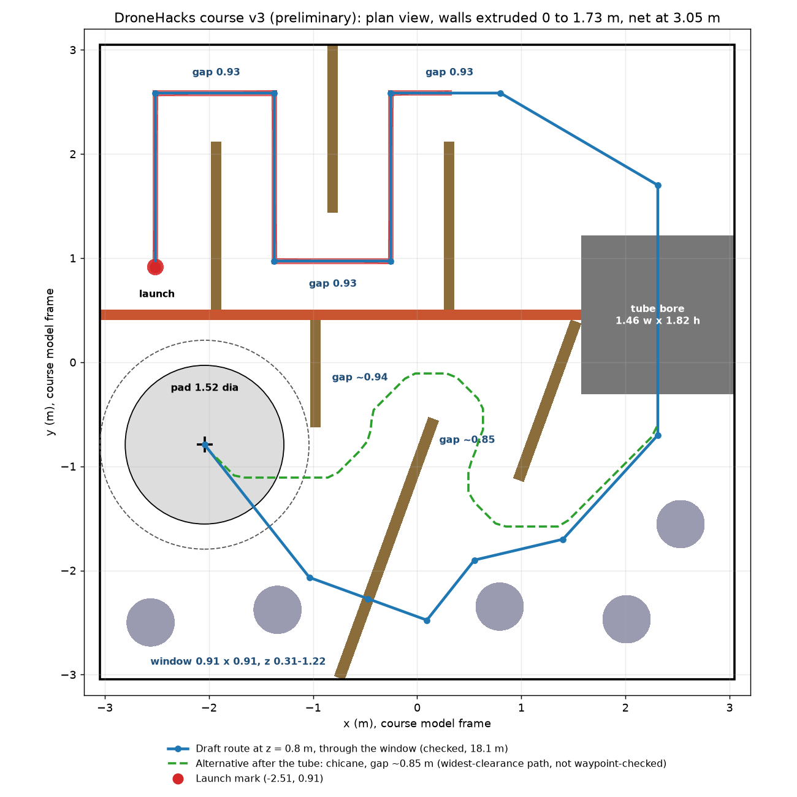

# DroneHacks plan

This plan is for team drone 16 (`skybeta-16`). It was rewritten on 2026-11-06 and assumes no drone experience. Nothing in it has flown yet. So far we have built only the simulator, described in [`simulator/README.md`](../simulator/README.md). The course layout is still preliminary, so some measurements may change slightly.

The plan tells you how sure we are about each number. "Measured" means it came from the real drone or the course model. "Estimated" means I calculated it, and it could be wrong. "Not tested" means someone has to try it.

## 1. The plan in short

The drone has to fly through a known obstacle course by itself, with nobody controlling it, and then land on a pad and switch itself off. The organizers published a 3D model of the course. We also have a phone scan of the course as it was built on 2026-11-06, which is more accurate, and we may load it onto the drone as a map. The course may still change after the scan.

Because we already have a map, the drone doesn't need to build one from scratch while flying. It needs to do three simpler things:

1. Keep track of where it is, using its cameras.
2. Compare what it sees with the map. Correct itself when it has drifted, and update the map when the course has changed.
3. Work through the course one stage at a time: corridor, maze, tunnel, window, landing.

The team has made these decisions:

- **The route is worked out from the map when the program starts.** It is not typed into the code, because the judges take points off for routes written into code.
- **The map starts from our scan, and the drone changes it when the course has changed.** If the cameras clearly see a wall where the map has none, or an opening where the map has a wall, the drone updates its map and plans a new route.
- **The drone flies about 0.8 m above the floor.** This lets it fit through the window, whose top edge is 1.22 m high.
- **When the cameras can't tell whether the path ahead is clear, the drone creeps forward if the map says the path is free.** It does not stop and wait, because plain walls could make the cameras unsure quite often.
- **A run has no human pilot stage.** One flip of a switch begins the run (section 8), and everything after it is automatic.
- **The tunnel is treated as a normal, wide passage.**
- **The landing uses the bottom laser sensor to detect the moment the drone touches the floor.** Section 7 explains how.

## 2. How scoring shapes the plan

A team's score has three parts. The run is worth 60 points, the technical presentation is worth 25, and "generality" (how well the software would work on a different course) is worth 15.

Finishing matters far more than speed. Any finished run below the wall tops beats every unfinished run. A run that reaches the landing area but never lands scores at most 35. A finished run scores 35, plus up to 20 for speed, plus 5 if it went through the window.

Here are some example scores, using the rulebook's example of a 60-second fastest finish:

| Our finish time | Through Gate B | Through the window |
|---|---|---|
| 150 s | 43.0 | 48.0 |
| 120 s | 45.0 | 50.0 |
| 90 s | 48.3 | 53.3 |
| 60 s | 55.0 | 60.0 |

This gives us a clear order of priorities:

1. **Finish the course, including the landing.** The landing alone adds about 15 to 25 points.
2. **Go through the window.** It is worth 5 points, about the same as cutting a run from 150 s to 90 s.
3. **Then go faster.** Cutting a run from 120 s to 90 s earns only about 3 points.

We only need one good run, because the best run counts and we can fly many runs in our time blocks. A touch on a wall adds 5 seconds. A crash ends that run, but it keeps the checkpoints already reached. So we can start slow and safe, and speed up later.

Finishing and then flying back to the launch mark multiplies the run score by 1.25. That is worth about 12 points, but it needs a second automatic takeoff. It comes last, after everything else works.

## 3. The drone

Every team has the same drone. These are its main parts and what each one does.

**Flight controller (Pixhawk 6C).** This small computer keeps the drone stable by adjusting the four motors hundreds of times per second. It runs flight software called PX4. Inside PX4, a part called EKF2 combines all the sensor readings into one best guess of where the drone is. We don't change any of this, and our code only tells it where to go.

**Main computer (Jetson Orin Nano).** Our code runs here. It has 6 processor cores, a small graphics processor, 7.4 GB of memory, and 164 GB of free storage (measured). The organizers' software already uses about 1.2 cores and 2.7 GB of memory when the drone is sitting still (measured). We haven't measured the load while moving.

**Front camera (OAK-D S2).** This has two black-and-white cameras side by side, 7.5 cm apart, like a pair of eyes. It takes 30 pictures per second from each one. The small difference between the left and right pictures shows how far away things are. It does not produce distance data by itself on this drone, so our code has to calculate it.

**Bottom laser sensor.** This points straight down and measures the distance to whatever is directly below the drone, up to about 4 m. PX4 uses it as the drone's height. The rulebook calls it a VL53L1X, but the drone's documentation says its beam is unusually narrow and that the exact part isn't recorded. Section 11 includes a simple test to find out how it really behaves.

**Size and weight.** The drone is about 50 cm wide and 41 cm long if it has 7-inch propellers, and weighs about 1.47 kg. These are estimates, because nobody has weighed it or confirmed the propeller size. It should fly for about 13 minutes on a battery (estimated).

**How our code talks to the drone.** The organizers' software lets our code do two main things: send a target position, or send a target speed. It also has a hold command that makes the drone stay where it is. The rules of that software say we shouldn't talk to PX4 directly, so all our commands go through it.

## 4. The course and the route

The course is a 6.1 m square inside a safety net. The walls are 1.73 m tall. The drone must stay below the wall tops. It passes five checkpoints in order, and the whole drone must cross each checkpoint's line:

1. **First corridor** (4 points). The drone flies to the end of the first corridor.
2. **Maze** (7 points). It weaves through three gaps, each 0.93 m wide, and leaves through Gate A.
3. **Tunnel** (10 points). This is the only way through the long barrier. It is 1.46 m wide, 1.82 m tall, and 1.52 m long.
4. **Chicane** (7 points, plus 5 for the window). The drone enters the landing area through the 0.91 m square window, or around the walls through Gate B.
5. **Landing** (7 points). It lands and switches off with the whole drone inside the pad's outer ring.

**Why the window comes first.** A 50 cm drone in a 91 cm window has about 21 cm to spare on each side. The Gate B route has two crossings, and the tighter one leaves only about 17 cm on each side. So the window has one crossing instead of two, more room, and 5 extra points.

The window has one risk. The bottom edge of the window is a 30 cm high piece of wall. As the drone crosses it, the bottom laser sees the wall instead of the floor, so the drone's height reading suddenly drops by about 30 cm. PX4 should ignore this brief jump if the drone is moving sideways fast enough, but it may stop trusting the laser if the drone crosses slowly (section 7 explains this). So the drone must cross without slowing down, and we still need to test this. If it causes trouble, we use Gate B.

**Checking the route.** I drew a draft route through the window and checked it against the course model at 0.8 m height. It is 18.15 m long. At its tightest, the centre of the drone is 41 cm from the nearest surface, which leaves about 16 cm after allowing for half the drone's width. When I picked points by hand for the Gate B route, one leg came within 12 cm of a wall, so hand-picking isn't good enough there. This is another reason to let the program calculate the route.

These numbers come from the organizers' model. Our scan shows several inner walls 20 to 80 cm from where that model puts them, and one chicane wall slanting the other way. The planner will recalculate the route from the scan.

**Boulders.** The course has five boulders, each 53 cm tall. The drone flies above them, but a boulder under the laser would look like a sudden height change. The draft route passes two boulders by only about 20 cm, so the route planner will treat each boulder as an area to stay away from.

## 5. How the drone knows where it is

### Camera tracking

The organizers' software (cuVSLAM) follows visual details from one picture to the next and works out how the drone has moved. This is the drone's only source of horizontal position, because there is no GPS. It is already installed and running.

It has two weaknesses. If it can't see enough detail, for example when facing a blank wall up close, it loses track. PX4 then no longer knows the drone's position, and the automatic flight ends. Also, small errors build up over time. If the error were 1% of the distance flown, it would reach 18 cm by the end of the course. We need to measure the real number.

### Correcting drift with the map

To remove that slow error, our code measures how far away the walls are, using the two camera pictures. It does this about 10 times per second, at a reduced picture size. It then takes those wall points and checks them against the map. If the points don't line up with the walls in the map, the code works out the small shift in position and heading that would line them up.

There are three safeguards:

- A flat wall only tells the drone how far it is from that wall, not how far along it. So the code only corrects the directions it can actually measure at that moment.
- Corrections are applied slowly, about 5 cm per second, so the drone never jumps.
- The correction only changes the target positions we send. We never change what PX4 thinks its position is. This follows the organizers' rules and keeps PX4's own control smooth.

### When the course differs from the map

The course may change after our scan. So just before each tight opening, the drone stops briefly, measures the opening's actual edges, and aims for the real centre.

A small difference, up to about 15 cm, is corrected straight away. A bigger difference could be a real change or a bad measurement. The drone believes it only if it sees the same thing in several pictures in a row, from 2 m away or closer, where the distance is accurate. It then moves that wall in its map and plans a new route. If it can't tell, it trusts the map.

### Knowing the starting position

The rules say the drone starts on the launch mark. So when the run starts, the code defines its current position as the launch mark on the map.

The drone's starting direction matters a lot. If it is pointed 3° off, the error reaches 26 cm after flying 5 m, which is more than the room we have in the window. We can't leave a placement guide on the course (rule 6.3). So the drone takes a distance measurement while still on the ground and uses the map to correct its starting direction.

### The main weakness of camera distance

The camera has no infrared projector, so a completely plain wall gives it nothing to match between the left and right pictures. We need a photo of the real walls and floor. The accuracy also falls with distance: about 4 cm at 1 m, and about 17 cm at 2 m. So the code trusts closer points more.

If distance data turns out to be too poor on the real walls, a small lidar that sits on top of the drone could replace it. A lidar spins a laser around to measure the distance to the walls, and an LD06 weighs about 42 g and costs about $69 to $99, depending on the seller. Extra sensors must cost under $100 and weigh under 50 g, so we would need to count its adapter too. We only buy one if testing shows we need it.

### What we decided not to use

Full mapping systems such as OctoMap, nvblox, SLAM Toolbox, ORB-SLAM and RTAB-Map rebuild a map we already have, and they use a lot of computing power. They would also take time away from flight testing. Reinforcement learning has the same problem. The rules also forbid saving a map or a recorded flight from one run and using it in a later run (rule 6.4). Our map comes from the published course model and our phone scan, which was made outside any run.

## 6. How our software is organized

Our code is three separate programs on the Jetson. If one crashes, the others keep running.

1. **The distance program** turns camera pictures into distance measurements.
2. **The position correction program** compares those distances with the map, and checks each opening.
3. **The mission program** decides where the drone goes next, and sends targets to the drone.

The mission program is the most important one, and it must still fly safely if the other two stop. All three run at a lower priority than the organizers' camera tracking, so they can't slow it down. Together with the organizers' software, I estimate they will use about 2.5 to 3.5 of the 6 cores and at most 3.5 GB of the 7.4 GB of memory.

The main logic is ordinary Python that doesn't depend on the drone's software. This lets us run and test it on the M1 Mac. All the flying decisions run on the drone, because the rules don't allow a laptop in the control loop during a run.

### Keeping the code general

The judges use an AI review to look for routes, waypoints and timings written into the code. So the course details live in two files, separate from the code:

- The **map file** holds the course, built from our scan. A different course needs only a different map file.
- The **mission file** lists the gates in order, and says which general behaviour each one uses, such as "fly through a gap" or "land".

At startup, the program calculates the route with the most room around it. It calculates a new one whenever the drone changes its map in flight. To show the judges this really is general, we will run the planner on the organizers' model, on our scan, and on many changed versions of both, and show the results.

### Moving between points

The mission program doesn't send the drone its final destination, because PX4 would fly there as fast as 12 m/s. It sends a target about 0.5 m ahead of the drone, and keeps moving that target forward as the drone advances, like a carrot on a stick. The drone's speed is about 0.95 times the distance to the target, so a 0.5 m carrot gives about 0.5 m/s. This makes the carrot's distance our speed control.

### The stages

Every stage has a clear job and a clear test for when it's complete.

**Waiting for the start.** The program prepares the map and route, then waits for the single start signal. Section 8 explains this.

**Takeoff.** The drone climbs to 0.8 m. It must leave the ground within 10 seconds of the motors starting, or PX4 shuts them off.

**First corridor.** The drone follows the route to the corridor's end. The red line on the floor is an optional extra guide. Because the camera is black and white and points straight ahead, it only sees the floor from about 1.6 m ahead, and the line shows only if it looks darker or brighter than the floor.

**Maze.** At each gap, the drone stops, measures the opening, lines up with its centre, and goes through. The stage is complete when the whole drone has passed Gate A.

**Tunnel.** The drone lines up outside the entrance with its nose straight, then flies through at a steady speed. This is the widest crossing on the course, with about 48 cm to spare on each side.

**Chicane.** The drone stops in front of the window, measures it, lines up and crosses. The stage is complete when the whole drone is past the line.

**Landing.** Section 7 describes this.

### When something goes wrong

If an opening looks blocked in several pictures in a row, the drone holds still and looks again. If it is still blocked, the drone marks it blocked in its map and plans a new route, for example through Gate B instead of the window. If the path ahead is simply unknown and the map says it's free, the drone creeps forward slowly.

The whole run must finish within 3 minutes. I estimate 90 to 120 seconds of normal flying, which leaves about 60 seconds for all the waiting and retrying. Once that time is used up, the drone stops waiting and creeps on.

We only stop a run if it's unsafe. A touch costs 5 seconds, and checkpoints already reached are kept, so giving up early rarely helps.

## 7. Landing with the bottom laser sensor

### The problem

To finish, the drone must land and switch its motors off without help. The organizers' software has no "land" command, and our code can't switch the motors off directly. We can only tell the drone to move downward.

PX4 can switch the motors off by itself if it decides the drone has landed. I read its source code to see what it looks for. It decides the drone has landed when all of these are true:

- We are commanding a descent faster than about 0.28 m/s.
- The drone isn't actually moving down.
- The motors have dropped to nearly their lowest power, about 16% if hover power is the 50% in the drone's settings.
- The drone isn't rotating.

Once those are true, PX4 goes through three stages, which take about 3 seconds in total, and then marks the drone as landed. Two seconds later, it switches the motors off.

The difficult condition is the motor power. When the drone touches the floor, its motors are still running at about hover power. PX4 only lowers them gradually, because it keeps trying to reach the commanded speed and can't. At a gentle 0.35 m/s command, this took about 5 seconds in our simulator. That costs finish time and leaves the drone sitting with its motors spinning for a long time, where a small bounce could disturb the process.

### The solution

A fast descent command would lower the power quickly, but it's only safe once the drone is already on the floor. **The bottom laser tells us exactly when that moment has come.** So the drone descends gently until the laser shows it has touched down, and only then commands a fast descent. Nothing moves, because the floor is in the way, but the motors drop to low power in about 1 second (measured in our simulator).

These are the steps:

1. **Remember the floor reading.** While sitting on the launch mark before takeoff, the code records what the laser reads when the drone is on the floor. We expect a small number, since the sensor sits just above the ground. This is our reference for "touching the floor", and it comes from the same run, so it is allowed.
2. **Stop over the pad.** The drone flies to the pad's centre at 0.8 m and waits to settle, for up to 3 seconds. The drone's centre can be up to about 48 cm from the pad's centre and still be fully inside the ring, so this is easy.
3. **Check the reading.** The laser should read about 0.8 m. If it doesn't, something unexpected is below the drone, so it holds and looks again.
4. **Descend at a medium speed.** The drone descends at 0.5 m/s until it is 0.3 m above the floor.
5. **Descend gently.** It continues at 0.35 m/s, which is just fast enough for PX4's landing check and slow enough for a soft touchdown. Below about 0.2 m, the code stops making sideways corrections. A sideways push at the moment of touching the floor is what tips a drone over.
6. **Confirm the touchdown.** Touchdown means two things are both true for 0.3 seconds: the laser is within about 3 cm of the remembered floor reading, and the drone has stopped moving downward. Requiring both means one bad reading can't trigger it.
7. **Push down.** The code now commands 1 m/s downward. The drone can't move, so PX4 lowers the motor power quickly.
8. **Wait for the motors to switch off.** PX4 marks the drone as landed about 3.5 seconds after it touched the floor, and switches off 2 seconds later. The clock stops at this moment.

In our simulator, the landing takes about 9 seconds from the start of the descent. Without the push-down step it takes about 4 seconds longer.

### What if something unexpected happens

- **The laser stops changing above the expected floor reading.** The drone is probably sitting on something, or the reading is stuck. If the drone isn't actually descending, the code treats it as touching down. If it's still descending, it continues at the gentle speed. The gentle speed is safe even if it reaches the floor without warning.
- **The laser stops giving readings.** The drone keeps descending at the gentle speed and uses "stopped moving down" alone to detect touchdown.
- **The motors don't switch off within about 8 seconds.** The drone keeps pushing down, since that does no harm. If they still don't stop after 15 seconds, the code lifts to 0.3 m and tries the landing once more.

### What the simulator showed

We flew this landing in [our simulator](../simulator/README.md), which runs PX4's real landing logic and the organizers' real software with drone 16's settings. The design worked, and the push-down step saved about 4 seconds. These are three flights of each kind, with times in seconds after the drone touched the floor, measured on PX4's own clock:

| | Motors at low power | PX4 says landed | Motors off |
|---|---|---|---|
| With the push-down step | 0.9 to 1.1 | 3.1 to 3.8 | **5.2 to 5.8** |
| Without the push-down step | 5.0 to 5.1 | 7.6 to 7.7 | **9.6 to 9.7** |

Later flights with the push-down step took up to about 6 seconds, so treat 6 seconds as the normal upper end. On 2026-11-07 we gave the simulator drone 16's motor positions and the laser's real reading rate (5 per second instead of 50), and the times stayed the same: 6.0 seconds with the push-down and 9.7 without. I first estimated about 3 seconds in total. It takes longer because PX4 slows down its landing stages. It normally spends about a third of a second on each stage, but it spends a full second on each when it has a ground distance sensor and doesn't mark the distance as valid. That is the case on drone 16, as the first finding below explains.

The flights and PX4's code also taught us five things that should apply to the real drone, because they come from PX4's own logic and drone 16's settings. We have not checked any of them on the real drone yet:

- **PX4's "distance is valid" flag stays false for the whole flight.** PX4 reports the distance to the ground (`dist_bottom`) along with a flag saying it is valid (`dist_bottom_valid`). The flag only turns on when PX4 uses the laser to work out the height of the ground. Drone 16 uses the laser as its main height source instead (`EKF2_HGT_REF` = 2), so the flag never turns on. Our code must read the distance and ignore this flag.
- **The distance never reads below 10 cm.** The setting `EKF2_MIN_RNG` = 0.1 raises any shorter reading to 0.1 m. So the floor reference will be about 0.10 m, and the distance stops changing during the last few centimetres of descent. This is why touchdown also needs "stopped moving down".
- **Once the drone is on the floor, the distance drifts.** It rose from about 0.10 m to as much as 0.18 m over the next few seconds, while the drone sat still. So once the code has confirmed touchdown, it must not check the laser again, or it might decide the drone has lifted off.
- **PX4 can stop believing the laser for a long time.** It compares the laser's changes with the drone's up-and-down speed. If they disagree while the drone has been moving sideways slower than about 0.32 m/s for 2 seconds, it stops using the laser. It only starts again once the drone moves up or down faster than 0.5 m/s. Until then, height comes mostly from the air pressure sensor, which PX4 barely trusts (`EKF2_BARO_NOISE` = 3.5 m). In one simulator flight, this let the drone sink from 0.77 m to the floor while PX4 kept reporting about 0.75 m. The trigger there was the simulated drone flying through a wall, which can't happen on the real drone, but a slow hover beside a boulder or the window's bottom edge could cause the same thing. So **the drone must never stop or crawl over an edge**. It should cross edges at more than about 0.4 m/s.
- **PX4 stops using the laser when the drone flies fast.** Drone 16's setting `EKF2_RNG_CTRL` = 1 means PX4 uses the laser for height only while the drone moves sideways slower than 1 m/s (`EKF2_RNG_A_VMAX`) and is lower than 3 m (`EKF2_RNG_A_HMAX`). Once it stops, it only starts again below 0.7 m/s. Without the laser, height comes from the air pressure sensor, which PX4 barely trusts. So the drone should cruise below about 0.9 m/s. This comes from reading PX4's code; we have not yet flown faster than 1 m/s in the simulator to see it happen.

### What still has to be tested

The simulator's floor contact is simplified, its weight and thrust are estimates, and this design has never run on a real drone. Three things could still change it:

- **Does the real drone bounce or shift when it touches down?** A bounce could restart PX4's landing stages. The simulated legs stop the drone dead.
- **What does our code actually read from the real laser?** We now know what to expect from PX4's code: a reference near 0.10 m and a flat reading near the floor. We still need to confirm it on the drone.
- **What is the real hover power?** The 50% setting may not match this drone, and it affects the 16% threshold.

Most of this can be checked without flying. With the motors off and the propellers removed, hold the drone by hand at known heights from 0 to 30 cm, and record what the code receives. That takes about five minutes.

## 8. Starting a run

This is the most probable way the organizers will require a run to start. It comes from their change log for software version 0.3.2, dated 2026-11-06, which they made at the request of the fleet owner.

1. **Before the signal, our program is already running and sending targets.** The organizers' software refuses to start the flight if it isn't hearing targets from our code.
2. **A teammate arms the drone on the remote control, with the referee present (rule 7.4).** Arming means giving the motors permission to spin. The mode switch must not yet be on Position, which is the mode where the drone holds its own place.
3. **On the referee's signal, the teammate flips the mode switch to Position.** This one flip is the single start command that rule 5.2 allows.
4. **The organizers' software sees the flip and hands control to our code.** This hand-over is called entering Offboard mode. It is tried once per arming, and only if the drone is on the ground, knows its position, and is receiving our targets.
5. **The drone takes off by itself.** It must leave the ground within 10 seconds of arming, or PX4 switches off the motors. The clock starts when the drone leaves the launch mark (rule 7.5).

Nobody flies the drone by hand at any stage. After the flip, the only person involved is a teammate holding the kill switch, which instantly stops the motors. The rules require this for every flight (rule 8.3). They are a safety watcher, not a pilot.

One point still needs confirming with the organizers. Rule 5.3 says the remote control is "for the kill switch only", which doesn't quite match steps 2 and 3. The change log is newer and is backed by the software actually on the drone, so we are designing for it.

Our code doesn't need to do anything special for the start. It sends a target to climb to 0.8 m from the moment the program is ready. That target has no effect until the hand-over happens. The simulator uses this same sequence, and the organizers' real code decides whether to accept the hand-over.

## 9. How the drone moves

PX4 handles balancing and motor control, so we don't need a detailed physics model. We only need to understand how the drone responds to a target.

You can think of it as nested control loops, each much faster than the one around it. The outer position loop reacts over about 1 second. Inside it are speed, tilt and motor loops, with the innermost reacting within a fraction of a second. To an electrical engineer, the outer loop looks like a first-order low-pass filter with a time constant of about 1 second.

This gives some useful results:

- **Stopping takes time.** After the target stops moving, the drone needs about 2.5 seconds to get within 5 cm of it. That is why it pauses at corners.
- **The drone trails its target.** At 0.5 m/s it runs about 0.5 m behind the target, so it would cut corners if it didn't stop.
- **Braking distance grows quickly with speed.** It is about 11 to 14 cm at 0.5 m/s and about 28 to 40 cm at 1 m/s, including the delay in reacting (estimated).
- **Speed is limited by the cameras as well as the motors.** A wall 0.5 m away moves quickly across the picture when the drone passes at 0.5 m/s. If the picture moves too quickly, or it blurs in dim light, camera tracking can fail. A good rule is that the speed in m/s should be no more than the distance to the nearest wall in metres.

**Our models.** We have two. The first is the full simulator in [`simulator/`](../simulator/README.md), which runs the real PX4 flight software in real time, so it is good for testing our code from start to finish. The second, which we haven't written yet, is a small program of about 150 lines on the Mac. It treats the drone as a single moving point with the same response delays and speed limits. It can run thousands of flights with random errors in position and timing, and it estimates how often the drone would touch a wall at each speed. As soon as we have flight logs, we adjust both to match them.

**What we measure instead of calculating.** These are the drone's weight, propeller size, hover power, response delay, how fast camera tracking drifts, and how air pushed off nearby walls affects the drone. Airflow near walls is too hard to predict, so we simply fly close to a wall and watch what happens.

## 10. RMA and CaDM

Both papers solve the same general problem: a robot's behaviour changes, and a neural network has to notice and adjust. RMA (Kumar et al., 2021) makes a four-legged robot adapt to terrain and payloads. It looks at the last half second of movement and estimates what has changed. CaDM (Lee et al., 2020) does something similar for a model that predicts how a simulated robot will move.

I don't recommend using either one to fly the drone, for these reasons:

- **They control the motors directly, many times per second.** RMA sends joint commands 100 times per second. We send targets into PX4 about 10 times per second, and PX4 already corrects for disturbances.
- **They need a huge amount of simulated training.** RMA used about 1.2 billion simulation steps and about 24 hours on a computer with a graphics card, and then a further 3 hours. We have an M1 Mac, and the organizers' simulator can't run on it. Our own simulator runs in real time with one drone, which is far too slow for that kind of training.
- **They solve a problem we don't really have.** Their benefit comes when conditions change a lot. We fly one drone with a fixed weight and an issued battery, at low speed. Our real risks are camera tracking and position error, which they don't address.
- **We don't have the time.** The first scored runs start in about a day, and the drone hasn't yet flown this way at all.

We can still borrow the main idea without the neural network. The mission program can look at the last few seconds of commands and responses, and calculate how slowly the drone is responding at the moment. If the response gets slower, for example as the battery drains, the code shortens the carrot and starts braking earlier. If what the drone does suddenly doesn't match what the code predicted, it may have touched something, or camera tracking may be failing, so the drone slows down.

This takes about 50 lines of code and very little computing power. Every number it produces can be plotted and explained to the judges. We will credit both papers as the inspiration.

If everything else works and time remains, we could try a small neural network trained on the Mac from our flight logs. We would first ask an organizer whether this is allowed, because the rules forbid feeding recorded flights into a later run.

## 11. Safety and the order of testing

### Before anything else

- **Replace the demo program.** The drone currently runs an organizers' demo that climbs to 1.5 m and flies a 5 m square, which would hit the course walls. It must be replaced by a harmless program before the propellers go on. The harmless program is already copied onto drone 16, but the drone won't use it until a teammate does steps 2 and 3 in [`drone_code/README.md`](../drone_code/README.md), which need the drone's password.
- **Check the flight controller connection.** At my last check, the Jetson couldn't talk to the flight controller. It probably had no power, but this needs confirming.
- **Check the camera calibration.** The camera's lens correction values are all zero. Either the pictures are already corrected or the calibration is missing, and distance measurement depends on this.

### Safety checks in the code

The mission program checks the following all the time:

- If position updates stop for more than 0.2 seconds, or camera tracking reports a problem, the drone holds.
- Every target is checked against the course boundaries, because the organizers' software doesn't limit horizontal movement.
- The target stays close to the drone, so the speed can't suddenly jump.
- If our automatic control has ended for any reason, the code stops sending the drone onward.

We don't change PX4's safety settings, because the rules forbid it (rule 8.5).

### Test order

Each step must pass before the next one starts. The team approves each flight before the drone arms, a teammate holds the kill switch, and every flight is recorded. Flying is allowed only inside the net (rule 8.2), and the drone must pass the organizers' inspection first (rule 8.4).

1. **On the table:** confirm the flight controller connection, settings and camera calibration.
2. **On the table:** replace the demo program with a harmless one.
3. **By hand, propellers off:** hold the drone at known heights and record the laser readings.
4. **By hand, propellers off:** move the drone 1 m forward, 1 m left, and turn it 90°. Check that the code sees the correct directions.
5. **By hand, propellers off:** carry it through the tunnel and confirm that camera tracking keeps working.
6. **Rehearse the start**, with the propellers off.
7. **First flight:** a short, low hover.
8. **Landing:** from that low hover, land and switch off automatically. This is tested early, since the landing is worth so much.
9. **Short flight:** fly 1 m out and back, and measure the response delay.
10. **Mock obstacles:** a mock gap, and a mock window with a bottom edge.
11. **Full course, slowly.**

### Schedule

- **Friday night:** steps 1 to 4, and write the stage logic and route planner.
- **Saturday daytime:** steps 5 to 9 in the net.
- **Saturday 7:30 PM:** time blocks are posted.
- **Saturday 10 PM to Sunday 2 AM:** first scored block. The goal is any finished run.
- **Sunday from 8 AM:** add the window, then speed. Arrive at the net 10 minutes early.
- **Sunday 12:30 PM:** the repository link is due, with a README and credits. Presentations start.
- **Sunday 4 PM:** everything we flew must be pushed. Scored runs close.

### What we build first

1. **First version:** stages, route planner, safety checks and landing, using camera tracking only. It is done when the drone finishes once at low speed.
2. **Second version:** add distance measurement, map correction and the opening check. It is done when finishes are repeatable and the window works.
3. **Third version:** add the response monitor and more speed.
4. **Last:** the flight back to the launch mark, if there is time.

## 12. What we still don't know

These are questions for the organizers:

- Is the start what their change log for version 0.3.2 describes: arm on the remote, then flip the switch to Position on the referee's signal? Rule 5.3 says the remote is for the kill switch only.
- Is a slow downward command the expected way to land, given that there's no land command?
- Where should the drone be powered up? Its position tracking starts from wherever it was when the software started.
- Which way will the drone face on the launch mark?
- How can the drone start its motors again for the return flight?
- May we fit a model of the drone's response from our practice logs, under rule 6.4?

And these are things we need to find out ourselves:

- What do the real walls and floor look like, and how good is the lighting? A photo would answer most of this.
- What is the real weight, propeller size and hover power?
- How much does camera tracking drift over a known distance?
- How does the real bottom laser behave near the floor and over the window's bottom edge? Section 7 says what we expect from PX4's code.
- How much does the real drone vibrate? The simulator's motion sensor noise is an estimate, and more vibration would make the real drone wander more than the simulated one.
- How much processor load does the software add while the drone is moving?

## Appendix: exact values for whoever writes the code

**Interface.** Publish `/skybeta/setpoint/pose` or `/skybeta/setpoint/twist`, and call `/skybeta/hold`. Read `/visual_slam/tracking/odometry`, `/visual_slam/status`, `/skybeta/state` and `/fmu/out/vehicle_local_position`. Do not publish `/fmu/in/*`. Twist commands expire after 1 s and are capped at 1.5 m/s. Pose altitude is floored at 0.3 m above the odometry origin, and twist is not floored, so landing uses twist.

**Landing parameters (Nov 3 dump for drone 16).** `LNDMC_Z_VEL_MAX` = 0.25, `LNDMC_TRIG_TIME` = 1, `COM_DISARM_LAND` = 2, `MPC_THR_MIN` = 0.12, `MPC_THR_HOVER` = 0.5, `MPC_USE_HTE` = 1, `MPC_Z_VEL_P_ACC` = 4, `MPC_Z_VEL_I_ACC` = 2, `EKF2_MIN_RNG` = 0.1, `EKF2_HGT_REF` = 2.

**Land detector logic (PX4 v1.16.0 source; the drone runs a patched v1.16.2).** The descend check is `velocity[2] >= 1.1 * LNDMC_Z_VEL_MAX`, or 0.275 m/s. The minimum thrust check is `MPC_THR_MIN + 0.1 * (hover - MPC_THR_MIN)` when climb rate control is on. Stage timing uses `LNDMC_TRIG_TIME / 3` per stage. The motor power timing assumes thrust = hover × (1 − a/g), with a = 4v + 2vt. It ignores anti-windup and ground effect. The auto-disarm description came from a summary of `Commander.cpp`, not from reading the code directly.

**Drone start limits.** `COM_DISARM_PRFLT` = 10 s. One Offboard attempt per arming.

**Camera.** 1024×640 at 30 Hz, fx 634.5 px, baseline 0.075 m. Topics `/oak/left/image_mono` and `/oak/right/image_mono`. Depth plan: downscale to 512×320, rectify, stereo match at about 10 Hz on the GPU if VPI works in the container, or on the CPU at lower resolution otherwise.

**Map correction.** Signed distance field at 2 cm per cell. About 2,000 points between 0.6 and 1.7 m height. Gauss-Newton on x, y and yaw with a robust loss. Update only the well-observed directions, checked with the Hessian's eigenvalues. Limit correction to 5 cm/s.

**Frames.** `setpoint_odom = inverse(T_map_odom) × carrot_map`. Measure `local_enu − odom_enu` from `/skybeta/state`. If `/visual_slam/status` reports a reset, hold and re-anchor from a scan.

**Recording.** Record `image_mono` (39 MB/s, about 68 minutes on the free disk) instead of `image_raw` (118 MB/s, about 23 minutes). Use a second container.

**Package.** `~/team_ws/src/team_nav` on the drone, with `COMPETITOR_PKG=team_nav` in `/etc/skybeta/drone.env`. Its source is [`drone_code/team_nav`](../drone_code/README.md).

**References.** [RMA](https://arxiv.org/abs/2107.04034), [CaDM](https://arxiv.org/abs/2005.06800), [PX4 land detector](https://docs.px4.io/main/en/advanced_config/land_detector), [PX4 source](https://github.com/PX4/PX4-Autopilot/blob/v1.16.0/src/modules/land_detector/MulticopterLandDetector.cpp), [LD06 datasheet](https://enacrobotique.github.io/doc/datasheets/LDROBOT_LD06_Datasheet.pdf).
