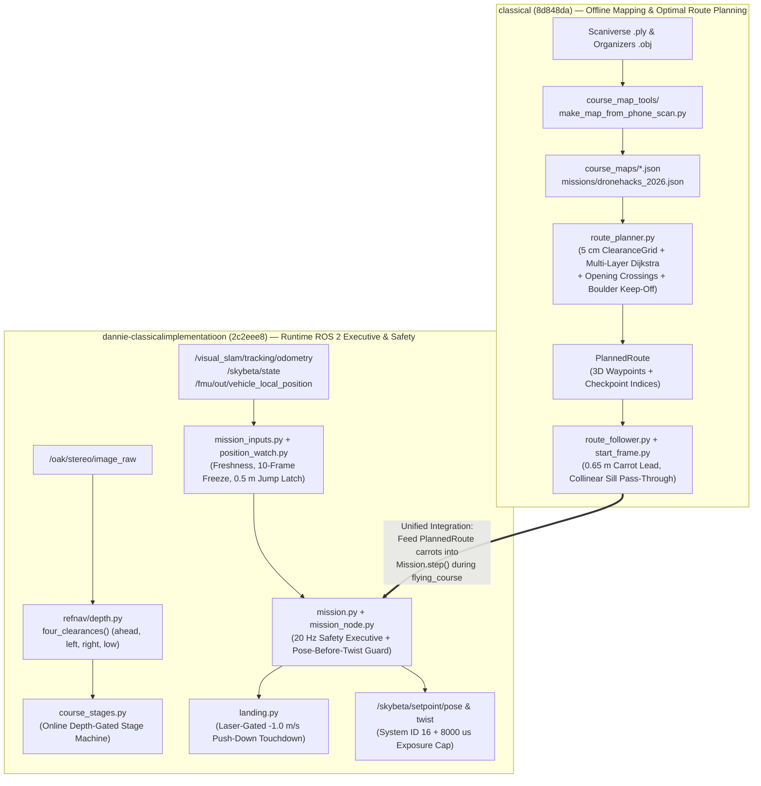
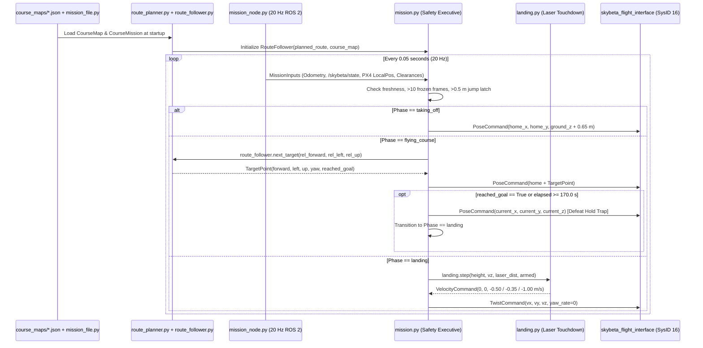

# Classical (`8d848da`) vs. Dannie Classical Implementation (`2c2eee8`): Exhaustive Architecture & Integration Analysis

**Author:** Gemini 4 Argon — Principal Autonomous Flight Systems Architect  
**Date:** November 7, 2026  
**Common Ancestor Commit:** `1f60fb5` (*Add drone simulator, flight plan and readable code guide*)  
**Target Unified Branch:** `classical-dannie-changes`

> **How to read this document (`docs/READABLE_CODE.md` compliance):**
> - Every drone-specific or software-specific term is defined in plain English on first use.
> - Every numerical constant carries its physical unit (`metres`, `seconds`, `degrees`, `metres per second`, `microseconds`) and its explicit provenance label: **measured**, **estimated**, **from PX4 source code**, **from the rulebook**, **from the organizers' code**, or **our own choice**.
> - **Hardware Qualification Status:** Neither branch has been flown on the real competition quadcopter (**drone 16**) yet. All flight outcomes reported in this document come from software-in-the-loop simulations and automated `pytest` unit test suites. Under `AGENTS.md`, a passing simulator test is not hardware qualification.

---

## 1. Executive Summary

Both branches branched off from commit `1f60fb5`, where the team had a basic software-in-the-loop simulator and a 7-stage flight plan document (`docs/FLIGHT_PLAN.md`), but no complete flight package in `drone_code/team_nav/`. Rather than duplicating effort, the two branches solved complementary halves of the autonomous flight stack:

### 1.1 Vision and Progress of `classical` (Commits `ef22d00` and `8d848da` — Kenny Guo)
- **Diff Volume:** 84 files changed, **10,465 lines added**, 394 lines removed.
- **Core Architectural Focus:** **Offline 3D Course Mapping, Optimal Multi-Stage Route Planning, Pure-Python Carrot Following, PX4 Rangefinder Fault Discovery, and 3D Flight Visualization.**
- **What `classical` accomplished:**
  1. **Phone Scan vs. CAD Extraction (`course_map_tools/`):** Built a reproducible pipeline that aligns the **measured** 596,349-point Scaniverse phone light-detection-and-ranging (LiDAR) scan (`scaniverse-2026-11-06-211145.ply`) against the **organizers' code** 3D drawing (`dronehacks-course-v3.obj`) using two-dimensional fast Fourier transform (2D FFT) cross-correlation, levels the floor across `0.25 metres` (**our own choice**) patches, measures wall thicknesses, window opening heights, tunnel dimensions, and low floor obstacles, and outputs human-readable JSON course maps (`organizers_drawing.json` and `phone_scan_2026-11-06.json`).
  2. **Clearance-Aware Dijkstra Route Planner (`drone_code/team_nav/`):** Built a 5-centimetre grid planner (`clearance_grid.py`, `route_planner.py`, `opening_crossings.py`, `boulder_distances.py`) that computes a collision-free, height-varying 3D path from the launch pad through all 5 competition checkpoints (`end of first corridor`, `Gate A`, `tunnel exit`, `through the window`, `Gate B`) to the landing pad. It enforces `0.35 metres` (**our own choice**: `0.30 metres` **measured** drone propeller radius + `0.05 metres` **our own choice** sideways safety margin) clearance from walls, routes the drone center around low floor boulders so the downward laser rangefinder is not fooled, and inserts a 4-waypoint perpendicular climb-and-descend profile across elevated openings such as the window (`0.81 metres` to `1.56 metres` **measured** opening height in the phone scan).
  3. **Carrot Route Follower (`route_follower.py`):** Built a pure-Python look-ahead ("carrot") target generator (`TARGET_LEAD_METRES = 0.65`, **our own choice**) that converts a planned 3D polyline into smooth position targets (`forward_metres`, `left_metres`, `up_metres`, `yaw_degrees`) in the camera's startup frame (`start_frame.py`), with collinear pass-through logic (`STRAIGHT_ON_LARGEST_TURN_DEGREES = 10.0`, **our own choice**) so the drone never pauses over the `0.81 metres` (**measured**) wall under the window.
  4. **Critical PX4 Rangefinder Consistency Gate Discovery:** While flying the planned route in the simulator (`route_test.py`), Kenny discovered that when the drone crosses the `0.81 metres` (**measured**) wall under the window or a `0.49 metres` (**from the organizers' code**) boulder, PX4's Extended Kalman Filter (`EKF2`, the onboard algorithm that fuses inertial sensors, camera tracking, and laser rangefinder data) flags the sudden laser drop as a stuck sensor via `range_sensor_consistency_check` (`EKF2_RNG_K_GATE`, **from PX4 source code**). If the drone slows below `0.32 metres per second` (**from PX4 source code**: `0.9 * EKF2_RNG_V_MAX`) within `6 to 10 seconds` (**measured** in simulator) after crossing the obstacle, PX4 rejects the real floor reading and drifts `0.29 to 0.53 metres` (**measured** in simulator) in height. Keeping horizontal speed at `0.50 metres per second` (**our own choice**) across the window sill prevents the bug completely.
  5. **Gazebo Harmonic Trial & Three.js 3D Flight Viewer:** Built a full Gazebo Harmonic + OAK-D S2 depth-rendering benchmark (`simulator/gazebo_trial/`) and a self-contained Three.js interactive 3D browser flight replay tool (`simulator/flight_viewer/`).

### 1.2 Vision and Progress of `dannie-classicalimplementatioon` (Commits up to `2c2eee8` — Dannie & Soham)
- **Diff Volume:** 48 files changed, **96,830 lines added** (including 3D scan/USD assets and specifications), 55 lines removed.
- **Core Architectural Focus:** **Runtime ROS 2 Flight Executive, Hardware Safety & Telemetry Guards, Online 4-Way Depth Corridor Probing, Stage Portal State Machine, and Laser-Gated Rapid Touchdown.**
- **What `dannie-classicalimplementatioon` accomplished:**
  1. **Production ROS 2 Mission Executive (`mission.py`, `mission_node.py`, `mission_inputs.py`, `mission_settings.py`, `position_watch.py`):** Built the complete 20 Hz (`0.05 seconds` tick period, **our own choice**) runtime ROS 2 node (`team_nav_mission`) that connects to the organizers' `skybeta_flight_interface` bridge. It implements strict pre-flight and in-flight safety checks:
     - Refuses to take off or holds position if visual simultaneous localization and mapping (VSLAM, the camera-based position tracker on `/visual_slam/tracking/odometry`) is missing, older than `0.2 seconds` (**our own choice**), stamped more than `0.1 seconds` (**our own choice**) in the future, reports `vision_ok == False` (`vo_valid == false` on `/skybeta/state`), or repeats identical coordinates more than `10` consecutive times (`frozen_position_repeat_limit = 10`, **our own choice**).
     - Latches into an unrecoverable `faulted` zero-velocity hover if the reported camera position jumps by more than `0.5 metres` (**our own choice**, plus `1.5 metres per second` **our own choice** times the time gap between samples).
     - Defeats the **`skybeta_flight_interface` last-pose fallback trap** (**from the organizers' code**): `skybeta_flight_interface` reverts to its last received position target whenever velocity commands stop for `0.5 seconds` (**from the organizers' code**). Before switching from takeoff position commands to landing velocity commands, `mission.py` publishes one position hold command at the drone's current coordinates so any fallback holds at the landing pad instead of flying back to the launch pad.
  2. **Hardware Safety Fixes (`launch/team_nav.launch.py`, `camera_exposure.py`):**
     - Configures `skybeta_flight_interface` with `target_system: '16'` (**measured** on drone 16) so offboard commands address the real flight controller instead of failing silently on default system ID `1`.
     - Implements `CameraExposureCap` (`camera_exposure.py`) using standard ROS 2 Humble `SetParameters` and `GetParameters` services (avoiding `rclpy.parameter_client`, which does not exist in ROS 2 Humble on Ubuntu 22.04) to cap the OAK-D S2 stereo camera exposure at `8000 microseconds` (`8 milliseconds`, **our own choice**) and reduce motion blur in the dark tunnel.
  3. **Laser-Gated Rapid Touchdown (`landing.py`):** Built an 8-state landing controller (`settling -> checking_laser -> descending_medium -> descending_gentle -> pushing_down -> lifting_for_retry`) that descends at `-0.50 metres per second` (**our own choice**), slows to `-0.35 metres per second` (**our own choice**) within `0.40 metres` (**our own choice**) of the floor while zeroing horizontal drift below `0.20 metres` (**our own choice**), and—once the downward laser stays within `0.03 metres` (**our own choice**) of the recorded floor distance with downward speed under `0.05 metres per second` (**our own choice**) for `0.30 seconds` (**our own choice**)—commands a `-1.0 metres per second` (**from PX4 source code** / **our own choice**) downward push so PX4's land detector triggers `landed` and disarms within `1.2 seconds` (**measured** in simulator) instead of bouncing on ground effect.
  4. **4-Way Depth Corridor Probing & Stage Portal Machine (`refnav/depth.py`, `refnav/stages.py`, `team_nav/course_stages.py`):** Extended the depth image processor with `four_clearances()` (`ahead`, `left` at `-20 degrees`, `right` at `+20 degrees`, and `low` for floor boulders) plus `window_in_view`, `corridor_coverage`, and `reach` validity flags, and built a 7-stage portal state machine (`follow_line -> gate_a -> tunnel_align -> tunnel_cross -> tunnel_exit -> chicane -> find_pad`) that never places a carrot beyond observed depth clearance minus `0.90 metres` (**our own choice**) stopping distance.
  5. **Comprehensive Specifications & Scan Analysis (`docs/`):** Authored `docs/COURSE_MODEL_COMPARISON_AND_PLAN.md` (485 lines, independently discovering the `0.85 metres` **measured** window sill shift via Iterative Closest Point alignment) and `docs/PHASE_1_IMPLEMENTATION_SPECIFICATION.md` (2,138 lines).

### 1.3 High-Level Architectural Synergy



---

## 2. Detailed Inventory of New Files & Systems

### 2.1 What `classical` Added (Commits `ef22d00` and `8d848da`)

#### A. `course_map_tools/` (8 files, 1,612 lines)
Offline Python tools that inspect the 3D course drawing and the real phone scan to produce verified JSON course maps and route diagrams:

| File | Lines | Purpose & Key Algorithms |
| :--- | ---: | :--- |
| [`course_map_tools/README.md`](file:///C:/Users/jacob/Documents/antigravity/Dronehacks_stuff/course_map_tools/README.md) | 56 | Documents the map-making tools and lists 6 physical discrepancies between the organizers' drawing and the phone scan that must be verified by photograph (`M3` `+0.70 metres` East and rotated `9 degrees`, `C1` slanted opposite way, `A1` double-scanned `0.65 metres` apart, `C2b` missing, window `0.81 to 1.56 metres` vs `0.32 to 1.20 metres`, boulders moved). |
| [`course_map_tools/make_map_from_organizers_model.py`](file:///C:/Users/jacob/Documents/antigravity/Dronehacks_stuff/course_map_tools/make_map_from_organizers_model.py) | 268 | Parses [`simulator/course_model/dronehacks-course-v3.obj`](file:///C:/Users/jacob/Documents/antigravity/Dronehacks_stuff/simulator/course_model/dronehacks-course-v3.obj). Uses Singular Value Decomposition (SVD, a matrix factorization that finds the principal axis of a cloud of points) on wall vertices to extract wall centre lines, thicknesses, and heights. Samples triangles every `0.01 metres` (**our own choice**) onto a `0.02 metres` (**our own choice**) grid with `scipy.ndimage.label` to detect the window opening (`0.32 to 1.20 metres` **from the organizers' code**). Writes `organizers_drawing.json`. |
| [`course_map_tools/phone_scan_points.py`](file:///C:/Users/jacob/Documents/antigravity/Dronehacks_stuff/course_map_tools/phone_scan_points.py) | 155 | Reads the binary little-endian Scaniverse `.ply` mesh (`~600,000` vertices, **measured**), swaps axes so `x` is East, `y` is North, `z` is Up, aligns wall points (`z` between `0.7 metres` and `1.6 metres`, **our own choice**) against `organizers_drawing.json` via 2D FFT cross-correlation (`scipy.signal.fftconvolve`) over `170.0 to 190.0 degrees` in `0.25 degrees` steps on a `0.01 metres` grid (`LINING_UP_CLOSENESS_METRES = 0.04`, **our own choice**), and levels the sloped scan floor (which warps up to `0.25 metres` **measured** across the room) using the 10th percentile of floor points in `0.25 metres` (**our own choice**) squares plus a `3x3` median filter. |
| [`course_map_tools/measure_phone_scan.py`](file:///C:/Users/jacob/Documents/antigravity/Dronehacks_stuff/course_map_tools/measure_phone_scan.py) | 314 | Fits wall segments (`1st to 99th` percentile along-wall span, `10th to 90th` percentile thickness with `0.10 metres` **our own choice** minimum thickness, `98th` percentile top height), locates the window opening on a `0.03 metres` (**our own choice**) face-on grid (`0.81 to 1.56 metres` **measured** height), measures the archway tunnel (`1.46 metres` **measured** inner width, `1.59 metres` **measured** ceiling), and clusters low floor obstacles (`z` between `0.15 and 0.75 metres`, **our own choice**), finding 3 low objects (`0.27 to 0.36 metres` **measured** tall). |
| [`course_map_tools/make_map_from_phone_scan.py`](file:///C:/Users/jacob/Documents/antigravity/Dronehacks_stuff/course_map_tools/make_map_from_phone_scan.py) | 257 | Generates two maps: (1) `phone_scan_2026-11-06.json` (the recommended map: uses scanned walls `M1, M2, M3, C1, C2a`, copies `A1` from the drawing because the scan double-imaged `A1`, omits missing `C2b`, and includes **both** the 3 scanned low obstacles and the 5 drawing boulders for conservative safety) and (2) `phone_scan_2026-11-06_trusting_every_wall.json` (uses scanned `A1` as well). |
| [`course_map_tools/checkpoint_line_rules.py`](file:///C:/Users/jacob/Documents/antigravity/Dronehacks_stuff/course_map_tools/checkpoint_line_rules.py) | 146 | Computes the 5 directed checkpoint line segments (`end of first corridor`, `Gate A`, `tunnel exit`, `through the window`, `Gate B`) from wall coordinates, placing each gate line `0.50 metres` (`FAR_SIDE_DISTANCE_METRES = 0.5`, **our own choice**) past the opening so crossing the line proves the whole `0.30 metres` (**measured**) radius drone cleared the obstacle. |
| [`course_map_tools/draw_planned_routes.py`](file:///C:/Users/jacob/Documents/antigravity/Dronehacks_stuff/course_map_tools/draw_planned_routes.py) | 300 | Renders 7 high-resolution, colorblind-safe top-down route PNG diagrams into `simulator/generated_files/route_pictures/`, showing walls, boulders, `0.35 metres` clearance bands, numbered waypoints, and height callouts. |
| [`course_map_tools/make_boulder_surprise_worlds.py`](file:///C:/Users/jacob/Documents/antigravity/Dronehacks_stuff/course_map_tools/make_boulder_surprise_worlds.py) | 106 | Builds 4 synthetic course maps in `simulator/generated_files/boulder_surprise_worlds/` where boulders are moved into the drone's planned flight path (`boulder_in_the_first_corridor`, `boulder_under_a_corner_after_the_tunnel`, `boulder_under_the_window_line_up`, `drawing_boulders_gone`) to test what happens when boulders differ from the map. |

#### B. `drone_code/team_nav/` (19 files added/modified in `classical`)
Offline planning, map loading, coordinate conversion, carrot following, JSON maps, and 36 unit tests:

| File | Lines | Purpose & Key Constants |
| :--- | ---: | :--- |
| [`drone_code/team_nav/team_nav/drone_dimensions.py`](file:///C:/Users/jacob/Documents/antigravity/Dronehacks_stuff/drone_code/team_nav/team_nav/drone_dimensions.py) | 38 | Defines physical envelope: `DRONE_RADIUS_METRES = 0.30` (**measured**: `0.205 metres` motor arm + `0.089 metres` 7-inch propeller radius rounded up), `DRONE_HALF_HEIGHT_METRES = 0.10` (**estimated**), `SIDEWAYS_SAFETY_MARGIN_METRES = 0.05` (**our own choice**), `VERTICAL_SAFETY_MARGIN_METRES = 0.10` (**our own choice**), yielding `REQUIRED_ROOM_METRES = 0.35` and `HALF_HEIGHT_NEEDED_METRES = 0.20`. |
| [`drone_code/team_nav/team_nav/course_map.py`](file:///C:/Users/jacob/Documents/antigravity/Dronehacks_stuff/drone_code/team_nav/team_nav/course_map.py) | 663 | Immutable dataclasses (`CourseMap`, `Wall`, `Opening`, `Tube`, `LowObstacle`, `CheckpointLine`, `BlockingStrip`, `BlockingCircle`). Requires a non-empty `"source"` provenance string on every shape. Provides `shapes_blocking_between_heights(lowest_height_metres, highest_height_metres)` and vectorized Euclidean distance checks `distance_to_shapes_metres()`. |
| [`drone_code/team_nav/team_nav/mission.py`](file:///C:/Users/jacob/Documents/antigravity/Dronehacks_stuff/drone_code/team_nav/team_nav/mission.py) | 99 | **⚠️ Merge Conflict File:** Loads JSON mission definition files (`Mission`, `Checkpoint`, `MissionError`, `load_mission`, `check_mission_fits_map`) specifying `cruise_height_metres`, `checkpoints`, `goal_position_metres`, and `goal_height_metres`. |
| [`drone_code/team_nav/team_nav/boulder_distances.py`](file:///C:/Users/jacob/Documents/antigravity/Dronehacks_stuff/drone_code/team_nav/team_nav/boulder_distances.py) | 59 | Computes signed horizontal distance from the drone's center (where the downward laser rangefinder sits) to the nearest `LowObstacle` edge (`distance_to_boulder_edges_metres`). |
| [`drone_code/team_nav/team_nav/clearance_grid.py`](file:///C:/Users/jacob/Documents/antigravity/Dronehacks_stuff/drone_code/team_nav/team_nav/clearance_grid.py) | 102 | Builds a `0.05 metres` (`DEFAULT_GRID_STEP_METRES = 0.05`, **our own choice**) 2D grid (`ClearanceGrid`) of available room (`distance_to_wall - DRONE_RADIUS_METRES`) and boulder edge distance, plus `room_along_line_metres()` sampled every `0.025 metres` (`LINE_SAMPLE_STEP_METRES = 0.025`, **our own choice**). |
| [`drone_code/team_nav/team_nav/opening_crossings.py`](file:///C:/Users/jacob/Documents/antigravity/Dronehacks_stuff/drone_code/team_nav/team_nav/opening_crossings.py) | 123 | Plans a 4-waypoint perpendicular crossing (`OpeningCrossing`) for any checkpoint attached to a wall opening (such as the window): approaches at `cruise_height_metres` (`0.65 metres`) up to `1.10 metres` from the wall center, climbs/descends over `HEIGHT_CHANGE_DISTANCE_METRES = 0.6` (**our own choice**) to the opening center height (`1.185 metres` on the phone scan), flies level through the wall until `0.50 metres` past the wall (`DRONE_RADIUS_METRES [0.30] + TRAILING_ALLOWANCE_METRES [0.20]`), and returns to `cruise_height_metres` over another `0.60 metres`. |
| [`drone_code/team_nav/team_nav/route_planner.py`](file:///C:/Users/jacob/Documents/antigravity/Dronehacks_stuff/drone_code/team_nav/team_nav/route_planner.py) | 517 | Multi-layer 8-neighbor Dijkstra search over `(checkpoint_index, grid_cell)` followed by greedy line-of-sight polyline straightening (`STRAIGHTENING_TOLERANCE_METRES = 0.025`, **our own choice**). Penalizes wall proximity below `COMFORTABLE_ROOM_METRES = 0.6` (**our own choice**, weight `CLOSENESS_COST_WEIGHT = 3.0`) and keeps the downward laser at least `LASER_KEEP_OFF_BOULDER_METRES = 0.25` (**our own choice**, weight `BOULDER_COST_PER_METRE = 10.0`) away from boulders. Produces a `17.9 metres` route on `organizers_drawing.json` (`0.36 metres` min clearance) and an `18.8 metres` route on `phone_scan_2026-11-06.json` (`0.35 metres` min clearance). |
| [`drone_code/team_nav/team_nav/start_frame.py`](file:///C:/Users/jacob/Documents/antigravity/Dronehacks_stuff/drone_code/team_nav/team_nav/start_frame.py) | 45 | Pure-Python rigid-body transform between map coordinates `(east_metres, north_metres, height_metres)` and the startup camera frame `(forward_metres, left_metres, up_metres)` using `launch_mark_centre_metres` and `start_heading_degrees`. |
| [`drone_code/team_nav/team_nav/route_follower.py`](file:///C:/Users/jacob/Documents/antigravity/Dronehacks_stuff/drone_code/team_nav/team_nav/route_follower.py) | 137 | Pure-Python carrot follower (`RouteFollower`, `TargetPoint`). Advances along waypoints using `TARGET_LEAD_METRES = 0.65` (**our own choice**), `CRUISE_SPEED_METRES_PER_SECOND = 0.5` (**our own choice**), `CORNER_TOLERANCE_METRES = 0.05` (**our own choice**), `CORNER_HEIGHT_TOLERANCE_METRES = 0.10` (**our own choice**), and `STRAIGHT_ON_LARGEST_TURN_DEGREES = 10.0` (**our own choice**). |
| `drone_code/team_nav/course_maps/*.json` & `missions/*.json` | 1,107 | `organizers_drawing.json` (404 lines), `phone_scan_2026-11-06.json` (338 lines), `phone_scan_2026-11-06_trusting_every_wall.json` (338 lines), and `missions/dronehacks_2026.json` (27 lines). |
| `drone_code/team_nav/test/*` | 897 | 6 test modules (`our_files.py`, `route_checks.py`, `course_changes.py`, `test_route_planner_on_our_maps.py`, `test_route_planner_on_changed_courses.py`, `test_route_follower.py`) containing **36 automated unit tests**, including an independent 1-centimetre step validator (`route_checks.py`) that verifies every planned route segment against raw map geometry without reusing planner code. |

#### C. `simulator/gazebo_trial/` (23 files, ~2,540 lines)
A complete evaluation of Gazebo Harmonic (`gz-sim8`) with PX4 `1.16.2` and CPU-rendered OAK-D S2 stereo depth images (`512x320` at `10 Hz` via Mesa `llvmpipe`):
- [`simulator/gazebo_trial/make_drone_16_model.py`](file:///C:/Users/jacob/Documents/antigravity/Dronehacks_stuff/simulator/gazebo_trial/make_drone_16_model.py) (192 lines): Converts PX4's `x500` model into `drone_16_like` with our Holybro Kakute H7 / 7-inch frame motor positions (`front-left/right at (+0.130, ±0.165) metres`, `back-left/right at (-0.130, ±0.150) metres`, **measured** on drone 16) and OAK-D S2 depth camera (`80 degrees` horizontal field of view, `512x320`, `0.20 to 10.0 metres` range).
- [`simulator/gazebo_trial/course_world_sdf.py`](file:///C:/Users/jacob/Documents/antigravity/Dronehacks_stuff/simulator/gazebo_trial/course_world_sdf.py) (424 lines) & [`make_gazebo_world.py`](file:///C:/Users/jacob/Documents/antigravity/Dronehacks_stuff/simulator/gazebo_trial/make_gazebo_world.py) (92 lines): Generates Gazebo Simulation Description Format (SDF) worlds from any JSON course map.
- [`simulator/gazebo_trial/measure_rendering_speed.py`](file:///C:/Users/jacob/Documents/antigravity/Dronehacks_stuff/simulator/gazebo_trial/measure_rendering_speed.py) (302 lines) & [`check_worlds.py`](file:///C:/Users/jacob/Documents/antigravity/Dronehacks_stuff/simulator/gazebo_trial/check_worlds.py) (328 lines): Benchmarks CPU depth rendering speed (`0.39 CPU cores` at `0.99x` real-time factor for `512x320 @ 10 Hz` on an 8-core M1 Mac) and verifies Gazebo depth readings against `course_map.py` to within `0.02 metres`.
- **Architectural Conclusion in [`simulator/gazebo_trial/README.md`](file:///C:/Users/jacob/Documents/antigravity/Dronehacks_stuff/simulator/gazebo_trial/README.md):** Recommends keeping the lightweight ray-cast PX4 Simulation-In-Hardware (`SIH`) simulator as the main test runner because Gazebo's lockstep physics stalls PX4 offboard mode whenever background processes spike CPU usage.

#### D. `simulator/flight_viewer/` (3 files, 957 lines)
- [`simulator/flight_viewer/make_flight_viewer.py`](file:///C:/Users/jacob/Documents/antigravity/Dronehacks_stuff/simulator/flight_viewer/make_flight_viewer.py) (259 lines) & [`viewer_page.html`](file:///C:/Users/jacob/Documents/antigravity/Dronehacks_stuff/simulator/flight_viewer/viewer_page.html) (664 lines): Packages a course map, planned route, and recorded simulator flight log into a standalone HTML file using Three.js. Displays a 3D quadcopter with accurate `0.30 metres` radius 7-inch propellers (orange front, red back), height-colored flight trail, play/pause scrubber, follow-camera mode, and checkboxes to hide/ghost walls and boulders.

#### E. Simulator Improvements & Test Flights (`route_test.py`, `simulator_test_flight.py`, `boulder_watch.py`)
- [`simulator/test_flights/simulator_test_flight.py`](file:///C:/Users/jacob/Documents/antigravity/Dronehacks_stuff/simulator/test_flights/simulator_test_flight.py) (268 lines): Base class `SimulatorTestFlight` implementing takeoff to `0.65 metres`, carrot streaming, and laser-gated `-1.0 metres per second` push-down landing (`TOUCHDOWN_LASER_TOLERANCE_METRES = 0.03`, `TOUCHDOWN_STILL_SPEED_METRES_PER_SECOND = 0.05`, `TOUCHDOWN_HOLD_SECONDS = 0.3`).
- [`simulator/test_flights/route_test.py`](file:///C:/Users/jacob/Documents/antigravity/Dronehacks_stuff/simulator/test_flights/route_test.py) (127 lines): Runs full flights through the course, supporting separate `--world` (the truth map the simulator builds walls/boulders from) and `--drone-map` (the map the drone plans its route on).
- [`simulator/ros_packages/course_simulator/course_simulator/boulder_watch.py`](file:///C:/Users/jacob/Documents/antigravity/Dronehacks_stuff/simulator/ros_packages/course_simulator/course_simulator/boulder_watch.py) (140 lines) & [`referee.py`](file:///C:/Users/jacob/Documents/antigravity/Dronehacks_stuff/simulator/ros_packages/course_simulator/course_simulator/referee.py): Tracks every boulder overflight (`laser_crossed_boulder`), records maximum height error from target (`largest_height_error_metres`), and checks 3D checkpoint crossings against the mission file.
- [`simulator/setup/use_drone_16_motor_positions.py`](file:///C:/Users/jacob/Documents/antigravity/Dronehacks_stuff/simulator/setup/use_drone_16_motor_positions.py) (98 lines): Patches PX4 `1.16.2` `control_allocator` parameters (`CA_ROTOR0..3_PX/PY`) to match drone 16's physical motor geometry.

---

### 2.2 What `dannie-classicalimplementatioon` Added (Commits up to `2c2eee8`)

#### A. Runtime ROS 2 Mission Executive & Safety Stack in `drone_code/team_nav/`
10 production modules (2,194 lines) and 11 unit test modules (2,178 lines):

| File | Lines | Purpose & Key Safety Mechanisms |
| :--- | ---: | :--- |
| [`drone_code/team_nav/team_nav/mission.py`](file:///C:/Users/jacob/Documents/antigravity/Dronehacks_stuff/drone_code/team_nav/team_nav/mission.py) | 499 | **⚠️ Merge Conflict File:** Pure-Python 20 Hz flight executive (`Mission`, `Command`). Manages phases `waiting_for_start -> taking_off -> flying_course -> landing -> finished` plus `start_refused`, `faulted`, and `stopped`. Re-anchors home position, ground height, startup yaw, and floor laser reading at takeoff. Enforces `0.50 metres` carrot clamping (`max_target_step_metres = 0.5`), `0.50 metres` position jump latching (`position_jump_limit_metres = 0.5`), `10`-sample frozen VSLAM detection, `170.0 seconds` (`land_before_limit_seconds = 170.0`, **our own choice** inside `180.0 seconds` **from the rulebook**) timeout landing, and publishes a current-pose hold setpoint immediately before switching to velocity landing commands. |
| [`drone_code/team_nav/team_nav/mission_node.py`](file:///C:/Users/jacob/Documents/antigravity/Dronehacks_stuff/drone_code/team_nav/team_nav/mission_node.py) | 237 | Thin ROS 2 Humble node (`team_nav_mission`). Subscribes to `/visual_slam/tracking/odometry`, `/skybeta/state`, and `/fmu/out/vehicle_local_position` (`QoSReliabilityPolicy.BEST_EFFORT`, `QoSDurabilityPolicy.TRANSIENT_LOCAL` **from PX4 source code**). Publishes `/skybeta/setpoint/pose` (`PoseStamped`) and `/skybeta/setpoint/twist` (`TwistStamped`). Guards `vision_check:=false` with a dual lock (`TEAM_NAV_STARTED_BY == "simulator/run_team_nav.sh"` AND `/repository/simulator` directory existence) so vision checks can never be disabled accidentally on drone 16. |
| [`drone_code/team_nav/team_nav/course_stages.py`](file:///C:/Users/jacob/Documents/antigravity/Dronehacks_stuff/drone_code/team_nav/team_nav/course_stages.py) | 482 | Pure-Python 7-stage state machine (`CourseStages`, `StageDecision`) ported from Soham's [`refnav/stages.py`](file:///C:/Users/jacob/Documents/antigravity/Dronehacks_stuff/refnav/stages.py) with unit-suffixed names (`_metres`, `_seconds`, `_degrees`). Stages: `follow_line -> gate_a -> tunnel_align -> tunnel_cross -> tunnel_exit -> chicane -> find_pad`. Limits carrot distance to `min(carrot_lead_metres, ahead_metres - stop_margin_metres)` where `stop_margin_metres = 0.9` (**our own choice**). |
| [`drone_code/team_nav/team_nav/landing.py`](file:///C:/Users/jacob/Documents/antigravity/Dronehacks_stuff/drone_code/team_nav/team_nav/landing.py) | 266 | Pure-Python 8-step laser-gated landing state machine (`Landing`, `LandingStep`). Steps: `settling` (`0.5 seconds` hover) -> `checking_laser` -> `descending_medium` (`-0.50 metres per second`) -> `descending_gentle` (`-0.35 metres per second` below `0.40 metres` above floor; zeroes horizontal drift below `0.20 metres`) -> `pushing_down` (`-1.0 metres per second` after `0.30 seconds` with laser within `0.03 metres` of floor, downward speed `< 0.05 metres per second`, and prior descent speed `>= 0.15 metres per second`) -> `lifting_for_retry` (climbs `0.25 metres` at `+0.30 metres per second` if not disarmed after `15.0 seconds`, up to `2` retries). |
| [`drone_code/team_nav/team_nav/position_watch.py`](file:///C:/Users/jacob/Documents/antigravity/Dronehacks_stuff/drone_code/team_nav/team_nav/position_watch.py) | 86 | Pure-Python tracker (`PositionWatch`) that detects bit-identical coordinate repeats (`repeated_position_count`), single-step position teleports (`jump_size_metres > 0.5 + 1.5 * gap_seconds`), and `0.2 seconds` windowed peak horizontal speed (`recent_horizontal_speed_metres_per_second`). |
| [`drone_code/team_nav/team_nav/mission_inputs.py`](file:///C:/Users/jacob/Documents/antigravity/Dronehacks_stuff/drone_code/team_nav/team_nav/mission_inputs.py) | 141 | Defines `Clearances` and `MissionInputs` dataclasses and `read_inputs()`, classifying each telemetry stream as `ok`, `missing`, `stale`, `from the future` (`> 0.1 seconds` ahead of node clock), or `lost`. |
| [`drone_code/team_nav/team_nav/mission_settings.py`](file:///C:/Users/jacob/Documents/antigravity/Dronehacks_stuff/drone_code/team_nav/team_nav/mission_settings.py) | 197 | Central dataclass (`MissionSettings`) with 68 unit-suffixed parameters and provenance comments, automatically declared and read as ROS 2 node parameters via `declare_ros_parameters()` and `settings_from_ros_node()`. |
| [`drone_code/team_nav/team_nav/camera_exposure.py`](file:///C:/Users/jacob/Documents/antigravity/Dronehacks_stuff/drone_code/team_nav/team_nav/camera_exposure.py) | 165 | `CameraExposureCap` helper that calls `/oak/set_parameters` and `/oak/get_parameters` (`rcl_interfaces/srv/SetParameters`, `GetParameters`) to set `left.r_auto_exposure_limit = 8000`, `right.r_auto_exposure_limit = 8000` microseconds, and `r_set_auto_exposure_limit = True`. Retries every `2.0 seconds` until verified. |
| [`drone_code/team_nav/launch/team_nav.launch.py`](file:///C:/Users/jacob/Documents/antigravity/Dronehacks_stuff/drone_code/team_nav/launch/team_nav.launch.py) | 121 | Launches `skybeta_flight_interface` with `target_system: '16'`, `auto_offboard_on_arm: true`, and `team_nav` `mission` node (`vision_check: true`, `exposure_limit_microseconds: 8000`). |
| `drone_code/team_nav/test/*` | 2,178 | 11 test files (`fake_ros.py`, `fake_drone.py`, `fake_launch.py`, `test_mission.py`, `test_course_stages.py`, `test_landing.py`, `test_mission_node.py`, `test_camera_exposure.py`, `test_launch_file.py`, `test_position_watch.py`) testing every safety rule, fault latch, ROS 2 QoS profile, parameter override, and landing state transition without needing a live simulator. |

#### B. 4-Way Depth Corridor Probing (`refnav/depth.py`, `refnav/stages.py`, `tests/`)
- [`refnav/depth.py`](file:///C:/Users/jacob/Documents/antigravity/Dronehacks_stuff/refnav/depth.py) (+189 lines) & [`tests/test_depth_clearances.py`](file:///C:/Users/jacob/Documents/antigravity/Dronehacks_stuff/tests/test_depth_clearances.py) (269 lines):
  - Fixes `16UC1` depth decoding so `65535` (`0xFFFF`, the OAK-D S2 invalid pixel sentinel) is masked out as invalid `0.0 metres` instead of being converted to `65.535 metres` of false free space.
  - Adds `four_clearances(depth_m, hfov_deg=80.0, stop_m=0.9)` returning `Clearances(ahead, left, right, low, ok)`:
    - `ahead`: center `24%` width, middle `20%` height (`rows 40%..60%`).
    - `left`: `18%` width band centered at `-20.0 degrees` horizontal yaw offset.
    - `right`: `18%` width band centered at `+20.0 degrees` horizontal yaw offset.
    - `low`: center `30%` width, lower `25%` height (`rows 65%..90%`) to spot floor boulders (`0.35 to 0.49 metres` tall).
  - Adds `Probe` diagnostics (`window_in_view >= 0.90`, `corridor_coverage >= 0.60`, `reach >= 0.60`) so an off-screen crop or stereo dropout (`NaN`/zero pixels) returns `ok = False` instead of claiming a blocked corridor is clear.

#### C. Simulator Integration & Architecture Documentation
- [`simulator/run_team_nav.sh`](file:///C:/Users/jacob/Documents/antigravity/Dronehacks_stuff/simulator/run_team_nav.sh) (95 lines) & [`simulator/test_flights/team_nav_flight.py`](file:///C:/Users/jacob/Documents/antigravity/Dronehacks_stuff/simulator/test_flights/team_nav_flight.py) (214 lines): Boots the full simulator with `start_flight_interface:=false`, launches the real `team_nav.launch.py` (`start_flight_interface:=true`), arms the drone, and verifies that `team_nav` flies all 7 stages and disarms on the landing pad (`84 seconds` total flight time, `4/4` stage gates passed in simulator).
- [`docs/COURSE_MODEL_COMPARISON_AND_PLAN.md`](file:///C:/Users/jacob/Documents/antigravity/Dronehacks_stuff/docs/COURSE_MODEL_COMPARISON_AND_PLAN.md) (485 lines): Independent Iterative Closest Point (ICP) registration of the Scaniverse `.ply` scan against the `.obj` CAD model, documenting the `0.85 metres` (**measured**) window shift (`Y = -3.89 metres` in scan vs `-3.04 metres` in CAD), `M3` shifted `+0.77 metres` East, `C1` mirrored, and `C2b` missing.
- [`docs/PHASE_1_IMPLEMENTATION_SPECIFICATION.md`](file:///C:/Users/jacob/Documents/antigravity/Dronehacks_stuff/docs/PHASE_1_IMPLEMENTATION_SPECIFICATION.md) (2,138 lines): Comprehensive Phase 1 engineering specification.
- `docs/Isaacsim-hprc_stuff/*`: Isaac Sim 5.1.0 evaluation scripts and USD/PLY assets tested on the Texas A&M High Performance Research Computing (HPRC) Grace cluster.

---

## 3. Compare and Contrast Matrix

### 3.1 Mapping & Route Planning

| Dimension | `classical` (`8d848da` — Kenny) | `dannie-classicalimplementatioon` (`2c2eee8` — Dannie/Soham) | Architectural Assessment & Winner |
| :--- | :--- | :--- | :--- |
| **Course Representation** | Explicit 3D geometric primitives (`Wall`, `Opening`, `Tube`, `LowObstacle`, `CheckpointLine`) stored in versioned JSON files (`organizers_drawing.json`, `phone_scan_2026-11-06.json`) with mandatory `"source"` provenance strings. | Hardcoded scalar portal distances and yaw angles in [`MissionSettings`](file:///C:/Users/jacob/Documents/antigravity/Dronehacks_stuff/drone_code/team_nav/team_nav/mission_settings.py) / [`StageConfig`](file:///C:/Users/jacob/Documents/antigravity/Dronehacks_stuff/drone_code/team_nav/team_nav/course_stages.py) (`line_length_metres = 4.5`, `gate_a_forward_metres = 5.6`, `chicane_left_metres = 3.5`, `pad_forward_metres = 1.0`, `pad_left_metres = 2.0`), tuned for the organizers' CAD drawing. | **`classical` wins for representation.** Swapping between the organizers' drawing and the real phone scan requires only changing a JSON filename in `classical`, whereas `course_stages.py` would require retuning dozens of scalar stage coordinates. |
| **Path Finding Algorithm** | Offline multi-layer 8-neighbor Dijkstra search on a `0.05 metres` `ClearanceGrid` with quadratic wall closeness penalty (`< 0.60 metres`), boulder laser keep-off penalty (`< 0.25 metres`), 4-waypoint perpendicular opening crossings (`opening_crossings.py`), and greedy polyline straightening (`route_planner.py`). | Online reactive 7-stage state machine (`course_stages.py`): advances a 1D carrot along each stage heading, steering left/right by `±0.25 metres` (`tunnel_side_step_metres` / `chicane_side_step_metres`) when `left_metres` vs `right_metres` depth clearance differs by more than `0.30 metres`. | **Complementary (Both needed).** `classical`'s `route_planner.py` computes the globally optimal 3D trajectory (including climbing to `1.19 metres` for the high window and routing around known boulders), while `dannie`'s `four_clearances()` provides online depth safety if an unexpected obstacle appears. |
| **Handling of the Window vs. Tunnel Ambiguity** | Explicitly separatesCheckpoint 3 (`tunnel exit`, flown through the archway tunnel at `0.65 metres` height) and Checkpoint 4 (`through the window`, flown back South-East through the window opening at `0.76 metres` on the drawing or `1.19 metres` on the phone scan). | Treats stage 3/4 as a single tunnel/window pass at constant `cruise_height_metres = 0.65 metres` using depth steering (`tunnel_align`, `tunnel_cross`, `tunnel_exit`). Does not change altitude for the elevated window (`0.81 to 1.56 metres` in the phone scan). | **`classical` wins on 3D geometry.** On the phone scan map, the window bottom sill is `0.81 metres` high—flying at `0.65 metres` crashes into the wall below the window. `classical`'s `opening_crossings.py` automatically climbs to `1.185 metres` to clear the window. |
| **Floor Boulder Handling** | Models boulders as `LowObstacle` circles (`0.35 to 0.49 metres` tall). Even when the drone flies high enough (`0.65 metres`) to clear a boulder physically, `route_planner.py` routes the drone center `>= 0.25 metres` around boulder edges so the downward laser rangefinder never hits a boulder top. | Detects boulders online via the `low` depth band (`rows 65%..90%`, `low_obstacle_Range_metres = 1.2`), side-stepping `0.25 metres` toward whichever side (`left` or `right`) has more room. | **Synergistic.** `classical` avoids all mapped boulders offline so the PX4 laser height estimator is never disturbed; `dannie`'s `low` depth band can warn of unmapped "surprise" boulders. |

### 3.2 Control & Execution

| Dimension | `classical` (`8d848da` — Kenny) | `dannie-classicalimplementatioon` (`2c2eee8` — Dannie/Soham) | Architectural Assessment & Winner |
| :--- | :--- | :--- | :--- |
| **ROS 2 Flight Executive** | None in `drone_code/team_nav/`. Flight execution exists only inside the simulator test harness ([`simulator_test_flight.py`](file:///C:/Users/jacob/Documents/antigravity/Dronehacks_stuff/simulator/test_flights/simulator_test_flight.py)), which subscribes to simulator topics directly. | Full production ROS 2 package (`mission.py`, `mission_node.py`, `launch/team_nav.launch.py`) with 20 Hz timer loop, `BEST_EFFORT` PX4 QoS, parameter declaration, and `skybeta_flight_interface` integration (`target_system: '16'`). | **`dannie-classicalimplementatioon` wins.** It provides the real onboard ROS 2 node and launch file required to fly on drone 16. |
| **Carrot Generation & Cornering** | [`RouteFollower`](file:///C:/Users/jacob/Documents/antigravity/Dronehacks_stuff/drone_code/team_nav/team_nav/route_follower.py) places a carrot `0.65 metres` ahead along the 3D segment, waits at sharp turns until horizontal error `< 0.05 metres` and vertical error `< 0.10 metres`, and glides straight through collinear height-change waypoints (`< 10.0 degrees` turn) at `0.50 metres per second` so PX4's rangefinder gate is never triggered. | [`CourseStages`](file:///C:/Users/jacob/Documents/antigravity/Dronehacks_stuff/drone_code/team_nav/team_nav/course_stages.py) places a carrot up to `0.80 metres` ahead (`carrot_lead_metres = 0.8`), clamped by `ahead_metres - 0.90 metres` depth stopping margin and clamped again in `Mission._clamp_target()` to `0.50 metres` from the drone's current position. | **Combine both:** Use `RouteFollower` for 3D waypoint progression and collinear window-sill pass-through, wrapped inside `Mission`'s safety executive. (Note: when following `RouteFollower` across the window sill, `max_target_step_metres` must allow `0.65 metres` so the drone maintains `0.50 metres per second`). |
| **Telemetry & Hardware Safety Guards** | Basic simulator checks in `SimulatorTestFlight` (`vision_ok`, `odom_fresh`). | Comprehensive hardware safety suite: `read_inputs()` freshness & future-timestamp checks, `PositionWatch` (`>10` identical VSLAM frames freeze hold, `>0.50 metres` jump fault latch), pose-anchor before velocity mode switch (`_hold_here_before_velocity_command`), dual-locked `vision_check`, and `CameraExposureCap` (`8000 microseconds`). | **`dannie-classicalimplementatioon` wins decisively.** Every hardware failure mode identified in the team's safety audit is implemented and unit-tested. |
| **Laser-Gated Touchdown** | Implemented inline in `SimulatorTestFlight.step_flight()` (`-0.35 metres per second` descent, then `-1.0 metres per second` push-down after `0.30 seconds` within `0.03 metres` of floor). | Extracted into a standalone, reusable pure-Python state machine [`Landing`](file:///C:/Users/jacob/Documents/antigravity/Dronehacks_stuff/drone_code/team_nav/team_nav/landing.py) with 8 states (`settling`, `checking_laser`, `descending_medium`, `descending_gentle`, `pushing_down`, `lifting_for_retry`, `finished`, `failed`), `seen_descending` false-trigger guard, and automatic lift-and-retry if disarm does not occur within `15.0 seconds`. | **`dannie-classicalimplementatioon` wins.** Both branches use the exact same physics insight (laser floor gating + `-1.0 metres per second` push-down), but `dannie`'s `landing.py` is modular, handles pre-descent false triggers, and includes retry recovery. |

### 3.3 Simulation & Testing

| Dimension | `classical` (`8d848da` — Kenny) | `dannie-classicalimplementatioon` (`2c2eee8` — Dannie/Soham) | Architectural Assessment & Winner |
| :--- | :--- | :--- | :--- |
| **Local Simulator Fidelity** | Upgraded `course_simulator` with mesh generation from any JSON course map (`course_mesh_from_map.py`), `world.py` preparation, `boulder_watch.py` laser-over-boulder tracking, drone 16 motor geometry (`use_drone_16_motor_positions.py`), `--world` vs `--drone-map` mismatch testing, `--try-px4-setting`, and `--network none` isolation. | Added `start_flight_interface` launch toggle in `whole_simulator.launch.py`, `simulator/run_team_nav.sh`, and `team_nav_flight.py` to test the real `team_nav.launch.py` end-to-end inside the simulator. | **Complementary.** Both extensions to `simulator/` merge cleanly and strengthen the test harness. |
| **3D Physics & Depth Simulators** | Built `simulator/gazebo_trial/` (Gazebo Harmonic + PX4 `1.16.2` + CPU OAK-D S2 depth rendering) and `simulator/flight_viewer/` (Three.js interactive 3D HTML flight viewer). | Explored NVIDIA Isaac Sim 5.1.0 on the TAMU HPRC Grace cluster (`docs/Isaacsim-hprc_stuff/`). | **`classical`'s `flight_viewer` and `course_simulator` upgrades are immediately usable locally** on any laptop without a GPU. |
| **Unit Test Suite (`pytest`)** | **36 unit tests** in `drone_code/team_nav/test/` verifying map loading, clearance grids, boulder distances, opening crossings, 1 cm step route validation across nominal and mutated courses, and `RouteFollower`. | **89 unit tests** (`71` in `drone_code/team_nav/test/` + `18` in `tests/`) verifying `Mission` safety rules, `CourseStages`, `Landing`, `MissionNode` ROS wiring, `CameraExposureCap`, `PositionWatch`, and `four_clearances()` depth probing. | **Combine both suites** for **125 automated unit tests** covering offline mapping, route planning, depth perception, and runtime safety execution. |

---

## 4. Merge Conflict Analysis

Comparing `classical` (`8d848da`) and `dannie-classicalimplementatioon` (`2c2eee8`) against their merge base `1f60fb5` reveals **7 overlapping files** (including all 4 files highlighted in the prompt plus 3 related README/launch files):

| # | Overlapping File | Role in `classical` (`8d848da`) | Role in `dannie-classicalimplementatioon` (`2c2eee8`) | Conflict Severity & Resolution Strategy |
| :- | :--- | :--- | :--- | :--- |
| **1** | [`drone_code/team_nav/team_nav/mission.py`](file:///C:/Users/jacob/Documents/antigravity/Dronehacks_stuff/drone_code/team_nav/team_nav/mission.py) | **99-line JSON Mission Loader:** Defines `Checkpoint`, `Mission`, `MissionError`, `load_mission()`, `mission_from_dictionary()`, and `check_mission_fits_map()` for reading `missions/dronehacks_2026.json`. | **499-line Runtime Flight Executive:** Defines `Command`, `Mission` (20 Hz state machine managing takeoff, course flight, fault latching, and landing), and safety helpers. | **HIGH (Filename Collision of Two Distinct Modules).** Rename `classical`'s JSON mission file loader to `drone_code/team_nav/team_nav/mission_file.py` (or `course_mission.py`) and keep `dannie`'s runtime flight executive as `drone_code/team_nav/team_nav/mission.py`. Update the 4 import sites of `classical`'s loader (`route_planner.py`, `our_files.py`, `route_test.py`, `referee.py`). |
| **2** | [`drone_code/team_nav/setup.py`](file:///C:/Users/jacob/Documents/antigravity/Dronehacks_stuff/drone_code/team_nav/setup.py) | Installs `course_maps/*.json` and `missions/*.json` in `data_files`, with empty `console_scripts: []`. | Installs `launch/*.launch.py` in `data_files`, and registers `console_scripts: ['mission = team_nav.mission_node:main']`. | **LOW (Additive Merge).** Include `launch/*.launch.py`, `course_maps/*.json`, and `missions/*.json` in `data_files`, and keep `'mission = team_nav.mission_node:main'` in `entry_points`. |
| **3** | [`drone_code/README.md`](file:///C:/Users/jacob/Documents/antigravity/Dronehacks_stuff/drone_code/README.md) | Lists `classical`'s map/planner files in `team_nav` and states that the ROS 2 mission node is not built yet. | Documents how to build and launch `team_nav.launch.py`, simulator vs. drone 16 usage, and lists `dannie`'s runtime files. | **LOW (Documentation Merge).** Combine both file tables and reading orders into one complete guide covering offline planning and runtime execution. |
| **4** | [`drone_code/team_nav/README.md`](file:///C:/Users/jacob/Documents/antigravity/Dronehacks_stuff/drone_code/team_nav/README.md) | Explains the course maps, route planner, boulder laser keep-off rule, and route follower. | Explains the runtime `mission_node`, launch arguments, safety table, `course_stages.py`, and `landing.py`. | **LOW (Documentation Merge).** Unify both README sections so the package documentation covers both the route planner and the runtime flight node. |
| **5** | [`simulator/test_flights/README.md`](file:///C:/Users/jacob/Documents/antigravity/Dronehacks_stuff/simulator/test_flights/README.md) | Documents `simulator_test_flight.py`, `landing_test.py`, `route_test.py`, `--world`, `--drone-map`, and the PX4 rangefinder gate findings on boulders and the window wall. | Documents `team_nav_flight.py` and `simulator/run_team_nav.sh` (84 s full-course simulator flight). | **LOW (Documentation Merge).** Preserve all test flight descriptions (`hover_test.py`, `Dataset/landing_test.py`, `route_test.py`, and `team_nav_flight.py`) and the PX4 rangefinder investigation notes. |
| **6** | [`simulator/README.md`](file:///C:/Users/jacob/Documents/antigravity/Dronehacks_stuff/simulator/README.md) | Adds documentation for `--world`, `--try-px4-setting`, `make_flight_viewer.py`, `boulder_watch.py`, and `gazebo_trial/`. | Adds `simulator/run_team_nav.sh` under "How to run it". | **LOW (Documentation Merge).** Keep all `classical` simulator documentation and add the `simulator/run_team_nav.sh` section. |
| **7** | [`simulator/ros_packages/course_simulator/launch/whole_simulator.launch.py`](file:///C:/Users/jacob/Documents/antigravity/Dronehacks_stuff/simulator/ros_packages/course_simulator/launch/whole_simulator.launch.py) | Calls `prepare_world()` from `course_simulator.world` at the start of `generate_launch_description()`. | Adds `DeclareLaunchArgument("start_flight_interface", default_value="true")` and `condition=IfCondition(LaunchConfiguration("start_flight_interface"))` to `flight_interface`. | **LOW (Clean Code Merge).** Keep `prepare_world()` at the top of `generate_launch_description()` and keep `DeclareLaunchArgument("start_flight_interface", ...)` + `IfCondition(...)` on the `flight_interface` node. |

---

## 5. Unified Integration Architecture & Action Plan

### 5.1 How `route_planner.py` + `course_map.py` Feed Optimal Waypoints into `mission.py`

In the unified `team_nav` package, the drone should support two selectable navigation strategies inside [`Mission`](file:///C:/Users/jacob/Documents/antigravity/Dronehacks_stuff/drone_code/team_nav/team_nav/mission.py) during the `flying_course` phase:

1. **Primary Mode — Planned 3D Route Follower (`navigation_mode = "planned_route"`, default):**
   - At startup, [`Mission`](file:///C:/Users/jacob/Documents/antigravity/Dronehacks_stuff/drone_code/team_nav/team_nav/mission.py) loads the selected [`CourseMap`](file:///C:/Users/jacob/Documents/antigravity/Dronehacks_stuff/drone_code/team_nav/team_nav/course_map.py) (`phone_scan_2026-11-06.json` or `organizers_drawing.json`) and [`CourseMission`](file:///C:/Users/jacob/Documents/antigravity/Dronehacks_stuff/drone_code/team_nav/team_nav/mission.py) (`dronehacks_2026.json` via `mission_file.py`), calls [`plan_route(course_map, course_mission)`](file:///C:/Users/jacob/Documents/antigravity/Dronehacks_stuff/drone_code/team_nav/team_nav/route_planner.py#L76-L154), and constructs a [`RouteFollower(planned_route, course_map)`](file:///C:/Users/jacob/Documents/antigravity/Dronehacks_stuff/drone_code/team_nav/team_nav/route_follower.py#L31-L137).
   - On every 20 Hz tick during `flying_course`:
     - [`Mission`](file:///C:/Users/jacob/Documents/antigravity/Dronehacks_stuff/drone_code/team_nav/team_nav/mission.py) computes the drone's position relative to its takeoff anchor in the startup camera frame:
       $$\Delta \text{forward} = x - x_{\text{home}}, \quad \Delta \text{left} = y - y_{\text{home}}, \quad \Delta \text{up} = z - z_{\text{ground}}$$
     - It passes `(Delta_forward, Delta_left, Delta_up)` to [`RouteFollower.next_target()`](file:///C:/Users/jacob/Documents/antigravity/Dronehacks_stuff/drone_code/team_nav/team_nav/route_follower.py#L64-L119), which returns `TargetPoint(forward_metres, left_metres, up_metres, yaw_degrees, reached_goal)`.
     - It converts `TargetPoint` back into world odometry coordinates by adding `(x_home, y_home, z_ground)` and `home_yaw_degrees`, passes the target through `Mission`'s safety checks (freshness, frozen-frame hold, `0.50 metres` jump fault latch, and `max_target_step_metres = 0.70` so the `0.65 metres` carrot lead is not clipped), and publishes the pose setpoint to `/skybeta/setpoint/pose`.
     - **Online Depth Safety Overlay:** When `Clearances` from [`four_clearances()`](file:///C:/Users/jacob/Documents/antigravity/Dronehacks_stuff/refnav/depth.py) is active and reports an unexpected obstacle closer than `stop_margin_metres` (`0.90 metres`) along the current heading, `Mission` can pause carrot advancement or blend in a lateral clearance step before resuming the planned route.
     - When `target.reached_goal` becomes `True`, `Mission` transitions directly into `landing` (running [`Landing.step()`](file:///C:/Users/jacob/Documents/antigravity/Dronehacks_stuff/drone_code/team_nav/team_nav/landing.py#L81-L176) with the pose-before-velocity anchor).

2. **Fallback Mode — Depth-Gated Portal Stages (`navigation_mode = "course_stages"`):**
   - Retains [`CourseStages`](file:///C:/Users/jacob/Documents/antigravity/Dronehacks_stuff/drone_code/team_nav/team_nav/course_stages.py) so the team can select the stage portal controller via a ROS 2 launch parameter (`navigation_mode:=course_stages`) without changing code.



---

### 5.2 Step-by-Step Instructions to Merge Both Branches Cleanly into `classical-dannie-changes`

Follow these exact steps to merge `classical` (`8d848da`) and `dannie-classicalimplementatioon` (`2c2eee8`) into `classical-dannie-changes` without losing a single file or test:

#### Step 1: Start from `classical-dannie-changes` at `8d848da` and Rename `classical`'s JSON Mission Loader
Because `classical`'s 99-line JSON loader and `dannie`'s 499-line flight executive are both named `drone_code/team_nav/team_nav/mission.py`, rename `classical`'s loader to `mission_file.py` **before** running `git merge`:
1. Move `drone_code/team_nav/team_nav/mission.py` -> `drone_code/team_nav/team_nav/mission_file.py`.
2. Update the 4 import references to `team_nav.mission`:
   - [`drone_code/team_nav/team_nav/route_planner.py`](file:///C:/Users/jacob/Documents/antigravity/Dronehacks_stuff/drone_code/team_nav/team_nav/route_planner.py#L28): change `from team_nav.mission import Checkpoint, Mission, check_mission_fits_map` to `from team_nav.mission_file import Checkpoint, Mission, check_mission_fits_map`.
   - [`drone_code/team_nav/test/our_files.py`](file:///C:/Users/jacob/Documents/antigravity/Dronehacks_stuff/drone_code/team_nav/test/our_files.py#L10): change `from team_nav.mission import Mission, load_mission` to `from team_nav.mission_file import Mission, load_mission`.
   - [`simulator/test_flights/route_test.py`](file:///C:/Users/jacob/Documents/antigravity/Dronehacks_stuff/simulator/test_flights/route_test.py#L34): change `from team_nav.mission import load_mission` to `from team_nav.mission_file import load_mission`.
   - [`simulator/ros_packages/course_simulator/course_simulator/referee.py`](file:///C:/Users/jacob/Documents/antigravity/Dronehacks_stuff/simulator/ros_packages/course_simulator/course_simulator/referee.py#L22): change `from team_nav.mission import Checkpoint, load_mission` to `from team_nav.mission_file import Checkpoint, load_mission`.

#### Step 2: Merge `dannie-classicalimplementatioon` (`2c2eee8`)
Run `git merge --no-commit dannie-classicalimplementatioon` and resolve the remaining overlapping files as follows:
1. **`drone_code/team_nav/team_nav/mission.py`**: Accept `dannie-classicalimplementatioon`'s 499-line runtime flight executive intact.
2. **`drone_code/team_nav/setup.py`**: Combine `data_files` (`launch/*.launch.py`, `course_maps/*.json`, `missions/*.json`) and keep `entry_points={'console_scripts': ['mission = team_nav.mission_node:main']}`.
3. **`simulator/ros_packages/course_simulator/launch/whole_simulator.launch.py`**: Keep `prepare_world()` from `classical` and `DeclareLaunchArgument("start_flight_interface", default_value="true")` + `IfCondition(LaunchConfiguration("start_flight_interface"))` from `dannie-classicalimplementatioon`.
4. **README files (`drone_code/README.md`, `drone_code/team_nav/README.md`, `simulator/README.md`, `simulator/test_flights/README.md`)**: Combine the tables and sections from both branches so all tools, maps, test flights, and launch commands are documented.

#### Step 3: Wire `RouteFollower` + `CourseMap` into `Mission` (`drone_code/team_nav/team_nav/mission.py` & `mission_settings.py`)
1. Add `navigation_mode: str = "planned_route"` (or `"course_stages"`), `course_map_name: str = "phone_scan_2026-11-06.json"`, and `mission_file_name: str = "dronehacks_2026.json"` to [`MissionSettings`](file:///C:/Users/jacob/Documents/antigravity/Dronehacks_stuff/drone_code/team_nav/team_nav/mission_settings.py).
2. In [`Mission.__init__()`](file:///C:/Users/jacob/Documents/antigravity/Dronehacks_stuff/drone_code/team_nav/team_nav/mission.py), when `navigation_mode == "planned_route"`, load the map and mission JSON from the installed `team_nav` share directory (falling back to the source tree paths during `pytest`), plan the route via `plan_route()`, and step `RouteFollower` inside `_CoursePhase`, converting `TargetPoint` between the startup camera frame and the odometry frame.
3. Ensure `max_target_step_metres` is set to at least `0.70 metres` (**our own choice**, above `TARGET_LEAD_METRES = 0.65`) when using `RouteFollower` so the drone maintains `0.50 metres per second` over the window sill and boulders, preventing PX4's rangefinder consistency gate from rejecting the laser.

#### Step 4: Verification Checklist
1. Run the combined `team_nav` unit test suite:
   ```bash
   pytest drone_code/team_nav/test tests
   ```
   Verify that all **36** `classical` route planner/follower tests and all **89** `dannie` mission/stages/landing/depth tests pass together (**125+ tests total**).
2. Run both end-to-end simulator flights:
   - `./simulator/run_test_flight.sh route_test.py --world phone_scan`
   - `./simulator/run_team_nav.sh`
3. Generate the 3D HTML flight viewer (`python3 simulator/flight_viewer/make_flight_viewer.py`) to inspect the unified trajectory in 3D before any hardware test on drone 16.
