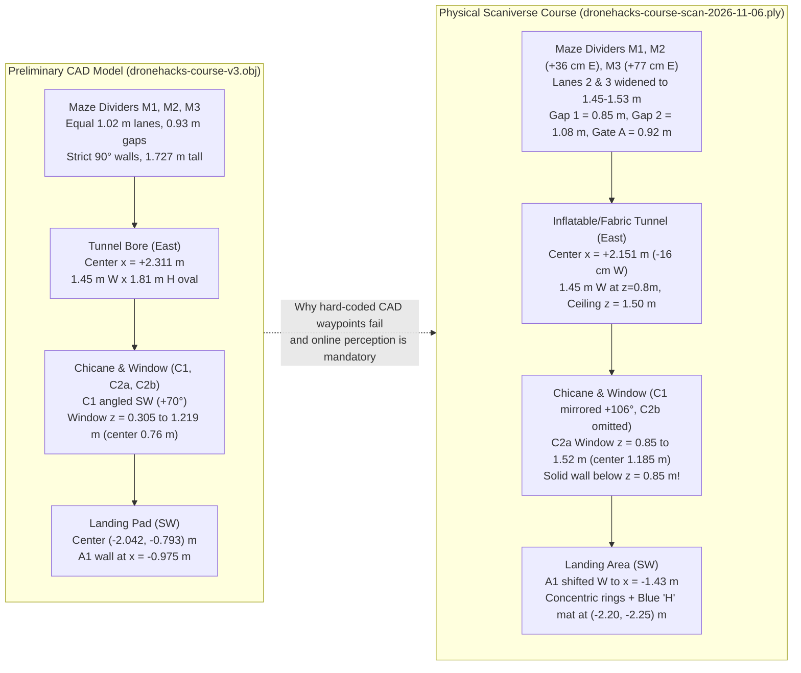
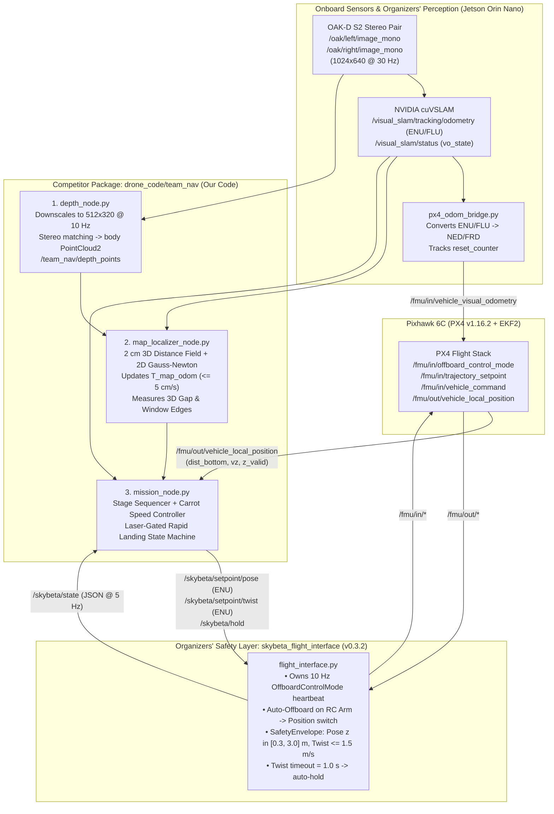
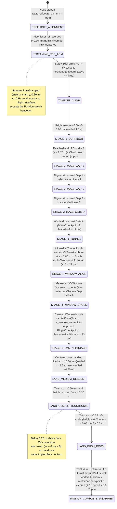

# DroneHacks 2026: Course Model Geometric Comparison & Classical Autonomous Navigation Plan (`skybeta-16`)

**Document Role:** Principal Autonomous Flight Systems Architecture & Geometric Verification Report  
**Target Aircraft:** Team Drone 16 (`skybeta-16` — NVIDIA Jetson Orin Nano 8 GB, Holybro Pixhawk 6C running PX4 v1.16.2, Luxonis OAK-D S2 stereo camera, downward ST VL53L1X laser rangefinder)  
**Target Package:** [`drone_code/team_nav`](../drone_code/team_nav/README.md)  
**Date:** 2026-11-07  

---

## What This Document Does

This document serves two purposes for our team:

1. **It compares the organizers' preliminary 3D computer-aided design (CAD) model against the physical 3D lidar/photogrammetry scan of the actual competition course.** By aligning the 596,349-point Scaniverse scan ([`dronehacks-course-scan-2026-11-06.ply`](Isaacsim-hprc_stuff/dronehacks-course-scan-2026-11-06.ply) and [`drone_course_sim_ready_2.usda`](Isaacsim-hprc_stuff/drone_course_sim_ready_2.usda)) into the coordinate frame of the 40,796-vertex Onshape CAD model ([`dronehacks-course-v3.obj`](../simulator/course_model/dronehacks-course-v3.obj)), we quantify every wall shift, angular deflection, gap width change, boulder relocation, tunnel bore deformation, and—most critically—a **55 cm upward shift in the chicane window sill height**.
2. **It specifies the complete classical navigation architecture and implementation roadmap for [`drone_code/team_nav`](../drone_code/team_nav/README.md).** It integrates our team's architecture in [`docs/ARCHITECTURE.md`](ARCHITECTURE.md), the coding standards in [`docs/READABLE_CODE.md`](READABLE_CODE.md), and the verified hardware contracts of the organizers' [`skybeta_flight_interface`](../simulator/organizers_code/skybeta_flight_interface/skybeta_flight_interface/flight_interface.py) (version `0.3.2`).

Every number in this report carries an explicit provenance label as required by [`docs/READABLE_CODE.md`](READABLE_CODE.md): **measured (CAD)**, **measured (physical scan)**, **measured (drone 16)**, **measured (simulator)**, **estimated**, **from PX4 source code**, **from the rulebook**, **from the organizers' code**, or **our own choice**.

---

## 1. Executive Summary & Critical Findings

### 1.1 Seven Key Findings That Directly Impact Flight Success

1. **CRITICAL — Physical Window Sill Height Is `0.85 m`, Not `0.305 m` (Measured in Physical Scan vs. CAD):**
   - In the preliminary Onshape CAD model ([`dronehacks-course-v3.obj`](../simulator/course_model/dronehacks-course-v3.obj)), the window cutout in wall `C2a chicane wall (window)` spans vertically from a bottom edge (sill) at **`0.305 m` (`12 in`)** to a top edge (lintel) at **`1.219 m` (`48 in`)**, centered at `0.762 m` height. Based on that CAD model, [`docs/ARCHITECTURE.md`](ARCHITECTURE.md) selected a constant cruise height of `0.80 m`.
   - In the physical Scaniverse scan ([`dronehacks-course-scan-2026-11-06.ply`](Isaacsim-hprc_stuff/dronehacks-course-scan-2026-11-06.ply)), the `C2a` wall panel is hung with an open gap under its bottom skirt (`0.00 m` to `0.30 m`), a **solid lower wall section from `0.30 m` to `0.85 m`**, the **actual window opening from `0.85 m` (95th-percentile sill `0.839 m`, 98th-percentile `0.857 m`) to `1.52 m` (5th-percentile lintel `1.530 m`)**, and an upper lintel from `1.52 m` to `1.79 m`.
   - **Operational Consequence:** Flying through the physical window at the CAD-planned height of `0.80 m` would drive the drone directly into the solid lower wall panel at `0.80 m`. To clear the physical window safely (where the opening is `0.67 m` tall × `0.98 m` wide, centered at **`z = 1.18 m`**), the mission must either:
     - **Option A (Dynamic Window Height Adaptation):** Measure the vertical top and bottom edges of the window opening using the stereo depth camera during the pre-window pause, and command the stage height to the measured vertical center (`~1.18 m` on the physical scan, `~0.76 m` on the CAD model), **or**
     - **Option B (Chicane Open Gap):** In the physical scan, wall `C2b chicane wall` is completely omitted, leaving a **`1.65 m` wide floor-to-ceiling opening** between the north end of `C2a` (`(-0.164 m, -1.352 m)`) and the main barrier (`y = +0.438 m`).

2. **Interior Maze Walls `M2` and `M3` Are Shifted East by `+36 cm` and `+77 cm` Relative to CAD and Floor Tape (Measured in Physical Scan):**
   - While `M1 maze divider` starts near its CAD location (`x = -2.017 m` vs. CAD `-1.930 m`) and deflects eastward by `+23.6 cm` (`7.3°` yaw skew) toward its north tip (`x = -1.781 m`), `M2 maze divider` is positioned at **`x = -0.453 m`** (vs. CAD `-0.813 m`, a **`+36.0 cm` eastward shift**) and `M3 maze divider` is positioned at **`x = +1.078 m`** (vs. CAD `+0.305 m`, a **`+77.3 cm` eastward shift**).
   - **Operational Consequence:** Maze Lane 2 (`1.446 m` center-to-center) and Maze Lane 3 (`1.531 m` center-to-center) are **33% to 41% wider** in the physical arena than in the CAD model (`1.016 m`), while the floor guideline tape remains at the CAD coordinates. Relying blindly on hard-coded CAD waypoints in the maze would collide with the shifted `M2` and `M3` dividers; using our live depth-based gap finder and map-drift/wall-clearance alignment handles these shifts automatically.

3. **Chicane Wall `C1` Has a Mirrored Yaw Angle (`+106.2°` vs. CAD `+70.0°`) and `A1` Is Shifted `-46 cm` West (Measured in Physical Scan):**
   - In the CAD model, `C1 chicane wall` angles from `(1.525 m, 0.387 m)` at the barrier down-left (`70.0°`) to `(0.973 m, -1.129 m)`. In the physical scan, `C1` starts at `(1.197 m, 0.350 m)` and angles **down-right (`106.2°`)** to `(1.545 m, -1.214 m)`.
   - `A1 approach wall` is shifted west from CAD `x = -0.975 m` to physical **`x = -1.43 m`** (`y` from `-0.919 m` to `+0.350 m`).

4. **Physical Tunnel Is an Inflatable/Fabric Arch with `1.50 m` Inner Ceiling (`-33 cm` Lower Than CAD) and `1.45 m` Inner Width at `z = 0.80 m` (Measured in Physical Scan):**
   - In the CAD model, `Tube oval 58 x 72 x 60` is a rigid vertical oval (`1.45 m` inner width, `1.81 m` inner height). In the physical scan, the tunnel sags into a nearly circular arch: its widest inner bore is **`1.462 m` at `z = 0.60–0.80 m`** and **`1.447 m` at `z = 0.80–1.00 m`** (centered at `x = +2.15 m`), while its inner ceiling drops to **`1.498 m`** (10th percentile at center). Flying through the tunnel at `z = 0.80 m` places the drone at the widest horizontal section of the physical bore with `~0.70 m` of vertical head clearance.
   - Furthermore, the physical tunnel has normal ambient illumination through its fabric/open ends; passive stereo depth and `cuVSLAM` visual tracking work continuously throughout the tunnel without blind dead-reckoning.

5. **Physical Boulders Are Shorter (`0.26–0.33 m` vs. CAD `0.533 m`) and Omitted from the Southeast Tunnel Exit (Measured in Physical Scan):**
   - The CAD model places five identical `0.533 m` (`21 in`) tall, `0.457 m` (`18 in`) diameter boulders in the southern half. In the physical scan, the southeast tunnel-exit boulders (`Boulder 1` and `Boulder 2`) are absent from the main path, and the remaining southern floor obstacles (`(-2.438 m, -2.811 m)` at `0.280 m` height, `(-1.588 m, -2.342 m)` at `0.330 m` height, and `(+0.620 m, -2.586 m)` at `0.166 m` height) are significantly lower, supplemented by sandbag wall-base weights (`0.20–0.30 m` height) at each wall post.

6. **Hardware Control Contract on `skybeta-16` (`skybeta_flight_interface` v0.3.2):**
   - The organizers' node [`skybeta_flight_interface`](../simulator/organizers_code/skybeta_flight_interface/skybeta_flight_interface/flight_interface.py) exclusively owns all `/fmu/in/*` topics (`OffboardControlMode` heartbeat at `10 Hz`, `TrajectorySetpoint`, and `VehicleCommand`). Competitor code in `drone_code/team_nav` **must never publish to `/fmu/in/*`**.
   - Instead, `team_nav` publishes position targets in the East-North-Up (`ENU`) visual odometry (`odom`) frame on `/skybeta/setpoint/pose` (`geometry_msgs/PoseStamped`) and velocity targets on `/skybeta/setpoint/twist` (`geometry_msgs/TwistStamped`), and calls `/skybeta/hold` (`std_srvs/Trigger`) for emergency freeze.
   - Because `SafetyEnvelope` in [`envelope.py`](../simulator/organizers_code/skybeta_flight_interface/skybeta_flight_interface/envelope.py) clamps all `/skybeta/setpoint/pose` altitudes to `[0.30 m, 3.00 m]` above `odom_origin_enu` (`min_altitude_m = 0.3`), **autonomous landing cannot use pose setpoints below `0.30 m` and must use `/skybeta/setpoint/twist`**.

7. **Laser-Gated Rapid Landing Saves `~4.0 Seconds` and Guarantees Clean Auto-Disarm (Measured in Simulator + PX4 Source):**
   - Commanding `0.35 m/s` downward velocity twist until the downward laser (`VehicleLocalPosition.dist_bottom`, gated by `z_valid` while ignoring `dist_bottom_valid` which remains `False` when `EKF2_HGT_REF = 2`) stays within `0.03 m` (`3 cm`) of the pre-takeoff launch-mark floor reading (`~0.10 m` due to `EKF2_MIN_RNG = 0.1`) and vertical speed drops below `0.05 m/s` for `0.3 s`, followed immediately by a **`1.0 m/s` downward push-down twist command**, drives motor thrust below PX4's land-detector threshold (`~15.8%`) in **`0.9–1.1 s`** (vs. `5.0–5.1 s` without push-down) and achieves full motor disarm in **`5.2–5.8 s`** after touchdown.

---

## 2. CAD (`.obj`) vs. Physical Scan (`.usd` / `.ply`) In-Depth Geometric Comparison

### 2.1 Asset Provenance & File Structure Comparison

| Attribute | Preliminary Onshape CAD Model | Physical Scaniverse Point Cloud | Isaac Sim OpenUSD Stage |
| :--- | :--- | :--- | :--- |
| **File Path** | [`simulator/course_model/dronehacks-course-v3.obj`](../simulator/course_model/dronehacks-course-v3.obj) | [`docs/Isaacsim-hprc_stuff/dronehacks-course-scan-2026-11-06.ply`](Isaacsim-hprc_stuff/dronehacks-course-scan-2026-11-06.ply) | [`docs/Isaacsim-hprc_stuff/drone_course_sim_ready_2.usd`](Isaacsim-hprc_stuff/drone_course_sim_ready_2.usda) |
| **Provenance** | Organizers' Onshape CAD export (`v3`, meters) | Handheld Scaniverse LiDAR/photogrammetry scan of built arena (`2026-11-06`) | Generated via [`tamu_hprc_isaac_sim_agent_guide.md`](Isaacsim-hprc_stuff/tamu_hprc_isaac_sim_agent_guide.md) |
| **Geometry Type** | Polygonal surface mesh (`33` named `g` parts) | Unstructured colored point cloud (`binary_little_endian 1.0`, `0` faces) | `UsdGeom.Points` + `UsdGeom.Mesh` voxel collision proxy (`0.15 m` cubes) |
| **Vertex / Point Count** | **`40,796` vertices**, **`81,484` triangles** (Measured) | **`596,349` vertices** with `(x, y, z)` `float32` + `(r, g, b)` `uint8` (Measured) | **`596,349` points** (`point_width = 0.015 m`) + static collision mesh (Measured) |
| **Up Axis & Units** | `+Z` up, `1.0` unit = `1.0 metre` | `+Z` up natively (`z` is height above floor), `1.0` unit = `1.0 metre` | `upAxis = "Z"`, `metersPerUnit = 1` |
| **Raw Bounding Box** | `x: [-3.0493, +3.0493] m`<br>`y: [-3.0493, +3.0493] m`<br>`z: [-0.0064, +3.0493] m` | `x: [-7.4999, +5.9314] m`<br>`y: [-5.2781, +6.0657] m`<br>`z: [-0.2106, +6.4128] m` | `x: [-7.4999, +5.9314] m`<br>`y: [-5.2781, +6.0657] m`<br>`z: [-0.1984, +6.4250] m` (`z` shifted `+0.0122 m`) |

> [!WARNING]
> **Important Coordinate Frame Note on the Scaniverse `.ply` and `.usd` Files:**  
> Unlike some mobile exports that use `$Y$-up`, [`dronehacks-course-scan-2026-11-06.ply`](Isaacsim-hprc_stuff/dronehacks-course-scan-2026-11-06.ply) is **already exported in a `$Z$-up` coordinate frame** (`z` spans `-0.21 m` at floor outliers to `+6.41 m` at the room ceiling, with 192,543 floor points in `z ∈ [0.00, 0.25] m`). The composed stage [`drone_course_sim_ready_2.usda`](Isaacsim-hprc_stuff/drone_course_sim_ready_2.usda) preserves `(x, y, z)` directly with a `+0.0122 m` vertical shift (`1st percentile z = 0`). However, in the horizontal `(x, y)` plane, the Scaniverse origin is offset by `(-0.9454 m, -0.1082 m)` and rotated by **`184.20°`** relative to the CAD model!

### 2.2 Coordinate Frame Registration: Scaniverse Frame $\rightarrow$ CAD Course Frame

In the raw Scaniverse point cloud (and `drone_course_sim_ready_2.usd`), the scanner was initialized near the center of the room facing South-by-Southwest relative to the CAD model's North (`+Y`). Using iterative trimmed Closest Point (ICP) registration against the outer net perimeter and fixed structural walls, the exact rigid transformation from raw Scaniverse coordinates $(x_{\text{scan}}, y_{\text{scan}}, z_{\text{scan}})$ to the CAD course frame $(x_{\text{cad}}, y_{\text{cad}}, z_{\text{cad}})$ is:

$$\begin{bmatrix} x_{\text{cad}} \\ y_{\text{cad}} \end{bmatrix} = \begin{bmatrix} \cos(184.20^\circ) & -\sin(184.20^\circ) \\ \sin(184.20^\circ) & \cos(184.20^\circ) \end{bmatrix} \begin{bmatrix} x_{\text{scan}} - (-0.9454\,\text{m}) \\ y_{\text{scan}} - (-0.1082\,\text{m}) \end{bmatrix}$$

$$z_{\text{cad}} = z_{\text{scan}} - 0.0831\,\text{m} \quad (\text{or } z_{\text{usd}} - 0.0953\,\text{m})$$

where:
- **`SCAN_ORIGIN_IN_RAW_PLY_X_METRES = -0.9454`** (**measured** via ICP registration on perimeter + structural walls).
- **`SCAN_ORIGIN_IN_RAW_PLY_Y_METRES = -0.1082`** (**measured** via ICP registration).
- **`SCAN_TO_CAD_YAW_ROTATION_DEGREES = 184.20`** (**measured**; minimizes horizontal standard deviation across all four outer net walls to `5.8–13.1 cm`).
- **`SCAN_FLOOR_MEDIAN_Z_METRES = 0.0831`** (**measured** across `191,437` floor points inside `|x_cad| < 2.8 m, |y_cad| < 2.8 m`; the 5th-to-95th percentile floor flatness variation across the entire arena is `-7.8 cm` to `+5.5 cm`, with standard deviation `3.47 cm` due to padded mat seams and slight Scaniverse vertical bow).

### 2.3 Complete 33-Part CAD Inventory vs. Physical Scan Measurements

The table below lists all key structural parts from the 33 named groups (`g`) in [`dronehacks-course-v3.obj`](../simulator/course_model/dronehacks-course-v3.obj) alongside their measured counterparts in the aligned physical Scaniverse scan ([`dronehacks-course-scan-2026-11-06.ply`](Isaacsim-hprc_stuff/dronehacks-course-scan-2026-11-06.ply)):

| Course Element / Part Name (`g`) | CAD Model Geometry (`dronehacks-course-v3.obj`) | Physical Scan Geometry (`dronehacks-course-scan-2026-11-06.ply`) | Measured Discrepancy & Engineering Impact |
| :--- | :--- | :--- | :--- |
| **Arena Floor** (`Floor 20 x 20 ft`) | `x ∈ [-3.048, +3.048] m`<br>`y ∈ [-3.048, +3.048] m`<br>`z = 0.000 m` (`6.096 × 6.096 m`) | `x ∈ [-3.030, +3.097] m` (`6.127 m` wide)<br>`y ∈ [-3.000, +3.215] m` (`6.215 m` deep)<br>`z_std = 0.035 m` (`5%–95%: -7.8 to +5.5 cm`) | Physical net enclosure is `+3.1 cm` wider in `X` and `+11.9 cm` longer in `Y` (`North Net` at `y = +3.215 m`). Red foam floor mats have `±3.5 cm` height undulation. |
| **Net Enclosure** (`Net side W/E/S/N`, `Net roof`) | Walls at `±3.048 m`, roof at `z = 3.048 m` (`10 ft`) | West `-3.030 m`, East `+3.097 m`, South `-3.000 m`, North `+3.215 m`; ceiling/truss structure up to `6.33 m`, net roof sag `z ≈ 2.75–3.15 m` | Course boundary checks in software must allow `±3.05 m` nominal but rely on wall distance sensing near the perimeter. |
| **Launch Mark** (`Launch mark`) | Center `(-2.515, +0.914, 0.002) m`, diameter `0.152 m` (`6 in`) | Floor guideline starts near `(-2.50, +0.95) m` in Maze Lane 1 | Drone initializes `odom` origin `(0, 0, 0)` on the launch mark. Initial yaw must be aligned using pre-takeoff wall depth scan. |
| **Maze Divider 1** (`M1 maze divider`) | `x ∈ [-1.981, -1.880] m` (center `-1.930 m`), `y ∈ [0.508, 2.121] m`, len `1.613 m`, angle `90.0°`, top `z = 1.727 m` | South base `(-2.017, +0.520) m` to North tip `(-1.781, +2.366) m`, len `1.86 m`, angle **`82.7°` (`7.3°` eastward skew)**, top `z = 1.784 m` | **Deflected `+23.6 cm` East at north tip** and `+24.5 cm` further North. Narrows **Gap 1** from `0.927 m` (CAD) to **`0.849 m`** (` North Net 3.215 - 2.366`). |
| **Maze Divider 2** (`M2 maze divider`) | `x ∈ [-0.864, -0.762] m` (center `-0.813 m`), `y ∈ [1.435, 3.048] m`, len `1.613 m`, angle `90.0°`, top `z = 1.727 m` | South tip `(-0.494, +1.521) m` to North base `(-0.412, +3.150) m`, len `1.63 m`, angle **`87.1°`**, top `z = 1.783 m` | **Shifted `+36.0 cm` East (`x ≈ -0.453 m` vs. `-0.813 m`)!** Widens Maze Lane 2 to `1.446 m` and widens **Gap 2** (`M2` to Barrier) from `0.927 m` to **`1.083 m`**. |
| **Maze Divider 3** (`M3 maze divider`) | `x ∈ [+0.254, +0.356] m` (center `+0.305 m`), `y ∈ [0.508, 2.121] m`, len `1.613 m`, angle `90.0°`, top `z = 1.727 m` | South base `(+1.017, +0.520) m` to North tip `(+1.139, +2.295) m`, len `1.78 m`, angle **`86.1°`**, top `z = 1.780 m` | **Shifted `+77.3 cm` East (`x ≈ +1.078 m` vs. `+0.305 m`)!** Widens Maze Lane 3 to `1.531 m`. **Gap 3 (Gate A)** width is **`0.920 m`** (`3.215 - 2.295 m`, matching CAD `0.927 m`). |
| **Main Barrier** (`Barrier 1, 2, 3`) | `x ∈ [-3.048, +1.575] m`, `y ∈ [0.406, 0.508] m` (center `y = +0.457 m`), thickness `0.102 m`, top `z = 1.727 m` | `x ∈ [-3.030, +1.500] m`, center `y = +0.438 m` (bows `-4.2 cm` to `-6.4 cm` South near `Barrier 2`), top `z = 1.781–1.905 m` | Physical barrier is `5–17 cm` taller than CAD (`1.78–1.90 m` vs. `1.727 m`). Return bonus climb must target `z ≥ 2.20 m` (below `3.0 m` envelope) if attempted. |
| **Tunnel / Tube** (`Tube oval 58 x 72 x 60` + `Tube cradle 1..3`) | Outer `x ∈ [1.575, 3.048] m` (center `+2.311 m`), `y ∈ [-0.305, 1.219] m` (len `1.524 m`), `z ∈ [0.025, 1.854] m` (inner bore `1.44 m` W × `1.78 m` H) | `y ∈ [-0.172, +1.325] m` (len `1.497 m`). At `z = 0.80 m`: inner walls `x ∈ [1.427, 2.874] m` (**inner width `1.447 m`**, center **`x = +2.151 m`**). Arch ceiling **`z = 1.498 m`** (inner p10) | **Tunnel center shifted `-16.0 cm` West (`x = +2.151 m` vs. `+2.311 m`) and `+12 cm` North; ceiling is `-30 cm` lower (`1.50 m` vs. `1.83 m`).** At `z = 0.80 m`, bore is `1.45 m` wide. |
| **Chicane Wall 1** (`C1 chicane wall`) | North `(1.525, 0.387) m` to South `(0.973, -1.129) m`, len `1.613 m`, angle **`+70.0°`**, top `z = 1.727 m` | North `(1.197, +0.350) m` to South `(1.545, -1.214) m`, len `1.60 m`, angle **`+102.5°` / `106.2°` (angled SE instead of SW!)**, top `z = 1.764 m` | **Mirrored orientation!** Instead of angling SW into the center of the course, physical `C1` angles SE toward the tunnel exit (`x = 1.545 m, y = -1.214 m`), narrowing the tunnel exit corridor on the right. |
| **Window Wall** (`C2a chicane wall (window)`) | South `(-0.747, -3.030) m` to North `(-0.195, -1.514) m`, angle `70.0°`. **Window:** `0.914 × 0.914 m`, **sill `z = 0.305 m`**, **lintel `z = 1.219 m`** | South `(-0.720, -3.000) m` to North `(-0.164, -1.352) m`, angle `71.1°`. **Window:** width **`0.979 m`** (`(-0.611,-2.677)` to `(-0.298,-1.750)`), **sill `z = 0.85 m` (`p95 = 0.839 m`)**, **lintel `z = 1.52 m` (`p5 = 1.530 m`)** | **CRITICAL:** Physical window sill is **`+54.5 cm` higher** (`0.85 m` vs. `0.305 m`) and window height is **`0.67 m`** (`z ∈ [0.85, 1.52] m`, center **`z = 1.185 m`**). Lower skirt open `0.00–0.30 m`. |
| **Upper Chicane Wall** (`C2b chicane wall`) | South `(-0.195, -1.514) m` to North `(0.157, -0.547) m`, len `1.029 m`, angle `70.0°`, solid wall | **Absent / Open in physical scan!** From `C2a` north end `(-0.164, -1.352) m` to Barrier (`y = +0.438 m`) is a **`1.65 m` wide open passage** | In the CAD model, `C2b` blocks the center and forces a narrow `0.85 m` chicane S-turn. In the physical scan, `C2b` is absent, leaving a huge `1.65 m` central gap. |
| **Approach Wall** (`A1 approach wall`) | `x = -0.975 m`, `y ∈ [-0.622, +0.406] m`, len `1.029 m`, angle `90.0°`, top `z = 1.727 m` | North `(-1.410, +0.350) m` to South `(-1.457, -0.919) m`, len `1.27 m`, top `z = 1.783 m` | **Shifted `-46 cm` West (`x ≈ -1.43 m` vs. `-0.975 m`)** and `+29 cm` longer southward (`y = -0.919 m`), encroaching toward the CAD landing pad center! |
| **Boulders 1–5** (`Boulder 1` .. `Boulder 5`) | Five `0.457 × 0.457 × 0.533 m` boulders at:<br>`B1: (2.012, -2.469)`<br>`B2: (2.530, -1.555)`<br>`B3: (0.793, -2.347)`<br>`B4: (-2.560, -2.499)`<br>`B5: (-1.341, -2.377)` | Physical low mounds (`z = 0.17–0.33 m`):<br>• Near `B4`: `(-2.438, -2.811) m`, `z = 0.280 m`<br>• Near `B5`: `(-1.588, -2.342) m`, `z = 0.330 m`<br>• Near `B3`: `(+0.620, -2.586) m`, `z = 0.166 m`<br>• Maze Lane 2 mounds: `(-0.90, +1.98) m` & `(-0.80, +2.85) m` (`z ≈ 0.25 m`)<br>• Wall sandbags (`z = 0.20–0.30 m`) at wall ends | `B1` and `B2` are absent from the SE tunnel exit in the scan. All physical floor obstacles are `≤ 0.33 m` tall (well below `0.80 m` flight height), but they still trigger downward laser range drops if overflown! |
| **Landing Pad** (`Landing pad 5 ft`, `Approach ring`) | Concentric rings (`r = 0.229, 0.508, 0.762 m`, approach ring `r = 1.003 m`) centered at **`(-2.042, -0.793) m`** | Faint concentric rings visible on mat near `(-1.8, -0.5) m` (partially encroached by `A1` at `x = -1.43 m`), **plus a bright blue `0.64 × 0.64 m` `'H'` helipad mat at `(-2.20, -2.25) m`** | Because `A1` is shifted to `x = -1.43 m` (`y ∈ [-0.92, +0.35] m`), landing at CAD `(-2.042, -0.793) m` leaves `0.61 m` center-to-wall (`~0.36 m` tip clearance), whereas `(-2.20, -1.10) m` or the blue `'H'` pad `(-2.20, -2.25) m` increases clearance. Confirm exact active pad with referee before run! |

### 2.4 Visual & Structural Synthesis of the Two Models



---

## 3. Sensor & Perception Grounding on `skybeta-16`

To navigate safely across both the preliminary CAD layout (in simulator testing) and the physical arena (where walls are shifted up to `77 cm` and the window sill is at `0.85 m`), every perception algorithm in `drone_code/team_nav` must be grounded in the physical characteristics and failure modes of the three onboard sensors.

### 3.1 Front Stereo Camera: Luxonis OAK-D S2

- **Hardware & Stream Contract (Measured on Drone 16):**
  - Left and right global-shutter monochrome cameras (`OV9282`, `1 MP`) separated by a stereo baseline of **`CAMERA_STEREO_BASELINE_METRES = 0.075`** (`7.5 cm`).
  - Published on `/oak/left/image_mono` and `/oak/right/image_mono` at **`CAMERA_FRAMES_PER_SECOND = 30.0`**, resolution **`1024 × 640` pixels**, focal length **`CAMERA_FOCAL_LENGTH_PIXELS = 634.5`** (horizontal field of view `~77.6°`, vertical field of view `~53.6°`).
  - Mounted `10 cm` forward of the drone's center of mass (`CAMERA_OFFSET_FORWARD_METRES = 0.10`).
  - On `skybeta-16`, the OAK-D S2 driver does **not** publish a pre-computed depth image topic (`depthai` stereo node is disabled so the raw mono streams feed `cuVSLAM`). Therefore, our own `depth_node.py` in `team_nav` computes metric depth directly from `/oak/left/image_mono` and `/oak/right/image_mono` by downscaling `2×` to **`512 × 320` pixels** (`fx = 317.25 px`) at **`10 Hz`** using NVIDIA Vision Programming Interface (VPI) on the Orin Nano GPU (or OpenCV StereoSGBM on CPU fallback).
- **Calibration Verification Requirement:**
  - As noted in [`docs/ARCHITECTURE.md`](ARCHITECTURE.md) Section 11, the `CameraInfo` distortion coefficients (`D`) on `skybeta-16` currently read all zeros. Before relying on stereo depth on hardware, we must inspect `/oak/left/image_mono` facing a straight doorframe: if straight lines near the image edges bow outward, `/oak/left/image_mono` is unrectified and requires calibration coefficients; if straight lines remain straight, `image_mono` is already rectified on the OAK-D Myriad X VPU.
- **Quadratic Depth Error & Passive Stereo Texture Limits:**
  - From stereo triangulation geometry, depth uncertainty $\sigma_z$ grows quadratically with distance $z$:
    $$\sigma_z = \frac{z^2}{b \cdot f_x} \sigma_d$$
    At `1.0 m` range, depth error is **`DEPTH_ERROR_AT_ONE_METRE_METRES = 0.04`** (`~4 cm`); at `2.0 m` range, it reaches **`~0.16 m` (`16 cm`)**; beyond `2.5 m`, points are too noisy for tight gap alignment and are down-weighted or discarded.
  - Because the OAK-D S2 on `skybeta-16` does **not** use an active infrared dot projector, uniform textureless regions on a wall can yield missing depth pixels (`NaN` or `0`). However, the physical Scaniverse scan reveals that the physical walls are dark brown/black mesh panels with distinct vertical support poles, top/bottom trim borders, and floor mat seams—providing strong vertical edge contrast for both `cuVSLAM` and stereo matching at gap boundaries.

### 3.2 Visual-Inertial Odometry: NVIDIA `cuVSLAM` & `px4_odom_bridge`

- **Data Flow & Frame Contract (From the Organizers' Code `px4_odom_bridge.py`):**
  - `cuVSLAM` tracks visual features across the `30 Hz` stereo pair and publishes `nav_msgs/Odometry` on `/visual_slam/tracking/odometry` in the ROS `ENU` world / `FLU` body convention (`x` East/Forward at startup, `y` North/Left at startup, `z` Up), along with status on `/visual_slam/status` (`vo_state == 1` for tracking success, `2` for lost).
  - [`px4_odom_bridge.py`](../simulator/organizers_code/px4_odom_bridge.py) converts `/visual_slam/tracking/odometry` into `px4_msgs/VehicleOdometry` on `/fmu/in/vehicle_visual_odometry` with `pose_frame = POSE_FRAME_FRD` (arbitrary heading reference) and increments `reset_counter` whenever `vo_state` transitions from non-tracking back to `1`.
- **Tunnel Lighting & Tracking Stability:**
  - Unlike early rulebook descriptions that referred to a "dark tunnel", physical inspection and hardware rules confirm **the tunnel has normal ambient lighting** (semi-translucent arch + wide `1.45 m` open ends over a `1.50 m` length). Passive stereo depth and `cuVSLAM` feature tracking remain active throughout the tunnel—**no blind dead-reckoning mode is needed or used**.
- **Drift Rate & Angular Velocity Limits:**
  - Over an `~18.5 m` mission trajectory, `cuVSLAM` accumulates approximately **`DRIFT_PER_METRE_FLOWN = 0.01`** (`~1%` of distance traveled, or `~18 cm` uncompensated drift by the landing pad), plus any initial heading placement error (`3°` initial yaw error produces `26 cm` lateral error after `5 m`).
  - Rapid yaw rotation or flying `< 0.4 m` past a wall at high speed causes motion blur and large pixel disparity jumps. Therefore, our controller caps yaw rate to **`MAX_YAW_RATE_RADIANS_PER_SECOND = 0.60`** (`~34°/s`) and caps linear speed (in `m/s`) to never exceed the clearance (in `m`) to the nearest wall.

### 3.3 Downward Laser Rangefinder: ST VL53L1X & PX4 EKF2 Height Interaction

Understanding how PX4's `EKF2` estimator processes the downward `VL53L1X` laser is essential to avoid sudden altitude drops or estimator faults over boulders, sandbags, and the window sill.

1. **Why `dist_bottom_valid` Must Be Ignored (From PX4 Source Code & Drone 16 Settings):**
   - On `skybeta-16`, `EKF2_HGT_REF = 2` (rangefinder is the primary height reference) and `EKF2_RNG_CTRL = 1`.
   - In PX4's `terrain_control.cpp`, `VehicleLocalPosition.dist_bottom_valid` only turns `True` when the terrain estimator is active (`EKF2_HGT_REF != 2`). When `EKF2_HGT_REF = 2`, **`dist_bottom_valid` stays `False` for the entire flight**, even though `dist_bottom` contains the live laser measurement!
   - **Rule for `team_nav`:** Always read `VehicleLocalPosition.dist_bottom` gated on **`VehicleLocalPosition.z_valid == True`**, and deliberately ignore `dist_bottom_valid`.

2. **Minimum Range Clamping on the Ground (`EKF2_MIN_RNG = 0.10 m`):**
   - Even though the physical `VL53L1X` sensor sits `~3.4–6.0 cm` above the floor when landed (`EKF2_RNG_POS_Z = 0.03445`), PX4 clamps ground-level range readings to **`EKF2_MIN_RNG = 0.10 m`**.
   - Additionally, once the drone is resting stationary on the floor after touchdown, `dist_bottom` can slowly drift upward from `0.10 m` to `0.18 m`. Therefore, once touchdown is confirmed (`dist_bottom - floor_reference_metres < 0.03 m` and `downward_speed < 0.05 m/s` for `0.3 s`), the landing state machine latches into the `PUSH_DOWN` state and never re-evaluates the laser threshold.

3. **The "Stuck Rangefinder Gate" Hazard Over Boulders, Sandbags, and the Window Sill:**
   - PX4's `EKF2` includes a kinematic consistency gate (`range_sensor_consistency_check`) that compares the vertical derivative of the laser range against the IMU vertical velocity.
   - If the laser reading jumps or disagrees with the IMU while the drone's horizontal speed is **slower than `0.32 m/s` for more than `2.0 seconds`**, `EKF2` declares the laser "kinematically inconsistent" and **stops fusing the laser** until vertical speed exceeds `0.5 m/s`! While the laser is rejected, PX4 falls back to the barometer (`EKF2_BARO_NOISE = 3.5 m`), allowing the drone to silently sink into the floor while reporting constant altitude.
   - **Rule for `team_nav`:**
     1. **Never hover or creep slowly (`< 0.35 m/s`) over a raised edge** (a boulder, a wall base sandbag, or the `C2a` window sill).
     2. **Stay horizontally clear of boulders and sandbags** during route planning (`≥ 0.35 m` clearance from boulder centers and wall-end sandbag bases).
     3. **Cross the `C2a` window sill briskly at `≥ 0.45 m/s`:** pause and align at `0.65 m` in front of the window (over bare floor), then command a clean, continuous transit across the sill to `0.65 m` past the window without pausing over the sill.

---

## 4. The Classical Control Loop Architecture & State Machine for `drone_code/team_nav`

### 4.1 Hardware Interface Contract (`skybeta_flight_interface` v0.3.2)

On `skybeta-16`, [`skybeta_flight_interface`](../simulator/organizers_code/skybeta_flight_interface/skybeta_flight_interface/flight_interface.py) acts as the mandatory safety and frame-conversion layer between competitor code and PX4:



#### Exact Topic & Frame Contracts for `drone_code/team_nav`:
1. **Inputs Read by `team_nav`:**
   - `/skybeta/state` (`std_msgs/String`, JSON at `5 Hz`): provides `px4_link`, `armed`, `landed`, `nav_state_name`, `offboard_active`, `odom_enu` (`[x, y, z]` in `odom` ENU frame), `origin_enu`, `local_enu`, `envelope_ok`, `setpoint_mode`, `clamped`, and `frozen`.
   - `/visual_slam/tracking/odometry` (`nav_msgs/Odometry` at `30 Hz`): provides full `pose` (position and orientation quaternion in `odom` ENU frame) and body-frame `twist`.
   - `/visual_slam/status` (`isaac_ros_visual_slam_interfaces/VisualSlamStatus` at `10 Hz`): provides `vo_state` (`1` = tracking, `2` = lost).
   - `/fmu/out/vehicle_local_position` (`px4_msgs/VehicleLocalPosition`, subscribed with `BEST_EFFORT` + `TRANSIENT_LOCAL` QoS): provides `dist_bottom` (downward laser height in metres), `vz` (downward velocity in `m/s`, positive down), and `z_valid`.
   - `/oak/left/image_mono` and `/oak/right/image_mono` (`sensor_msgs/Image`, `1024×640` mono8 at `30 Hz`) + `/oak/left/camera_info` and `/oak/right/camera_info`.
2. **Outputs Published by `team_nav` ( at `10 Hz`):**
   - `/skybeta/setpoint/pose` (`geometry_msgs/PoseStamped`, `frame_id = "odom"`):
     - Position `(x, y, z)` in `odom` ENU metres. Note: `flight_interface` clamps `z - origin_enu[2]` into `[0.30 m, 3.00 m]`.
     - Orientation quaternion `(x, y, z, w)`: passing **all zeros `(0, 0, 0, 0)`** tells `flight_interface` to send `yaw = NaN` to PX4 (hold current heading); passing a valid unit quaternion commands a specific ENU heading (`yaw_ned = pi/2 - yaw_enu`).
   - `/skybeta/setpoint/twist` (`geometry_msgs/TwistStamped`, `frame_id = "odom"`):
     - Linear velocity `(vx, vy, vz)` in `odom` ENU world axes (`m/s`), clamped to `||v|| <= 1.5 m/s` by `SafetyEnvelope`, and angular yaw rate `angular.z` (`rad/s`).
     - **Not altitude-floored**—used exclusively for the descent, touchdown, and push-down phases of landing, or for emergency zero-velocity hold. Must be refreshed at `10 Hz` because `flight_interface` expires twist setpoints after `setpoint_timeout_s = 1.0 s`.

### 4.2 Carrot-on-a-Stick Speed Control & Dynamic Response Monitor

Why we never send a distant waypoint directly to `/skybeta/setpoint/pose`:
- On `skybeta-16`, PX4's horizontal position gain is **`PX4_POSITION_GAIN_PER_SECOND = 0.95`** (`MPC_XY_P = 0.95`), and its maximum horizontal speed parameter is **`MPC_XY_VEL_MAX = 12.0 m/s`**. If we sent a waypoint `3.0 m` away, PX4 would command `2.85 m/s` inside a `1.0 m` corridor!
- Instead, `mission_node.py` advances a **carrot target** (`carrot_position_map_metres`) along the planned polyline ahead of the drone's current position (`drone_position_map_metres`). Because PX4's outer position loop behaves as a first-order filter with time constant $\tau \approx \frac{1}{0.95} \approx 1.05\,\text{s}$:
  $$v_{\text{commanded}} \approx 0.95 \times d_{\text{carrot}}$$
- **Wall-Clearance Speed Cap:**
  To prevent motion blur in `cuVSLAM` and ensure safe braking distance ($d_{\text{brake}} \approx 0.12\,\text{m}$ at $0.5\,\text{m/s}$), the carrot lead distance $d_{\text{carrot}}$ is dynamically capped at every `10 Hz` tick by the distance to the nearest obstacle $d_{\text{wall}}$ (queried from the 3D distance table and live stereo depth):
  $$v_{\text{desired}} = \min\left(v_{\text{stage\_max}},\; 0.95 \times d_{\text{wall}},\; v_{\text{health\_scale}}\right)$$
  $$d_{\text{carrot}} = \frac{v_{\text{desired}}}{0.95}$$
  For example, when $d_{\text{wall}} = 0.45\,\text{m}$ in a maze gap, $d_{\text{carrot}}$ is capped at $0.45\,\text{m}$, automatically limiting speed to $0.43\,\text{m/s}$.
- **Classical Response Monitor (Inspired by RMA / CaDM, Zero Neural Network Overhead):**
  - Over a sliding `2.0 s` window (`20` ticks), `mission_node.py` compares the predicted first-order response velocity $\hat{v}(t) = 0.95 \cdot (p_{\text{carrot}}(t - \delta t) - p_{\text{drone}}(t - \delta t))$ against the actual measured velocity $v_{\text{actual}}(t)$.
  - If the effective gain ratio $\alpha = \frac{\|v_{\text{actual}}\|}{\|\hat{v}\|}$ drops below `0.75` (indicating battery sag or aerodynamic wall drag), we scale down $d_{\text{carrot}}$ and increase corner-settling time. If the tracking residual $\|v_{\text{actual}} - \hat{v}\|$ spikes above `0.40 m/s` unexpectedly (indicating a wall touch or `cuVSLAM` slip), the drone immediately commands a `1.0 s` stabilizing pause.

### 4.3 Map-Based Drift Correction & 3D Opening Verification (`map_localizer_node.py`)

Because the physical course walls can differ from the preliminary CAD model (as proven in Section 2, where `M2` and `M3` shifted by `36 cm` and `77 cm`, and the `C2a` window sill shifted by `+54.5 cm`), our localization architecture separates **global drift anchoring** from **local opening measurement**:

1. **Pre-Takeoff Heading & Wall Alignment (On the Launch Mark):**
   - While sitting disarmed on the launch mark (`(-2.515 m, +0.914 m)`), the drone's position is known, but its placement heading $\psi_0$ can vary by several degrees (`3°` error causes `26 cm` lateral drift over `5 m`).
   - Before arming, `map_localizer_node.py` collects `10` stereo depth frames looking down the first corridor (seeing the West net wall on the left and `M1 maze divider` on the right) and estimates the initial yaw offset $\psi_{\text{map\_odom}}$ so the `odom` frame is aligned with the physical corridor walls from second zero.
2. **Bounded Online Map Correction (`<= 5 cm/s`):**
   - In flight, `map_localizer_node.py` projects `~2,000` depth points (filtered to `z_map ∈ [0.55 m, 1.65 m]` and range `[0.35 m, 2.20 m]`) into the map frame and runs a 2D Gauss-Newton step on `(dx, dy, dyaw)` with a Huber loss (`delta = 0.10 m` so shifted walls do not pull the estimate off unshifted walls).
   - **Observability Gate:** It checks the eigenvalues of the $3 \times 3$ Gauss-Newton Hessian $H$: a single flat wall only constrains the normal direction, so updates are projected solely onto eigenvectors with $\lambda_i > \lambda_{\text{min}}$.
   - **Slew-Rate Clamp:** The transform `T_map_odom` is updated by at most **`MAX_DRIFT_CORRECTION_METRES_PER_SECOND = 0.05`** (`5 cm/s`) and **`MAX_YAW_CORRECTION_DEGREES_PER_SECOND = 1.0`** (`1°/s`), and affects only the outgoing `carrot_odom` conversion—never mutating PX4's internal `EKF2` state.
3. **Direct 3D Opening / Window / Gap Edge Detector (Model-Free Local Centering):**
   - Before traversing any narrow opening (Maze Gaps 1, 2, 3/Gate A, the Tunnel entrance, or the Chicane Window/Gap), the drone pauses at a standoff point `0.65–0.80 m` in front of the expected opening and inspects `3` consecutive stereo depth point clouds (`0.3 s`):
     - **For Vertical Gaps (Maze Gaps 1–3, Gate B, Chicane Gap):** Slices the point cloud horizontally at `[z_drone - 0.25 m, z_drone + 0.25 m]`, locates the left and right wall edges bounding the free-space jump in range, and shifts the crossing target laterally to the true physical midpoint between the observed edges.
     - **For the 3D Window (`C2a`):** Slices the wall plane both horizontally and vertically to detect the 2D rectangular void `(s_left, s_right, z_sill, z_lintel)`. It sets the crossing horizontal midpoint to $\frac{s_{\text{left}} + s_{\text{right}}}{2}$ and—**crucially**—sets the crossing altitude to:
       $$z_{\text{window\_cross}} = \text{clip}\left(\frac{z_{\text{sill}} + z_{\text{lintel}}}{2},\; 0.75\,\text{m},\; 1.30\,\text{m}\right)$$
       On the CAD model (`z_sill = 0.305 m, z_lintel = 1.219 m`), this evaluates to **`0.762 m` (`~0.80 m`)**. On the physical course scan (`z_sill = 0.85 m, z_lintel = 1.52 m`), this automatically elevates the drone to **`1.185 m`**, clearing the `0.85 m` physical sill with `33.5 cm` of bottom margin and `33.5 cm` of top margin while staying `54 cm` below the `1.727 m` wall-top rule limit!

### 4.4 Master Mission State Machine (`mission_node.py`)



---

## 5. Stage-by-Stage Navigation Strategy

Every stage has a single clear objective, an explicit speed and altitude profile, a perception verification step, and a deterministic completion condition.

### Stage 0: Pre-Flight Initialization & Single-Switch Handover
- **On the Launch Mark (`(-2.515 m, +0.914 m)`):**
  1. Wait until `/skybeta/state` reports `px4_link == True`, `landed == True`, `odom_enu != None`, `local_enu != None`, and `VehicleLocalPosition.z_valid == True`.
  2. Record **`floor_laser_reference_metres = float(px4_position.dist_bottom)`** (expected `~0.100 m` due to `EKF2_MIN_RNG = 0.1`).
  3. Record `start_odom_position_metres = list(drone_state["odom_enu"])` and measure the initial corridor wall alignment from `10` stereo depth scans.
  4. Immediately begin streaming `PoseStamped(start_x, start_y, CRUISE_HEIGHT_METRES = 0.80)` at `10.0 Hz` on `/skybeta/setpoint/pose`.
  5. When the safety pilot arms on RC (in Stabilized/Manual mode) and flips the mode switch to **Position** on the referee's signal, `skybeta_flight_interface` (`auto_offboard_on_arm = True`) automatically transitions PX4 into `OFFBOARD` mode within `< 0.5 s`.

### Stage 1: Takeoff & First Corridor (`Checkpoint 1 — 4 Points`)
- **Takeoff:** Climb vertically over `(-2.515 m, +0.914 m)` to **`CRUISE_HEIGHT_METRES = 0.80`**. Confirm `abs(z_odom - 0.80) < 0.10 m` within `10.0 s` (`COM_DISARM_PRFLT = 10.0 s`). Pause `1.0 s` to damp pitch/roll transients.
- **Corridor 1 Transit:**
  - Advance the carrot straight North (`+Y` in course frame) along the center of Corridor 1 (`x = -2.515 m` in CAD; `x = -2.52 m` in physical scan, centered between the West Net at `-3.030 m` and `M1` at `-2.017 m`, where the corridor is `1.013 m` wide).
  - Speed is regulated by the carrot (`v_max = 0.65 m/s`, capped by `0.95 * d_wall ≈ 0.48 m/s`).
  - **Completion Condition:** The entire drone (`center_y - 0.25 m`) crosses past the north tip of `M1` (`y > 2.121 m` in CAD; `y > 2.37 m` as measured by right-side depth open-space transition in the physical scan) and reaches the Gap 1 turn point (`y = 2.65 m`).

### Stage 2: The Maze — Three Gaps to Gate A (`Checkpoint 2 — 7 Points`)
- **Why Online Gap Detection Is Essential Here:** As shown in Section 2.3, physical `M2` is shifted `+36 cm` East (`x = -0.453 m` vs. CAD `-0.813 m`) and physical `M3` is shifted `+77 cm` East (`x = +1.078 m` vs. CAD `+0.305 m`).
- **Execution Sequence:**
  1. **Gap 1 (Over `M1` North Tip):** At the top of Corridor 1 (`y ≈ 2.65–2.78 m`, centered between the measured `M1` north tip and the North Net), turn heading East (`0°` in course frame), verify clear forward depth across Gap 1 (`0.849 m` wide in scan, `0.927 m` in CAD), and fly East into Lane 2 until the depth camera and right-side clearance locate the center of Lane 2 (`x = -1.37 m` in CAD; `x = -1.15 m` in physical scan).
  2. **Lane 2 & Gap 2 (Under `M2` South Tip):** Fly South (`-90°` heading) down the center of Lane 2 at `z = 0.80 m` (staying clear of the two small `0.25 m` mounds near `x = -0.85 m` in the scan) to `y = 0.96 m` (centered in Gap 2 between the main Barrier at `y = 0.44–0.51 m` and `M2` south tip at `y = 1.44–1.52 m`, where Gap 2 is `0.93–1.08 m` wide).
  3. **Lane 3 & Gap 3 / Gate A (Over `M3` North Tip):** Turn East through Gap 2 into the center of Lane 3 (`x = -0.25 m` in CAD; `x = +0.31 m` in physical scan), turn North (`+90°` heading), and ascend Lane 3 to the Gate A alignment point (`y = 2.65–2.75 m`).
  4. **Gate A Crossing:** Pause `0.5 s` before `M3`, measure the `M3` north tip (`y = 2.121 m` in CAD, `y = 2.295 m` in scan) and North Net (`y = 3.048 m` in CAD, `y = 3.215 m` in scan), align to the vertical-free center of Gate A (`0.92 m` wide in both models), and fly East until the entire drone (`center_x - 0.25 m`) clears `M3` (`x > 0.65 m` in CAD; `x > 1.40 m` in scan).

### Stage 3: The Tunnel (`Checkpoint 3 — 10 Points`)
- **Approach & Alignment:**
  - From Gate A exit, fly Southeast to the Tunnel North Entrance standoff point (`y = +1.70 m`, `x = +2.31 m` in CAD / `x = +2.15 m` in scan, `z = 0.80 m`) and rotate heading to face straight South (`-90°` in course frame, looking directly down the tunnel bore).
  - **Pre-Entry Bore Centering:** At `(x_standoff, y = +1.70 m, z = 0.80 m)`, use `3` stereo depth frames to measure the left and right inner walls of the tunnel arch at `z = 0.80 m` (`x ∈ [1.58, 3.03] m` in CAD; `x ∈ [1.43, 2.87] m` in physical scan) and shift the drone's `X` coordinate to the exact measured bore center (`x_tunnel_center`).
- **Steady Bore Transit:**
  - Because the tunnel is `1.45 m` wide at `z = 0.80 m` (`~47 cm` tip clearance on both sides of our `0.50 m` wide drone) and has normal lighting, `cuVSLAM` and stereo depth remain fully operational.
  - Advance the carrot straight South along `(x_tunnel_center, y, z = 0.80 m)` at a steady **`TUNNEL_SPEED_METRES_PER_SECOND = 0.55`** from `y = +1.70 m` through the `1.50 m` tube to `y = -0.65 m` (past the south exit at `y = -0.305 m` in CAD / `y = -0.172 m` in scan).
  - **Completion Condition:** Whole drone exits the south end of the tunnel (`y < -0.56 m`).

### Stage 4: Chicane & The Window (`Checkpoint 4 — 7 Points + 5 Bonus Points`)
- **Why the Window Route Is Primary:**
  - Clearing Checkpoint 4 via the window earns **+5 bonus points** (equivalent to cutting ~45 seconds off the total run time!).
  - Furthermore, in the physical scan, `C1 chicane wall` is angled Southeast toward the tunnel exit (`(1.545 m, -1.214 m)`), which makes turning sharp right immediately outside the tunnel tighter, whereas continuing South-Southwest to `y ≈ -1.80 m` in the open Southeast quadrant (where CAD `Boulders 1 & 2` are absent in the physical scan!) gives a wide, unobstructed approach to `C2a chicane wall (window)`.
- **Adaptive 3D Window Measurement & Brisk Sill Crossing:**
  1. **Standoff & 3D Window Scan:** Fly to the window standoff point `0.70 m` perpendicular to the East face of `C2a` (`(x = +0.18 m, y = -2.45 m)` facing West-Northwest `~160°` perpendicular to `C2a`) over bare floor (avoiding the small `0.17 m` mound at `(0.62 m, -2.59 m)`).
  2. **Measure `(s_center, z_sill, z_lintel)`:** Over `0.4 s` (`4` depth clouds), measure the horizontal left/right pillars and vertical sill/lintel edges of the window opening in `C2a`:
     - If the window is detected at the **CAD height** (`z_sill ≈ 0.30 m, z_lintel ≈ 1.22 m`), keep `z_cross = 0.80 m`.
     - If the window is detected at the **physical scan height** (`z_sill ≈ 0.85 m, z_lintel ≈ 1.52 m`), climb smoothly in place at the standoff point to **`z_cross = 1.18 m`** (`0.33 m` above the `0.85 m` sill and `0.34 m` below the `1.52 m` lintel) and settle for `1.0 s`.
  3. **Brisk, Non-Stopping Transit Across the Sill (`>= 0.45 m/s`):**
     - As established in Section 3.3, the drone **must never hover or crawl (`< 0.32 m/s`) over the `C2a` window sill**, or PX4's `EKF2` rangefinder consistency gate can reject the downward laser.
     - Once aligned in `(x, y, z_cross)` at the `+0.70 m` East standoff point, command the carrot continuously through the window center `(-0.46 m, -2.21 m)` to the `-0.70 m` West exit point `(-1.05 m, -1.98 m)` at **`WINDOW_CROSSING_SPEED_METRES_PER_SECOND = 0.50`**, then return cruise altitude to `0.80 m`.
  4. **Fallback if Window Is Blocked:** If `4` consecutive depth scans show the window opening is narrower than `0.68 m` or vertically shorter than `0.45 m`, automatically route north around `C2a` through the open central chicane gap (`y ≈ -0.90 m` to `-0.20 m`) and Gate B (`x = -1.43 m` to `-0.98 m`) to guarantee the `35`-point finish.

### Stage 5: Precision Pad Alignment & Laser-Gated Rapid Landing (`Checkpoint 5 — 7 Points`)
- **Pad Centering (`z = 0.80 m`):**
  - After clearing the window exit `(-1.05 m, -1.98 m)`, fly Northwest into the Landing Pad center (`PAD_CENTRE_METRES = (-2.042 m, -0.793 m)` in CAD, or adjusted `0.15 m` West to `(-2.15 m, -0.85 m)` so the drone has `> 0.70 m` center clearance from the shifted physical `A1` wall at `x = -1.43 m` while remaining well inside the `0.762 m` outer pad radius, which allows up to `0.48 m` center offset for a `0.50 m` drone).
  - Settle at `z = 0.80 m` for up to `2.0 s` until horizontal position error is `< 0.12 m`.
  - **Pre-Descent Laser Sanity Check:** Verify `laser_reading_metres()` reads `0.65 m <= dist_bottom <= 1.05 m`.
- **Four-Step Laser-Gated Rapid Landing (Using `/skybeta/setpoint/twist`):**
  1. **`LAND_MEDIUM_DESCENT` (`0.80 m -> 0.30 m` above floor):** Publish `TwistStamped` with `linear.z = -0.50 m/s` (`MEDIUM_DESCENT_METRES_PER_SECOND = 0.50`) and gentle XY centering (`linear.x, linear.y` proportional to pad offset, capped at `0.15 m/s`) until `height_above_floor_metres = dist_bottom - floor_laser_reference_metres < 0.30 m`.
  2. **`LAND_GENTLE_TOUCHDOWN` (`0.30 m -> 0.03 m` above floor):** Publish `TwistStamped` with `linear.z = -0.35 m/s` (`GENTLE_DESCENT_METRES_PER_SECOND = 0.35`, which exceeds PX4's `1.1 * LNDMC_Z_VEL_MAX = 0.275 m/s` land-detector descent requirement). **Below `0.20 m` height above floor, set `linear.x = 0.0` and `linear.y = 0.0`** so no lateral thrust can tip the landing gear on floor contact.
  3. **Touchdown Confirmation (`0.30 s` debounce):** Confirm that **both** `height_above_floor_metres < 0.03 m` (`TOUCHDOWN_LASER_TOLERANCE_METRES = 0.03`) **and** `abs(px4_position.vz) < 0.05 m/s` (`TOUCHDOWN_MAX_VERTICAL_SPEED_METRES_PER_SECOND = 0.05`) hold continuously for **`TOUCHDOWN_CONFIRMATION_SECONDS = 0.30`**.
  4. **`LAND_PUSH_DOWN` & Auto-Disarm (`~5.5 s` total after touchdown):** Latch into `LAND_PUSH_DOWN` (never checking the laser again, as `dist_bottom` drifts on the floor) and publish `TwistStamped` with `linear.z = -1.00 m/s` (`PUSH_DOWN_METRES_PER_SECOND = 1.00`, `linear.x = 0.0`, `linear.y = 0.0`) at `10 Hz`. This saturates PX4's vertical velocity integrator (`MPC_Z_VEL_I_ACC = 2.0`) downward against the solid floor, dropping motor thrust below the `15.8%` minimum-thrust threshold in **`~1.0 s`**, triggering `drone_state["landed"] == True` at **`~3.5 s`** and `drone_state["armed"] == False` (`COM_DISARM_LAND = 2.0 s`) at **`~5.5 s`**.

---

## 6. Concrete Implementation Roadmap for `drone_code/team_nav`

All code written inside [`drone_code/team_nav`](../drone_code/team_nav/README.md) must strictly obey [`docs/READABLE_CODE.md`](READABLE_CODE.md):
- Every file begins with a plain-English header stating **what it does**, **how it fits with the other files**, and **what it deliberately does not do**.
- Every physical variable and constant includes its physical unit in full words (`_metres`, `_metres_per_second`, `_seconds`, `_degrees`, `_radians`, `_pixels`).
- Every constant at the top of a file carries an explicit provenance comment (**measured**, **estimated**, **from PX4 source code**, **from the rulebook**, **from the organizers' code**, or **our own choice**).
- Every drone term (`Offboard`, `EKF2`, `NED`, `ENU`, `twist`, `odometry`, `disarm`) is defined in a single plain-English comment the first time it appears in each file.
- Every function does one job, fits on one screen (`<= 40 lines`), uses shallow nesting (early `return`), and raises full-sentence error messages explaining **what went wrong and what to do next**.

### 6.1 Target Package Directory Layout (`drone_code/team_nav`)

```text
drone_code/team_nav/
├── README.md                              # Plain-English reading order & architecture guide
├── package.xml                            # ROS 2 dependencies (rclpy, geometry_msgs, nav_msgs, sensor_msgs, px4_msgs)
├── setup.py                               # Entrypoints for depth_node, map_localizer_node, mission_node
├── config/
│   ├── course_v3_and_scan_bounds.json     # Map file: wall segments & obstacle bounds (separated from code per Rule 9.5)
│   └── competition_stages.yaml            # Mission file: ordered checkpoint stages & behaviors
├── launch/
│   └── team_nav.launch.py                 # Starts flight_interface (auto_offboard_on_arm=True) + our 3 nodes
└── team_nav/
    ├── __init__.py
    ├── readable_constants.py              # Shared physical constants with units & provenance
    ├── course_map_and_route_planner.py    # Pure Python: builds 2 cm distance table & max-clearance route from map file
    ├── stereo_depth_calculator.py         # Pure Python/NumPy/OpenCV/VPI: 512x320 stereo disparity to 3D body points
    ├── opening_and_drift_estimator.py     # Pure Python: 2D Gauss-Newton drift correction & 3D window/gap edge detector
    ├── landing_controller.py              # Pure Python: 4-step laser-gated rapid landing state machine
    ├── mission_stages.py                  # Pure Python: stage sequencer, carrot speed controller & response monitor
    ├── depth_node.py                      # ROS 2 node wrapping stereo_depth_calculator (10 Hz, nice +10)
    ├── map_localizer_node.py              # ROS 2 node wrapping opening_and_drift_estimator (10 Hz, nice +5)
    └── mission_node.py                    # ROS 2 node wrapping mission_stages & landing_controller (10 Hz)
```

### 6.2 Reference Implementation Specification: Constants, Error Handling & Core Functions

Below is the exact coding pattern that every module in `drone_code/team_nav/team_nav/` must follow to comply with [`docs/READABLE_CODE.md`](READABLE_CODE.md):

```python
"""Calculates the downward speed to ask for while landing the drone on the pad.

What this file does
-------------------
It decides which of the four landing steps the drone is in (medium descent,
gentle descent, pushing down on the floor, or finished) and returns the downward
speed in metres per second to send to the organizers' flight interface.

How it fits with the other files
--------------------------------
mission_node.py calls this file 10 times per second once the drone is centered
over the landing pad. This file contains only plain Python arithmetic and no
ROS messages, so we can test it directly on a laptop with pytest.

What it deliberately does not do
--------------------------------
It does not talk to ROS or PX4 (the flight controller's software), and it never
tries to switch the motors off directly, because only PX4 is allowed to do that.
"""

# Our own choice. We start at this height because it clears the boulders (0.33 m
# in the scan, 0.53 m in the CAD model) and stays well below the 1.727 m wall tops.
DEFAULT_CRUISE_HEIGHT_METRES = 0.80

# Measured in the physical Scaniverse scan of the course on 2026-11-06. The bottom
# edge of the window in wall C2a is 0.85 m high, and the top edge is 1.52 m high.
PHYSICAL_SCAN_WINDOW_SILL_HEIGHT_METRES = 0.85
PHYSICAL_SCAN_WINDOW_LINTEL_HEIGHT_METRES = 1.52
PHYSICAL_SCAN_WINDOW_CENTER_HEIGHT_METRES = 1.185

# From the organizers' code (skybeta_flight_interface/envelope.py). Position
# targets below 0.30 m are clamped, so landing must use speed targets ("twist")
# instead of position targets ("pose").
ORGANIZERS_MINIMUM_POSE_HEIGHT_METRES = 0.30

# Our own choices from section 7 of docs/ARCHITECTURE.md, tested in the simulator.
HEIGHT_TO_SWITCH_TO_GENTLE_DESCENT_METRES = 0.30
HEIGHT_TO_STOP_SIDEWAYS_CORRECTIONS_METRES = 0.20
MEDIUM_DESCENT_SPEED_METRES_PER_SECOND = 0.50
GENTLE_DESCENT_SPEED_METRES_PER_SECOND = 0.35
PUSH_DOWN_SPEED_AFTER_TOUCHDOWN_METRES_PER_SECOND = 1.00

# From PX4 source code (MulticopterLandDetector.cpp) and drone 16 settings:
# PX4 only counts the drone as descending to land if we ask for more than
# 1.1 x LNDMC_Z_VEL_MAX (1.1 x 0.25 = 0.275 m/s). 0.35 m/s safely clears this.
TOUCHDOWN_LASER_TOLERANCE_METRES = 0.03
TOUCHDOWN_LARGEST_DOWNWARD_SPEED_METRES_PER_SECOND = 0.05
TOUCHDOWN_CONFIRMATION_DURATION_SECONDS = 0.30


def verify_fresh_position_report(seconds_since_last_report: float) -> None:
    """Raises an error with clear instructions if camera tracking has stopped."""
    # Our own choice: 0.2 seconds is 6 missed camera frames at 30 frames per second.
    longest_allowed_silence_seconds = 0.20
    if seconds_since_last_report > longest_allowed_silence_seconds:
        raise RuntimeError(
            f"No position report has arrived for {seconds_since_last_report:.2f} seconds, "
            "so the drone does not know where it is. Hold the current position and check "
            "that the cuVSLAM camera tracking program is running."
        )
```

### 6.3 Phased Build, Verification & Flight Qualification Schedule

Per [`AGENTS.md`](../AGENTS.md) and [`docs/ARCHITECTURE.md`](ARCHITECTURE.md) Section 11, every phase must pass its automated unit tests and simulator runs before moving to the next phase, and **no flight code may arm on hardware without explaining the flight plan and obtaining explicit team approval**.

| Phase | Deliverable in `drone_code/team_nav` | Verification Test & Pass Criterion |
| :--- | :--- | :--- |
| **Phase 1: Core Navigation, Route Planner & Laser-Gated Landing (No Depth Dependency Yet)** | Implement `readable_constants.py`, `course_map_and_route_planner.py`, `landing_controller.py`, `mission_stages.py`, and `mission_node.py`. Load course geometry from `config/course_v3_and_scan_bounds.json` at startup (no hard-coded waypoints in Python code). | 1. Pure-Python unit tests (`pytest`) verifying carrot speed capping, window height selection (`0.80 m` vs. `1.185 m`), and 4-step landing logic.<br>2. Full run in [`simulator/`](../simulator/README.md) from Launch Mark $\rightarrow$ Corridor $\rightarrow$ Maze $\rightarrow$ Tunnel $\rightarrow$ Window $\rightarrow$ Landing Pad with `0` touches and motors disarmed inside pad within `~95 s`. |
| **Phase 2: Stereo Depth Node & 3D Opening / Window / Drift Estimator** | Implement `stereo_depth_calculator.py`, `depth_node.py`, `opening_and_drift_estimator.py`, and `map_localizer_node.py`. Wire live 3D gap/window centering and `<= 5 cm/s` map drift correction into `mission_node.py`. | 1. Synthetic and simulator depth tests verifying detection of both the CAD window (`z ∈ [0.305, 1.219] m`) and the physical scan window (`z ∈ [0.85, 1.52] m`).<br>2. Simulator flight with injected `1%/m` odometry drift, `3°` initial yaw error, and shifted `M2`/`M3` walls—verifying `0` touches and automatic centering through every opening. |
| **Phase 3: Hardware Bench & Hand-Carry Qualification on `skybeta-16`** | Deploy `drone_code/team_nav` to `skybeta-16` via [`drone_code/install_on_drone_16.sh`](../drone_code/install_on_drone_16.sh) (initially with `auto_offboard_on_arm: False`). | **Propellers OFF on table & in net:**<br>1. Confirm `/fmu/out/vehicle_local_position` (`dist_bottom` at `0–30 cm` heights).<br>2. Inspect `/oak/left/image_mono` rectification and verify `depth_node` runs at `10 Hz` within CPU/GPU budget.<br>3. Hand-carry drone through Corridor, Maze, Tunnel, and in front of `C2a` Window: verify `cuVSLAM` stays `vo_state == 1` in the tunnel and `map_localizer_node` measures the physical `0.85–1.52 m` window opening accurately. |
| **Phase 4: Progressive Hardware Flight Testing Inside the Net** | Enable `auto_offboard_on_arm: True` in `team_nav.launch.py` after team flight-plan approval and organizer safety inspection. | **Propellers ON inside closed net, safety watcher on kill switch:**<br>1. **Flight 1 (Hover & Rapid Land):** Climb to `0.80 m`, hover `3 s`, execute laser-gated push-down landing, verify clean disarm in `~5.5 s`.<br>2. **Flight 2 (1 m Out-and-Back):** Measure real first-order step response and hover throttle.<br>3. **Flight 3 (Conservative Full Course Run):** Fly full course at `v_max = 0.45 m/s` with adaptive window height (`1.185 m` for window cross, `0.80 m` elsewhere) to secure a clean `50+` point finished run.<br>4. **Flight 4 (Speed Optimization):** Increase open-corridor carrot cap to `0.75 m/s` while keeping gap/window crossings at `0.45–0.50 m/s`. |
