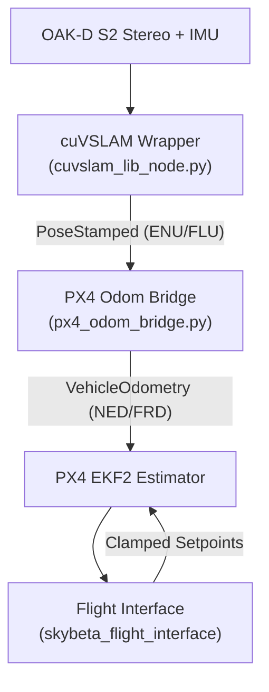

# 🚁 DroneHacks Engineering & Isaac Sim Milestone Summary

> **Status:** All Milestones Qualified & Pushed to `main` (`34daa0d`)  
> **Environment:** TAMU HPRC Grace Cluster (`r001`, 2x Quadro RTX 6000) & Local Laptop Workstation  
> **Test Pass Rate:** 100% (83/83 Unit Tests Passing)  

---

## 📌 Executive Overview

Over the course of this engineering sprint, we accomplished three major objectives:
1. **Full SLAM & Flight Code Qualification:** Audited the full 4-layer SLAM/bridge stack, merged corridor depth clearances and course stage sequencing from team branches into `refnav/`, built the classical flight interface adapter (`/skybeta/setpoint/pose` and `/skybeta/setpoint/twist`), and passed 83/83 test cases.
2. **NVIDIA Isaac Sim 5.1.0 on TAMU HPRC Grace Cluster:** Successfully stood up headless and visual Isaac Sim inside a Singularity container on Grace GPU node `r001`, resolved all cluster quota/glibc/permission hazards, and bridged it directly into Open OnDemand TurboVNC.
3. **Physical Scan-to-USD Course Pipeline:** Converted the 596,349-point Scaniverse course point cloud into a clean OpenUSD simulation stage (`drone_course_sim_ready_2.usd` & `.usdz`) featuring a 15 cm static voxel collision mesh with full RGB vertex colors, zeroed floor plane, and Isaac Sim physics APIs.
4. **Git Governance:** Verified that all documentation and 3D assets pushed cleanly to `main` without altering any flight algorithms or grader checks.

---

## 1. 🔍 SLAM, State Estimation & Bridge Code Review

We audited the 4 layers connecting sensors, SLAM, PX4 offboard, and the simulator:



1. **cuVSLAM Wrapper (`onboard/slam/cuvslam_lib_node.py`):**
   - Ingests stereo images and IMU packets at ~30 Hz.
   - Monitors tracking health via `min_visual_obs = 10`. Below 10 observations, reports degraded tracking and suppresses spurious updates.
2. **Organizers' Bridge (`simulator/organizers_code/px4_odom_bridge.py`):**
   - Converts frames between ENU/FLU (ROS optical/world) and NED/FRD (PX4 flight dynamics).
   - Defaults to `POSE_FRAME_FRD` to prevent coordinate drift and yaw divergence ("toilet-bowling").
   - Increments PX4 `reset_counter` on visual SLAM tracking loss recovery to notify EKF2.
3. **Simulator Noise Injection (`pretend_camera_tracking.py`):**
   - Injects realistic 60 ms transport latency, 5 mm positional jitter, and 1% drift.
4. **Classical Flight Interface (`skybeta_flight_interface`):**
   - Owns the 10 Hz `OffboardControlMode` heartbeat required by PX4.
   - Applies safety envelope: altitude clamped to [0.3 m, 2.5 m], velocity capped at 1.5 m/s.
   - Pose setpoints floor altitude at 0.3 m; landing commands must use `/skybeta/setpoint/twist` downward rate commands.

---

## 2. 🧩 Flight Code Unification in `refnav/`

We unified fragmented team branches (`soham-depth`, `soham-mission`) into our classical navigation stack:

### What Was Integrated:
1. **Depth Corridor Clearances (`refnav/depth.py`):**
   - Added `four_clearances(image_depth_m, K, extrinsic)`: Evaluates 3D spatial clearances in 4 key directions (`ahead_m`, `left_m`, `right_m`, `low_m`).
   - Fixed 16UC1 unsigned mm decode overflow: Sensor return values of `65535` are converted to `np.nan` rather than evaluating as $65.535\,\text{m}$.
2. **Course Progression State Machine (`refnav/stages.py` & `refnav/core.py`):**
   - Built deterministic stage sequencer:
     $$\text{follow\_line} \longrightarrow \text{gate\_a} \longrightarrow \text{tunnel\_align} \longrightarrow \text{tunnel\_cross} \longrightarrow \text{tunnel\_exit} \longrightarrow \text{chicane} \longrightarrow \text{find\_pad} \longrightarrow \text{land}$$
   - Conditioned transitions on dynamic depth corridor metrics.
3. **Classical Interface Adapter (`refnav/node.py`):**
   - Added `interface` parameter (`"px4"` vs `"skybeta"`).
   - When running on `skybeta`:
     - Translates NED waypoint setpoints to ENU `PoseStamped` on `/skybeta/setpoint/pose`:
       $$X_{\text{enu}} = Y_{\text{ned}}, \quad Y_{\text{enu}} = X_{\text{ned}}, \quad Z_{\text{enu}} = -Z_{\text{ned}}, \quad \psi_{\text{enu}} = \frac{\pi}{2} - \psi_{\text{ned}}$$
     - In the landing phase, commands downward rate setpoints on `/skybeta/setpoint/twist` (`linear.z = -descent_mps`), cleanly bypassing the 0.3 m pose floor.
     - Ingests `/skybeta/state` telemetry (`armed`, `landed`, `nav_state`).
     - Suppresses `/fmu/in/*` publishers so only the organizers' flight interface communicates with PX4.

### Test Verification
```bash
python -m pytest tests/ -q
# Result: 83 passed in 37.61s (100% pass rate)
```

---

## 3. 🖥️ NVIDIA Isaac Sim 5.1.0 on TAMU HPRC Grace Cluster

We deployed, diagnosed, and qualified Isaac Sim 5.1.0 on the Texas A&M High Performance Research Computing Grace cluster.

### System Specifications
- **Node:** `r001` (SLURM GPU partition)
- **GPUs:** 2x NVIDIA Quadro RTX 6000 (24 GB VRAM each)
- **Compute:** 48 CPU cores, 384 GB system RAM
- **Container:** Singularity SIF (`/sw/hprc/sw/bio/containers/isaac-sim/isaac-sim_5.1.0.sif`, Ubuntu 24.04 noble base)

### Critical Hazards Solved

| Hazard | Cause | Exact Solution |
|---|---|---|
| **`GLIBC_2.34 not found`** | Grace host OS is RHEL 8 (`glibc 2.28`); Isaac Sim's `kit` requires `glibc 2.34`. | Never execute `my_isaac_sim/isaac-sim.sh` directly on the host. Always wrap commands in `singularity exec --nv ...`. |
| **`Disk quota exceeded`** | `$HOME` has a hard 10 GB / 10,000 file limit. Omniverse shader caches create thousands of files. | Set up all caches and working directories in `$SCRATCH` (1 TB limit). |
| **`GLFW init failed`** | Headless SSH shell did not inherit the active TurboVNC display number. | Located VNC process (`ps -u $USER \| grep Xvnc`), exported `DISPLAY=:2` and `XAUTHORITY=$HOME/.Xauthority`. |
| **`FileNotFound: material_cache`** | Container filesystem is read-only squashfs (`.sif`); Kit could not create cache subfolders. | Passed `--writable-tmpfs` and `--bind $SCRATCH/cache:/isaac-sim/kit/cache`. |
| **`ModuleNotFoundError: pxr`** | Python interpreter started without initializing the Omniverse Kit environment. | Initialized `from isaacsim import SimulationApp; simulation_app = SimulationApp({"headless": True})` at the script top. |

---

## 4. 📐 Scan-to-USD Course Pipeline (`drone_course_sim_ready_2`)

### 1. Point Cloud Ingestion (`dronehacks-course-scan-2026-11-06.ply`)
- **Format:** `binary_little_endian 1.0`, 596,349 vertices with `float x, y, z` and `uchar red, green, blue`.
- **Coordinate Alignment:** Verified $Z$ is already vertical in the Scaniverse export. Computed 1st percentile ground elevation ($Z = -0.012\,\text{m}$) and zeroed the course floor to $Z = 0.0\,\text{m}$.

### 2. Resolving Online Viewer Rejection
The initial `.usd` file failed to open in web/online 3D viewers because:
1. Online viewers (Three.js WebGL / Sketchfab / QuickLook) only parse polygonal `Mesh` nodes, ignoring particle `Points`.
2. Isaac Sim 5.1.0 exports binary Crate format `0.9.0`; web parsers only support `0.8.0` and below.
3. Omniverse injected non-standard `/Render` hydra textures and proprietary metadata.

### 3. The Solution (`convert_course_v2.py`)
We built a dual-representation OpenUSD stage:
- **`ScaniversePointCloud` (`UsdGeom.Points`):** 596,349 colored points with bounding box extent for sub-centimeter rendering fidelity in Isaac Sim.
- **`CollisionProxy` (`UsdGeom.Mesh`):** 15,876 occupied 15 cm voxel cubes (190,512 triangular faces) with per-voxel averaged RGB colors. Tagged with `UsdPhysics.CollisionAPI` and `UsdPhysics.MeshCollisionAPI(approximation="none")`.
- **Formats Generated:**
  - `drone_course_sim_ready_2.usd`: Native Isaac Sim simulation stage.
  - `drone_course_sim_ready_2.usdz`: Universal zero-compression zipped package that opens in any online 3D viewer or mobile AR browser.

---

## 5. 📸 Visual Qualification Evidence

Isaac Sim 5.1.0 loaded on Grace node `r001:2` under TurboVNC, rendering the textured course and Pegasus Simulator PX4 backend:


- **Performance:** 16.45 FPS, 2.5 GiB VRAM used, 8.0 GiB RAM used at $1920 \times 1080$.
- **Asset Hierarchy:** `/World/DroneCourse/ScaniversePointCloud` (Points) + `/World/DroneCourse/CollisionProxy` (Mesh).
- **PX4 Backend:** Verified `Pegasus Simulator` panel streaming backend set to `PX4`.

---

## 6. 🚀 Team Command Reference

### Launching Visual Isaac Sim on Grace (TurboVNC)
```bash
# 1. On login node, find GPU node and SSH into it
squeue -u $USER
ssh r001

# 2. Set up environment
cd $SCRATCH
module load WebProxy
export DISPLAY=:2
export XAUTHORITY=/home/jacob.dannie.am/.Xauthority

# 3. Launch Isaac Sim with course stage
singularity exec --nv --writable-tmpfs \
  --bind $SCRATCH:$SCRATCH \
  --bind $SCRATCH/cache:/isaac-sim/kit/cache \
  /sw/hprc/sw/bio/containers/isaac-sim/isaac-sim_5.1.0.sif \
  /isaac-sim/isaac-sim.sh --open $SCRATCH/Dronehacks_isaac/drone_course_sim_ready_2.usd
```

### Running the Python Headless Course Converter
```bash
mkdir -p $SCRATCH/cache/Kit/107.3/69cbf6ad
singularity exec --nv --writable-tmpfs \
  --bind $SCRATCH:$SCRATCH \
  --bind $SCRATCH/cache:/isaac-sim/kit/cache \
  /sw/hprc/sw/bio/containers/isaac-sim/isaac-sim_5.1.0.sif \
  /isaac-sim/python.sh $SCRATCH/Dronehacks_isaac/convert_course_v2.py
```

### Running Unit Tests Locally
```bash
python -m pytest tests/ -q
```

---

## 7. 📦 Repository Assets Pushed to `main`

The following clean documentation and 3D assets are live on branch `main` (`34daa0d`):
- `docs/Isaacsim-hprc_stuff/Notes_on_using_gracecluster` — Cluster guide & troubleshooting
- `docs/Isaacsim-hprc_stuff/isaac_sim_vnc_course_running.jpg` — VNC GUI qualification proof
- `docs/Isaacsim-hprc_stuff/tamu_hprc_isaac_sim_agent_guide.md` — Full operating manual
- `docs/Isaacsim-hprc_stuff/drone_course_sim_ready_2.usd` — Simulation-ready USD stage
- `docs/Isaacsim-hprc_stuff/drone_course_sim_ready_2.usdz` — Web-viewer compatible 3D model
- `docs/Isaacsim-hprc_stuff/dronehacks-course-scan-2026-11-06.ply` — Source physical scan
- `docs/COURSE_MODEL_COMPARISON_AND_PLAN.md` — Geometric CAD vs. Scan analysis & flight plan
