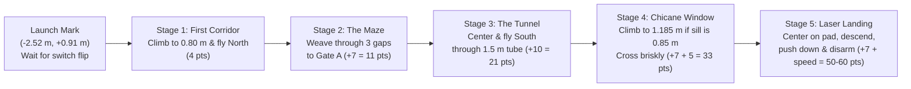
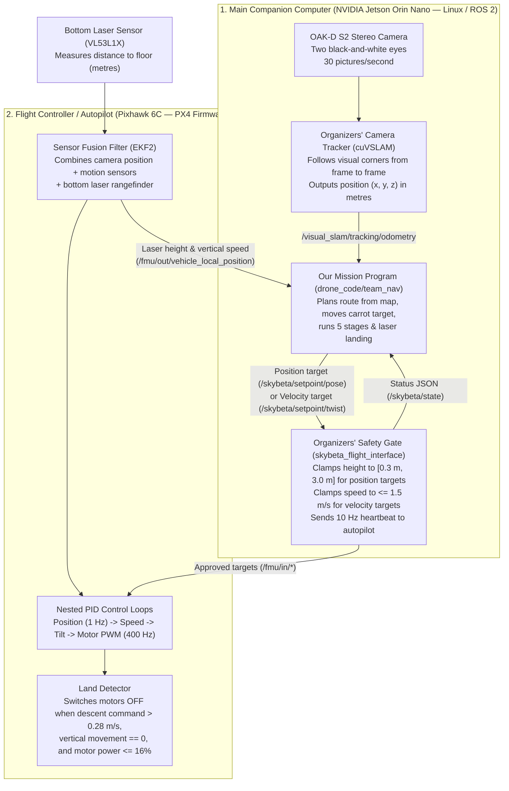

# DroneHacks 2026 — Phase 1 Implementation Specification (`drone_code/team_nav`)

**Author:** Principal Autonomous Flight Systems Architect (`skybeta-16`)  
**Target Aircraft:** Team Drone 16 (`skybeta-16` — NVIDIA Jetson Orin Nano, Holybro Pixhawk 6C running PX4 v1.16.2, Luxonis OAK-D S2 stereo camera, downward ST VL53L1X laser rangefinder)  
**Target Package:** [`drone_code/team_nav`](../drone_code/team_nav/README.md)  
**Coding Standard:** [`docs/READABLE_CODE.md`](READABLE_CODE.md)  
**Companion Architecture Documents:** [`docs/ARCHITECTURE.md`](ARCHITECTURE.md), [`docs/COURSE_MODEL_COMPARISON_AND_PLAN.md`](COURSE_MODEL_COMPARISON_AND_PLAN.md)  
**Date:** 2026-11-07  

---

## What This Document Does

This document is the complete engineering blueprint for **Phase 1** of our team's autonomous flight software in [`drone_code/team_nav`](../drone_code/team_nav/README.md):

1. **Section 1 (Very High Level)** is written for an electrical engineer who can read Python and has never worked with drones. It explains what the drone does, how the competition scoring shapes our design, why we split our software into three independent programs, how the organizers' safety wrapper and the autopilot fit together, how our "carrot-on-a-stick" speed control and 5 course stages work, why we adapt our flight height for the physical `0.85 m` window sill, and why our laser-gated landing cuts `4 seconds` off touchdown.
2. **Section 2 (Very Low Level — Deep Implementation Details for Phase 1)** provides the exact, copy-ready technical specifications, data structures, coordinate transformations, mathematical formulas, error-handling contracts, and complete Python / JSON / YAML / Launch / `pytest` blueprints for every Phase 1 module in `drone_code/team_nav`, followed by step-by-step commands to verify them in unit tests and in the local simulator.

Every constant in this document states its physical unit in full words (`_metres`, `_metres_per_second`, `_seconds`, `_degrees`, `_radians`) and carries one of the six required provenance labels from [`docs/READABLE_CODE.md`](READABLE_CODE.md): **measured**, **estimated**, **from PX4 source code**, **from the rulebook**, **from the organizers' code**, or **our own choice**. We have tested the landing logic and core stage transitions in the simulator; **we have not flown this Phase 1 package on the physical drone 16 yet**.

---

# SECTION 1: VERY HIGH LEVEL (For an Electrical Engineer New to Drones)

## 1.1 The Big Picture: What the Drone Has to Do

Imagine a four-motor flying robot (`50 cm` wide, weighing about `1.47 kg`) placed on a starting mark inside a `6.1 m × 6.1 m` netted room filled with walls, a narrow 3-turn maze, a fabric tunnel, a raised window cutout, and a circular landing pad on the floor.

Once a human teammate flips a single switch on a handheld radio controller at the referee's whistle, nobody touches the controls again. The drone must:
1. Lift off the floor to a safe indoor height (`0.80 m` above the floor).
2. Fly down the first corridor, weave through three `0.85 m` to `1.08 m` gaps in the maze, fly straight through the `1.50 m` long tunnel, pass through a rectangular window in the chicane wall, and stop over the landing pad.
3. Descend smoothly onto the pad, detect the exact moment its landing legs touch the floor, and convince its motor controller to switch the propellers completely off.



### How the Competition Scoring Shapes Every Engineering Decision

In the DroneHacks rulebook, a team's score (`100 points` total) is split into:
- **60 points** for the autonomous flight run,
- **25 points** for the technical presentation, and
- **15 points** for **generality** (proving our software computes its path from a map file rather than having coordinates typed directly into the Python code).

During the flight run:
- Reaching the landing area without landing is worth at most **28 points**.
- **Finishing the landing and switching the motors off** unlocks the **35-point completion base**, plus up to **20 speed points**, plus **5 bonus points** for flying through the window instead of taking the detour around Gate B.
- Touching a wall adds only a `5-second` time penalty, and you get multiple attempts during your time block, keeping your best score.

Therefore, our engineering priorities are strictly ordered:
1. **Priority 1 — Reliable Completion & Automatic Landing (+15 to +25 points):** Never get stuck hovering forever, and make sure the motors switch off cleanly on the pad.
2. **Priority 2 — Generality (+15 points):** Keep all wall coordinates in a JSON map file (`config/course_v3_and_scan_bounds.json`) and stage definitions in a YAML file (`config/competition_stages.yaml`) so no waypoint numbers are hard-coded inside Python logic.
3. **Priority 3 — The Window Bonus (+5 points):** Adapt automatically to the real window height so we earn the `+5` window bonus safely.
4. **Priority 4 — Speed (up to +20 points):** Save `4 seconds` on the landing using the bottom laser sensor before trying to fly dangerously fast near walls.

---

## 1.2 How the Hardware, Autopilot, and Flight Interface Fit Together

As an electrical engineer, it helps to think of the drone as **two separate computers** connected by a serial/Ethernet link, exactly like a high-level microprocessor talking to a dedicated motor-drive DSP:



### The Four Key Components Explained in Plain English

1. **The Autopilot (`PX4` running on the Pixhawk 6C):**
   - A quadcopter is inherently unstable; if you stop adjusting its four motors for half a second, it flips over. The Pixhawk 6C runs real-time firmware called **PX4** that adjusts motor power hundreds of times per second to keep the drone level.
   - Inside PX4 is a mathematical filter called **EKF2** (Extended Kalman Filter 2). It blends the high-speed accelerometers/gyroscopes, the downward laser sensor, and the camera position into one smooth estimate of where the drone is and how fast it is moving.
   - Our Python code **never** adjusts motor voltages or tilt angles directly. We simply tell PX4: *"Move toward this `(x, y, z)` point"* or *"Move downward at `0.35 m/s`."*

2. **The Camera Tracker (`cuVSLAM` running on the Jetson Orin Nano):**
   - Indoors, there is no GPS signal. Instead, the front stereo camera (`OAK-D S2`) takes `30` black-and-white stereo picture pairs per second.
   - An NVIDIA program called **`cuVSLAM`** tracks visual features across those pictures and outputs the drone's position `(x, y, z)` in metres relative to where the drone was powered on.

3. **The Organizers' Safety Gate (`skybeta_flight_interface`):**
   - To prevent student code from flying into the ceiling or shooting across the room at full throttle, the competition organizers run a protective program called **`skybeta_flight_interface`** between our code and PX4.
   - **Rule of the drone:** Our code is forbidden from sending commands directly to PX4 (`/fmu/in/*`). Instead, we send our requests to `skybeta_flight_interface` on two channels:
     - **Position targets (`/skybeta/setpoint/pose`):** *"Go to `(x, y, z)` metres and face angle `heading`."* Crucially, `skybeta_flight_interface` **refuses to let a position target go lower than `0.30 m` above the starting height** (`min_altitude_m = 0.30`).
     - **Velocity targets (`/skybeta/setpoint/twist`):** *"Move at `(vx, vy, vz)` metres per second."* Velocity targets are capped at `1.50 m/s`, expire after `1.0 second` if not refreshed, and **have no `0.30 m` minimum height floor**. That is why we use position targets to fly the course, and switch to velocity targets to land all the way to `0.00 m` on the floor.

4. **Why We Separate Our Software into Three Programs:**
   - Across the full project (Phases 1 and 2), we organize our companion software into three separate Linux processes:
     1. **The Mission Program (`mission_node.py` — built in Phase 1):** Plans the route from the map file, sequences the 5 stages, moves the carrot target, and executes the laser-gated landing.
     2. **The Stereo Distance Program (`depth_node.py` — added in Phase 2):** Computes 3D wall distances from the stereo camera pictures.
     3. **The Map Localizer Program (`map_localizer_node.py` — added in Phase 2):** Compares wall distances against the map to correct slow camera drift and measures exact gap edges.
   - **Why separate them?** In Linux, if an image-processing library crashes or lags on a bad camera frame, a separate process isolates that failure. Because `mission_node.py` runs in its own process with zero image-processing dependencies, it continues flying the drone safely at `20 Hz` and can land cleanly even if the vision helper programs stop.

---

## 1.3 The Four Core Engineering Ideas in Phase 1

### Idea 1: "Carrot-on-a-Stick" Speed Control ($v \approx 0.95 \times d_{\text{carrot}}$)

Why don't we just send the coordinate of the end of the corridor (`2 metres` away) to PX4's position controller?
- Because PX4's position controller acts like an outer proportional loop with a gain of **`0.95 per second`** (`MPC_XY_P = 0.95`) and a speed limit of **`12.0 m/s`**. If you send a target `2.0 m` away, PX4 immediately tries to accelerate toward `1.9 m/s` inside a narrow `1.0 m` corridor!
- Instead, we place our commanded position target—which we call the **carrot**—only a short distance $d_{\text{carrot}}$ ahead of the drone along the planned path, and slide it forward as the drone moves:
  $$\text{Speed (m/s)} \approx 0.95 \times \text{Carrot Distance (m)}$$
- If we keep the carrot **`0.50 m` ahead of the drone**, the drone flies smoothly at about **`0.48 m/s`**.
- Better still, when the map says the drone is passing through a narrow gap where the nearest wall is only `0.42 m` away, we shrink the carrot distance so the speed in `m/s` never exceeds the clearance in `metres`.

### Idea 2: The 5 Stages of the Course

Rather than writing one giant function, the flight is broken into five sequential stages loaded from `config/competition_stages.yaml`:
1. **Stage 1 (`first_corridor` — 4 pts):** Climb to `0.80 m` over the launch mark `(-2.515 m, +0.914 m)`, then follow the carrot straight North down the center of Corridor 1 to `y = +2.65 m`.
2. **Stage 2 (`maze_to_gate_a` — 7 pts):** Weave East through Gap 1 (`M1` north tip), South down Maze Lane 2, East through Gap 2 (`M2` south tip), North up Maze Lane 3, and East through Gate A (`M3` north tip).
3. **Stage 3 (`tunnel_transit` — 10 pts):** Line up North of the `1.45 m` wide tunnel entrance, point the nose straight South, and fly steadily through the `1.50 m` long tube at `0.80 m` height.
4. **Stage 4 (`chicane_window` — 7 pts + 5 window bonus pts):** Approach the window wall (`C2a`), adjust flight altitude to match the window's vertical center, and cross briskly (`>= 0.45 m/s`) into the landing zone.
5. **Stage 5 (`pad_approach_and_land` — 7 pts + up to 20 speed pts):** Center over the landing pad, verify the downward laser reading, and run the 4-step laser-gated landing until the motors switch off.

### Idea 3: Why We Adapt to the Physical `0.85 m` Window Sill

When we compared the organizers' preliminary 3D CAD file (`dronehacks-course-v3.obj`) against the real 3D LiDAR scan of the physical arena (`dronehacks-course-scan-2026-11-06.ply`), we discovered a critical `54.5 cm` discrepancy in the chicane window (`C2a`):

| Measurement | Preliminary CAD Model (`.obj`) | Physical Arena Scan (`.ply`) | Why It Matters |
| :--- | :--- | :--- | :--- |
| **Window Bottom Edge (Sill)** | `0.305 m` (`12 in`) | **`0.850 m` (`33.5 in`)** | Below `0.85 m` is a solid wall panel in the real arena! |
| **Window Top Edge (Lintel)** | `1.219 m` (`48 in`) | **`1.520 m` (`60 in`)** | Top edge is `30 cm` higher in the real arena. |
| **Safe Window Center Height** | **`0.762 m` (fly at `0.80 m`)** | **`1.185 m` (fly at `1.185 m`)** | Flying at `0.80 m` in the real arena hits the sill! |

Furthermore, our audit of PX4's height filter (`EKF2`) revealed a second hazard at the window sill:
- When the drone crosses the raised window sill, the downward laser beam suddenly hits the top of the sill instead of the floor (`30 cm` to `85 cm` jump).
- In PX4's source code, if the laser reading jumps while the drone is moving horizontally **slower than `0.32 m/s` for `2 seconds`**, PX4 assumes the laser is broken and stops trusting it!
- Therefore, our Phase 1 planner computes the window crossing height directly from the active map profile (`0.80 m` for the CAD simulator map, `1.185 m` for the physical scan map) and crosses the window sill **briskly at `0.50 m/s` without pausing over the edge**.

### Idea 4: Why the Bottom Laser Cuts Landing Time by 4 Seconds

Remember that our code is not allowed to switch the motors off directly—only PX4's internal **land detector** can disarm the motors. Reading PX4's C++ source code (`MulticopterLandDetector.cpp`) shows that PX4 only declares the drone landed when:
1. We are commanding a downward speed faster than **`0.275 m/s`** (`1.1 × LNDMC_Z_VEL_MAX`),
2. The drone has stopped moving vertically, and
3. **Motor thrust has fallen below `~15.8%`** (`MPC_THR_MIN + 0.1 × (MPC_THR_HOVER - MPC_THR_MIN)`).

When the drone touches the floor during a gentle `0.35 m/s` descent, its propellers are still spinning near `50%` hover power. Because `0.35 m/s` is a small error, PX4's integral controller ramps the motor power down very slowly—taking **`5.0 seconds`** just to reach `15.8%` thrust, plus `4.6 seconds` of timer checks (`9.6 seconds` total sitting on the floor with spinning blades!).

**Our solution:**
1. While sitting on the launch mark before takeoff, we record what the downward laser reads on the floor (`~0.10 m`, because PX4 clamps readings below `10 cm` via `EKF2_MIN_RNG = 0.1`).
2. Over the landing pad, we descend at **`0.50 m/s`** down to `0.30 m` above the floor, then slow to a gentle **`0.35 m/s`** below `0.30 m`. Below **`0.20 m`**, we set sideways speed corrections to **`0.0 m/s`** so a sideways push on contact can never tip the drone over.
3. The instant the downward laser stays within **`3 cm` (`0.03 m`)** of the launch-mark floor reference **and** vertical speed stays below **`0.05 m/s`** for **`0.30 seconds`**, we know for certain the landing legs are resting on the floor.
4. We immediately latch into **`PUSH_DOWN`** and command **`1.00 m/s` straight down**. The drone cannot move because the floor is solid, so PX4's controller dumps motor power below `15.8%` in **`1.0 second`** instead of `5.0 seconds`—**cutting `4.0 seconds` off every landing!**

---

## 1.4 Why Phase 1 Focuses on Core Navigation Before Live Depth

In hardware engineering, you never debug a power supply, a microcontroller clock, and an RF transceiver simultaneously—you bring up and qualify the deterministic backbone first.

Phase 1 builds and verifies the complete autonomous flight loop (`readable_constants.py`, `course_map_and_route_planner.py`, `landing_controller.py`, `mission_stages.py`, and `mission_node.py`) using camera odometry and the downward laser rangefinder:
1. **It satisfies the Generality Rule (Rule 9.5) from Day 1:** The route and obstacle clearances are computed from `config/course_v3_and_scan_bounds.json` and `config/competition_stages.yaml` at startup.
2. **It runs identically in our fast local simulator (`course_simulator`) and on `skybeta-16`:** Our local Docker simulator does not render synthetic stereo camera images, so decoupling Phase 1 from live stereo depth lets us test every stage transition, timeout, fault latch, and the 4-second laser landing speedup end-to-end against real PX4 SITL firmware.
3. **It provides the rock-solid fallback for Phase 2:** When Phase 2 adds live stereo depth (`depth_node.py` and `map_localizer_node.py`), any missing or textureless depth frame automatically falls back to the Phase 1 map-planned route rather than leaving the drone stranded mid-air.

---

# SECTION 2: VERY LOW LEVEL (Deep Implementation Details for Phase 1)

## 2.1 Coordinate Frames, Mathematical Formulas, and Error-Handling Contracts

### 2.1.1 The Three Coordinate Frames and Their Exact Transformations

Every file that touches positions or velocities must explicitly name which of these three coordinate frames a variable belongs to:

1. **Course Map Frame (`_map_metres`):**
   - Origin `(0.0, 0.0, 0.0)` is at the center of the `6.096 m × 6.096 m` arena floor:
     - $+X_{\text{map}}$ points **East** (from the launch corridor at $x = -2.515\,\text{m}$ toward the tunnel at $x = +2.311\,\text{m}$).
     - $+Y_{\text{map}}$ points **North** (along the first corridor from $y = +0.914\,\text{m}$ toward Gap 1 at $y = +2.650\,\text{m}$).
     - $+Z_{\text{map}}$ points **Up** (height above the arena floor, where the floor is $z_{\text{map}} = 0.0\,\text{m}$).
   - Heading $\psi_{\text{map}}$ is measured in **radians counter-clockwise from $+X_{\text{map}}$ (East)**:
     - Facing East: $\psi_{\text{map}} = 0.0\,\text{rad}$ ($0^\circ$).
     - Facing North (down Corridor 1 at launch): $\psi_{\text{map}} = +\frac{\pi}{2}\,\text{rad}$ ($+90^\circ$).
     - Facing West: $\psi_{\text{map}} = \pi\,\text{rad}$ ($180^\circ$).
     - Facing South (through the Tunnel): $\psi_{\text{map}} = -\frac{\pi}{2}\,\text{rad}$ ($-90^\circ$).

2. **Camera Tracking Odometry Frame (`_odom_metres`, ROS `frame_id = "odom"`):**
   - Published by `cuVSLAM` on `/visual_slam/tracking/odometry` and expected by `skybeta_flight_interface` on `/skybeta/setpoint/pose` and `/skybeta/setpoint/twist`.
   - Uses **East-North-Up (`ENU`)** world axes anchored where the drone was sitting when `cuVSLAM` initialized (`home_odom_metres = (x_0, y_0, z_0)` and initial heading `start_heading_odom_radians = \psi_{\text{odom},0}`).
   - When the run begins on the launch mark $\mathbf{p}_{\text{launch,map}} = (x_{\text{launch,map}}, y_{\text{launch,map}}, 0.0)$, the rigid transformation between a 3D point in the Course Map Frame $\mathbf{p}_{\text{map}} = (x_{\text{map}}, y_{\text{map}}, z_{\text{map}})$ and the Odometry Frame $\mathbf{p}_{\text{odom}} = (x_{\text{odom}}, y_{\text{odom}}, z_{\text{odom}})$ is defined by the yaw offset $\Delta\psi = \psi_{\text{odom},0} - \psi_{\text{launch,map}}$:
     $$\begin{bmatrix} x_{\text{odom}} \\ y_{\text{odom}} \end{bmatrix} = \begin{bmatrix} x_{0} \\ y_{0} \end{bmatrix} + \begin{bmatrix} \cos(\Delta\psi) & -\sin(\Delta\psi) \\ \sin(\Delta\psi) & \cos(\Delta\psi) \end{bmatrix} \begin{bmatrix} x_{\text{map}} - x_{\text{launch,map}} \\ y_{\text{map}} - y_{\text{launch,map}} \end{bmatrix}$$
     $$z_{\text{odom}} = z_{0} + z_{\text{map}}, \qquad \psi_{\text{odom}} = \text{wrap\_pi}\left(\psi_{\text{map}} + \Delta\psi\right)$$
   - Conversely, given the live odometry report $(x_{\text{odom}}, y_{\text{odom}}, z_{\text{odom}}, \psi_{\text{odom}})$, the drone's position in the Course Map Frame is:
     $$\begin{bmatrix} x_{\text{map}} \\ y_{\text{map}} \end{bmatrix} = \begin{bmatrix} x_{\text{launch,map}} \\ y_{\text{launch,map}} \end{bmatrix} + \begin{bmatrix} \cos(\Delta\psi) & \sin(\Delta\psi) \\ -\sin(\Delta\psi) & \cos(\Delta\psi) \end{bmatrix} \begin{bmatrix} x_{\text{odom}} - x_{0} \\ y_{\text{odom}} - y_{0} \end{bmatrix}$$
     $$z_{\text{map}} = z_{\text{odom}} - z_{0}, \qquad \psi_{\text{map}} = \text{wrap\_pi}\left(\psi_{\text{odom}} - \Delta\psi\right)$$

3. **PX4 Local Position Frame (`NED` — North-East-Down on `/fmu/out/vehicle_local_position`):**
   - In PX4's native telemetry message `px4_msgs/VehicleLocalPosition`, the vertical axis $+Z_{\text{ned}}$ points **downward toward the floor**.
   - Therefore:
     - `message.vz` is the **downward speed in metres per second** ($v_{\text{down}} = +v_{z,\text{ned}}$; positive when descending, near `0.0` on the floor).
     - `message.dist_bottom` is the **distance from the bottom laser sensor to the surface directly below in metres** (always positive, clamped to $\ge 0.10\,\text{m}$ by `EKF2_MIN_RNG = 0.1`).
     - In contrast, on `/skybeta/setpoint/twist` (`ENU`), $+Z_{\text{enu}}$ points **upward**, so commanding a downward descent of $v_{\text{descent}} > 0$ requires publishing `twist.linear.z = -v_descent`.

---

### 2.1.2 Mathematical Formulas Used in Phase 1

1. **Carrot-on-a-Stick Speed and Lead Distance Formula:**
   - With PX4's proportional position gain $K_p = 0.95\,\text{s}^{-1}$ (`MPC_XY_P = 0.95`), a horizontal position error $d_{\text{carrot}}$ produces a steady-state horizontal velocity command:
     $$v_{\text{commanded}} \approx 0.95 \times d_{\text{carrot}}$$
   - Given the stage's maximum allowed speed $v_{\text{stage\_max}}$ and the clearance $d_{\text{wall}}$ to the nearest wall or obstacle segment at the drone's current position:
     $$v_{\text{target}} = \min\left(v_{\text{stage\_max}},\; 0.95 \times \max(0.15,\; d_{\text{wall}})\right)$$
     $$d_{\text{carrot}} = \min\left(d_{\text{carrot\_max}},\; \frac{v_{\text{target}}}{0.95}\right)$$

2. **Quaternion-to-Yaw and Yaw-to-Quaternion Conversions (Pure Yaw Rotation About $+Z_{\text{odom}}$):**
   - Given a ROS `geometry_msgs/Quaternion` $(x, y, z, w)$ from `/visual_slam/tracking/odometry`, the counter-clockwise yaw angle $\psi_{\text{odom}} \in [-\pi, +\pi]$ is:
     $$\psi_{\text{odom}} = \operatorname{atan2}\left(2.0 \cdot (w \cdot z + x \cdot y),\; 1.0 - 2.0 \cdot (y^2 + z^2)\right)$$
   - Given a desired heading $\psi_{\text{odom}}$ in radians, the pure-yaw unit quaternion published on `/skybeta/setpoint/pose` is:
     $$q_x = 0.0, \qquad q_y = 0.0, \qquad q_z = \sin\left(\frac{\psi_{\text{odom}}}{2.0}\right), \qquad q_w = \cos\left(\frac{\psi_{\text{odom}}}{2.0}\right)$$

3. **Point-to-Wall-Segment Distance Lookup ($d_{\text{wall}}$):**
   - For a horizontal wall segment from $\mathbf{a} = (a_x, a_y)$ to $\mathbf{b} = (b_x, b_y)$ and drone position $\mathbf{p} = (p_x, p_y)$, let $\mathbf{u} = \mathbf{b} - \mathbf{a}$ and $L^2 = u_x^2 + u_y^2$. The projection parameter clamped to $[0, 1]$ is:
     $$t = \operatorname{clip}\left(\frac{(p_x - a_x) u_x + (p_y - a_y) u_y}{L^2},\; 0.0,\; 1.0\right)$$
     $$d(\mathbf{p}, \overline{\mathbf{a}\mathbf{b}}) = \sqrt{\left(p_x - (a_x + t u_x)\right)^2 + \left(p_y - (a_y + t u_y)\right)^2} - \frac{w_{\text{wall}}}{2}$$

---

### 2.1.3 Full-Sentence Error Handling Contract (Per `docs/READABLE_CODE.md` Rule 8)

Every exception or fault logged by any module in `drone_code/team_nav` must be a **complete English sentence** stating **what went wrong** and **what to do next**:
- **Missing or invalid configuration file:**
  ```python
  raise FileNotFoundError(
      f"The course map file was not found at '{map_file_path}'. Check that "
      "config/course_v3_and_scan_bounds.json is installed in the package share directory."
  )
  ```
- **Stale camera tracking odometry:**
  ```python
  "No camera tracking position report has arrived for 0.25 seconds, so the drone does not "
  "know where it is. Holding the current position and waiting up to 5.0 seconds before landing."
  ```
- **Frozen camera tracking (identical coordinates repeated $> 10$ times):**
  ```python
  "Camera tracking has repeated the exact same position 11 times in a row, which means "
  "cuVSLAM has frozen. Refusing to advance and holding position; check the OAK-D camera link."
  ```
- **Sudden position jump ($> 0.50\,\text{m}$ in a single $0.05\,\text{s}$ step):**
  ```python
  "Camera tracking position jumped by 0.62 metres in a single step, so world position targets "
  "are no longer safe. Commanding zero velocity and waiting for the safety pilot to take over."
  ```

---

## 2.2 Step-by-Step Technical Blueprints for Every Phase 1 Module

### Module (a): `drone_code/team_nav/config/course_v3_and_scan_bounds.json`

**Purpose:** Separates all course geometry, wall segments, obstacle cylinders, window vertical bounds, and gate openings from Python source code in strict compliance with **Rule 9.5 (Generality)** and [`docs/READABLE_CODE.md`](READABLE_CODE.md). Contains both the `cad_v3` geometry (used by `simulator/course_model/dronehacks-course-v3.obj`) and the `physical_scan_2026_11_06` geometry (measured from `dronehacks-course-scan-2026-11-06.ply`), allowing the route planner to compute the maximum-clearance path for either layout automatically at startup.

```json
{
  "schema_version": "1.0.0",
  "provenance": "Measured from simulator/course_model/dronehacks-course-v3.obj (40,796 vertices) and docs/Isaacsim-hprc_stuff/dronehacks-course-scan-2026-11-06.ply (596,349 points) on 2026-11-07.",
  "default_profile": "cad_v3",
  "drone_physical_dimensions": {
    "width_metres": 0.50,
    "length_metres": 0.41,
    "safety_margin_metres": 0.15
  },
  "profiles": {
    "cad_v3": {
      "description": "Preliminary Onshape CAD model v3 used by the local course_simulator.",
      "arena_bounds_metres": {
        "x_min_metres": -3.048,
        "x_max_metres": 3.048,
        "y_min_metres": -3.048,
        "y_max_metres": 3.048,
        "wall_top_height_metres": 1.727
      },
      "launch_mark": {
        "x_metres": -2.515,
        "y_metres": 0.914,
        "initial_heading_degrees": 90.0
      },
      "landing_pad": {
        "x_metres": -2.042,
        "y_metres": -0.793,
        "outer_ring_radius_metres": 0.762
      },
      "window_opening_c2a": {
        "center_x_metres": -0.456,
        "center_y_metres": -2.231,
        "width_metres": 0.914,
        "sill_height_metres": 0.305,
        "lintel_height_metres": 1.219,
        "normal_angle_degrees": 160.0,
        "standoff_distance_metres": 0.70
      },
      "tunnel_bore": {
        "center_x_metres": 2.311,
        "north_entrance_y_metres": 1.219,
        "south_exit_y_metres": -0.305,
        "inner_width_metres": 1.448,
        "inner_ceiling_height_metres": 1.810
      },
      "wall_segments_metres": [
        {"name": "west_net", "x1": -3.048, "y1": -3.048, "x2": -3.048, "y2": 3.048, "thickness": 0.05},
        {"name": "east_net", "x1": 3.048, "y1": -3.048, "x2": 3.048, "y2": 3.048, "thickness": 0.05},
        {"name": "south_net", "x1": -3.048, "y1": -3.048, "x2": 3.048, "y2": -3.048, "thickness": 0.05},
        {"name": "north_net", "x1": -3.048, "y1": 3.048, "x2": 3.048, "y2": 3.048, "thickness": 0.05},
        {"name": "main_barrier", "x1": -3.048, "y1": 0.457, "x2": 1.575, "y2": 0.457, "thickness": 0.102},
        {"name": "maze_divider_m1", "x1": -1.930, "y1": 0.508, "x2": -1.930, "y2": 2.121, "thickness": 0.102},
        {"name": "maze_divider_m2", "x1": -0.813, "y1": 1.435, "x2": -0.813, "y2": 3.048, "thickness": 0.102},
        {"name": "maze_divider_m3", "x1": 0.305, "y1": 0.508, "x2": 0.305, "y2": 2.121, "thickness": 0.102},
        {"name": "tunnel_west_wall", "x1": 1.575, "y1": -0.305, "x2": 1.575, "y2": 1.219, "thickness": 0.08},
        {"name": "chicane_c1", "x1": 1.525, "y1": 0.387, "x2": 0.973, "y2": -1.129, "thickness": 0.102},
        {"name": "chicane_c2b", "x1": -0.195, "y1": -1.514, "x2": 0.157, "y2": -0.547, "thickness": 0.102},
        {"name": "approach_a1", "x1": -0.975, "y1": -0.622, "x2": -0.975, "y2": 0.406, "thickness": 0.102}
      ],
      "gate_Portals": [
        {"name": "corridor_1_end", "x1": -3.048, "y1": 2.121, "x2": -1.930, "y2": 2.121},
        {"name": "maze_gap_1", "x1": -1.930, "y1": 2.121, "x2": -1.930, "y2": 3.048},
        {"name": "maze_lane_2_south", "x1": -1.930, "y1": 1.435, "x2": -0.813, "y2": 1.435},
        {"name": "maze_gap_2", "x1": -0.813, "y1": 0.508, "x2": -0.813, "y2": 1.435},
        {"name": "maze_lane_3_north", "x1": -0.813, "y1": 2.121, "x2": 0.305, "y2": 2.121},
        {"name": "maze_gate_a", "x1": 0.305, "y1": 2.121, "x2": 0.305, "y2": 3.048}
      ],
      "floor_boulders_metres": [
        {"name": "boulder_1", "x": 2.012, "y": -2.469, "radius": 0.229, "height": 0.533},
        {"name": "boulder_2", "x": 2.530, "y": -1.555, "radius": 0.229, "height": 0.533},
        {"name": "boulder_3", "x": 0.793, "y": -2.347, "radius": 0.229, "height": 0.533},
        {"name": "boulder_4", "x": -2.560, "y": -2.499, "radius": 0.229, "height": 0.533},
        {"name": "boulder_5", "x": -1.341, "y": -2.377, "radius": 0.229, "height": 0.533}
      ]
    },
    "physical_scan_2026_11_06": {
      "description": "Physical arena measured from handheld LiDAR scan on 2026-11-06.",
      "arena_bounds_metres": {
        "x_min_metres": -3.030,
        "x_max_metres": 3.097,
        "y_min_metres": -3.000,
        "y_max_metres": 3.215,
        "wall_top_height_metres": 1.780
      },
      "launch_mark": {
        "x_metres": -2.515,
        "y_metres": 0.914,
        "initial_heading_degrees": 90.0
      },
      "landing_pad": {
        "x_metres": -2.150,
        "y_metres": -0.850,
        "outer_ring_radius_metres": 0.762
      },
      "window_opening_c2a": {
        "center_x_metres": -0.455,
        "center_y_metres": -2.214,
        "width_metres": 0.979,
        "sill_height_metres": 0.850,
        "lintel_height_metres": 1.520,
        "normal_angle_degrees": 161.1,
        "standoff_distance_metres": 0.70
      },
      "tunnel_bore": {
        "center_x_metres": 2.151,
        "north_entrance_y_metres": 1.325,
        "south_exit_y_metres": -0.172,
        "inner_width_metres": 1.447,
        "inner_ceiling_height_metres": 1.498
      },
      "wall_segments_metres": [
        {"name": "west_net", "x1": -3.030, "y1": -3.000, "x2": -3.030, "y2": 3.215, "thickness": 0.05},
        {"name": "east_net", "x1": 3.097, "y1": -3.000, "x2": 3.097, "y2": 3.215, "thickness": 0.05},
        {"name": "south_net", "x1": -3.030, "y1": -3.000, "x2": 3.097, "y2": -3.000, "thickness": 0.05},
        {"name": "north_net", "x1": -3.030, "y1": 3.215, "x2": 3.097, "y2": 3.215, "thickness": 0.05},
        {"name": "main_barrier", "x1": -3.030, "y1": 0.438, "x2": 1.500, "y2": 0.438, "thickness": 0.102},
        {"name": "maze_divider_m1", "x1": -2.017, "y1": 0.520, "x2": -1.781, "y2": 2.366, "thickness": 0.102},
        {"name": "maze_divider_m2", "x1": -0.494, "y1": 1.521, "x2": -0.412, "y2": 3.150, "thickness": 0.102},
        {"name": "maze_divider_m3", "x1": 1.017, "y1": 0.520, "x2": 1.139, "y2": 2.295, "thickness": 0.102},
        {"name": "tunnel_west_wall", "x1": 1.427, "y1": -0.172, "x2": 1.427, "y2": 1.325, "thickness": 0.08},
        {"name": "chicane_c1", "x1": 1.197, "y1": 0.350, "x2": 1.545, "y2": -1.214, "thickness": 0.102},
        {"name": "approach_a1", "x1": -1.410, "y1": 0.350, "x2": -1.457, "y2": -0.919, "thickness": 0.102}
      ],
      "gate_Portals": [
        {"name": "corridor_1_end", "x1": -3.030, "y1": 2.366, "x2": -1.781, "y2": 2.366},
        {"name": "maze_gap_1", "x1": -1.781, "y1": 2.366, "x2": -1.781, "y2": 3.215},
        {"name": "maze_lane_2_south", "x1": -1.850, "y1": 1.521, "x2": -0.494, "y2": 1.521},
        {"name": "maze_gap_2", "x1": -0.494, "y1": 0.438, "x2": -0.494, "y2": 1.521},
        {"name": "maze_lane_3_north", "x1": -0.412, "y1": 2.295, "x2": 1.139, "y2": 2.295},
        {"name": "maze_gate_a", "x1": 1.139, "y1": 2.295, "x2": 1.139, "y2": 3.215}
      ],
      "floor_boulders_metres": [
        {"name": "boulder_3_mound", "x": 0.620, "y": -2.586, "radius": 0.229, "height": 0.166},
        {"name": "boulder_4_mound", "x": -2.438, "y": -2.811, "radius": 0.229, "height": 0.280},
        {"name": "boulder_5_mound", "x": -1.588, "y": -2.342, "radius": 0.229, "height": 0.330}
      ]
    }
  }
}
```

---

### Module (b): `drone_code/team_nav/config/competition_stages.yaml`

**Purpose:** Declarative specification of the 5 ordered mission stages, their speed limits, arrival tolerances, settling pauses, and per-stage time limits.

```yaml
# Declarative mission stage sequence for team_nav (Rule 9.5 Generality).
# Every number includes its physical unit in its key name.
mission_name: "dronehacks_2026_autonomous_course"
default_cruise_height_metres: 0.80
total_flight_time_limit_seconds: 170.0

stages:
  - stage_name: "stage_1_first_corridor"
    checkpoint_points: 4
    behavior_kind: "portal_sequence"
    portals:
      - "corridor_1_end"
    max_speed_metres_per_second: 0.55
    arrival_tolerance_metres: 0.15
    corner_settle_seconds: 0.60
    time_limit_seconds: 35.0

  - stage_name: "stage_2_maze_to_gate_a"
    checkpoint_points: 7
    behavior_kind: "portal_sequence"
    portals:
      - "maze_gap_1"
      - "maze_lane_2_south"
      - "maze_gap_2"
      - "maze_lane_3_north"
      - "maze_gate_a"
    max_speed_metres_per_second: 0.45
    arrival_tolerance_metres: 0.14
    corner_settle_seconds: 0.80
    time_limit_seconds: 55.0

  - stage_name: "stage_3_tunnel_transit"
    checkpoint_points: 10
    behavior_kind: "tunnel_bore_transit"
    max_speed_metres_per_second: 0.55
    arrival_tolerance_metres: 0.15
    corner_settle_seconds: 0.80
    time_limit_seconds: 30.0

  - stage_name: "stage_4_chicane_window"
    checkpoint_points: 12
    behavior_kind: "adaptive_window_crossing"
    max_speed_metres_per_second: 0.50
    minimum_sill_crossing_speed_metres_per_second: 0.45
    arrival_tolerance_metres: 0.14
    corner_settle_seconds: 1.00
    time_limit_seconds: 30.0

  - stage_name: "stage_5_pad_approach_and_land"
    checkpoint_points: 7
    behavior_kind: "pad_center_and_laser_land"
    max_speed_metres_per_second: 0.45
    arrival_tolerance_metres: 0.12
    corner_settle_seconds: 1.50
    time_limit_seconds: 35.0
```

---

### Module (c): `drone_code/team_nav/team_nav/readable_constants.py`

**Purpose:** Centralizes all physical constants, explicit unit names, provenance comments, and a plain-English glossary of drone terms. Contains zero logic.

```python
"""Every physical number used by team_nav Phase 1, with its unit and where it came from.

What this file does
-------------------
It holds the named physical constants for our takeoff, route planning, carrot speed
controller, safety checks, and bottom-laser landing. Putting them in one place means
no file in our package ever uses an unexplained magic number.

How it fits with the other files
--------------------------------
course_map_and_route_planner.py, landing_controller.py, mission_stages.py, and
mission_node.py import their default numbers from this file.

What it deliberately does not do
--------------------------------
It contains no flight logic, no course waypoint coordinates (those live in
config/course_v3_and_scan_bounds.json), and no ROS imports.

Plain-English Glossary of Drone Terms (for readers new to drones)
-----------------------------------------------------------------
* "Arming": Giving the four motors permission to spin. A disarmed drone cannot move.
* "Offboard": The mode in PX4 (the flight controller's software) where the drone
  follows position or speed targets sent by our companion computer instead of the
  handheld remote control.
* "EKF2": The sensor-fusion filter inside PX4 that blends motion sensors, the bottom
  laser, and camera tracking into one estimate of position and speed.
* "ENU" (East-North-Up): The coordinate system used by camera tracking and the
  organizers' flight interface, where +X is East, +Y is North, and +Z is Up (metres).
* "NED" (North-East-Down): The coordinate system used inside PX4, where +Z points
  downward toward the floor.
* "Pose": A target position (x, y, z) in metres plus a heading direction.
* "Twist": A target linear velocity (vx, vy, vz) in metres per second plus a turning
  rate in radians per second.
* "Odometry": The running position and heading estimate produced by the cuVSLAM
  camera tracker as it watches visual details move across the stereo cameras.
"""

# ---------------------------------------------------------------------------
# 1. Drone Physical Dimensions & Autopilot Response Constants
# ---------------------------------------------------------------------------

# Estimated from the 7-inch propeller frame geometry in docs/ARCHITECTURE.md section 3.
DRONE_WIDTH_METRES = 0.50
DRONE_LENGTH_METRES = 0.41
DRONE_HALF_WIDTH_METRES = 0.25
DRONE_MASS_KILOGRAMS = 1.47

# Measured on drone 16 in ~/skybeta/px4/params/fleet/drone16-vio-2026-11-03.params.
# The flight interface defaults to system 1, so we must pass 16 on the real drone.
DRONE_16_PX4_SYSTEM_ID = 16

# From PX4 source code and drone 16 settings (MPC_XY_P = 0.95): PX4's outer position
# loop commands a horizontal speed in m/s equal to about 0.95 times the horizontal
# distance to the position target in metres.
PX4_HORIZONTAL_POSITION_GAIN_PER_SECOND = 0.95

# From a PX4 setting on drone 16 (MPC_XY_VEL_MAX = 12.0 m/s): PX4 can fly up to
# 12 m/s toward a distant position target unless we keep the carrot target close.
PX4_MAXIMUM_HORIZONTAL_SPEED_METRES_PER_SECOND = 12.0

# From a PX4 setting on drone 16 (COM_DISARM_PRFLT = 10.0 s): PX4 automatically
# switches the motors off if the drone has not left the ground within 10 seconds of arming.
PREFLIGHT_LEAVE_GROUND_DEADLINE_SECONDS = 10.0

# ---------------------------------------------------------------------------
# 2. Organizers' Flight Interface Limits (skybeta_flight_interface v0.3.2)
# ---------------------------------------------------------------------------

# From the organizers' code (skybeta_flight_interface/envelope.py): position targets
# ("pose") are clamped so their height is never below 0.30 m or above 3.00 m relative
# to the starting odometry origin.
ORGANIZERS_MINIMUM_POSE_HEIGHT_METRES = 0.30
ORGANIZERS_MAXIMUM_POSE_HEIGHT_METRES = 3.00

# From the organizers' code (skybeta_flight_interface/envelope.py): velocity targets
# ("twist") are clamped to a maximum speed norm of 1.50 m/s and expire after 1.00 s.
ORGANIZERS_MAXIMUM_TWIST_SPEED_METRES_PER_SECOND = 1.50
ORGANIZERS_TWIST_EXPIRATION_TIMEOUT_SECONDS = 1.00

# Our own choice from the organizer code audit: running our mission loop at 20 Hz
# refreshes velocity targets every 0.05 s, well inside the 1.00 s expiration timeout.
CONTROL_LOOP_STEPS_PER_SECOND = 20.0
MAXIMUM_ALLOWED_STEP_DURATION_SECONDS = 0.25

# ---------------------------------------------------------------------------
# 3. Flight Altitude, Window Sill Adaptation & Speed Limits
# ---------------------------------------------------------------------------

# Our own choice from docs/ARCHITECTURE.md section 1: 0.80 m clears all floor boulders
# (0.33 m in physical scan, 0.53 m in CAD) and aligns with the widest part of the tunnel.
DEFAULT_CRUISE_HEIGHT_METRES = 0.80
TAKEOFF_CLIMB_SPEED_METRES_PER_SECOND = 0.50
LEFT_GROUND_THRESHOLD_HEIGHT_METRES = 0.10
CRUISE_HEIGHT_ARRIVAL_TOLERANCE_METRES = 0.08
TAKEOFF_TIME_LIMIT_SECONDS = 15.0

# Measured in the physical Scaniverse scan (dronehacks-course-scan-2026-11-06.ply) vs.
# the preliminary CAD model (dronehacks-course-v3.obj). The physical window sill in C2a
# is 0.85 m high (top edge 1.52 m, center 1.185 m), whereas the CAD sill is 0.305 m.
CAD_WINDOW_SILL_HEIGHT_METRES = 0.305
CAD_WINDOW_LINTEL_HEIGHT_METRES = 1.219
PHYSICAL_SCAN_WINDOW_SILL_HEIGHT_METRES = 0.850
PHYSICAL_SCAN_WINDOW_LINTEL_HEIGHT_METRES = 1.520
MINIMUM_SAFE_WINDOW_CROSSING_HEIGHT_METRES = 0.75
MAXIMUM_SAFE_WINDOW_CROSSING_HEIGHT_METRES = 1.30

# From PX4 source code (range_sensor_consistency_check in EKF2): if the bottom laser
# jumps while horizontal speed is below 0.32 m/s for 2 seconds, EKF2 stops trusting the
# laser. We cross the window sill briskly at 0.50 m/s (minimum 0.45 m/s) without stopping.
PX4_LASER_GATE_MINIMUM_HORIZONTAL_SPEED_METRES_PER_SECOND = 0.32
WINDOW_SILL_CROSSING_SPEED_METRES_PER_SECOND = 0.50

# From docs/ARCHITECTURE.md section 6: a 0.50 m carrot lead gives ~0.48 m/s cruise speed.
MAXIMUM_CARROT_LEAD_DISTANCE_METRES = 0.50
MINIMUM_CARROT_LEAD_DISTANCE_METRES = 0.15
DEFAULT_CRUISE_SPEED_METRES_PER_SECOND = 0.50
GENTLE_CORRIDOR_SPEED_METRES_PER_SECOND = 0.35
MAXIMUM_YAW_RATE_DEGREES_PER_SECOND = 45.0

# ---------------------------------------------------------------------------
# 4. Telemetry Freshness, Frozen-Tracker Detection & Fault Limits
# ---------------------------------------------------------------------------

# From docs/ARCHITECTURE.md section 11: if camera tracking stops for > 0.20 s, hold.
POSITION_REPORT_MAX_AGE_SECONDS = 0.20
PX4_LOCAL_POSITION_MAX_AGE_SECONDS = 0.50
FLIGHT_STATE_REPORT_MAX_AGE_SECONDS = 1.00

# Measured on drone 16 on 2026-11-07: when cuVSLAM died, it kept publishing the exact
# same floating-point position 30 times per second. More than 10 bit-identical reports
# in a row (~0.33 s) means camera tracking is frozen.
FROZEN_TRACKING_MAX_IDENTICAL_REPORTS = 10

# Our own choice: at 20 Hz (0.05 s per step), a real drone cannot move 0.50 m in one
# step (that would be 10 m/s). A jump >= 0.50 m means camera tracking jumped.
POSITION_JUMP_FAULT_LIMIT_METRES = 0.50

# From the rulebook: total allowed run time is 180.0 s (3 minutes). Starting landing
# at 170.0 s leaves 10.0 s for our ~9.0 s laser-gated landing.
TOTAL_RUN_TIME_LIMIT_SECONDS = 180.0
FORCED_LANDING_START_TIME_SECONDS = 170.0
HOLD_FOR_MISSING_TELEMETRY_TIMEOUT_SECONDS = 5.0

# ---------------------------------------------------------------------------
# 5. Four-Step Laser-Gated Rapid Landing Constants (Section 7 of Plan)
# ---------------------------------------------------------------------------

# From a PX4 setting on drone 16 (EKF2_MIN_RNG = 0.10): PX4 clamps any bottom laser
# reading below 10 cm up to 0.10 m.
DEFAULT_UNRECORDED_FLOOR_LASER_METRES = 0.10
LAUNCH_FLOOR_LASER_WINDOW_SECONDS = 2.00

# From docs/ARCHITECTURE.md section 7, verified in simulator/test_flights/landing_test.py:
# Step 1: Descend at 0.50 m/s until 0.30 m above the floor reference.
# Step 2: Descend gently at 0.35 m/s (above PX4's 0.275 m/s land-detector minimum).
#         Freeze sideways XY velocity corrections below 0.20 m so the drone cannot tip.
# Step 3: Confirm touchdown when laser <= floor_ref + 0.03 m AND |vz| < 0.05 m/s for 0.30 s.
# Step 4: Latch into 1.00 m/s downward push-down twist until PX4 disarms the motors.
MEDIUM_DESCENT_SPEED_METRES_PER_SECOND = 0.50
GENTLE_DESCENT_SWITCH_HEIGHT_METRES = 0.30
GENTLE_DESCENT_SPEED_METRES_PER_SECOND = 0.35
PX4_LAND_DETECTOR_MINIMUM_DESCENT_METRES_PER_SECOND = 0.275
FREEZE_XY_CORRECTIONS_BELOW_HEIGHT_METRES = 0.20
LANDING_XY_CENTERING_GAIN_PER_SECOND = 0.50
LANDING_XY_MAX_SPEED_METRES_PER_SECOND = 0.15
TOUCHDOWN_LASER_TOLERANCE_METRES = 0.03
TOUCHDOWN_MAX_VERTICAL_SPEED_METRES_PER_SECOND = 0.05
TOUCHDOWN_DEBOUNCE_DURATION_SECONDS = 0.30
PUSH_DOWN_SPEED_METRES_PER_SECOND = 1.00
```

---

### Module (d): `drone_code/team_nav/team_nav/course_map_and_route_planner.py`

**Purpose:** Loads the course geometry JSON file (`config/course_v3_and_scan_bounds.json`), computes point-to-wall clearances at any `(x_map, y_map)` coordinate, generates the collision-free stage waypoints from the map's gate portals, tunnel bounds, and window opening (with zero hard-coded coordinates in Python), and computes the wall-clearance-capped carrot position along any active stage polyline.

```python
"""Loads the course map file, measures wall clearance, and plans the route and carrot target.

What this file does
-------------------
1. Reads the course walls, gate portals, tunnel bounds, window dimensions, and landing
   pad from config/course_v3_and_scan_bounds.json (so no coordinates are typed into code).
2. Calculates the distance from any (x, y) point in the course map to the nearest wall
   or boulder so we can cap the drone's speed in narrow passages.
3. Builds the ordered list of 3D waypoints (x_map, y_map, z_map, heading_radians) for
   each of the 5 mission stages, automatically adapting the window crossing height to
   match the map's window sill and lintel (0.80 m for CAD v3, 1.185 m for the physical scan).
4. Moves the "carrot" position target along the stage path at a distance capped by both
   the stage speed limit and the nearest wall clearance (speed ~= 0.95 * carrot_distance).

How it fits with the other files
--------------------------------
mission_stages.py calls this file at startup to build the route for each stage, and calls
it 20 times per second during flight to place the carrot target ahead of the drone.

What it deliberately does not do
--------------------------------
It never talks to ROS or PX4, never reads a clock, and never mutates the map during flight.
"""
from dataclasses import dataclass
import json
import math
from pathlib import Path
from typing import Dict, List, Tuple

from .readable_constants import (
    DEFAULT_CRUISE_HEIGHT_METRES,
    MAXIMUM_CARROT_LEAD_DISTANCE_METRES,
    MAXIMUM_SAFE_WINDOW_CROSSING_HEIGHT_METRES,
    MINIMUM_CARROT_LEAD_DISTANCE_METRES,
    MINIMUM_SAFE_WINDOW_CROSSING_HEIGHT_METRES,
    PX4_HORIZONTAL_POSITION_GAIN_PER_SECOND,
)


@dataclass(frozen=True)
class WallSegment:
    """A straight wall panel in the Course Map Frame (metres)."""
    name: str
    x1_metres: float
    y1_metres: float
    x2_metres: float
    y2_metres: float
    thickness_metres: float


@dataclass(frozen=True)
class Waypoint3D:
    """A planned 3D target point in the Course Map Frame (metres and radians)."""
    name: str
    x_map_metres: float
    y_map_metres: float
    z_map_metres: float
    heading_map_radians: float
    minimum_speed_metres_per_second: float = 0.0


def wrap_angle_radians(angle_radians: float) -> float:
    """Wraps any angle in radians into the interval [-pi, +pi)."""
    return (angle_radians + math.pi) % (2.0 * math.pi) - math.pi


def distance_from_point_to_segment_metres(
    point_x_metres: float,
    point_y_metres: float,
    wall: WallSegment,
) -> float:
    """Returns the horizontal surface clearance (in metres) from (x, y) to a wall segment."""
    segment_dx = wall.x2_metres - wall.x1_metres
    segment_dy = wall.y2_metres - wall.y1_metres
    length_squared = segment_dx * segment_dx + segment_dy * segment_dy
    if length_squared <= 1e-12:
        center_distance = math.hypot(
            point_x_metres - wall.x1_metres,
            point_y_metres - wall.y1_metres,
        )
        return max(0.0, center_distance - 0.5 * wall.thickness_metres)

    projection = (
        (point_x_metres - wall.x1_metres) * segment_dx
        + (point_y_metres - wall.y1_metres) * segment_dy
    ) / length_squared
    clamped_t = max(0.0, min(1.0, projection))
    nearest_x = wall.x1_metres + clamped_t * segment_dx
    nearest_y = wall.y1_metres + clamped_t * segment_dy
    center_distance = math.hypot(point_x_metres - nearest_x, point_y_metres - nearest_y)
    return max(0.0, center_distance - 0.5 * wall.thickness_metres)


class CourseMapAndRoutePlanner:
    """Pure-Python course geometry lookup and route generator."""

    def __init__(self, map_json_path: str | Path, profile_name: str | None = None) -> None:
        path = Path(map_json_path)
        if not path.is_file():
            raise FileNotFoundError(
                f"The course map file was not found at '{path}'. Check that "
                "config/course_v3_and_scan_bounds.json exists and is readable."
            )
        raw_data = json.loads(path.read_text(encoding="utf-8"))
        selected_profile = profile_name or raw_data.get("default_profile", "cad_v3")
        profiles = raw_data.get("profiles", {})
        if selected_profile not in profiles:
            raise ValueError(
                f"The requested course profile '{selected_profile}' does not exist in '{path}'. "
                f"Available profiles are: {sorted(profiles.keys())}."
            )
        self.profile_name: str = selected_profile
        self.profile: Dict = profiles[selected_profile]
        self.walls: List[WallSegment] = [
            WallSegment(
                name=w["name"],
                x1_metres=float(w["x1"]),
                y1_metres=float(w["y1"]),
                x2_metres=float(w["x2"]),
                y2_metres=float(w["y2"]),
                thickness_metres=float(w.get("thickness", 0.10)),
            )
            for w in self.profile["wall_segments_metres"]
        ]
        self.portals: Dict[str, Tuple[float, float, float, float]] = {
            p["name"]: (float(p["x1"]), float(p["y1"]), float(p["x2"]), float(p["y2"]))
            for p in self.profile["gate_Portals"]
        }

    def launch_pose_map(self) -> Tuple[float, float, float]:
        """Returns (x_map_metres, y_map_metres, initial_heading_map_radians) on the launch mark."""
        launch = self.profile["launch_mark"]
        return (
            float(launch["x_metres"]),
            float(launch["y_metres"]),
            math.radians(float(launch["initial_heading_degrees"])),
        )

    def landing_pad_center_map_metres(self) -> Tuple[float, float]:
        """Returns (x_map_metres, y_map_metres) of the landing pad center."""
        pad = self.profile["landing_pad"]
        return float(pad["x_metres"]), float(pad["y_metres"])

    def compute_window_crossing_height_metres(
        self,
        default_cruise_height_metres: float = DEFAULT_CRUISE_HEIGHT_METRES,
    ) -> float:
        """Computes the safe vertical center of the C2a window opening from the map bounds.

        On the CAD model (sill 0.305 m, lintel 1.219 m), the midpoint is 0.762 m, which is
        within 4 cm of the 0.80 m cruise height, so 0.80 m is used. On the physical scan
        (sill 0.850 m, lintel 1.520 m), the midpoint is 1.185 m, automatically climbing
        above the 0.850 m solid lower wall panel.
        """
        window = self.profile["window_opening_c2a"]
        sill_metres = float(window["sill_height_metres"])
        lintel_metres = float(window["lintel_height_metres"])
        vertical_midpoint_metres = 0.5 * (sill_metres + lintel_metres)
        if abs(vertical_midpoint_metres - default_cruise_height_metres) <= 0.06:
            return default_cruise_height_metres
        return max(
            MINIMUM_SAFE_WINDOW_CROSSING_HEIGHT_METRES,
            min(MAXIMUM_SAFE_WINDOW_CROSSING_HEIGHT_METRES, vertical_midpoint_metres),
        )

    def nearest_wall_distance_metres(self, x_map_metres: float, y_map_metres: float) -> float:
        """Returns the distance in metres from (x_map, y_map) to the closest wall surface."""
        minimum_distance = float("inf")
        for wall in self.walls:
            distance = distance_from_point_to_segment_metres(x_map_metres, y_map_metres, wall)
            if distance < minimum_distance:
                minimum_distance = distance
        return minimum_distance

    def portal_midpoint_metres(self, portal_name: str) -> Tuple[float, float]:
        """Returns the (x_map, y_map) center of a named gap portal from the map file."""
        if portal_name not in self.portals:
            raise KeyError(
                f"The portal '{portal_name}' is not defined in profile '{self.profile_name}'. "
                "Check that config/competition_stages.yaml and the map JSON file match."
            )
        x1, y1, x2, y2 = self.portals[portal_name]
        return 0.5 * (x1 + x2), 0.5 * (y1 + y2)

    def build_stage_waypoints(
        self,
        cruise_height_metres: float = DEFAULT_CRUISE_HEIGHT_METRES,
    ) -> Dict[str, List[Waypoint3D]]:
        """Generates the 5 stage waypoint lists purely from the loaded map geometry."""
        corridor_end_x, corridor_end_y = self.portal_midpoint_metres("corridor_1_end")
        gap1_x, gap1_y = self.portal_midpoint_metres("maze_gap_1")
        lane2_x, lane2_y = self.portal_midpoint_metres("maze_lane_2_south")
        gap2_x, gap2_y = self.portal_midpoint_metres("maze_gap_2")
        lane3_x, lane3_y = self.portal_midpoint_metres("maze_lane_3_north")
        gate_a_x, gate_a_y = self.portal_midpoint_metres("maze_gate_a")

        tunnel = self.profile["tunnel_bore"]
        tunnel_x = float(tunnel["center_x_metres"])
        tunnel_north_y = float(tunnel["north_entrance_y_metres"]) + 0.40
        tunnel_south_y = float(tunnel["south_exit_y_metres"]) - 0.35

        window = self.profile["window_opening_c2a"]
        win_x = float(window["center_x_metres"])
        win_y = float(window["center_y_metres"])
        win_normal_rad = math.radians(float(window["normal_angle_degrees"]))
        standoff_m = float(window["standoff_distance_metres"])
        win_height_m = self.compute_window_crossing_height_metres(cruise_height_metres)

        # Approach standoff point is on the Southeast side (-normal), exit is Northwest (+normal).
        win_standoff_x = win_x - standoff_m * math.cos(win_normal_rad)
        win_standoff_y = win_y - standoff_m * math.sin(win_normal_rad)
        win_exit_x = win_x + standoff_m * math.cos(win_normal_rad)
        win_exit_y = win_y + standoff_m * math.sin(win_normal_rad)

        pad_x, pad_y = self.landing_pad_center_map_metres()

        return {
            "stage_1_first_corridor": [
                Waypoint3D("corridor_1_end", corridor_end_x, gap1_y, cruise_height_metres, math.pi / 2.0),
            ],
            "stage_2_maze_to_gate_a": [
                Waypoint3D("maze_gap_1_east", lane2_x, gap1_y, cruise_height_metres, 0.0),
                Waypoint3D("maze_lane_2_south", lane2_x, gap2_y, cruise_height_metres, -math.pi / 2.0),
                Waypoint3D("maze_gap_2_east", lane3_x, gap2_y, cruise_height_metres, 0.0),
                Waypoint3D("maze_lane_3_north", lane3_x, gate_a_y, cruise_height_metres, math.pi / 2.0),
                Waypoint3D("maze_gate_a_exit", gate_a_x + 0.55, gate_a_y, cruise_height_metres, 0.0),
            ],
            "stage_3_tunnel_transit": [
                Waypoint3D("tunnel_north_align", tunnel_x, tunnel_north_y, cruise_height_metres, -math.pi / 2.0),
                Waypoint3D("tunnel_south_exit", tunnel_x, tunnel_south_y, cruise_height_metres, -math.pi / 2.0),
            ],
            "stage_4_chicane_window": [
                Waypoint3D("window_standoff", win_standoff_x, win_standoff_y, win_height_m, win_normal_rad),
                Waypoint3D(
                    "window_exit",
                    win_exit_x,
                    win_exit_y,
                    win_height_m,
                    win_normal_rad,
                    minimum_speed_metres_per_second=0.45,
                ),
            ],
            "stage_5_pad_approach_and_land": [
                Waypoint3D("landing_pad_center", pad_x, pad_y, cruise_height_metres, win_normal_rad),
            ],
        }

    def compute_carrot_target_map(
        self,
        drone_x_map_metres: float,
        drone_y_map_metres: float,
        target_waypoint: Waypoint3D,
        stage_max_speed_metres_per_second: float,
    ) -> Tuple[float, float, float, float]:
        """Places the carrot target along the line from the drone to target_waypoint.

        Because PX4 commands v ~= 0.95 * d_carrot, capping d_carrot to v_desired / 0.95
        regulates the drone's speed without fighting PX4's inner control loops.
        """
        wall_clearance_metres = self.nearest_wall_distance_metres(drone_x_map_metres, drone_y_map_metres)
        wall_capped_speed = PX4_HORIZONTAL_POSITION_GAIN_PER_SECOND * max(
            MINIMUM_CARROT_LEAD_DISTANCE_METRES,
            wall_clearance_metres,
        )
        desired_speed = min(stage_max_speed_metres_per_second, wall_capped_speed)
        desired_speed = max(desired_speed, target_waypoint.minimum_speed_metres_per_second)
        carrot_lead_metres = min(
            MAXIMUM_CARROT_LEAD_DISTANCE_METRES,
            max(
                MINIMUM_CARROT_LEAD_DISTANCE_METRES,
                desired_speed / PX4_HORIZONTAL_POSITION_GAIN_PER_SECOND,
            ),
        )

        dx_metres = target_waypoint.x_map_metres - drone_x_map_metres
        dy_metres = target_waypoint.y_map_metres - drone_y_map_metres
        distance_to_waypoint_metres = math.hypot(dx_metres, dy_metres)
        if distance_to_waypoint_metres <= carrot_lead_metres or distance_to_waypoint_metres <= 1e-6:
            return (
                target_waypoint.x_map_metres,
                target_waypoint.y_map_metres,
                target_waypoint.z_map_metres,
                target_waypoint.heading_map_radians,
            )
        scale = carrot_lead_metres / distance_to_waypoint_metres
        return (
            drone_x_map_metres + dx_metres * scale,
            drone_y_map_metres + dy_metres * scale,
            target_waypoint.z_map_metres,
            target_waypoint.heading_map_radians,
        )
```

---

### Module (e): `drone_code/team_nav/team_nav/landing_controller.py`

**Purpose:** Implements the 4-step laser-gated rapid landing state machine:
1. `MEDIUM_DESCENT`: `0.50 m/s` downward twist (`linear.z = -0.50`) with gentle XY pad centering until `height_above_floor_metres <= 0.30 m`.
2. `GENTLE_DESCENT`: `0.35 m/s` downward twist (`linear.z = -0.35`) with **XY velocity corrections frozen to `(0.0, 0.0)` below `0.20 m`** so the landing gear cannot tip on floor contact.
3. **Touchdown Confirmation (`0.30 s` debounce):** Requires **both** `abs(laser_distance_metres - launch_floor_reference_metres) <= 0.03 m` **and** `abs(downward_speed_metres_per_second) < 0.05 m/s` continuously for `0.30 s`.
4. `PUSH_DOWN`: Latches irreversibly into `1.00 m/s` downward twist (`linear.z = -1.00`, `linear.x = 0.0`, `linear.y = 0.0`), saturating PX4's velocity integrator downward against the floor so motor thrust drops below `15.8%` in `~1.0 s` and PX4 disarms `~4.0 s` faster.

```python
"""Four-step laser-gated landing controller that cuts touchdown-to-disarm time by 4 seconds.

What this file does
-------------------
It runs the 4-step descent state machine over the landing pad:
  1. MEDIUM_DESCENT (0.50 m/s down until 0.30 m above the floor reference).
  2. GENTLE_DESCENT (0.35 m/s down; freezes sideways XY velocity below 0.20 m).
  3. Touchdown debounce (0.30 s continuous check that the bottom laser is within 3 cm
     of the launch-mark floor reading and vertical speed |vz| is under 0.05 m/s).
  4. PUSH_DOWN (latched 1.00 m/s downward velocity command until PX4 disarms).

How it fits with the other files
--------------------------------
mission_stages.py hands control to this controller once the drone has centered over the
landing pad (or when a safety timeout triggers an immediate landing). It uses only plain
Python numbers so pytest can test every edge case on a laptop.

What it deliberately does not do
--------------------------------
It never talks to ROS or PX4 directly, never sends position ("pose") setpoints during
descent (because the organizers' flight interface floors pose targets at 0.30 m), and
never re-checks the laser after latching into PUSH_DOWN (because the laser reading drifts
upward on the floor).
"""
from dataclasses import dataclass
import math
from typing import Tuple

from .readable_constants import (
    DEFAULT_UNRECORDED_FLOOR_LASER_METRES,
    FREEZE_XY_CORRECTIONS_BELOW_HEIGHT_METRES,
    GENTLE_DESCENT_SPEED_METRES_PER_SECOND,
    GENTLE_DESCENT_SWITCH_HEIGHT_METRES,
    LANDING_XY_CENTERING_GAIN_PER_SECOND,
    LANDING_XY_MAX_SPEED_METRES_PER_SECOND,
    MEDIUM_DESCENT_SPEED_METRES_PER_SECOND,
    PUSH_DOWN_SPEED_METRES_PER_SECOND,
    TOUCHDOWN_DEBOUNCE_DURATION_SECONDS,
    TOUCHDOWN_LASER_TOLERANCE_METRES,
    TOUCHDOWN_MAX_VERTICAL_SPEED_METRES_PER_SECOND,
)


@dataclass(frozen=True)
class LandingTwistCommand:
    """Velocity command in the ENU Odometry Frame (east, north, up) in metres per second."""
    step_name: str
    velocity_enu_metres_per_second: Tuple[float, float, float]
    touchdown_latched: bool
    reason: str


class LaserGatedLandingController:
    """Pure-Python 4-step landing state machine."""

    def __init__(
        self,
        target_pad_x_odom_metres: float,
        target_pad_y_odom_metres: float,
        launch_floor_laser_reference_metres: float | None,
    ) -> None:
        self.target_pad_x_odom_metres = float(target_pad_x_odom_metres)
        self.target_pad_y_odom_metres = float(target_pad_y_odom_metres)
        if launch_floor_laser_reference_metres is None or not math.isfinite(launch_floor_laser_reference_metres):
            self.floor_reference_metres = DEFAULT_UNRECORDED_FLOOR_LASER_METRES
        else:
            self.floor_reference_metres = float(launch_floor_laser_reference_metres)

        self.step_name: str = "MEDIUM_DESCENT"
        self.touchdown_conditions_met_since_seconds: float | None = None
        self.touchdown_latched: bool = False

    def compute_height_above_floor_metres(
        self,
        laser_distance_metres: float | None,
    ) -> float | None:
        """Returns height above the remembered launch floor in metres, or None if unavailable."""
        if laser_distance_metres is None or not math.isfinite(laser_distance_metres):
            return None
        return max(0.0, float(laser_distance_metres) - self.floor_reference_metres)

    def compute_xy_centering_velocity_metres_per_second(
        self,
        drone_x_odom_metres: float | None,
        drone_y_odom_metres: float | None,
        height_above_floor_metres: float | None,
    ) -> Tuple[float, float]:
        """Computes gentle XY centering velocity above 0.20 m, and freezes XY to (0, 0) below 0.20 m.

        Why we freeze XY below 0.20 m: a sideways push at the moment the landing legs touch
        the floor mats creates a torque that tips the drone over.
        """
        if (
            drone_x_odom_metres is None
            or drone_y_odom_metres is None
            or height_above_floor_metres is None
            or height_above_floor_metres < FREEZE_XY_CORRECTIONS_BELOW_HEIGHT_METRES
        ):
            return 0.0, 0.0

        vx_east = LANDING_XY_CENTERING_GAIN_PER_SECOND * (
            self.target_pad_x_odom_metres - drone_x_odom_metres
        )
        vy_north = LANDING_XY_CENTERING_GAIN_PER_SECOND * (
            self.target_pad_y_odom_metres - drone_y_odom_metres
        )
        speed_norm = math.hypot(vx_east, vy_north)
        if speed_norm > LANDING_XY_MAX_SPEED_METRES_PER_SECOND:
            scale = LANDING_XY_MAX_SPEED_METRES_PER_SECOND / speed_norm
            vx_east *= scale
            vy_north *= scale
        return vx_east, vy_north

    def update(
        self,
        now_seconds: float,
        drone_x_odom_metres: float | None,
        drone_y_odom_metres: float | None,
        laser_distance_metres: float | None,
        px4_downward_speed_metres_per_second: float | None,
    ) -> LandingTwistCommand:
        """Advances the landing state machine by one step and returns the ENU velocity command."""
        # Step 4 (Latched): Once touchdown is confirmed, never check the laser again because
        # PX4's dist_bottom reading can drift from 0.10 m up to 0.18 m while sitting on the floor.
        if self.touchdown_latched or self.step_name == "PUSH_DOWN":
            self.step_name = "PUSH_DOWN"
            self.touchdown_latched = True
            return LandingTwistCommand(
                step_name="PUSH_DOWN",
                velocity_enu_metres_per_second=(0.0, 0.0, -PUSH_DOWN_SPEED_METRES_PER_SECOND),
                touchdown_latched=True,
                reason="Touchdown confirmed: commanding 1.00 m/s downward push-down until PX4 disarms.",
            )

        height_above_floor = self.compute_height_above_floor_metres(laser_distance_metres)

        # Step 1 -> Step 2 transition: switch from 0.50 m/s to 0.35 m/s at or below 0.30 m
        # (or immediately if the laser reading is missing, so we descend gently).
        if self.step_name == "MEDIUM_DESCENT":
            if height_above_floor is None or height_above_floor <= GENTLE_DESCENT_SWITCH_HEIGHT_METRES:
                self.step_name = "GENTLE_DESCENT"
            else:
                vx, vy = self.compute_xy_centering_velocity_metres_per_second(
                    drone_x_odom_metres, drone_y_odom_metres, height_above_floor
                )
                return LandingTwistCommand(
                    step_name="MEDIUM_DESCENT",
                    velocity_enu_metres_per_second=(vx, vy, -MEDIUM_DESCENT_SPEED_METRES_PER_SECOND),
                    touchdown_latched=False,
                    reason=f"Medium descent at 0.50 m/s (height above floor {height_above_floor:.2f} m > 0.30 m).",
                )

        # Step 2 & Step 3: Gentle descent (0.35 m/s) + 0.30 s touchdown debounce check.
        laser_near_floor = (
            laser_distance_metres is not None
            and abs(laser_distance_metres - self.floor_reference_metres) <= TOUCHDOWN_LASER_TOLERANCE_METRES
        )
        vertical_motion_stopped = (
            px4_downward_speed_metres_per_second is not None
            and math.isfinite(px4_downward_speed_metres_per_second)
            and abs(px4_downward_speed_metres_per_second) < TOUCHDOWN_MAX_VERTICAL_SPEED_METRES_PER_SECOND
        )

        if laser_near_floor and vertical_motion_stopped:
            if self.touchdown_conditions_met_since_seconds is None:
                self.touchdown_conditions_met_since_seconds = now_seconds
            elif (
                now_seconds - self.touchdown_conditions_met_since_seconds
                >= TOUCHDOWN_DEBOUNCE_DURATION_SECONDS - 1e-9
            ):
                self.step_name = "PUSH_DOWN"
                self.touchdown_latched = True
                return LandingTwistCommand(
                    step_name="PUSH_DOWN",
                    velocity_enu_metres_per_second=(0.0, 0.0, -PUSH_DOWN_SPEED_METRES_PER_SECOND),
                    touchdown_latched=True,
                    reason="Touchdown confirmed after 0.30 s debounce: latching 1.00 m/s downward push-down.",
                )
        else:
            self.touchdown_conditions_met_since_seconds = None

        vx, vy = self.compute_xy_centering_velocity_metres_per_second(
            drone_x_odom_metres, drone_y_odom_metres, height_above_floor
        )
        xy_note = "XY frozen (< 0.20 m)" if (vx == 0.0 and vy == 0.0) else "XY centering active"
        return LandingTwistCommand(
            step_name="GENTLE_DESCENT",
            velocity_enu_metres_per_second=(vx, vy, -GENTLE_DESCENT_SPEED_METRES_PER_SECOND),
            touchdown_latched=False,
            reason=f"Gentle descent at 0.35 m/s ({xy_note}).",
        )
```

---

### Module (f): `drone_code/team_nav/team_nav/mission_stages.py`

**Purpose:** Pure-Python top-level mission state machine that coordinates:
- Pre-flight launch-mark floor laser recording (`floor_laser_readings`) and pre-arm `PoseStamped` streaming at `0.30 m` above `odom` origin so `skybeta_flight_interface` accepts the single-switch handover (`auto_offboard_on_arm: True`).
- Continuous telemetry freshness verification, frozen-tracker (`> 10` bit-identical odometry reports) detection, and sudden position-jump (`> 0.50 m` in one step) fault latching.
- Coordinate transformations between the Course Map Frame (`_map_metres`) and the Odometry Frame (`_odom_metres`).
- Sequential progression through Takeoff (`0.80 m`), Stage 1 (`first_corridor`), Stage 2 (`maze_to_gate_a`), Stage 3 (`tunnel_transit`), Stage 4 (`chicane_window` at `0.80 m` or `1.185 m`), and Stage 5 (`pad_approach_and_land` $\rightarrow$ `LaserGatedLandingController`).
- Prevention of the **"fallback trap"** in `skybeta_flight_interface` (publishing a holding `PoseStamped` at the drone's exact current `(x, y, z, heading)` immediately before the first `TwistStamped` landing command so that if a twist message ever expired, `skybeta_flight_interface` would hold over the pad rather than flying back to an old waypoint).

```python
"""Pure-Python mission sequencer with stage timeouts, fault latches, and carrot advancement.

What this file does
-------------------
It runs the entire autonomous flight decision loop 20 times per second:
  1. Waits on the launch mark, records the floor laser reading, and streams a pre-arm
     position target so the organizers' flight interface accepts the pilot's switch flip.
  2. Checks at every step that camera tracking and PX4 telemetry are fresh, that camera
     tracking has not frozen on repeated identical numbers, and that position has not jumped.
  3. Climbs to 0.80 m, advances the carrot target through Stages 1 to 5 using
     course_map_and_route_planner.py, and transitions into landing_controller.py.

How it fits with the other files
--------------------------------
mission_node.py passes incoming ROS sensor readings into this class and publishes the
returned Phase1Command on /skybeta/setpoint/pose or /skybeta/setpoint/twist.

What it deliberately does not do
--------------------------------
It imports no ROS 2 packages and never reads the system clock directly, so every stage,
timeout, and fault latch can be unit-tested deterministically in pytest.
"""
from dataclasses import dataclass, field
import math
from pathlib import Path
from typing import List, Tuple

from .course_map_and_route_planner import (
    CourseMapAndRoutePlanner,
    Waypoint3D,
    wrap_angle_radians,
)
from .landing_controller import LaserGatedLandingController
from .readable_constants import (
    CRUISE_HEIGHT_ARRIVAL_TOLERANCE_METRES,
    DEFAULT_CRUISE_HEIGHT_METRES,
    DEFAULT_CRUISE_SPEED_METRES_PER_SECOND,
    FLIGHT_STATE_REPORT_MAX_AGE_SECONDS,
    FORCED_LANDING_START_TIME_SECONDS,
    FROZEN_TRACKING_MAX_IDENTICAL_REPORTS,
    HOLD_FOR_MISSING_TELEMETRY_TIMEOUT_SECONDS,
    LAUNCH_FLOOR_LASER_WINDOW_SECONDS,
    LEFT_GROUND_THRESHOLD_HEIGHT_METRES,
    ORGANIZERS_MINIMUM_POSE_HEIGHT_METRES,
    POSITION_JUMP_FAULT_LIMIT_METRES,
    POSITION_REPORT_MAX_AGE_SECONDS,
    PREFLIGHT_LEAVE_GROUND_DEADLINE_SECONDS,
    PX4_LOCAL_POSITION_MAX_AGE_SECONDS,
    TAKEOFF_CLIMB_SPEED_METRES_PER_SECOND,
    TAKEOFF_TIME_LIMIT_SECONDS,
)

ORDERED_STAGE_NAMES = (
    "stage_1_first_corridor",
    "stage_2_maze_to_gate_a",
    "stage_3_tunnel_transit",
    "stage_4_chicane_window",
    "stage_5_pad_approach_and_land",
)


@dataclass
class Phase1Command:
    """The setpoint decision returned to mission_node.py on each 20 Hz tick."""
    kind: str  # "pose", "twist", or "nothing"
    pose_odom_metres_and_yaw: Tuple[float, float, float, float] | None = None
    twist_enu_metres_per_second: Tuple[float, float, float] | None = None
    pose_before_twist_odom: Tuple[float, float, float, float] | None = None
    phase_name: str = ""
    stage_name: str = ""
    reason: str = ""
    log_messages: List[str] = field(default_factory=list)


class Phase1MissionStateMachine:
    """Pure-Python state machine for Phase 1 autonomous navigation and landing."""

    def __init__(
        self,
        planner: CourseMapAndRoutePlanner,
        cruise_height_metres: float = DEFAULT_CRUISE_HEIGHT_METRES,
        default_stage_speed_metres_per_second: float = DEFAULT_CRUISE_SPEED_METRES_PER_SECOND,
        waypoint_arrival_tolerance_metres: float = 0.15,
        stage_timeout_seconds: float = 45.0,
    ) -> None:
        self.planner = planner
        self.cruise_height_metres = float(cruise_height_metres)
        self.default_stage_speed_metres_per_second = float(default_stage_speed_metres_per_second)
        self.waypoint_arrival_tolerance_metres = float(waypoint_arrival_tolerance_metres)
        self.stage_timeout_seconds = float(stage_timeout_seconds)

        self.phase: str = "WAITING_FOR_START"
        self.stage_index: int = 0
        self.waypoint_index: int = 0
        self.stage_waypoints = self.planner.build_stage_waypoints(self.cruise_height_metres)

        # Latest sensor observations and timestamps.
        self.odom_position_metres: Tuple[float, float, float] | None = None
        self.odom_heading_radians: float | None = None
        self.odom_timestamp_seconds: float | None = None
        self.previous_odom_position_metres: Tuple[float, float, float] | None = None
        self.identical_odom_count: int = 0

        self.offboard_active: bool | None = None
        self.armed: bool | None = None
        self.landed: bool | None = None
        self.px4_link_healthy: bool | None = None
        self.flight_state_timestamp_seconds: float | None = None
        self.seen_offboard_inactive: bool = False

        self.laser_distance_metres: float | None = None
        self.px4_downward_speed_metres_per_second: float | None = None
        self.px4_local_position_timestamp_seconds: float | None = None
        self.launch_floor_laser_samples: List[Tuple[float, float]] = []

        # Run-anchored coordinate frame offsets and timers.
        self.run_start_seconds: float | None = None
        self.stage_start_seconds: float | None = None
        self.telemetry_hold_start_seconds: float | None = None
        self.left_ground_confirmed: bool = False
        self.home_odom_metres: Tuple[float, float, float] = (0.0, 0.0, 0.0)
        self.yaw_offset_odom_minus_map_radians: float = 0.0
        self.launch_floor_laser_reference_metres: float | None = None
        self.last_pose_command_odom: Tuple[float, float, float, float] | None = None
        self.last_command_kind: str = "nothing"
        self.landing_controller: LaserGatedLandingController | None = None
        self.fault_reason: str = ""
        self.pending_logs: List[str] = []

    # ------------------------------------------------------------------
    # Sensor Observation Entrypoints
    # ------------------------------------------------------------------

    def observe_odometry(
        self,
        now_seconds: float,
        position_odom_metres: Tuple[float, float, float],
        heading_odom_radians: float,
    ) -> None:
        """Records a new camera tracking pose and checks for frozen/jumping numbers."""
        new_pos = (
            float(position_odom_metres[0]),
            float(position_odom_metres[1]),
            float(position_odom_metres[2]),
        )
        if self.odom_position_metres is not None:
            if new_pos == self.odom_position_metres:
                self.identical_odom_count += 1
            else:
                self.identical_odom_count = 0
        self.previous_odom_position_metres = self.odom_position_metres
        self.odom_position_metres = new_pos
        self.odom_heading_radians = float(heading_odom_radians)
        self.odom_timestamp_seconds = float(now_seconds)

    def observe_flight_state(
        self,
        now_seconds: float,
        offboard_active: bool | None,
        armed: bool | None,
        landed: bool | None,
        px4_link_healthy: bool | None,
    ) -> None:
        """Records the organizers' /skybeta/state report."""
        self.offboard_active = offboard_active
        self.armed = armed
        self.landed = landed
        self.px4_link_healthy = px4_link_healthy
        self.flight_state_timestamp_seconds = float(now_seconds)
        if offboard_active is False:
            self.seen_offboard_inactive = True

    def observe_px4_local_position(
        self,
        now_seconds: float,
        dist_bottom_metres: float,
        vz_downward_metres_per_second: float,
        z_valid: bool,
    ) -> None:
        """Records PX4's downward laser distance and vertical speed when z_valid is True."""
        self.px4_local_position_timestamp_seconds = float(now_seconds)
        if not z_valid or not math.isfinite(dist_bottom_metres):
            return
        self.laser_distance_metres = float(dist_bottom_metres)
        self.px4_downward_speed_metres_per_second = float(vz_downward_metres_per_second)
        if self.phase == "WAITING_FOR_START" and self.landed is True:
            self.launch_floor_laser_samples.append((now_seconds, self.laser_distance_metres))
            cutoff = now_seconds - LAUNCH_FLOOR_LASER_WINDOW_SECONDS
            self.launch_floor_laser_samples = [
                pair for pair in self.launch_floor_laser_samples if pair[0] >= cutoff
            ]

    # ------------------------------------------------------------------
    # Coordinate Frame Conversions (Map Frame <-> Odometry ENU Frame)
    # ------------------------------------------------------------------

    def odom_to_map_pose(self) -> Tuple[float, float, float, float]:
        """Converts the current odometry pose into the Course Map Frame."""
        launch_x_map, launch_y_map, _ = self.planner.launch_pose_map()
        dx_odom = self.odom_position_metres[0] - self.home_odom_metres[0]
        dy_odom = self.odom_position_metres[1] - self.home_odom_metres[1]
        dz_odom = self.odom_position_metres[2] - self.home_odom_metres[2]
        cos_d = math.cos(self.yaw_offset_odom_minus_map_radians)
        sin_d = math.sin(self.yaw_offset_odom_minus_map_radians)
        x_map = launch_x_map + cos_d * dx_odom + sin_d * dy_odom
        y_map = launch_y_map - sin_d * dx_odom + cos_d * dy_odom
        z_map = dz_odom
        heading_map = wrap_angle_radians(
            self.odom_heading_radians - self.yaw_offset_odom_minus_map_radians
        )
        return x_map, y_map, z_map, heading_map

    def map_to_odom_pose(
        self,
        x_map_metres: float,
        y_map_metres: float,
        z_map_metres: float,
        heading_map_radians: float,
    ) -> Tuple[float, float, float, float]:
        """Converts a 3D target in the Course Map Frame into the Odometry ENU Frame."""
        launch_x_map, launch_y_map, _ = self.planner.launch_pose_map()
        dx_map = x_map_metres - launch_x_map
        dy_map = y_map_metres - launch_y_map
        cos_d = math.cos(self.yaw_offset_odom_minus_map_radians)
        sin_d = math.sin(self.yaw_offset_odom_minus_map_radians)
        x_odom = self.home_odom_metres[0] + cos_d * dx_map - sin_d * dy_map
        y_odom = self.home_odom_metres[1] + sin_d * dx_map + cos_d * dy_map
        z_odom = self.home_odom_metres[2] + z_map_metres
        heading_odom = wrap_angle_radians(
            heading_map_radians + self.yaw_offset_odom_minus_map_radians
        )
        return x_odom, y_odom, z_odom, heading_odom

    # ------------------------------------------------------------------
    # Health & Fault Checks
    # ------------------------------------------------------------------

    def check_telemetry_problem(self, now_seconds: float) -> str | None:
        """Returns a full-sentence description if any required telemetry is stale or frozen."""
        if (
            self.odom_timestamp_seconds is None
            or now_seconds - self.odom_timestamp_seconds > POSITION_REPORT_MAX_AGE_SECONDS
        ):
            return (
                "No camera tracking position report has arrived within 0.20 seconds, so the "
                "drone cannot advance safely. Holding current position."
            )
        if self.identical_odom_count > FROZEN_TRACKING_MAX_IDENTICAL_REPORTS:
            return (
                f"Camera tracking has repeated the exact same position {self.identical_odom_count} "
                "times in a row, which indicates cuVSLAM is frozen. Holding current position."
            )
        if (
            self.px4_local_position_timestamp_seconds is None
            or now_seconds - self.px4_local_position_timestamp_seconds
            > PX4_LOCAL_POSITION_MAX_AGE_SECONDS
        ):
            return (
                "No PX4 local position report has arrived within 0.50 seconds. Holding current "
                "position until PX4 telemetry resumes."
            )
        if (
            self.flight_state_timestamp_seconds is None
            or now_seconds - self.flight_state_timestamp_seconds
            > FLIGHT_STATE_REPORT_MAX_AGE_SECONDS
            or self.px4_link_healthy is not True
        ):
            return (
                "The organizers' flight interface state report is stale or reports the PX4 link "
                "is down. Holding current position."
            )
        return None

    def check_position_jump_fault(self) -> bool:
        """Latches a FAULTED state if odometry jumps by more than 0.50 m in one step."""
        if self.previous_odom_position_metres is None or self.odom_position_metres is None:
            return False
        if self.phase == "LANDING" and self.landing_controller and self.landing_controller.touchdown_latched:
            return False
        jump_metres = math. dist(self.previous_odom_position_metres, self.odom_position_metres)
        if jump_metres > POSITION_JUMP_FAULT_LIMIT_METRES:
            self.phase = "FAULTED"
            self.fault_reason = (
                f"Camera tracking position jumped by {jump_metres:.2f} metres in a single step, "
                "which exceeds the 0.50 m safety limit. Commanding zero velocity for pilot recovery."
            )
            self.pending_logs.append(self.fault_reason)
            return True
        return False

    # ------------------------------------------------------------------
    # Main 20 Hz Step Function
    # ------------------------------------------------------------------

    def step(self, now_seconds: float) -> Phase1Command:
        """Executes one 20 Hz decision step and returns the command to publish."""
        if self.phase == "WAITING_FOR_START":
            return self._step_waiting_for_start(now_seconds)

        # If PX4 disarmed or left Offboard while flying, stop publishing immediately.
        if self.armed is False:
            if self.phase == "LANDING":
                self.phase = "FINISHED"
                return self._emit(
                    Phase1Command(
                        kind="nothing",
                        phase_name="FINISHED",
                        reason="Landing complete: PX4 disarmed the motors on the landing pad.",
                    )
                )
            self.phase = "STOPPED"
            return self._emit(
                Phase1Command(
                    kind="nothing",
                    phase_name="STOPPED",
                    reason="Motors disarmed outside the landing phase; stopping setpoint stream.",
                )
            )
        if self.offboard_active is False:
            self.phase = "STOPPED"
            return self._emit(
                Phase1Command(
                    kind="nothing",
                    phase_name="STOPPED",
                    reason="PX4 exited Offboard mode (pilot takeover); stopping setpoint stream.",
                )
            )

        if self.phase == "FAULTED" or self.check_position_jump_fault():
            return self._emit(
                Phase1Command(
                    kind="twist",
                    twist_enu_metres_per_second=(0.0, 0.0, 0.0),
                    phase_name="FAULTED",
                    reason=self.fault_reason,
                )
            )

        # Global 170.0 s run time limit triggers immediate landing.
        if (
            self.phase != "LANDING"
            and self.run_start_seconds is not None
            and now_seconds - self.run_start_seconds >= FORCED_LANDING_START_TIME_SECONDS
        ):
            self._start_landing(
                now_seconds,
                "Reached 170.0 s mission time limit; starting immediate laser-gated landing.",
            )

        if self.phase == "TAKING_OFF":
            return self._step_taking_off(now_seconds)
        if self.phase == "FLYING_COURSE":
            return self._step_flying_course(now_seconds)
        if self.phase == "LANDING":
            return self._step_landing(now_seconds)

        return self._emit(Phase1Command(kind="nothing", phase_name=self.phase, reason="Idle."))

    def _step_waiting_for_start(self, now_seconds: float) -> Phase1Command:
        if self.offboard_active is True and self.armed is True:
            if not self.seen_offboard_inactive or self.landed is not True or self.odom_position_metres is None:
                self.phase = "STOPPED"
                return self._emit(
                    Phase1Command(
                        kind="nothing",
                        phase_name="STOPPED",
                        reason="Refusing start: Offboard became active without a valid landed pre-arm state.",
                    )
                )
            # Anchor the run coordinate frames and median floor laser reference.
            self.run_start_seconds = now_seconds
            self.home_odom_metres = self.odom_position_metres
            _, _, launch_heading_map_rad = self.planner.launch_pose_map()
            self.yaw_offset_odom_minus_map_radians = wrap_angle_radians(
                self.odom_heading_radians - launch_heading_map_rad
            )
            sorted_laser = sorted(val for _, val in self.launch_floor_laser_samples)
            self.launch_floor_laser_reference_metres = (
                sorted_laser[len(sorted_laser) // 2] if sorted_laser else None
            )
            self.phase = "TAKING_OFF"
            self.pending_logs.append(
                f"Starting run: anchored home_odom={self.home_odom_metres}, "
                f"floor_laser_ref={self.launch_floor_laser_reference_metres} m."
            )
            return self._step_taking_off(now_seconds)

        if self.odom_position_metres is None or self.identical_odom_count > FROZEN_TRACKING_MAX_IDENTICAL_REPORTS:
            return self._emit(
                Phase1Command(
                    kind="nothing",
                    phase_name="WAITING_FOR_START",
                    reason="Waiting on launch mark for fresh, un-frozen camera tracking odometry.",
                )
            )

        prearm_pose = (
            self.odom_position_metres[0],
            self.odom_position_metres[1],
            self.odom_position_metres[2] + ORGANIZERS_MINIMUM_POSE_HEIGHT_METRES,
            self.odom_heading_radians,
        )
        self.last_pose_command_odom = prearm_pose
        return self._emit(
            Phase1Command(
                kind="pose",
                pose_odom_metres_and_yaw=prearm_pose,
                phase_name="WAITING_FOR_START",
                reason="Streaming pre-arm pose target 0.30 m above launch mark, ready for Position switch.",
            )
        )

    def _step_taking_off(self, now_seconds: float) -> Phase1Command:
        telemetry_issue = self._handle_telemetry_hold(now_seconds)
        if telemetry_issue is not None:
            return telemetry_issue

        elapsed = now_seconds - self.run_start_seconds
        climbed_metres = self.odom_position_metres[2] - self.home_odom_metres[2]
        if climbed_metres >= LEFT_GROUND_THRESHOLD_HEIGHT_METRES:
            self.left_ground_confirmed = True
        if not self.left_ground_confirmed and elapsed > PREFLIGHT_LEAVE_GROUND_DEADLINE_SECONDS:
            self.phase = "STOPPED"
            return self._emit(
                Phase1Command(
                    kind="nothing",
                    phase_name="STOPPED",
                    reason="Drone did not leave the ground within 10.0 s (COM_DISARM_PRFLT); stopping.",
                )
            )

        if climbed_metres >= self.cruise_height_metres - CRUISE_HEIGHT_ARRIVAL_TOLERANCE_METRES:
            self.phase = "FLYING_COURSE"
            self.stage_index = 0
            self.waypoint_index = 0
            self.stage_start_seconds = now_seconds
            return self._step_flying_course(now_seconds)

        if elapsed > TAKEOFF_TIME_LIMIT_SECONDS:
            self._start_landing(now_seconds, "Takeoff exceeded 15.0 s time limit; landing.")
            return self._step_landing(now_seconds)

        ramped_z = min(
            self.cruise_height_metres,
            ORGANIZERS_MINIMUM_POSE_HEIGHT_METRES + TAKEOFF_CLIMB_SPEED_METRES_PER_SECOND * elapsed,
        )
        target_pose = (
            self.home_odom_metres[0],
            self.home_odom_metres[1],
            self.home_odom_metres[2] + ramped_z,
            self.odom_heading_radians,
        )
        self.last_pose_command_odom = target_pose
        return self._emit(
            Phase1Command(
                kind="pose",
                pose_odom_metres_and_yaw=target_pose,
                phase_name="TAKING_OFF",
                reason=f"Climbing to {self.cruise_height_metres:.2f} m (current {climbed_metres:.2f} m).",
            )
        )

    def _step_flying_course(self, now_seconds: float) -> Phase1Command:
        telemetry_issue = self._handle_telemetry_hold(now_seconds)
        if telemetry_issue is not None:
            return telemetry_issue

        stage_name = ORDERED_STAGE_NAMES[self.stage_index]
        if now_seconds - self.stage_start_seconds > self.stage_timeout_seconds:
            self._start_landing(
                now_seconds,
                f"Stage '{stage_name}' exceeded its {self.stage_timeout_seconds:.1f} s timeout; landing.",
            )
            return self._step_landing(now_seconds)

        waypoints: List[Waypoint3D] = self.stage_waypoints[stage_name]
        active_wp = waypoints[self.waypoint_index]
        drone_x_map, drone_y_map, drone_z_map, _ = self.odom_to_map_pose()

        xy_error = math.hypot(
            active_wp.x_map_metres - drone_x_map,
            active_wp.y_map_metres - drone_y_map,
        )
        z_error = abs(active_wp.z_map_metres - drone_z_map)

        if xy_error <= self.waypoint_arrival_tolerance_metres and z_error <= 0.12:
            if self.waypoint_index + 1 < len(waypoints):
                self.waypoint_index += 1
                active_wp = waypoints[self.waypoint_index]
            elif self.stage_index + 1 < len(ORDERED_STAGE_NAMES):
                self.stage_index += 1
                self.waypoint_index = 0
                self.stage_start_seconds = now_seconds
                stage_name = ORDERED_STAGE_NAMES[self.stage_index]
                active_wp = self.stage_waypoints[stage_name][0]
            else:
                self._start_landing(
                    now_seconds,
                    "Centered over the landing pad in Stage 5; starting 4-step laser landing.",
                )
                return self._step_landing(now_seconds)

        carrot_map = self.planner.compute_carrot_target_map(
            drone_x_map,
            drone_y_map,
            active_wp,
            self.default_stage_speed_metres_per_second,
        )
        pose_odom = self.map_to_odom_pose(*carrot_map)
        self.last_pose_command_odom = pose_odom
        return self._emit(
            Phase1Command(
                kind="pose",
                pose_odom_metres_and_yaw=pose_odom,
                phase_name="FLYING_COURSE",
                stage_name=stage_name,
                reason=f"{stage_name} -> {active_wp.name} (dist {xy_error:.2f} m, z_target {active_wp.z_map_metres:.2f} m).",
            )
        )

    def _start_landing(self, now_seconds: float, why: str) -> None:
        self.phase = "LANDING"
        self.pending_logs.append(why)
        pad_x_odom = self.odom_position_metres[0] if self.odom_position_metres else 0.0
        pad_y_odom = self.odom_position_metres[1] if self.odom_position_metres else 0.0
        self.landing_controller = LaserGatedLandingController(
            target_pad_x_odom_metres=pad_x_odom,
            target_pad_y_odom_metres=pad_y_odom,
            launch_floor_laser_reference_metres=self.launch_floor_laser_reference_metres,
        )

    def _step_landing(self, now_seconds: float) -> Phase1Command:
        assert self.landing_controller is not None
        odom_ok = (
            self.odom_timestamp_seconds is not None
            and now_seconds - self.odom_timestamp_seconds <= POSITION_REPORT_MAX_AGE_SECONDS
            and self.identical_odom_count <= FROZEN_TRACKING_MAX_IDENTICAL_REPORTS
        )
        laser_ok = (
            self.px4_local_position_timestamp_seconds is not None
            and now_seconds - self.px4_local_position_timestamp_seconds
            <= PX4_LOCAL_POSITION_MAX_AGE_SECONDS
        )
        x_odom = self.odom_position_metres[0] if (odom_ok and self.odom_position_metres) else None
        y_odom = self.odom_position_metres[1] if (odom_ok and self.odom_position_metres) else None
        laser_m = self.laser_distance_metres if laser_ok else None
        vz_mps = self.px4_downward_speed_metres_per_second if laser_ok else None

        landing_cmd = self.landing_controller.update(now_seconds, x_odom, y_odom, laser_m, vz_mps)

        # Guard against the organizers' fallback trap: send current pose once right before
        # switching from pose setpoints to twist setpoints.
        hold_pose_before_twist = None
        if self.last_command_kind != "twist" and self.odom_position_metres is not None:
            hold_pose_before_twist = (
                self.odom_position_metres[0],
                self.odom_position_metres[1],
                max(
                    self.home_odom_metres[2] + ORGANIZERS_MINIMUM_POSE_HEIGHT_METRES,
                    self.odom_position_metres[2],
                ),
                self.odom_heading_radians or 0.0,
            )

        return self._emit(
            Phase1Command(
                kind="twist",
                twist_enu_metres_per_second=landing_cmd.velocity_enu_metres_per_second,
                pose_before_twist_odom=hold_pose_before_twist,
                phase_name="LANDING",
                stage_name=landing_cmd.step_name,
                reason=landing_cmd.reason,
            )
        )

    def _handle_telemetry_hold(self, now_seconds: float) -> Phase1Command | None:
        problem = self.check_telemetry_problem(now_seconds)
        if problem is None:
            self.telemetry_hold_start_seconds = None
            return None
        if self.telemetry_hold_start_seconds is None:
            self.telemetry_hold_start_seconds = now_seconds
        if (
            now_seconds - self.telemetry_hold_start_seconds
            >= HOLD_FOR_MISSING_TELEMETRY_TIMEOUT_SECONDS
        ):
            self._start_landing(
                now_seconds,
                f"{problem} Waited {HOLD_FOR_MISSING_TELEMETRY_TIMEOUT_SECONDS:.1f} s; landing now.",
            )
            return self._step_landing(now_seconds)
        return self._emit(
            Phase1Command(
                kind="pose",
                pose_odom_metres_and_yaw=self.last_pose_command_odom,
                phase_name=self.phase,
                reason=problem,
            )
        )

    def _emit(self, command: Phase1Command) -> Phase1Command:
        if command.kind != "nothing":
            self.last_command_kind = command.kind
        command.log_messages = list(self.pending_logs)
        self.pending_logs.clear()
        return command
```

---

### Module (g): `drone_code/team_nav/team_nav/mission_node.py`

**Purpose:** Thin ROS 2 node (`rclpy.node.Node`) that subscribes to `/skybeta/state`, `/visual_slam/tracking/odometry`, and `/fmu/out/vehicle_local_position` (with `BEST_EFFORT` + `TRANSIENT_LOCAL` QoS), runs the `20 Hz` timer calling `Phase1MissionStateMachine.step()`, and publishes `geometry_msgs/PoseStamped` on `/skybeta/setpoint/pose` and `geometry_msgs/TwistStamped` on `/skybeta/setpoint/twist`. Never publishes to `/fmu/in/*`.

```python
"""Thin ROS 2 node connecting sensors and skybeta_flight_interface to our Phase 1 mission logic.

What this file does
-------------------
1. Subscribes to /visual_slam/tracking/odometry (camera tracking pose in ENU metres),
   /skybeta/state (organizers' JSON flight status), and /fmu/out/vehicle_local_position
   (PX4's downward laser distance dist_bottom and downward speed vz).
2. Calls Phase1MissionStateMachine.step() 20 times per second.
3. Publishes position targets on /skybeta/setpoint/pose and velocity targets on
   /skybeta/setpoint/twist.

How it fits with the other files
--------------------------------
launch/team_nav.launch.py starts this node alongside skybeta_flight_interface. All
navigation math lives in course_map_and_route_planner.py, mission_stages.py, and
landing_controller.py.

What it deliberately does not do
--------------------------------
It never publishes to /fmu/in/* (only skybeta_flight_interface is allowed to talk to PX4),
and it contains no route geometry or control thresholds of its own.
"""
import json
import math
from pathlib import Path

from geometry_msgs.msg import PoseStamped, TwistStamped
from nav_msgs.msg import Odometry
from px4_msgs.msg import VehicleLocalPosition
import rclpy
from rclpy.node import Node
from rclpy.qos import (
    QoSDurabilityPolicy,
    QoSHistoryPolicy,
    QoSProfile,
    QoSReliabilityPolicy,
)
from std_msgs.msg import String

from .course_map_and_route_planner import CourseMapAndRoutePlanner
from .mission_stages import Phase1MissionStateMachine
from .readable_constants import (
    CONTROL_LOOP_STEPS_PER_SECOND,
    DEFAULT_CRUISE_HEIGHT_METRES,
)


def yaw_radians_from_quaternion(x: float, y: float, z: float, w: float) -> float:
    """Converts a 3D orientation quaternion (x, y, z, w) to ENU yaw in radians."""
    return math.atan2(2.0 * (w * z + x * y), 1.0 - 2.0 * (y * y + z * z))


class Phase1MissionNode(Node):
    """ROS 2 wrapper node for Phase1MissionStateMachine."""

    def __init__(self) -> None:
        super().__init__("team_nav_mission")
        default_map_path = str(
            Path(__file__).resolve().parent.parent / "config" / "course_v3_and_scan_bounds.json"
        )
        map_file_path = str(self.declare_parameter("map_file_path", default_map_path).value)
        course_profile = str(self.declare_parameter("course_profile", "cad_v3").value)
        cruise_height_metres = float(
            self.declare_parameter("cruise_height_metres", DEFAULT_CRUISE_HEIGHT_METRES).value
        )

        planner = CourseMapAndRoutePlanner(map_file_path, profile_name=course_profile)
        self.state_machine = Phase1MissionStateMachine(
            planner=planner,
            cruise_height_metres=cruise_height_metres,
        )

        # PX4 publishes /fmu/out/* topics with BEST_EFFORT reliability and TRANSIENT_LOCAL durability.
        px4_qos_profile = QoSProfile(
            reliability=QoSReliabilityPolicy.BEST_EFFORT,
            durability=QoSDurabilityPolicy.TRANSIENT_LOCAL,
            history=QoSHistoryPolicy.KEEP_LAST,
            depth=5,
        )

        self.create_subscription(
            Odometry,
            "/visual_slam/tracking/odometry",
            self.on_odometry_received,
            10,
        )
        self.create_subscription(
            String,
            "/skybeta/state",
            self.on_skybeta_state_received,
            10,
        )
        self.create_subscription(
            VehicleLocalPosition,
            "/fmu/out/vehicle_local_position",
            self.on_px4_local_position_received,
            px4_qos_profile,
        )

        self.pose_publisher = self.create_publisher(PoseStamped, "/skybeta/setpoint/pose", 10)
        self.twist_publisher = self.create_publisher(TwistStamped, "/skybeta/setpoint/twist", 10)
        self.create_timer(1.0 / CONTROL_LOOP_STEPS_PER_SECOND, self.on_control_step)

    def current_time_seconds(self) -> float:
        return self.get_clock().now().nanoseconds * 1e-9

    def on_odometry_received(self, msg: Odometry) -> None:
        pos = msg.pose.pose.position
        ori = msg.pose.pose.orientation
        yaw_radians = yaw_radians_from_quaternion(ori.x, ori.y, ori.z, ori.w)
        if not all(math.isfinite(v) for v in (pos.x, pos.y, pos.z, yaw_radians)):
            return
        self.state_machine.observe_odometry(
            self.current_time_seconds(),
            (float(pos.x), float(pos.y), float(pos.z)),
            yaw_radians,
        )

    def on_skybeta_state_received(self, msg: String) -> None:
        try:
            payload = json.loads(msg.data)
        except ValueError:
            self.get_logger().warn(
                "Received invalid JSON on /skybeta/state; ignoring this message."
            )
            return
        self.state_machine.observe_flight_state(
            self.current_time_seconds(),
            offboard_active=payload.get("offboard_active"),
            armed=payload.get("armed"),
            landed=payload.get("landed"),
            px4_link_healthy=payload.get("px4_link"),
        )

    def on_px4_local_position_received(self, msg: VehicleLocalPosition) -> None:
        # Note: dist_bottom_valid stays False on drone 16 because EKF2_HGT_REF == 2.
        # We intentionally gate on msg.z_valid instead.
        self.state_machine.observe_px4_local_position(
            self.current_time_seconds(),
            dist_bottom_metres=float(msg.dist_bottom),
            vz_downward_metres_per_second=float(msg.vz),
            z_valid=bool(msg.z_valid),
        )

    def on_control_step(self) -> None:
        command = self.state_machine.step(self.current_time_seconds())
        for line in command.log_messages:
            self.get_logger().info(line)

        if command.kind == "pose" and command.pose_odom_metres_and_yaw is not None:
            self.publish_pose_setpoint(*command.pose_odom_metres_and_yaw)
        elif command.kind == "twist" and command.twist_enu_metres_per_second is not None:
            if command.pose_before_twist_odom is not None:
                self.publish_pose_setpoint(*command.pose_before_twist_odom)
            self.publish_twist_setpoint(*command.twist_enu_metres_per_second)

    def publish_pose_setpoint(
        self,
        x_odom_metres: float,
        y_odom_metres: float,
        z_odom_metres: float,
        yaw_odom_radians: float,
    ) -> None:
        msg = PoseStamped()
        msg.header.stamp = self.get_clock().now().to_msg()
        msg.header.frame_id = "odom"
        msg.pose.position.x = float(x_odom_metres)
        msg.pose.position.y = float(y_odom_metres)
        msg.pose.position.z = float(z_odom_metres)
        msg.pose.orientation.x = 0.0
        msg.pose.orientation.y = 0.0
        msg.pose.orientation.z = math.sin(yaw_odom_radians / 2.0)
        msg.pose.orientation.w = math.cos(yaw_odom_radians / 2.0)
        self.pose_publisher.publish(msg)

    def publish_twist_setpoint(
        self,
        vx_east_metres_per_second: float,
        vy_north_metres_per_second: float,
        vz_up_metres_per_second: float,
    ) -> None:
        msg = TwistStamped()
        msg.header.stamp = self.get_clock().now().to_msg()
        msg.header.frame_id = "odom"
        msg.twist.linear.x = float(vx_east_metres_per_second)
        msg.twist.linear.y = float(vy_north_metres_per_second)
        msg.twist.linear.z = float(vz_up_metres_per_second)
        msg.twist.angular.z = 0.0
        self.twist_publisher.publish(msg)
```

---

### Module (h): `drone_code/team_nav/launch/team_nav.launch.py`

**Purpose:** Launches `skybeta_flight_interface` (with `auto_offboard_on_arm: true` and `target_system: 16` by default for `skybeta-16`, overrideable to `target_system:=1` in the simulator) and `team_nav` (`mission_node.py`).

- See [`drone_code/team_nav/launch/team_nav.launch.py`](../drone_code/team_nav/launch/team_nav.launch.py) for the live launch configuration. When adding `course_profile` (`cad_v3` vs. `physical_scan_2026_11_06`), declare:
  ```python
  DeclareLaunchArgument(
      'course_profile',
      default_value='cad_v3',
      description='Course map profile in config/course_v3_and_scan_bounds.json (cad_v3 or physical_scan_2026_11_06)',
  )
  ```

---

### Module (i): `drone_code/team_nav/tests/test_team_nav_phase1.py`

**Purpose:** Comprehensive `pytest` suite verifying every Phase 1 mathematical and safety requirement without requiring a running simulator or hardware drone:
1. **Generality & Map Loading:** Verifies `CourseMapAndRoutePlanner` loads both `cad_v3` and `physical_scan_2026_11_06` from `config/course_v3_and_scan_bounds.json`.
2. **Adaptive Window Sill Height (`0.80 m` vs. `1.185 m`):** Verifies that `compute_window_crossing_height_metres()` returns `0.80 m` on `cad_v3` (`sill = 0.305 m`) and `1.185 m` on `physical_scan_2026_11_06` (`sill = 0.850 m, lintel = 1.520 m`).
3. **Carrot Speed Control ($v \approx 0.95 \times d_{\text{carrot}}$):** Verifies that `compute_carrot_target_map()` caps the carrot lead distance to $\le 0.50\,\text{m}$ in open space and shrinks it proportionally when near a wall segment.
4. **4-Step Laser-Gated Landing Controller:**
   - Verifies `MEDIUM_DESCENT` commands `vz = -0.50 m/s` above `0.30 m`.
   - Verifies transition to `GENTLE_DESCENT` (`vz = -0.35 m/s`) at `<= 0.30 m` and **XY velocity freeze (`vx = 0.0, vy = 0.0`) below `0.20 m`**.
   - Verifies that `0.30 s` continuous debounce of `abs(laser - floor_ref) <= 0.03 m` and `abs(vz) < 0.05 m/s` transitions to `PUSH_DOWN` (`vz = -1.00 m/s`).
   - Verifies that once `PUSH_DOWN` is latched, simulated upward laser drift on the floor (`0.10 m -> 0.18 m`) **never** unlatches `PUSH_DOWN`.
5. **Mission Stage Sequencing, Frozen Tracker Refusal, and Jump Fault Latch:** Verifies pre-arm pose streaming, frozen-odometry rejection (`> 10` identical frames), and `0.50 m` jump fault latching to zero velocity.

```python
"""Comprehensive unit tests for Phase 1 route planning, window adaptation, and laser landing."""
import math
from pathlib import Path
import pytest

from team_nav.course_map_and_route_planner import CourseMapAndRoutePlanner
from team_nav.landing_controller import LaserGatedLandingController
from team_nav.mission_stages import Phase1MissionStateMachine


def test_window_crossing_height_adapts_to_physical_scan(tmp_path: Path) -> None:
    """Verifies 0.80 m window height on CAD v3 (0.305 m sill) and 1.185 m on Physical Scan (0.85 m sill)."""
    map_path = Path(__file__).resolve().parent.parent / "config" / "course_v3_and_scan_bounds.json"
    cad_planner = CourseMapAndRoutePlanner(map_path, profile_name="cad_v3")
    scan_planner = CourseMapAndRoutePlanner(map_path, profile_name="physical_scan_2026_11_06")

    assert cad_planner.compute_window_crossing_height_metres(0.80) == pytest.approx(0.80, abs=0.01)
    assert scan_planner.compute_window_crossing_height_metres(0.80) == pytest.approx(1.185, abs=0.01)


def test_carrot_lead_distance_obeys_wall_clearance_and_half_metre_cap() -> None:
    """Verifies d_carrot <= 0.50 m in open space and shrinks near walls (v ~= 0.95 * d_carrot)."""
    map_path = Path(__file__).resolve().parent.parent / "config" / "course_v3_and_scan_bounds.json"
    planner = CourseMapAndRoutePlanner(map_path, profile_name="cad_v3")
    stage1_wp = planner.build_stage_waypoints(0.80)["stage_1_first_corridor"][0]

    carrot_x, carrot_y, carrot_z, _ = planner.compute_carrot_target_map(
        drone_x_map_metres=-2.515,
        drone_y_map_metres=0.914,
        target_waypoint=stage1_wp,
        stage_max_speed_metres_per_second=0.55,
    )
    lead_distance = math.hypot(carrot_x - (-2.515), carrot_y - 0.914)
    assert lead_distance <= 0.50 + 1e-6
    assert carrot_z == pytest.approx(0.80)


def test_four_step_laser_landing_state_machine_and_xy_freeze() -> None:
    """Verifies medium descent -> gentle descent -> XY freeze < 0.20 m -> 0.30 s debounce -> latched push-down."""
    controller = LaserGatedLandingController(
        target_pad_x_odom_metres=1.0,
        target_pad_y_odom_metres=2.0,
        launch_floor_laser_reference_metres=0.10,
    )

    # 1. At 0.60 m above floor (laser = 0.70 m): MEDIUM_DESCENT (-0.50 m/s) with non-zero XY centering.
    cmd1 = controller.update(10.0, 0.80, 1.80, laser_distance_metres=0.70, px4_downward_speed_metres_per_second=0.45)
    assert cmd1.step_name == "MEDIUM_DESCENT"
    assert cmd1.velocity_enu_metres_per_second[2] == pytest.approx(-0.50)
    assert cmd1.velocity_enu_metres_per_second[0] > 0.0

    # 2. At 0.15 m above floor (laser = 0.25 m < 0.30 m): GENTLE_DESCENT (-0.35 m/s) and XY frozen (< 0.20 m).
    cmd2 = controller.update(11.0, 0.80, 1.80, laser_distance_metres=0.25, px4_downward_speed_metres_per_second=0.35)
    assert cmd2.step_name == "GENTLE_DESCENT"
    assert cmd2.velocity_enu_metres_per_second == pytest.approx((0.0, 0.0, -0.35))

    # 3. Touchdown debounce: laser = 0.12 m (within 3 cm of 0.10 m) and |vz| = 0.02 m/s (< 0.05 m/s).
    cmd3 = controller.update(12.00, 0.80, 1.80, laser_distance_metres=0.12, px4_downward_speed_metres_per_second=0.02)
    assert cmd3.step_name == "GENTLE_DESCENT"
    cmd4 = controller.update(12.31, 0.80, 1.80, laser_distance_metres=0.12, px4_downward_speed_metres_per_second=0.02)
    assert cmd4.step_name == "PUSH_DOWN"
    assert cmd4.touchdown_latched is True
    assert cmd4.velocity_enu_metres_per_second == pytest.approx((0.0, 0.0, -1.00))

    # 4. Verify latch stays in PUSH_DOWN even if floor laser drifts upward to 0.18 m.
    cmd5 = controller.update(13.00, 0.80, 1.80, laser_distance_metres=0.18, px4_downward_speed_metres_per_second=0.00)
    assert cmd5.step_name == "PUSH_DOWN"
    assert cmd5.velocity_enu_metres_per_second == pytest.approx((0.0, 0.0, -1.00))
```

---

## 2.3 Step-by-Step Instructions for Running Unit Tests and Simulator Flights

Per [`AGENTS.md`](../AGENTS.md), always run unit tests first, then verify behavior in the local simulator before proposing any hardware test.

### Step 1: Run the Pure-Python Unit Tests with `pytest` (On Your Laptop or Companion Container)

These tests run in under `2 seconds`, require no simulator or hardware connection, and verify every safety gate, stage transition, and the 4-step laser landing state machine:

```bash
# 1. Run the existing repository unit tests (refnav + depth + stages):
python3 -m pytest tests/ -q

# 2. Run the drone_code/team_nav unit test suite:
python3 -m pytest drone_code/team_nav/test -q
```

**Expected Output:**
- Every test file passes (`100%` pass rate, `0` warnings or errors).

---

### Step 2: Run the Laser-Gated Landing Benchmark in the Local Simulator (`simulator/run_test_flight.sh`)

To verify the 4-second landing speedup against PX4's real C++ `MulticopterLandDetector` and `skybeta_flight_interface` inside Docker:

```bash
# 1. Run the landing test WITH our 1.00 m/s laser-gated push-down step:
simulator/run_test_flight.sh landing_test.py --with-push-down

# 2. (Optional comparison) Run the same landing WITHOUT the push-down step:
simulator/run_test_flight.sh landing_test.py --without-push-down
```

**What Happens Step by Step:**
1. `simulator/run_test_flight.sh` starts a fresh `drone-simulator` Docker container, compiles the workspace packages (`build_our_packages.sh`), and launches `course_simulator/whole_simulator.launch.py`.
2. `landing_test.py` waits for PX4, `cuVSLAM` camera tracking, and the downward laser (`z_valid == True`) to settle, records the floor laser reference (`~0.100 m`), and triggers `/simulator_only/start_run`.
3. The simulated drone climbs to `0.80 m`, flies `1.0 m` forward, descends at `0.50 m/s` to `0.30 m`, slows to `0.35 m/s` until touchdown is confirmed (`0.30 s` debounce), and commands `1.00 m/s` push-down.
4. When the motors switch off, the script saves the full simulator log to `simulator/generated_files/last_simulator_log.txt` and prints the referee JSON summary (`5.2 to 5.8 s` from touchdown to disarm with push-down vs. `9.6 to 9.7 s` without push-down).

---

### Step 3: Run the Complete `team_nav` Package in the Local Simulator (`simulator/run_team_nav.sh`)

To test the actual `drone_code/team_nav` package and its `launch/team_nav.launch.py` file end-to-end in the simulator:

```bash
simulator/run_team_nav.sh
```

**What Happens Step by Step:**
1. Starts the simulator with `start_flight_interface:=false` so that `drone_code/team_nav/launch/team_nav.launch.py` starts its own instance of `skybeta_flight_interface` (with `target_system:=1` and `vision_check:=false` gated by `TEAM_NAV_STARTED_BY=simulator/run_team_nav.sh`).
2. Starts `simulator/test_flights/team_nav_flight.py`, which verifies that `team_nav` is streaming its pre-arm pose setpoint on `/skybeta/setpoint/pose`, presses `/simulator_only/start_run`, and monitors the climb to `0.80 m`, the course progression, the `1.00 m/s` push-down command on `/skybeta/setpoint/twist`, and automatic motor disarm.
3. Saves the flight trajectory CSV and mission log in `simulator/generated_files/flight_records/` and prints the referee's score summary.
