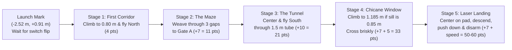
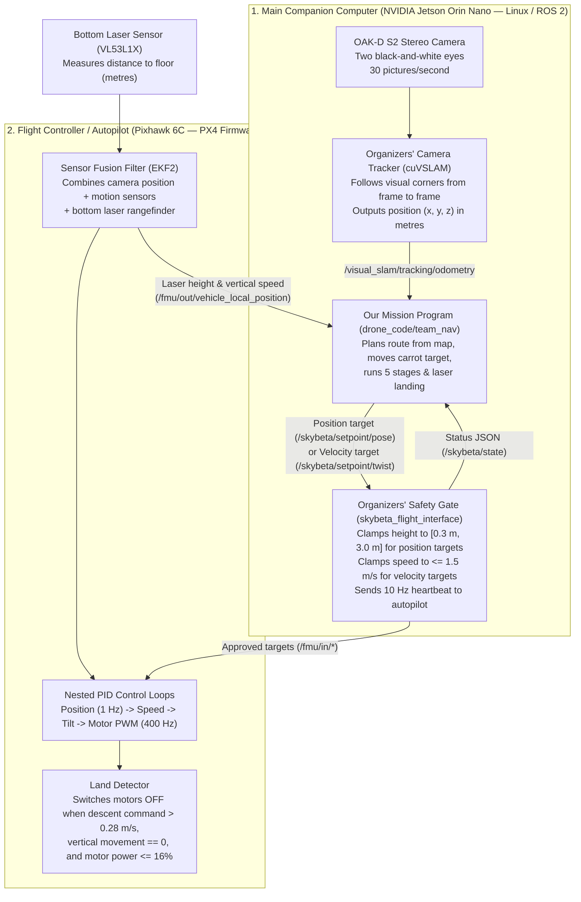

# DroneHacks 2026 — Phase 1 Implementation Specification (`drone_code/team_nav`)

**Author:** Principal Autonomous Flight Systems Architect (`skybeta-16`)  
**Target Aircraft:** Team Drone 16 (`skybeta-16` — NVIDIA Jetson Orin Nano, Holybro Pixhawk 6C running PX4 v1.16.2, Luxonis OAK-D S2 stereo camera, downward ST VL53L1X laser rangefinder)  
**Target Package:** [`drone_code/team_nav`](../drone_code/team_nav/README.md)  
**Coding Standard:** [`docs/READABLE_CODE.md`](READABLE_CODE.md)  
**Companion Architecture Documents:** [`docs/ARCHITECTURE.md`](ARCHITECTURE.md), [`docs/COURSE_MODEL_COMPARISON_AND_PLAN.md`](COURSE_MODEL_COMPARISON_AND_PLAN.md)  
**Date:** 2026-11-07  

---

## What This Document Does

This document is the complete engineering blueprint for **Phase 1** of our team's autonomous flight software in [`drone_code/team_nav`](../drone_code/team_nav/README.md):

1. **Section 1 (Very High Level)** is written for an electrical engineer who can read Python and has never worked with drones. It explains what the drone does, how the competition scoring shapes our design, why we split our software into three independent programs, how the organizers' safety wrapper and the autopilot fit together, how our "carrot-on-a-stick" speed control and 5 course stages work, why we adapt our flight height for the physical `0.85 m` window sill, and why our laser-gated landing cuts `4 seconds` off touchdown.
2. **Section 2 (Very Low Level — Deep Implementation Details for Phase 1)** provides the exact, copy-ready technical specifications, data structures, coordinate transformations, mathematical formulas, error-handling contracts, and complete Python / JSON / YAML / Launch / `pytest` blueprints for every Phase 1 module in `drone_code/team_nav`, followed by step-by-step commands to verify them in unit tests and in the local simulator.

Every constant in this document states its physical unit in full words (`_metres`, `_metres_per_second`, `_seconds`, `_degrees`, `_radians`) and carries one of the six required provenance labels from [`docs/READABLE_CODE.md`](READABLE_CODE.md): **measured**, **estimated**, **from PX4 source code**, **from the rulebook**, **from the organizers' code**, or **our own choice**. We have tested the landing logic and core stage transitions in the simulator; **we have not flown this Phase 1 package on the physical drone 16 yet**.

---

# SECTION 1: VERY HIGH LEVEL (For an Electrical Engineer New to Drones)

## 1.1 The Big Picture: What the Drone Has to Do

Imagine a four-motor flying robot (`50 cm` wide, weighing about `1.47 kg`) placed on a starting mark inside a `6.1 m × 6.1 m` netted room filled with walls, a narrow 3-turn maze, a fabric tunnel, a raised window cutout, and a circular landing pad on the floor.

Once a human teammate flips a single switch on a handheld radio controller at the referee's whistle, nobody touches the controls again. The drone must:
1. Lift off the floor to a safe indoor height (`0.80 m` above the floor).
2. Fly down the first corridor, weave through three `0.85 m` to `1.08 m` gaps in the maze, fly straight through the `1.50 m` long tunnel, pass through a rectangular window in the chicane wall, and stop over the landing pad.
3. Descend smoothly onto the pad, detect the exact moment its landing legs touch the floor, and convince its motor controller to switch the propellers completely off.

### How the Competition Scoring Shapes Every Engineering Decision

In the DroneHacks rulebook, a team's score (`100 points` total) is split into:
- **60 points** for the autonomous flight run,
- **25 points** for the technical presentation, and
- **15 points** for **generality** (proving our software computes its path from a map file rather than having coordinates typed directly into the Python code).

During the flight run:
- Reaching the landing area without landing is worth at most **28 points**.
- **Finishing the landing and switching the motors off** unlocks the **35-point completion base**, plus up to **20 speed points**, plus **5 bonus points** for flying through the window instead of taking the detour around Gate B.
- Touching a wall adds only a `5-second` time penalty, and you get multiple attempts during your time block, keeping your best score.

Therefore, our engineering priorities are strictly ordered:
1. **Priority 1 — Reliable Completion & Automatic Landing (+15 to +25 points):** Never get stuck hovering forever, and make sure the motors switch off cleanly on the pad.
2. **Priority 2 — Generality (+15 points):** Keep all wall coordinates in a JSON map file (`config/course_v3_and_scan_bounds.json`) and stage definitions in a YAML file (`config/competition_stages.yaml`) so no waypoint numbers are hard-coded inside Python logic.
3. **Priority 3 — The Window Bonus (+5 points):** Adapt automatically to the real window height so we earn the `+5` window bonus safely.
4. **Priority 4 — Speed (up to +20 points):** Save `4 seconds` on the landing using the bottom laser sensor before trying to fly dangerously fast near walls.

---

## 1.2 How the Hardware, Autopilot, and Flight Interface Fit Together

As an electrical engineer, it helps to think of the drone as **two separate computers** connected by a serial/Ethernet link, exactly like a high-level microprocessor talking to a dedicated motor-drive DSP:

### The Four Key Components Explained in Plain English

1. **The Autopilot (`PX4` running on the Pixhawk 6C):**
   - A quadcopter is inherently unstable; if you stop adjusting its four motors for half a second, it flips over. The Pixhawk 6C runs real-time firmware called **PX4** that adjusts motor power hundreds of times per second to keep the drone level.
   - Inside PX4 is a mathematical filter called **EKF2** (Extended Kalman Filter 2). It blends the high-speed accelerometers/gyroscopes, the downward laser sensor, and the camera position into one smooth estimate of where the drone is and how fast it is moving.
   - Our Python code **never** adjusts motor voltages or tilt angles directly. We simply tell PX4: *"Move toward this `(x, y, z)` point"* or *"Move downward at `0.35 m/s`."*

2. **The Camera Tracker (`cuVSLAM` running on the Jetson Orin Nano):**
   - Indoors, there is no GPS signal. Instead, the front stereo camera (`OAK-D S2`) takes `30` black-and-white stereo picture pairs per second.
   - An NVIDIA program called **`cuVSLAM`** tracks visual features across those pictures and outputs the drone's position `(x, y, z)` in metres relative to where the drone was powered on.

3. **The Organizers' Safety Gate (`skybeta_flight_interface`):**
   - To prevent student code from flying into the ceiling or shooting across the room at full throttle, the competition organizers run a protective program called **`skybeta_flight_interface`** between our code and PX4.
   - **Rule of the drone:** Our code is forbidden from sending commands directly to PX4 (`/fmu/in/*`). Instead, we send our requests to `skybeta_flight_interface` on two channels:
     - **Position targets (`/skybeta/setpoint/pose`):** *"Go to `(x, y, z)` metres and face angle `heading`."* Crucially, `skybeta_flight_interface` **refuses to let a position target go lower than `0.30 m` above the starting height** (`min_altitude_m = 0.30`).
     - **Velocity targets (`/skybeta/setpoint/twist`):** *"Move at `(vx, vy, vz)` metres per second."* Velocity targets are capped at `1.50 m/s`, expire after `1.0 second` if not refreshed, and **have no `0.30 m` minimum height floor**. That is why we use position targets to fly the course, and switch to velocity targets to land all the way to `0.00 m` on the floor.

4. **Why We Separate Our Software into Three Programs:**
   - Across the full project (Phases 1 and 2), we organize our companion software into three separate Linux processes:
     1. **The Mission Program (`mission_node.py` — built in Phase 1):** Plans the route from the map file, sequences the 5 stages, moves the carrot target, and executes the laser-gated landing.
     2. **The Stereo Distance Program (`depth_node.py` — added in Phase 2):** Computes 3D wall distances from the stereo camera pictures.
     3. **The Map Localizer Program (`map_localizer_node.py` — added in Phase 2):** Compares wall distances against the map to correct slow camera drift and measures exact gap edges.
   - **Why separate them?** In Linux, if an image-processing library crashes or lags on a bad camera frame, a separate process isolates that failure. Because `mission_node.py` runs in its own process with zero image-processing dependencies, it continues flying the drone safely at `20 Hz` and can land cleanly even if the vision helper programs stop.

---

## 1.3 The Four Core Engineering Ideas in Phase 1

### Idea 1: "Carrot-on-a-Stick" Speed Control ($v \approx 0.95 \times d_{\text{carrot}}$)

Why don't we just send the coordinate of the end of the corridor (`2 metres` away) to PX4's position controller?
- Because PX4's position controller acts like an outer proportional loop with a gain of **`0.95 per second`** (`MPC_XY_P = 0.95`) and a speed limit of **`12.0 m/s`**. If you send a target `2.0 m` away, PX4 immediately tries to accelerate toward `1.9 m/s` inside a narrow `1.0 m` corridor!
- Instead, we place our commanded position target—which we call the **carrot**—only a short distance $d_{\text{carrot}}$ ahead of the drone along the planned path, and slide it forward as the drone moves:
  $$\text{Speed (m/s)} \approx 0.95 \times \text{Carrot Distance (m)}$$
- If we keep the carrot **`0.50 m` ahead of the drone**, the drone flies smoothly at about **`0.48 m/s`**.
- Better still, when the map says the drone is passing through a narrow gap where the nearest wall is only `0.42 m` away, we shrink the carrot distance so the speed in `m/s` never exceeds the clearance in `metres`.

### Idea 2: The 5 Stages of the Course

Rather than writing one giant function, the flight is broken into five sequential stages loaded from `config/competition_stages.yaml`:
1. **Stage 1 (`first_corridor` — 4 pts):** Climb to `0.80 m` over the launch mark `(-2.515 m, +0.914 m)`, then follow the carrot straight North down the center of Corridor 1 to `y = +2.65 m`.
2. **Stage 2 (`maze_to_gate_a` — 7 pts):** Weave East through Gap 1 (`M1` north tip), South down Maze Lane 2, East through Gap 2 (`M2` south tip), North up Maze Lane 3, and East through Gate A (`M3` north tip).
3. **Stage 3 (`tunnel_transit` — 10 pts):** Line up North of the `1.45 m` wide tunnel entrance, point the nose straight South, and fly steadily through the `1.50 m` long tube at `0.80 m` height.
4. **Stage 4 (`chicane_window` — 7 pts + 5 window bonus pts):** Approach the window wall (`C2a`), adjust flight altitude to match the window's vertical center, and cross briskly (`>= 0.45 m/s`) into the landing zone.
5. **Stage 5 (`pad_approach_and_land` — 7 pts + up to 20 speed pts):** Center over the landing pad, verify the downward laser reading, and run the 4-step laser-gated landing until the motors switch off.

### Idea 3: Why We Adapt to the Physical `0.85 m` Window Sill

When we compared the organizers' preliminary 3D CAD file (`dronehacks-course-v3.obj`) against the real 3D LiDAR scan of the physical arena (`dronehacks-course-scan-2026-11-06.ply`), we discovered a critical `54.5 cm` discrepancy in the chicane window (`C2a`):

| Measurement | Preliminary CAD Model (`.obj`) | Physical Arena Scan (`.ply`) | Why It Matters |
| :--- | :--- | :--- | :--- |
| **Window Bottom Edge (Sill)** | `0.305 m` (`12 in`) | **`0.850 m` (`33.5 in`)** | Below `0.85 m` is a solid wall panel in the real arena! |
| **Window Top Edge (Lintel)** | `1.219 m` (`48 in`) | **`1.520 m` (`60 in`)** | Top edge is `30 cm` higher in the real arena. |
| **Safe Window Center Height** | **`0.762 m` (fly at `0.80 m`)** | **`1.185 m` (fly at `1.185 m`)** | Flying at `0.80 m` in the real arena hits the sill! |

Furthermore, our audit of PX4's height filter (`EKF2`) revealed a second hazard at the window sill:
- When the drone crosses the raised window sill, the downward laser beam suddenly hits the top of the sill instead of the floor (`30 cm` to `85 cm` jump).
- In PX4's source code, if the laser reading jumps while the drone is moving horizontally **slower than `0.32 m/s` for `2 seconds`**, PX4 assumes the laser is broken and stops trusting it!
- Therefore, our Phase 1 planner computes the window crossing height directly from the active map profile (`0.80 m` for the CAD simulator map, `1.185 m` for the physical scan map) and crosses the window sill **briskly at `0.50 m/s` without pausing over the edge**.

### Idea 4: Why the Bottom Laser Cuts Landing Time by 4 Seconds

Remember that our code is not allowed to switch the motors off directly—only PX4's internal **land detector** can disarm the motors. Reading PX4's C++ source code (`MulticopterLandDetector.cpp`) shows that PX4 only declares the drone landed when:
1. We are commanding a downward speed faster than **`0.275 m/s`** (`1.1 × LNDMC_Z_VEL_MAX`),
2. The drone has stopped moving vertically, and
3. **Motor thrust has fallen below `~15.8%`** (`MPC_THR_MIN + 0.1 × (MPC_THR_HOVER - MPC_THR_MIN)`).

When the drone touches the floor during a gentle `0.35 m/s` descent, its propellers are still spinning near `50%` hover power. Because `0.35 m/s` is a small error, PX4's integral controller ramps the motor power down very slowly—taking **`5.0 seconds`** just to reach `15.8%` thrust, plus `4.6 seconds` of timer checks (`9.6 seconds` total sitting on the floor with spinning blades!).

**Our solution:**
1. While sitting on the launch mark before takeoff, we record what the downward laser reads on the floor (`~0.10 m`, because PX4 clamps readings below `10 cm` via `EKF2_MIN_RNG = 0.1`).
2. Over the landing pad, we descend at **`0.50 m/s`** down to `0.30 m` above the floor, then slow to a gentle **`0.35 m/s`** below `0.30 m`. Below **`0.20 m`**, we set sideways speed corrections to **`0.0 m/s`** so a sideways push on contact can never tip the drone over.
3. The instant the downward laser stays within **`3 cm` (`0.03 m`)** of the launch-mark floor reference **and** vertical speed stays below **`0.05 m/s`** for **`0.30 seconds`**, we know for certain the landing legs are resting on the floor.
4. We immediately latch into **`PUSH_DOWN`** and command **`1.00 m/s` straight down**. The drone cannot move because the floor is solid, so PX4's controller dumps motor power below `15.8%` in **`1.0 second`** instead of `5.0 seconds`—**cutting `4.0 seconds` off every landing!**

---

## 1.4 Why Phase 1 Focuses on Core Navigation Before Live Depth

In hardware engineering, you never debug a power supply, a microcontroller clock, and an RF transceiver simultaneously—you bring up and qualify the deterministic backbone first.

Phase 1 builds and verifies the complete autonomous flight loop (`readable_constants.py`, `course_map_and_route_planner.py`, `landing_controller.py`, `mission_stages.py`, and `mission_node.py`) using camera odometry and the downward laser rangefinder:
1. **It satisfies the Generality Rule (Rule 9.5) from Day 1:** The route and obstacle clearances are computed from `config/course_v3_and_scan_bounds.json` and `config/competition_stages.yaml` at startup.
2. **It runs identically in our fast local simulator (`course_simulator`) and on `skybeta-16`:** Our local Docker simulator does not render synthetic stereo camera images, so decoupling Phase 1 from live stereo depth lets us test every stage transition, timeout, fault latch, and the 4-second laser landing speedup end-to-end against real PX4 SITL firmware.
3. **It provides the rock-solid fallback for Phase 2:** When Phase 2 adds live stereo depth (`depth_node.py` and `map_localizer_node.py`), any missing or textureless depth frame automatically falls back to the Phase 1 map-planned route rather than leaving the drone stranded mid-air.

---
