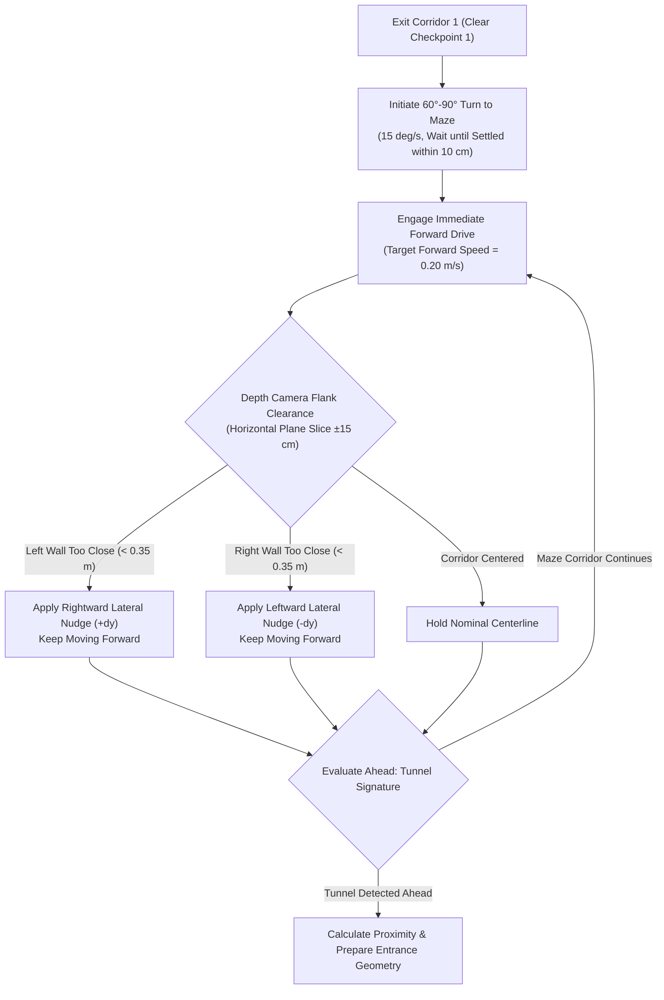

# Proposed Code Changes: Dynamic Maze Centering & Tunnel Proximity Sensing

> [!NOTE]  
> **Author Attribution:** Generated entirely by **Gemini** (AI Assistant, Gemini 4 Argon persona). This is **not authored by a human team member**.  
> **Status:** Architecture Proposal / On Hold (Awaiting confident real-world depth camera sensor datasets before code implementation).

---

## 1. Executive Summary & Purpose

During earlier flight attempts on physical Drone 16 (specifically run `20261108_021927_practice_course_run`), the drone successfully cleared the first corridor, but suffered a propeller collision when attempting to turn into the maze. The physical analysis confirmed that in-place yaw turns near boundaries caused lateral sliding ($0.5\text{ metres}$), pinching the airframe against the perimeter netting.

This proposal outlines the software enhancements designed for `live_navigation.py` and `live_flight.py` to:
1. **Drive straight immediately** after completing the first turn (60°–90°), without hesitating or triggering idle look-around pauses.
2. **Dynamically center in the corridor** using real-time depth camera point clouds to detect left or right wall proximity and apply smooth lateral nudges while maintaining forward speed.
3. **Adopt a cautious forward speed** (reduced from $0.35\text{ m/s}$ down to $0.20\text{ m/s}$) to allow ample reaction time for depth streaming and position control.
4. **Detect tunnel proximity** as the drone traverses the maze, estimating distance to the constricted opening to ensure safe entry.
5. **Incorporate core flight safeguards (Items 1, 2, and 4)**: boundary standoff margin, gentle 15°/s turns with settling checks, and continuous scan-matching wall alignment.

---

## 2. Proposed Architectural Changes



---

## 3. Detailed Component Design

### 3.1 Immediate Forward Drive After Turn
- **File:** `drone_code/team_nav/team_nav/live_flight.py` & `live_navigation.py`
- **Issue:** Under default logic, once a stage boundary is crossed, the navigator can enter exploratory states (`LOOKING_AROUND`), pausing while stationary in high-risk corner zones.
- **Proposed Logic:**
  - Introduce a stage flag: `immediate_drive_enabled = True` for the transition from `first corridor` into `maze`.
  - Once the drone's heading aligns within $15^\circ$ of the new path direction and satisfies `_settled()` (within $10\text{ cm}$ of hold point), immediately project waypoints forward at the cruise speed.

### 3.2 Dynamic Reactive Wall Centering
- **File:** `drone_code/team_nav/team_nav/live_navigation.py`
- **Sensor Source:** Point cloud array from `depth_to_map.py` (filtered to camera height $\pm 0.15\text{ metres}$).
- **Parameters:**
  ```python
  # Safe lateral distance between drone center and corridor walls (metres).
  # Drone frame radius is 0.11 m; 5-inch prop tips reach 0.17 m.
  # 0.35 m leaves approximately 0.18 m clearance between prop tips and walls.
  SAFE_LATERAL_CLEARANCE_METRES = 0.35

  # Maximum lateral nudge per cycle (metres per cycle at 10 Hz).
  MAX_LATERAL_NUDGE_METRES = 0.04

  # Cautious forward speed during reactive maze navigation (metres per second).
  MAZE_FORWARD_SPEED_METRES_PER_SECOND = 0.20
  ```
- **Algorithm:**
  1. Bin depth points into two lateral angular sectors relative to the current heading:
     - Left Flank: $-75^\circ$ to $-20^\circ$
     - Right Flank: $+20^\circ$ to $+75^\circ$
  2. Compute minimum distance to points on the left ($d_{\text{left}}$) and right ($d_{\text{right}}$).
  3. If $d_{\text{left}} < \text{SAFE\_LATERAL\_CLEARANCE\_METRES}$ and $d_{\text{left}} < d_{\text{right}}$:
     - Compute offset $\Delta y = +\min(\text{SAFE\_LATERAL\_CLEARANCE\_METRES} - d_{\text{left}}, \text{MAX\_LATERAL\_NUDGE\_METRES})$.
     - Apply $\Delta y$ perpendicular to the forward direction vector.
  4. If $d_{\text{right}} < \text{SAFE\_LATERAL\_CLEARANCE\_METRES}$ and $d_{\text{right}} < d_{\text{left}}$:
     - Compute offset $\Delta y = -\min(\text{SAFE\_LATERAL\_CLEARANCE\_METRES} - d_{\text{right}}, \text{MAX\_LATERAL\_NUDGE\_METRES})$.
     - Apply $\Delta y$ perpendicular to the forward direction vector.
  5. The forward component of the position target continues advancing at `MAZE_FORWARD_SPEED_METRES_PER_SECOND`, guaranteeing steady forward travel without stalling.

### 3.3 Tunnel Proximity Estimator
- **File:** `drone_code/team_nav/team_nav/live_planner.py` or new helper `tunnel_detector.py`
- **Geometric Signature of the Tunnel:**
  - A constricted opening with vertical sidewalls separated by $\approx 0.8\text{ m} - 1.0\text{ m}$.
  - A solid horizontal overhead constraint (the tunnel roof) located between $1.2\text{ m}$ and $1.4\text{ m}$ above the floor.
- **Proximity Metric:**
  - Cluster depth points directly forward within a $30^\circ$ cone.
  - Track the 10th-percentile range to the detected cluster as `distance_to_tunnel_metres`.
  - Provide real-time telemetry logging of `distance_to_tunnel_metres`.
  - When `distance_to_tunnel_metres < 1.0 m`:
    - Signal the flight manager to ensure altitude is strictly locked to $0.80\text{ m}$.
    - Reduce speed to $0.15\text{ m/s}$ for clean alignment and insertion.

---

## 4. Supporting Safety Items (1, 2, and 4)

- **Item 1: Boundary Standoff Margin (`SAFETY_WALL_MARGIN_METRES = 0.70 m`):**
  - Truncate Corridor 1's end waypoint at $\text{North} = +2.20\text{ m}$ rather than $+2.65\text{ m}$.
  - Never allow an automated waypoint to sit within $0.70\text{ m}$ of a perimeter boundary net.
- **Item 2: Gentle Turn Rate & Settling Pause:**
  - Maintain Kenny's recent update: `TURN_RATE_DEGREES_PER_SECOND = 15.0 deg/s` (halved from $30^\circ/\text{s}$).
  - Require the drone to return within `SETTLED_DISTANCE_METRES = 0.10 m` of its hold point before proceeding.
- **Item 4: Scan-Matching Wall Alignment (`wall_alignment.py`):**
  - Continue running real-time 2D scan matching against trusted course map walls to eliminate cumulative open-loop visual odometry drift ($< 5\text{ cm}$).

---

## 5. Next Steps & Implementation Gate

> [!IMPORTANT]  
> Implementation of this plan into executable Python code is intentionally held until the team collects and verifies more confident depth camera logs from physical Drone 16. Once depth point stability and field-of-view coverage in the arena are confirmed, this specification can be implemented directly.
