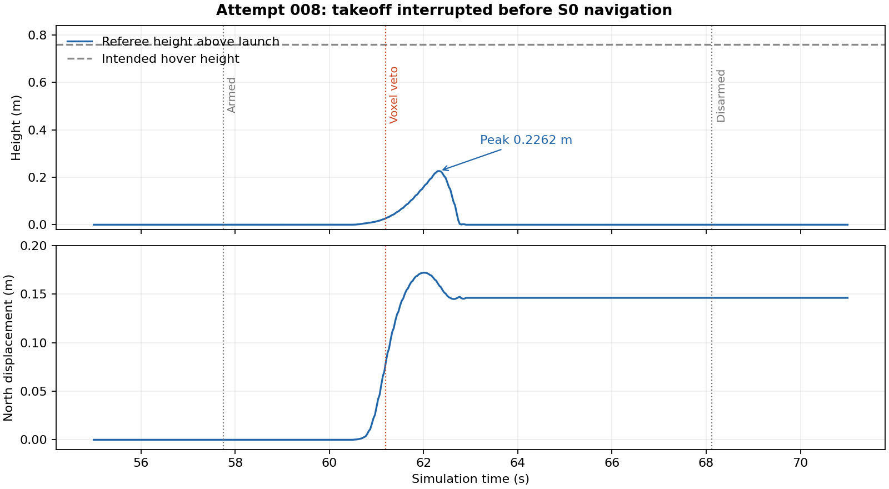

# S0 full-course experiment 009 — incomplete

The requested end-to-end S0 course flight **did not complete**. Qualification and calibration prerequisites were removed for this isolated Gazebo experiment; obstacle avoidance remained active. Attempt 008 lifted off, reached 0.2262 m above its starting height, then withdrew on a live occupied-voxel veto during climb. It completed zero checkpoints and never reached S0 route navigation.

## What actually flew

Runtime `02949ac21d333db1e754c35c23fb5edf72dccfee`, archived SHA256 `b0a5a23e10082110cc442cce215eeab95150db752482ac5935c074c43e49bda6`, ran in a network-isolated container using image `sha256:32650af6bc9424e7aa9a1977fe4f386ec201f23bef0c6cea587ba70e2c8ad5d1`. OGRE confirmed the NVIDIA GeForce RTX 5070 Laptop GPU renderer.

Native Offboard and ARM commands occurred at 57.740 s. The aircraft armed at 57.752 s, left the ground at 59.612 s, and the owner withdrew around 61.2 s. The referee observed peak launch-relative height 0.2262 m at 62.336 s and about 0.1721 m northward displacement. Native estimated speed peaked at 0.855546 m/s after withdrawal. The referee counted zero obstacle touches and zero checkpoints.

The native mode changed to code 2 at 62.192 s, the landed flag returned at 66.108 s, and disarm occurred at 68.120 s. **No LAND command was recorded.** Final landed/disarmed state is not a commanded-LAND qualification result. The recording covers 106.572 s and passed integrity verification. See `artifacts/s0_course_experiment_009/attempt-008/independent-review.md` and its JSON for exact evidence and raw-bag identity.

The configured composition uses G0 reasoning, D5 candidates and D0 prediction with 23 participant-map goals. The actual run stopped during the existing owner's takeoff phase, before those route-navigation decisions were exercised. It is not evidence that a full S0 policy navigated the course, nor a comparison result against Classic.

## Integration fixes established

- Derived the native-to-visual origin from synchronized stationary observations instead of assuming zero translation through EKF startup. Source timestamps and measured covariance were retained.
- Added bounded native callback synchronization and a separately serviced ROS clock. Valid previous depth can remain usable while its replacement waits for pose alignment, without extending its expiry.
- Removed duplicate experimental depth work and processed the newest frame with a matching pose on the serialized owner executor.
- Corrected depth delivery: a read-only 12 s A/B test received 120 reliable images with 100 ms maximum gaps versus 97 best-effort images with 300 ms gaps. Reliable KEEP_LAST 1 is enabled only for the experimental depth image. Attempt 006 subsequently received 42 frames in 4.2 s and processed 41 maps.
- Accepted legitimate ordered PX4 status transitions sharing one simulation timestamp. Backward time and sampled-state conflicts still reject.
- Removed redundant experimental limits stricter than the underlying policy: grounded pose/depth comparison now uses the existing 250 ms map window; final state age uses the existing 100 ms state window. The 50 ms publication wall budget and ordinary policy checks remain.

The final full regression run passed 850 tests, including the diagnostics-only follow-up. Transport, status and publication changes also passed focused suites and independent reviews. Classic's follower was not substituted; ordinary owner defaults remain in place. These are integration results, not measured braking qualification or hardware-flight authorization.

## Attempt history

| Attempt | Runtime | Result |
| --- | --- | --- |
| 001 | ba23fbe | Refused before arming: zero origin translation placed estimated center below the floor. |
| 002 | 8c595c8 | Profile construction rejected a 4 ms source/callback clock skew; no owner started. |
| 003 | c7c1b14 | Interrupted pre-arm setpoints; readiness repeatedly restarted priming. Canceled while disarmed. |
| 004 | 0476ac7 | Readiness dropped and callback-clock wait expired before arming. |
| 005 | bd52655 | Depth delivery remained intermittent; final state-age check refused before arming. |
| 006 | cc36582 | Armed on the ground; wrapper incorrectly rejected an ordered same-tick status transition. No physical movement. |
| 007 | 9e85de3 | Refused before arming on redundant 50 ms final state-age check. |
| 008 | 02949ac | Actual short liftoff; occupied-voxel veto during climb. No route navigation. |

The disarmed QoS comparison was a separate read-only measurement, not a flight attempt. Every failed attempt is retained separately.

## Remaining obstacle-policy issue

Offline reconstruction reproduces the climb veto from floor-return support expanded into neighboring occupied cells. The reproduced nearest occupied-cell boxes intersect the inflated body sweep even though the reconstructed raw floor endpoints lie farther away. The replay passed the last issued point and reproduced refusal near the subsequent native state. It cannot prove the exact callback-selected frame used by the live owner, so this is a strongly supported explanation rather than an exact live-cell attribution.

Repeating the reconstruction at 0.10 m and 0.05 m voxel resolution still refused. Generic voxel-size reduction or a wider floor exemption is therefore not an established fix. The existing occupied-voxel veto remains enabled.

The next implementation needs source-provenanced refinement of a coarse-cell hit: retain the contributing rays and their pixel/depth/pose uncertainty, distinguish floor support from obstacle support, and retain the veto when evidence is missing or ambiguous. A diagnostics-only follow-up now records up to four actual colliding cells, their source stamps and the checked path. It changes no obstacle decisions and has not been flown. See [voxel replay and refinement plan](S0_ATTEMPT_008_VOXEL_REPLAY.md). No new moving trial has been run with such a refinement.

Compact evidence is under `artifacts/s0_course_experiment_009`. Full raw bags remain in the sibling `taskforce-s0-experiment-009/attempt-NNN/observations` directories; manifests record their absolute paths and SHA256 values. The experiment's simulator and owner were stopped. Physical hardware was not used.
