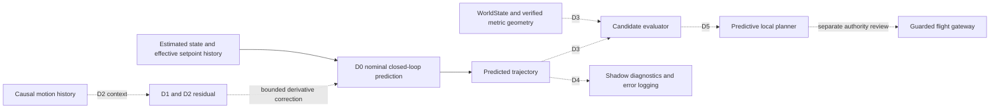

# Adaptive dynamics roadmap

D0 is the implemented position-setpoint baseline. D1–D5 describe future work.
The progression adds learned correction, adaptation, environment evaluation,
observational integration, and then planning in separate stages.

## D1 residual model

Use the D0 `DroneState`, `PositionSetpoint`, and `dt` as the input contract.
Construct features from current NED velocity, yaw and yaw rate, position and
wrapped heading error, nominal tracking references, and the effective interval.
Train a small 64×64 or 128×128 MLP to estimate a correction to translational
and angular acceleration. Bound the correction and integrate through the same
physical state update. Represent residuals in SI units in the prediction frame.
Keep training and deployed inference separate and retain D0 as the baseline.

Generate causal state/action pairs from randomized tracking gains, time
constants, acceleration availability, disturbances and command delays. The
synthetic one-step and open-loop metrics in D0 are evaluation starting points.
Split by entire trajectories and dynamics settings, with held-out parameter
combinations. Measure one-step and horizon-dependent errors, stability, model
size, and host and target inference latency. Improvement on held-out rollouts
and useful target-device cost are gates for increasing model complexity.

## D2 adaptive context

Add an explicit bounded history of aligned estimated states, effective
setpoints, measured transitions and optional prediction residuals. End the
window at the current capture time, clear it on reference resets, and represent
missing or stale samples. A history MLP or 32/64-unit GRU can map it to an 8–16
dimensional context. Keep inference weights fixed while updating the context
from observations. Compare with D1 and a simple online parameter estimator.
Measure the time to recover after a dynamics change, latent stability, held-out
generalization, rollout error and incremental cost. Physical interpretation of
latent coordinates requires independent identification evidence.

## D3 predictive evaluation against the world

Pass predicted trajectories, a compact read-only semantic context, verified
local metric geometry, and an explicit objective to a separate evaluator. Map
the trajectory and vehicle swept envelope into the geometry frame using a
validated transform with compatible capture time and reference epoch. Treat
unknown and stale geometry conservatively. An opening candidate and sampled
rays provide evidence for further observation. A complete occupied/free/unknown
volume, clearance margin and validated full vehicle dimensions are prerequisites
for geometric feasibility. Output diagnostic scores, reasons and rankings.

The existing WorldState and reasoning interfaces provide semantic data and
non-executable goals. A common `frame_id` string does not establish a transform
between the local NED trajectory and an ENU or arbitrary-heading odometry map.
The evaluator needs calibrated frame alignment and explicit clock binding.
[WorldState PR](https://github.com/jacobdannieam-byte/DroneHacks-Dannie-/pull/1) ·
[Reasoning PR](https://github.com/jacobdannieam-byte/DroneHacks-Dannie-/pull/2)

## D4 ROS 2 shadow adapter

Start from ROS bag replay. Select authoritative estimated pose and velocity
using PX4 local position or odometry and validated estimator health. Use NED
velocity directly when the source declares it. For ROS odometry, rotate
child-frame twist into the world frame and explicitly transform ENU into NED.
Reuse the repo's frame utilities and validated heading alignment. Derive yaw
from the appropriate attitude or heading estimate. Derive yaw rate from a
validated synchronized heading derivative or attitude kinematics. A body FRD
angular velocity component alone is insufficient away from level attitude.

For each sample, preserve state capture time, receive time, source clock, and
reference epoch. Pair it with the setpoint that was effective over the interval,
using ordered command history, transport timestamps and measured response delay.
The current flight node stamps PX4-bound messages with system time, even under
ROS simulation time. The existing PX4-to-ROS odometry bridge stamps at receipt.
An adapter needs explicit clock mapping and latency characterization before
using these sources for training labels. Guard against estimator resets,
backwards clock jumps, stale samples, dropped messages and queue backpressure.

Shadow output consists of diagnostic trajectories, error records and timing.
The existing mission owns the PX4 flight command path. Qualify shadow operation
alongside VIO, depth, semantic mapping and normal ROS workloads before collecting
target-device performance evidence.

## D5 local predictive planning

Generate bounded candidate setpoint sequences, predict their physical responses,
and reject infeasible trajectories against verified metric geometry and the
uncertainty-inflated vehicle envelope. Rank feasible trajectories by goal
progress, clearance, uncertainty and effort. A rejected or unknown corridor
requires information gathering or another feasible candidate. Test offline and
in simulation before considering flight integration. A separate review must
cover estimator and sensor health, actual tracking margins, command authority,
failsafe behavior, emergency takeover, deadline tails and team approval.

## Embedded budgets to verify

The provisional 20 Hz design allocates up to 2 ms each for preprocessing and one
prediction, 10 ms each for candidate rollout and geometry evaluation, and 25 ms
for total local planning. Measure median, p95, worst observed, missed deadlines,
input age, scheduling jitter, memory, and CPU/GPU usage on the Orin Nano with
co-running workloads. Compare CPU inference with GPU/TensorRT for small models
and include transfer, conversion and scheduling costs. D0's Windows timings
measure an offline workload. [D0 implementation and evidence](adaptive_dynamics_d0.md)
