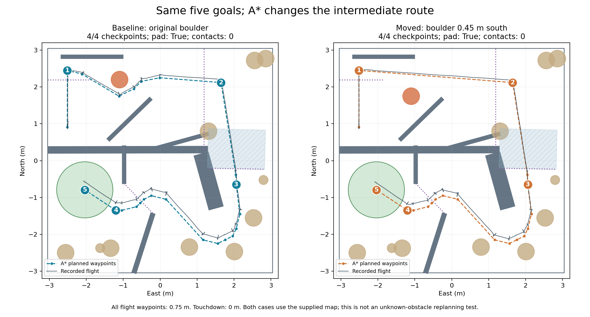

# Five goals with A* intermediate waypoints

The `hardcoded` branch starts from `codex/attemptone-five-waypoints` at
`296209d5bfe29489255db9d06635c3a27172b03c`. The five main goals remain fixed;
A* generates the connecting points from the supplied participant map before flight.
Read the [flight guide](../../drone_code/team_nav/team_nav/practice_flights/README.md)
for implementation details and run commands.



## Targets and heights

Coordinates are east and north in the course frame. Height is above the launch floor.
Every intermediate flight point also targets 0.75 m. The controller descends to the
floor only after reaching the landing pad.

| Main goal | East (m) | North (m) | Height (m) |
|---|---:|---:|---:|
| First corridor | -2.5146 | 2.4510 | 0.75 |
| Maze exit | 1.6500 | 2.1200 | 0.75 |
| Tunnel exit | 2.0600 | -0.6500 | 0.75 |
| Chicane exit | -1.2000 | -1.3500 | 0.75 |
| Landing pad | -2.0422 | -0.7925 | 0.75, then 0 |

The complete numbered coordinate-and-height lists are
[baseline waypoints](baseline_waypoints_with_heights.csv) and
[moved-obstacle waypoints](moved_waypoints_with_heights.csv).
There are 23 and 18 flight points respectively, excluding the initial climb and
the additional touchdown row. Extra points accommodate obstacle clearance and turns.

The first stop is about 5 cm earlier than the parent's 2.50 m north target, while
still clearing the checkpoint with the full airframe. The aircraft stops, turns
in place, and departs forward; no reverse segment is generated. Arrival means
measured horizontal error below 2.5 cm and height error below 8 cm for one second.
Departure also requires heading alignment within 5 degrees. These are controller
tolerances, not a promise of mathematically exact position or ground-truth accuracy.

## What the obstacle experiment shows

Only the north-west boulder changes: its centre moves from (-1.10, 2.20) m to
(-1.10, 1.75) m, 45 cm south. Both the participant map and Gazebo world receive
that change. The baseline route passes south of the original boulder; the new
route passes north of the shifted boulder, with fewer intermediate stops.

This proves map-based route adaptation. It does not demonstrate discovery and
online replanning around an unreported obstacle. Live stereo depth still pauses
travel when the next step is obstructed, but does not update the planning map.
The simulated tracking source is also not a qualification of hardware visual odometry.

## Validation on 2026-11-08

Both runs used the same flight source, five goals, PX4 settings, and controller.
The [source manifest](source_hashes.json) records the tested flight files.
Neither checkpoint definitions nor height/contact checks were weakened.

| Independent Gazebo referee | Original map | Moved boulder |
|---|---:|---:|
| Run folder | `20261108_122402` | `20261108_123324` |
| Checkpoints | 4 / 4 | 4 / 4 |
| Landed on pad | Yes | Yes |
| Contacts | 0 | 0 |
| Above walls / left course | No / No | No / No |
| Maximum PX4 height-estimate error | 0.073 m | 0.082 m |
| Motors off after takeoff | 416.73 s | 359.83 s |
| Program exit code | 0 | 0 |

Full referee results: [baseline](baseline_referee.json), [moved](moved_referee.json).
The plot overlays recorded simulator positions on each planned route. The visible
tracking offset, especially near the chicane, remains a limitation; the planner
checks the parent's declared 25 cm north / 3 cm east-west error cases there.

The six relevant test files passed **69 tests in 114.12 seconds**:

```bash
python3 -m pytest test/test_astar_waypoints.py test/test_five_waypoints.py \
  test/test_full_course.py test/test_first_maze_leg.py \
  test/test_flight_steps.py test/test_live_navigation.py -q
```

Tests run from `drone_code/team_nav` in the Gazebo Docker image with ROS Humble and
the PX4 messages sourced. They cover collision-free turns and segments, full-body
checkpoint clearance, no reverse departure, changed routes, and refusal of an
unreachable map, alongside the existing controller regressions.

Flights ran in WSL Ubuntu using `drone-simulator-gazebo-full`. The temporary runtime
used an internal Docker network and a Fast DDS UDP profile to work around WSL
transport issues; the repository's launcher was not changed. The WSL competing
time service had already been stopped as described in the simulator README.
No PX4 parameters or estimator checks were changed. Raw logs, camera frames and
trajectories are retained locally under `physical-gazebo-evidence/astar-hardcoded/`;
this folder commits the compact plans, height tables, results and comparison.

To regenerate the comparison from the retained full run folders:

```bash
python simulator/gazebo_full/compare_astar_runs.py BASELINE_RUN MOVED_RUN docs/astar_comparison
```
