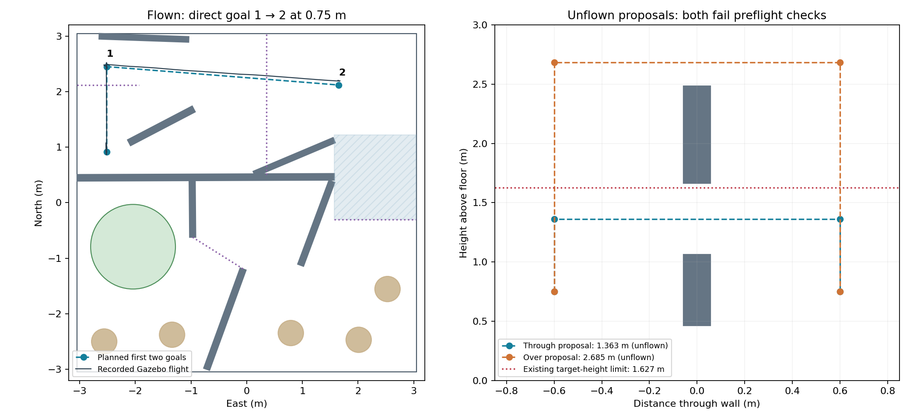

# Earlier corrected-course verification (commit 54c15b6)

This records the earlier bounded test. For the current sensor-alignment implementation
and its full-course validation status, see [window alignment](../window_alignment/README.md).

Status on 2026-11-08: **the first two goals passed a bounded Gazebo flight. Neither
window alternative is flight-qualified, and no corrected full-course pass is claimed.**



## Inputs and geometry

Dannie pushed `corrected_dronehacks.obj` to `hardcoded` in commit `2b56750`.
Soham's commit `36561d1` supplies `make_map_from_corrected_model.py` and
`real_course_2026-11-08.json`; these were imported without merging his controller.
The generator's input path is adjusted to Dannie's existing root-level OBJ.

Gazebo builds its collision world from the derived map, not directly from the raw OBJ.
The teammate's map deliberately shortens the start diagonal wall by 0.30 m and omits
the tunnel cradles; those choices are described in its source fields and generator.
They remain approximations to confirm against the physical course. No new geometry
was removed or resized to make this test pass.

The old north-west boulder is absent. The direct goal 1 → 2 segment from
(-2.5146, 2.4510) to (1.6500, 2.1200) m has a sampled minimum airframe clearance of
0.245 m in the map. Both targets remain 0.75 m above launch.

The window in the C2a wall lies between goals 3 and 4. The map gives a width of
0.580 m, lower edge 1.0626 m, upper edge 1.6626 m, and wall top 2.4848 m.
Independent intersections of the actual mesh triangles at heights 1.16–1.56 m
give a width of **0.603936 m**. See [mesh samples](window_mesh_measurements.json).
The map's 2 cm discretization is conservative; this check does not silently widen it.

## Two requested alternatives

These files specify the local window maneuver, not complete executable paths from
goal 3 to goal 4. The five main goals are not replaced by the four local points.
Connecting and qualifying the whole route remains unfinished.

| Proposal | Approach | Crossing | Exit/descent | Why it is not flown |
|---|---:|---:|---:|---|
| Through opening | 0.750 m | 1.3626 m | 0.750 m | Insufficient allowance for current position uncertainty |
| Over window wall | 0.750 m | 2.6848 m | 0.750 m | Above the existing 1.627 m centre-height limit |

Full coordinates: [through proposal](through_window_proposal.json),
[over proposal](over_window_proposal.json), [all local point heights](proposal_waypoints.csv).
Both climb or descend while stopped 0.60 m from the wall.

The airframe's crosswise propeller span is 0.4978 m. A perfectly centred, perpendicular
crossing therefore leaves 4.11 cm per side in the map, or 5.31 cm using the measured
mesh width. The existing body margin alone is 5 cm. The previous route also checked
a declared 25 cm northward tracking offset; projected along this opening, that is
another 23.49 cm. The earlier full-course flight plots visibly showed tracking drift.
The through proposal therefore needs measured window alignment and a validated bound
on residual position/heading error; a nominal geometric fit is not sufficient evidence.

The over proposal uses wall top plus the existing 0.20 m vertical envelope. The
course boundary is 1.727 m high and the target check reserves 0.10 m for the body,
leaving 1.627 m. Flying just above the opening would hit the solid header. This version
does not change that boundary, disable the check, or claim an over-wall course pass.

## Actual Gazebo result

Run `20261108_142709`, with `corrected_course --route verify-first-two`:

- First corridor cleared at 19.13 s; Maze cleared at 76.30 s.
- Straight goal 1 → 2, no initial reverse; planned height 0.75 m.
- Landed at goal 2 as requested by this bounded test; motors off at 113.77 s.
- Zero contacts, zero penalties, no course-boundary or wall-height violations.
- Maximum PX4 height-estimate error 0.030 m (takeoff evaluated separately: 0.031 m).
- Exit code 0. **Not a pad landing or a full-course completion.**

See [independent referee](referee_summary.json) and [actual plan](first_two_plan.json).
Raw records are retained locally under
`physical-gazebo-evidence/hardcoded-corrected/20261108_142709/`.
The parent controller printed its old `FIVE WAYPOINTS FINISHED` label even for this
two-goal test; the immediately following scope message and referee identify the true
result. The final branch changes that cosmetic label to `PLANNED ROUTE FINISHED`.
The [tested source hashes](tested_source_hashes.json) preserve the exact flight snapshot;
that result-label edit is the only post-flight controller change.

The run used WSL Ubuntu and the existing Gazebo Docker image, with the same temporary
internal-network/UDP transport workaround as the earlier experiments. No PX4 parameters,
sensor models, contact/height checks, tracking drift, or referee rules were changed.

## Reproduce

From the repository root in the supported Linux/Docker simulator environment:

```bash
bash simulator/gazebo_full/fly_course_in_gazebo.sh \
  --world drone_code/team_nav/course_maps/real_course_2026-11-08.json \
  --run-mode practice --longest-run-seconds 450 -- practice_flight corrected_course \
  --route verify-first-two
```

With the ROS workspace sourced, the following save proposals and refuse before starting
ROS control, so they cannot arm or publish flight targets:

```bash
TEAM_NAV_RUN_MODE=practice ros2 run team_nav practice_flight corrected_course --route through
TEAM_NAV_RUN_MODE=practice ros2 run team_nav practice_flight corrected_course --route over
```

Final regression checks: **70 passed in 7.27 s**, covering `test_corrected_course.py`,
`test_five_waypoints.py`, `test_full_course.py`, `test_first_maze_leg.py`,
`test_flight_steps.py`, and `test_live_navigation.py`. The new tests verify the direct
leg, both refusals, a missing window, and that refused proposals never start ROS flight
control. An initial missing-window test incorrectly assumed the old sketch had none;
the fixture was corrected to remove openings explicitly. Production checks were unchanged.

Remaining work: reconcile the window aperture with the map, implement and measure sensor-based
window alignment, then validate a complete through-window flight. The over-wall alternative
is incompatible with the current course height limit.
