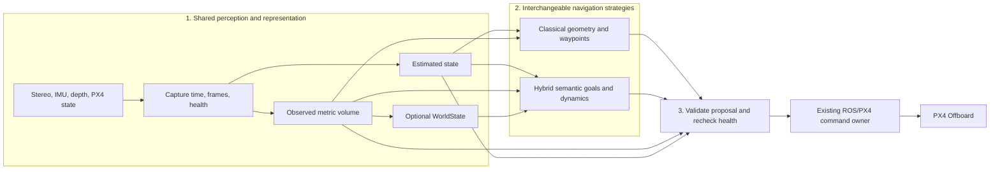

# Target architecture

**Proposed decision.** Keep the managed Jazzy companion and its established
paths as the shared codebase. Use configuration to select strategies once
each can pass the same observation, proposal and execution contracts. Keep
the existing Humble/SIH emulator as a separate reproducible runtime lane
while its dependencies and organizer interface differ. Review owners are
the project maintainers and the owners of the flight, perception and
simulator code.

This is the proposed managed target. Today's baseline reaches the existing
owner through `refnav.core.Mission`. Phase 4/6 produce diagnostics and Phase 7
reviews a receipt offline. Connecting those diagnostics to flight decisions
requires the native review and staged tests in the migration plan. For the
emulator, the organizer interface remains the sole owner in its own ROS
graph. The harness supplies simulated observations and uses simulator truth
for emulation and grading.

## Stable module boundaries

| Stage | Initial module home | Boundary |
| --- | --- | --- |
| 1 | `onboard/slam`, `onboard/vio`, `onboard/adapters`, `onboard/config` | Native ROS inputs, calibrated transforms, estimation and health. The native EV bridge publishes estimator inputs. |
| 1 | `refnav/depth.py`, `refnav/world_model/` | Legacy classical clearance plus capture-time mapping. Consolidate common decoding only after parity review. Keep independent metric and semantic evidence. |
| 2 | `refnav/core.py`, reviewed `refnav/stages.py` candidate | Preserve the baseline policy. Extract or adapt course-specific policy only after missing native detector inputs are measured. |
| 2 | `refnav/reasoning/`, `refnav/dynamics/`, `refnav/predictive_planner.py` | Optional semantic goal, frozen predictor selection and bounded candidate generator. D0 is default. |
| 3 | `refnav/trajectory_evaluation.py`, `refnav/node.py`, `refnav/core.py` | Validated geometry and provenance, existing mission supervision and one PX4 publisher path. Native command changes need a separate review. |
| Evidence | `onboard/diagnostics/`, `examples/`, `tests/`, `artifacts/` | Offline, shadow, replay, native diagnostics and qualification. Runtime evidence records the exact build and environment. |

Leave imports, launch files and deployment paths in place. A later package
move needs a compatibility map, import and entrypoint tests, plus companion
and emulator smoke tests. Add packages when an accepted capability needs
them. Standalone neural and RL strategies are deferred.

## Common strategy interfaces

| Boundary | Existing building blocks | Proposed shared contract |
| --- | --- | --- |
| Observation and estimated state | `DepthCapture`, `PoseSample`, `DepthCalibration`, `DroneState`, `LocalNED` | SI values, source, capture and receipt times, named clock and reference epoch, calibration and validity. Carry uncertainty and estimator health. Do not compare PX4 boot stamps with ROS timestamps without a reviewed mapping. |
| Belief | `SpatialSnapshot`, `MetricSnapshot`, optional `WorldState` | Fresh observed-free, occupied and unknown volume with bounded age and extent. Optional semantic evidence has its own provenance and lifetime. |
| Goal | `MetricGoal`, `GoalProposal`, `GoalBinding` | Mission/goal ID, reference and validity window, target or request to observe/stop. Validate source and semantics against the snapshot. |
| Candidate | `Candidate`, `PositionSetpoint` | Bounded timestamped position/yaw schedule or explicit stop request. Preserve half-open effective intervals. Strategy output is advisory. |
| Uncertainty | `VehicleBounds`, `FrameAlignment`, predictor diagnostics | Carry vehicle envelope, pose/transform/tracking bounds and model context with declared units and assumptions. Unknown or stale evidence fails the sweep. |
| Validation | `CandidateDiagnostic`, `Evaluation`, `ProposalReceipt` | Candidate ID, source snapshots and epoch, age, deadline, swept-volume disposition, progress/clearance and structured refusal reason. Revalidate at use. |
| Health and fallback | `Health`, `Plan`, current mission/owner states | Track stale pose, missed deadline, reset, estimator loss, authority, operator takeover and landing independently. Stop requests go through the existing owner and reviewed fallback. |

The future selector should be resolved once by the reviewed entrypoint and
produce exactly one policy instance. Preserve the current baseline command
and defaults first. Configurations need explicit runtime profiles and
versioned model or scenario references. Optional semantics and prediction
must not silently change units, clocks or authority.

## Alternatives and consequences

Using one branch per strategy now would duplicate package paths, vehicle
contracts and gate changes. A common managed codebase reduces that cost and
lets the same recorded inputs compare classical and hybrid configurations.
A distinct pinned branch is warranted for the current classical emulator
because it builds a different ROS/PX4 graph and owns its own simulation
assets. Prefer to move it to an isolated profile only when one checkout can
reproduce both launch graphs and their evidence.

Preserve the current owner contracts and native targets while testing
shared interfaces. Expect native Phase 1 clock/VIO qualification,
capture-time metric clearance, verified applied commands and measured
Orin performance before a live hybrid handoff. Carry the relevant
provisional timing limits into benchmark review and revisit them with
native data. See the [migration plan](MIGRATION_PLAN.md) for review order.
