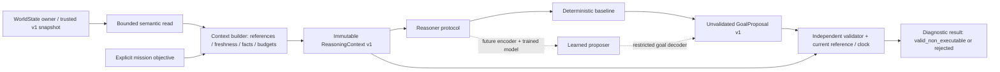

# Semantic reasoning integration I0–I4

Current extension: [goal reasoner comparison](goal_reasoning_comparison.md) adds
G1/G2, bounded inspection objectives and read-only H1/H2 integration. The I0–I4
results below are historical evidence for the preserved G0/schema-v1 baseline;
their original scope statements do not describe the whole current checkout.

WorldState + mission objective → compact ReasoningContext → replaceable Reasoner
→ independently validated, **non-executable** GoalProposal. This implements I0–I3
and the I4 design. No learned model, trajectory planner, ROS node or vehicle
command gateway is implemented.

## Reproduce

From the repository root, using Python 3.11.9 on the measured host:

```sh
python -m pip install numpy pytest
python -m pytest -q tests
python -m examples.semantic_reasoning_demo --output artifacts/reasoning --repeats 40
```

The runtime reasoning package uses the Python standard library. Existing
WorldState and offline fixture generation use the existing NumPy dependency.
No additional package, network, GPU, ROS, simulator or Jetson is needed. On Linux,
`python3` may replace `python`. The demo writes reasoning `replay.json`,
`evaluation.json`, `benchmark.json` and a readable `decisions.md` table. It does not
replace `artifacts/world_model/` or the original benchmark.

## Audit, references and boundaries

Verified PR #1 remains open/unmerged with head
`8f71328ed022377b45ee3a936df67272a5d65fbf`, targeting `experimental` at
`a254248`. Created `feature/semantic-reasoning-i0-i1` from that head. This change
is intended as a draft stacked PR targeting `feature/semantic-world-model-p1`.
Neither shared branch nor parent PR is merged automatically.

Read the repository instructions (`AGENTS.md`, `AI_CONTEXT.md`, `CLAUDE.md`,
`README.md`, `FLIGHT_CODE.md`), actual `refnav/world_model/` modules, existing
geometry/memory/semantic tests, offline replay, implementation guide and saved
P1 evidence. Baseline executed before implementation: **93 passed in 11.98 s**.

Connected Notion references were accessible:

- [Semantic Reasoning Integration I0–I4](https://app.notion.com/p/411f393aa76881e78dd6d7beb6592060):
  primary contract, baseline policy, validation, replay and learned-interface plan.
  Read the full page; its initial status describes a proposal, not completed work.
- [Architecture blueprint](https://app.notion.com/p/411f393aa768814e97a4cb94b726398c):
  explicit geometry, authoritative memory and separated planning/safety layers.
- [World State and Belief Updating](https://app.notion.com/p/411f393aa76881b497eee15a475eac58):
  identity, uncertainty, reference correction and contradiction handling.
- [Semantic Reasoning and Hierarchical Planning](https://app.notion.com/p/411f393aa768819b8ca4dddd6ed3fb7c):
  semantic goals are distinct from feasible movements and execution.
- [Master Research Roadmap](https://app.notion.com/p/410f393aa76881c0a464eaf3d7fd750f):
  staged evaluation and distinction between runtime world memory, policy and prediction.

The current P1 APIs are `world.snapshot(now)`, `entities(world, now, semantic_type)`
and `openings(world, now, envelope)`. `openings` first obtains the complete snapshot,
which copies each evidence history and performs a JSON round trip. At 128 entities
the original Windows benchmark reported 45.686 ms median query cost. The existing
query already refuses safe traversability, and must retain that behavior.

All pre-existing WorldState method ASTs were compared with the parent revision
and are unchanged. Only an additive semantic read method was added. No existing
tests, P1 artifacts, flight files, PX4/VIO interfaces, notebook, launch/configuration
file, safety threshold or simulator service is changed.

## Architecture and trust boundary



Normal operation trusts the WorldState owner and context builder as the source
of facts. A learned proposer is not trusted to choose IDs, erase unknowns or assert
validation. Strict decoding and an independent guard check its output. Content
hashes bind a proposal to the exact context, mission and time; they are **not
authentication** of an arbitrary sender or proof that sensor geometry is true.
A remote adapter will need authenticated transport and a trusted source binding.

There is deliberately no arrow from a validated proposal to PX4. Importing the
package does no IO. Evaluation helpers import sensor fixtures only when invoked;
the normal context/reasoner/validator modules do not import evaluation or sensors.

## I0: immutable ReasoningContext v1

The frozen, slotted contracts in `schema.py` contain tuples and other immutable
records. Nested geometry, evidence and relationships cannot be edited through a
context. Returned wire dictionaries are detached values. No raw images, depth
arrays, beams, control variables or free-form prompt text are included.

| Field | Meaning |
| --- | --- |
| `schema_version` | Strict version 1 |
| `reference` | `WorldReference(frame_id, epoch, clock_id)` expected by this consumer |
| `snapshot_timestamp` | Source owner's last update; may be null only in an invalid context |
| `context_created_at`, `expires_at` | Caller-clock construction time and validity horizon |
| `stale_after_s` | Entity age horizon from the semantic owner (5 s for original snapshots) |
| `mission_goal` | Explicit mission intent and optional known target; not an environmental fact |
| `entities` | Bounded tuple of semantic summaries |
| `omitted_entities` | Count of owner records not included, including byte-budget omissions |
| `context_valid`, `invalid_reasons` | Explicit fail-closed result of source normalization |
| `context_reference` | SHA-256 of canonical context content excluding this field |

Each entity retains its actual ID/type, estimated center/normal/width/optional
height/uncertainty, last observation and age, status, two heuristic confidences,
sighting/contradiction counts, bounded evidence summaries, supported relationships,
missing evidence and conditional traversability. Evidence retains observation ID,
source, capture stamp, position/angular uncertainty and blocking ray counts/fraction
when present. These are heuristic belief fields, not calibrated probabilities.

The current schema only admits observed `bounded_by` relations to real wall
entities. `connected_regions` must remain empty: P1 has no verified connectivity
proof. Future topology needs a versioned evidence contract rather than inserting
region names. Unknown height stays null. `traversability` may only be `unknown`,
`blocked` or `insufficient_clearance`; safe/true/confirmed-traversable claims fail.
For passage records, full-volume, swept-path and vehicle/margin prerequisites are
always retained as missing. A confirmation label alone cannot fill geometry.

`MissionGoal` admits `investigate_candidate_passage`, `review_candidates` or
`reach_region`. An optional target must exist with the appropriate type. A known
opening target can receive ranking preference because the caller requested its
investigation; this does not imply it leads anywhere. A known region goal still
produces insufficient information without verified connectivity. P1 normally has
no region entities, so such an unknown region target yields an invalid context.

### Builder and the additive public read API

```python
from refnav.reasoning import (
    ContextConfig, DeterministicReasoner, MissionGoal, WorldReference,
    build_context, validate_proposal,
)

reference = WorldReference(frame_id='odom', epoch=0, clock_id='replay')
context = build_context(world, MissionGoal(), now=now, reference=reference,
                        config=ContextConfig(max_entities=32, max_context_bytes=16384))
proposal = DeterministicReasoner().propose(context)
result = validate_proposal(proposal, context, now=now, reference=reference)
# result.proposal, when present, is a goal record, never a motion command.
```

`build_context` accepts either the public WorldState or its v1 snapshot dictionary.
For normal fast ticks it calls the new
`world.semantic_snapshot(now, max_entities=32, evidence_limit=2,
preferred_entity_id=None)`. This method holds the existing owner lock, scans/sorts
bounded records, and copies only selected geometry/semantic fields and the last
two evidence entries. It neither reads raw beams nor calls `snapshot`, `asdict` or
world serialization. It returns native Python scalar values, detached dictionaries,
omission metadata and explicitly separate owner/query timestamps. The builder
does not access private entity dictionaries or mutate WorldState.

Selection is deterministic: explicit known mission target first, then openings,
then latest observation, then ID. The context normalizer validates all records
in the supplied snapshot before selecting its own prefix. Byte accounting reserves
room for relation pruning and reference metadata; records are included only while
the budget permits. Relation targets omitted from the context are removed and
`supporting_entities_omitted` is recorded. Proposals must also expose
`omitted_context_entities` whenever any entities were omitted. The context is a
selected view; it cannot establish the globally best candidate among unseen records.

Defaults: at most 32 summaries, two evidence entries/entity and 16,384 UTF-8
bytes/context. Configurable limits are 1–128 summaries, 1–8 evidence entries and
1,024–65,536 bytes. Strict JSON and dictionary decoders reject unknown/missing
fields, duplicate JSON keys/IDs, nonfinite numbers, bad types and excess budgets.
An explicitly targeted record that cannot fit makes the context invalid.

The original `snapshot(now)` API remains unchanged, including its timestamp
semantics. Original snapshots have no independent owner-update stamp or configurable
stale horizon. Their timestamp is treated as the authoritative producer stamp and
their default P1 horizon is 5 s. Prefer `semantic_snapshot` for custom configuration
and live owner freshness. A serialized snapshot cannot prove producer liveness.

## I1: proposals and deterministic policy

`GoalProposal` fields are `schema_version`, deterministic `proposal_id`, permitted
`intent`, optional `target_entity_id`, `reason_codes`, `missing_information`,
`source_entity_ids`, `context_reference`, explicit `reference`, and
`validation_status`. The proposal digest excludes the validation status so a
validator can mark a grounded proposal without changing its identity.

| Intent | Meaning in this contract |
| --- | --- |
| `observe_more` | Acquire missing evidence / reobserve a retained hypothesis |
| `investigate_candidate` | Non-executable investigation objective; unknowns must remain explicit |
| `reject_blocked_candidate` | Record that blocking evidence makes this candidate unavailable |
| `review_alternative` | Review another grounded option; requires at least two real opening sources |
| `insufficient_information` | No justified target or coherent context is available |

All five are decodable and validated. Under P1's incomplete aperture/volume
evidence, the baseline emits only observe, reject or insufficient information.
Other models can implement `Reasoner.propose(context) -> GoalProposal`. The
validator is intentionally not an equality comparison with this baseline: tests
show an independently authored investigation goal can pass while preserving all
unknowns and remaining non-executable.

Baseline rules:

1. Invalid context/reference integrity → insufficient information, no location target.
2. No opening in the selected context → insufficient information, no invented landmark.
3. Rank openings by explicit known mission-target preference; current before
   stale/uncertain before invalidated; then lower observation age, more sightings
   (capped at eight for ranking), higher geometry/semantic confidence, fewer
   missing fields and lexicographic ID. Distance is never used to guess mission
   connectivity. When multiple candidates are present, include a second grounded
   source and `alternatives_available`.
4. Selected invalidated opening → reject with actual blocking evidence and missing fields.
5. Selected stale/uncertain opening → observe with `reobserve_stale_belief`.
6. Other selected P1 opening → observe; include `height_unconfirmed` and
   `clearance_unconfirmed` as appropriate. No confidence threshold promotes safety.

Entity identity remains stable across proposals; a changed timestamp/geometry,
mission or evidence changes the context and proposal hashes. Repeated calls on
the same context produce byte-identical output.

## I2: independent validation and clocks

`validate_proposal(proposal, context, now=..., reference=...)` accepts a strict
GoalProposal DTO or wire dictionary. It does not call the reasoner. It independently
checks schema/field allowlists, permitted intent, content references/digests,
current frame/epoch/clock binding, freshness, real target/source IDs, relationship
grounding, entity age/status, required missing fields and factual reason codes.

Unknown targets, unsupported actions, injected setpoint/trajectory/velocity/command
fields (including nested extras), self-asserted validation and erased unknowns
cannot bypass the guard. Invalidated targets require rejection and actual
blocking evidence; stale/uncertain targets cannot become investigation/review
goals. Alternative review requires two opening sources, not one opening plus an
unrelated wall. A candidate's incomplete clearance never becomes safe.

The result is `ValidationResult(valid, reason_codes, checked_at, proposal)`.
Invalid results have no approved proposal and explicit machine-readable failures.
Success returns a copy marked `valid_non_executable`. An invalid context may still
produce a diagnostic refusal from the reasoner, but the validator rejects it:
refusal text is not a context-validity bypass.

All stamps use the named caller clock in seconds. Builder source age defaults to
≤1 s; context lifetime defaults to 0.5 s. Validation independently checks both
context and source age at its **current** caller time. A reasoner is a pure function
of its context; it cannot sense elapsed time or later resets without a new input.
The consumer must always validate against its current reference and time.

World frame geometry is retained in odom, metres, +z up as in P1. No hidden
body-relative transform, yaw removal or re-localization is attempted. A frame,
epoch or clock change makes old contexts incompatible. Explicitly rebind a new
WorldReference only after the WorldState owner has reset/validated its reference.
No location-based decision survives an incompatible reference automatically.

## I3: replay and tests

The demo consumes only the existing P1 WorldState replay snapshots. Synthetic
scene truth remains confined to the original depth renderer/evaluation. The
reasoner never sees truth coordinates, depth images, rays or ground-truth labels.
Each output row includes available IDs, full compact context, mission, unvalidated
proposal and the independent validation result/approved copy.

| Existing world event | Goal |
| --- | --- |
| Partial wall | Insufficient information, no target |
| Opening revealed | Observe `opening_0003` |
| New pose | Reassess same ID and updated evidence |
| Turn-away | Observe same retained ID; last observation stays t=0.4 |
| Stale at t=6.5 | Reobserve same ID; no renewed supporting observation claimed |
| Reobserved at t=7.2 | Observe same updated provisional entity |
| Blocking evidence at t=7.4 | Reject same ID as blocked |

All seven decisions match the explicit expected policy and validate as
non-executable. A deliberately weak comparison policy chooses the widest opening,
requests investigation and omits unknowns/status. Six of its seven outputs fail
the same independent guard; its empty-candidate refusal passes. This comparison
demonstrates the contract's information-preservation rules. It is not a trained
model, competitive planning baseline, navigation experiment or measured flight benefit.

Final suite executed: **160 passed in 13.37 s** = all 93 existing + 67 new tests.
Tests cover geometry/provenance preservation, nested immutability, empty/missing
state, schema/reference/clock/freshness gates, duplicate IDs/JSON keys, fabricated
connectivity, confidence corruption, source/hash tampering, budget truncation,
permuted ordering, reobservation/occlusion, blocking, candidate ranking, invalid
intents and command payloads, independently authored proposals and 1/32/128 stores.

Development failure retained: the first new test run had 2 failed / 58 passed.
The compact API exposed NumPy scalars that the old JSON round trip had converted
to native numbers; strict numeric contracts correctly rejected them. Explicit
native scalar conversion in the new API fixed both tests. No existing method,
numeric validation rule or flight safeguard was relaxed.

## Benchmark provenance, results and trade-offs

`artifacts/reasoning/benchmark.json` records source SHA-256 hashes, the untouched
original benchmark hash, Python/OS/processor, every timing stage, memory and actual
included/omitted counts. Available Windows AMD64 Intel Family 6 Model 183 host,
Python 3.11.9; **not Jetson measurements**. Forty steady calls/stage after one
warm-up, using `perf_counter`. Fixtures have eight-entry entity histories to match
the original P1 scaling workload. Sensor generation and public checkpoint fixture
population are excluded from timed regions. Tracemalloc runs separately from
latency measurement. Independent stage measurements need not sum exactly.

Median milliseconds in the measured execution:

| Stage | 1 world entity | 32 world entities | 128 world entities |
| --- | ---: | ---: | ---: |
| Existing full snapshot | 0.342 | 10.799 | 42.757 |
| Existing opening query | 0.342 | 10.829 | 42.868 |
| New bounded semantic read | 0.010 | 0.256 | 0.308 |
| Build from pre-acquired semantic read | 0.481 | 6.430 | 6.722 |
| Build from world, including read | 0.510 | 6.749 | 6.193 |
| Deterministic reasoner | 0.171 | 0.890 | 0.879 |
| Independent validation | 0.156 | 0.870 | 0.855 |
| Total pipeline | 0.896 | 7.685 | 8.508 |

Total pipeline median / p95 / worst observed ms: **0.896 / 1.052 / 1.155**,
**7.685 / 8.322 / 11.598**, **8.508 / 9.507 / 10.229**, respectively. Full per-stage
median, p95 and worst values are in the JSON artifact.

The 1/32/128 stores yield 1/13/13 context entities, explicitly omitting 0/19/115.
Serialized sizes: 1,559 / 14,495 / 14,496 bytes. Estimated recursive Python context
size: 3,208 / 27,212 / 27,212 bytes (excludes allocator/interpreter overhead).
One pipeline's traced peak allocations: 17,981 / 199,561 / 199,563 bytes. Whole
benchmark-process peak resident memory was 50,249,728 bytes, including interpreter,
libraries and fixture generation; this is not the context's memory footprint.

On this execution the complete bounded pipeline costs more than a one-entity
legacy query (0.896 vs 0.342 ms), while the 128-store bounded pipeline costs less
than the full legacy query (8.508 vs 42.868 ms). This is a measured architectural
trade-off: less copied history and a selected entity subset, plus explicit
contracts, reasoning and validation. It is **not** a speed comparison of identical
full-graph outputs. The original 45.686 ms P1 result is retained at its original
revision; ordinary host timing variation prevents treating that historical value
as a controlled improvement baseline. No target frequency or Orin result is claimed.

## I4: future learned reasoning adapters (design only)

All options must output the same strict GoalProposal with real IDs and a bound
context reference. None may issue commands, erase missing evidence or upgrade
unknown geometry. Decoder outputs must pass the independent guard. A VLA does
not automatically understand arbitrary JSON or scene graphs.

| Option | Inputs and encoding | Model output / adaptation | Benefits and limits | Orin implications and safety boundary |
| --- | --- | --- | --- | --- |
| A: structured graph features | Entity-type embedding, metric geometry, uncertainty, age, confidences, status/unknown masks and observed bounded-by edges. Supply a separately validated current vehicle pose to transform odom points into relative features. Include mission intent and ID-index mapping. | Graph encoder or transformer plus a restricted goal/target-index head. Train or adapt on grounded context→goal examples with stale/blocked/refusal cases; decode indices back to existing IDs. | Explicit masks/provenance and bounded tokens; cannot recover omitted entities, missing height or unobserved topology. Current context alone has no vehicle pose for a relative transform. | Budget encoder size, maximum graph tokens, latency tails and shared CPU/GPU RAM with cuVSLAM. No on-device cost measured. Validate output through I2; no trajectory authority. |
| B: learned spatial embedding | Separate bounded geometric/occupancy encoder plus semantic summaries, observed/unknown masks, timestamp and reference binding. A volumetric map would be additional future input; P1 beams are not a certified volume. | Pool to latent state for a goal policy or predictive model; requires suitable training, uncertainty supervision and a grounded target decoder. | Potential compression of spatial structure is a hypothesis; pooling can lose boundaries, provenance and rare blocking evidence. Evaluate latent drift, reset behavior and false confident outputs. | Measure encoder activation/storage cost, update rate and co-resident estimator load. Latent confidence cannot replace explicit unknown evidence or the validator. |
| C: multimodal VLM/VLA interface | Synchronized visual features, calibration/pose, mission instructions and structured context through learned feature projection, graph tokenization or a tested serialization/prompt adapter. Add observation/action encoders if adapting an action-trained VLA to high-level goals. | A task-adapted restricted goal decoder or carefully evaluated structured-generation adapter. Requires training/fine-tuning or empirically tested prompting; no assumption of zero-shot graph understanding. | May use appearance and instruction cues; hallucinated landmarks, time misalignment, distribution shift and output-format failures need explicit rejection tests. No model is selected or loaded here. | Vision/token processing and shared memory may dominate; quantify on the actual Orin, with estimator running, before choosing architecture/precision. Raw VLA action chunks are outside this contract. Only non-executable goals pass I2. |

Evaluation before choosing an adapter: identical held-out contexts and input
observations; false target/relationship/clearance claims, omission sensitivity,
refusal quality, changing-layout generalization, epoch/clock resets, latency
tails, peak shared memory and temperature/power mode. Compare against this
deterministic baseline and include failures. Better offline goal matching alone
does not establish better navigation or safe physical operation.

## Files and remaining integration work

| File | Change |
| --- | --- |
| `refnav/world_model/state.py` | Add bounded detached `semantic_snapshot`; all prior methods unchanged |
| `refnav/reasoning/schema.py` | Immutable v1 DTOs, strict codecs, content references and Reasoner protocol |
| `refnav/reasoning/context.py` | Public adapter, freshness/grounding checks, unknown preservation and budgets |
| `refnav/reasoning/baseline.py` | Deterministic candidate ranking and information-seeking/refusal policy |
| `refnav/reasoning/validation.py` | Independent fail-closed non-executable proposal validation |
| `refnav/reasoning/evaluation.py` | Isolated replay comparison and measured host benchmark |
| `refnav/reasoning/__init__.py` | Public import-only API |
| `examples/semantic_reasoning_demo.py` | Replay-to-context/proposal/validation demonstration |
| `tests/conftest.py` | Import path and detached reasoning fixtures; no ROS setup |
| `tests/test_reasoning_*.py` | Context, baseline, adversarial validation and evaluation tests |
| `artifacts/reasoning/` | Replay, decisions, evaluation, benchmark and executed test results |
| `docs/semantic_reasoning_integration.md` | Audit, contracts, evidence and future adapter design |

Known limits: inherited synthetic-only geometry, unknown aperture height and
region connectivity, no volumetric map, heuristic confidence, bounded context
omissions, greedy candidate policy and serialization/hash overhead. There is no
global semantic route planner, learned policy, action-conditioned predictor or
sensor-health/vehicle authority interface. Strict v1 relation/ontology schemas
require an explicit versioned extension for richer facts.

Future flight integration needs a separate adapter from a validated semantic goal
to a geometric subgoal; complete conservative occupied/free/unknown volumes and
aperture bounds; full vehicle/propeller envelope, localization/tracking error,
stopping distance and trajectory/dynamics feasibility checks; synchronized
estimator/sensor health; and an independently reviewed command gateway with
current authority/freshness and native PX4 failsafes. The current `Mission.step`
accepts preplanned route legs and is not such an adapter. Physical deployment
also requires target ARM builds/calibration, RC takeover qualification and
explicit team flight authorization. None is implemented or invoked by this PR.
