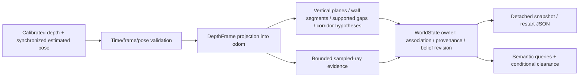

# Semantic world model: offline prototype 1

Depth + estimated pose → geometric evidence → provisional semantics → bounded
WorldState → read-only queries. This implementation has no flight-control or ROS
integration. It does not establish a safe path, infer mission checkpoints, or use
simulator truth in inference.

## Run it

From the repository root, on Windows use `python`; on Linux `python3`:

```sh
python -m pip install numpy pytest
python -m pytest -q tests
python -m examples.semantic_world_model_demo --output artifacts/world_model --repeats 40
```

Only NumPy (already used by `refnav/depth.py`) and the existing pytest framework
are needed. No additional runtime dependency, GPU, ROS, simulator, or vehicle is
required. The tested host versions are Python 3.11.9, NumPy 2.3.5 and pytest 9.0.3;
these are evidence provenance, not requirements to upgrade the flight environment.
The SVG diagnostic uses ordinary text generation. No visualization library is needed.

Outputs: evolving `replay.json`, final `snapshot.json`, restart `checkpoint.json`,
`benchmark.json` and `top_down.svg`. The bulky ray checkpoint is generated locally
and ignored by Git. The other artifacts are committed for review. Re-running the
demo replaces only these outputs. Diagnostic geometry is deterministic; timing
and allocator measurements naturally vary between executions.

## Architecture audit and source basis

Initial workspace was empty. Cloned the requested repository's `experimental`
branch; clean base was `a25424805ad79fbf122f4d84c9859ab3477b5c62` (documentation
commit following baseline import `c3c5df3`). Created
`feature/semantic-world-model-p1`. Baseline `python -m pytest -q tests` executed:
**30 passed in 10.20 s**. No existing flight, launch, calibration, safety,
notebook or controller file is changed by this prototype.

Repository references inspected:

- `AGENTS.md`, `AI_CONTEXT.md`, `CLAUDE.md`, `README.md`, `FLIGHT_CODE.md`,
  `onboard/README.md`: team ownership, native ROS interfaces and flight boundaries.
- `refnav/core.py`: pure mission and fail-closed estimator/depth/authority checks.
- `refnav/node.py`: ROS camera/TF input and PX4 command boundary, kept independent.
- `refnav/depth.py`: calibrated optical-z projection and explicit missing returns.
- `tests/test_refnav_core.py`: existing kinematic fake and ray-cast sensor convention.
- `onboard/slam/cuvslam_lib_node.py`: body-rig estimated odometry, tracked-feature
  evidence, covariance withholding; startup world is not automatically surveyed ENU.
- `onboard/vio/ev_bridge.py`, `frames.py`, `adapters/geometry.py`, `px4_odom.py`:
  ENU/FLU vs NED/FRD, reset/health gates and estimated TF.
- `onboard/config/vio.yaml`, `vision_bridge.yaml`, the flight-example source and
  notebook introduction: inspected as text, never executed.

All eight requested Notion pages were accessible through the connected workspace.
These are proposed research, not evidence that a deployed system already exists:

| Reference | Applied lesson |
| --- | --- |
| [Architecture Planning — Semantic World Model v0.1](https://app.notion.com/p/411f393aa768814e97a4cb94b726398c) | Geometry → semantic interpreter → authoritative memory; separate command boundary |
| [Master Research Roadmap](https://app.notion.com/p/410f393aa76881c0a464eaf3d7fd750f) | Measurable staged baseline; avoid confusing world state and learned policy |
| [Problem 2 — Semantics & Affordances](https://app.notion.com/p/411f393aa7688172be43d5f4f5fe7470) | Labels need spatial evidence and conditional affordances |
| [Semantic Acquisition notes](https://app.notion.com/p/411f393aa76881968889c1d99fcc1dc6) | Start with explicit geometry; learned inference is an optional later experiment |
| [Problem 3 — Memory & Belief](https://app.notion.com/p/411f393aa76881b497eee15a475eac58) | Retain identity, age observations, revise contradictory beliefs |
| [Academic Literature](https://app.notion.com/p/411f393aa76881909d94d0c3c6029e49) | Compact hierarchy; distinguish runtime graph from trained weights |
| [Academic × Industry synthesis](https://app.notion.com/p/411f393aa76881fa9a0eee681393ffb2) | Bounded map/graph, independent local clearance and safety layers |
| [Current Lab Reference](https://app.notion.com/p/410f393aa768815494c2fa9e307ed73a) | Jazzy lab differs from older Humble intake; no local live-interface assumptions |

Hydra/Kimera motivate incremental spatial hierarchy and queryable memory; CSIRO
motivates retaining uncertain observations; Swift motivates a compact timed state;
ModalAI motivates module separation. This adapts the supplied synthesis rather
than reimplementing those systems or reproducing their benchmark claims. The
Notion literature page explicitly says the complete original long research report
is not imported; this work does not claim to have read that absent report.

This task combines the blueprint's P1 geometry, P2 scene memory, and part of P3
queries under the user's "Prototype 1" scope. The live P0 topic/rate audit remains
unperformed because this checkout is a Windows host without ROS, Jetson or a live
simulator. No telemetry inspection, service management, arming or flight ran.

## Components and data ownership



WorldState owns Python entity records and up to three NumPy ray batches in CPU
RAM. There are no model weights. Raw images are not retained. A reentrant lock
serializes processing and produces detached snapshots. A caller must avoid
mutating an Observation during `process`. The private dictionaries are owner
internals, not a multi-node API. JSON checkpoints are optional disk persistence;
entities persist in RAM across frames even without writing a checkpoint.

This small bounded representation avoids dense reconstruction, distance-field
optimization, learned tensors and building-scale scene graph dependencies. It is
suitable as an embedded baseline to profile, not demonstrated Orin compatibility
or a substitute for a validated collision map. At 128 entities, copying and
scanning the full graph is already a measurable cost (see results below).

## Sensor and frame contract

- `depth_m`: rectified 2D optical-z depth in metres, not radial range/disparity.
  Use existing `decode_depth` for ROS 32FC1 metres or 16UC1 millimetres in a future
  adapter. All nonfinite/nonpositive, near-range and far-range returns are unknown.
- `K = (fx, fy, cx, cy)` from calibration corresponding to that exact image.
- `R_body_cam`, `t_body_cam`: **body FLU ← camera optical**; optical axes right,
  down, forward. Extrinsics include camera translation.
- `R_world_body`, `t_world_body`: **odom ← body FLU** at capture time. `odom` is
  a fixed local, gravity-aligned, right-handed frame with +z up; horizontal x/y
  need not be east/north. Never mix two frames merely because both are named odom.
- Projection reuses `DepthFrame` with its full `R_world_body` in the rotation
  argument. `world_point = R_world_body @ (R_body_cam @ optical_point +
  t_body_cam) + t_world_body`. Its `dirs` preserve optical-z scale. **Do not use
  `level_rotation` here:** its yaw removal is appropriate for instantaneous
  clearance, but would accumulate incompatible heading-relative geometry.
- `onboard.adapters.geometry.px4_to_ros` is the existing NED/FRD→ENU/FLU adapter.
  Use a validated estimated source and surveyed frame ownership if later adapting
  PX4; no new conversion mathematics or access to simulator pose is needed.
- All source/pose/arrival/query stamps are seconds in the same named `clock_id`.
  Offline uses replay seconds. A ROS adapter must use capture stamps and its ROS
  clock (`use_sim_time` / `/clock` for replay, system time on hardware), and
  synchronize/interpolate poses. PX4's independent timestamp cannot be substituted.
- Reject future captures, age >0.5 s, pose skew >0.03 s, missing/invalid rotations
  or translations, invalid calibration and excessive pose uncertainty.
  Position sigma + 10 m × angular sigma must be ≤0.25 m by default.
- Geometry error proxy = position sigma + range × angle sigma + 0.08 m sampling
  bin allowance. It reduces confidence and expands conditional clearance margins.
  This is a heuristic bound proxy, **not a statistically calibrated covariance**.
  Width query uses the proxy on each side, plus both caller-supplied margins.
- Frame/epoch/clock mismatch and suspected translation jump latch
  `reference_reset_required`. Jump threshold is 1 m + 3 m/s × elapsed capture
  time. Explicit `reset_reference(frame_id, newer_epoch, clock_id)` discards
  incompatible geometry and beams, preserves monotonically increasing IDs, and
  permits a restarted clock. Export a snapshot first to archive the old epoch.
  Backward arrival clock also requires reset. A backward capture at a forward
  arrival time is treated as packet reordering. No automatic frame stitching.

Rotation jumps, slow drift and plausible but incorrect poses cannot all be
detected by these gates. A future adapter must propagate estimator reset counters,
tracking validity, frame calibration and covariance. cuVSLAM's initial body-world
must be checked for gravity alignment before using this detector.

## Observation → geometry → semantic inference

1. Validate the input, reference epoch and temporal ordering. Bad current-domain
   arrivals still age old memory; they add no geometry or confirmation evidence.
2. Project with existing calibrated math. Adapt stride upward to cap sampled rays
   at 5,000 and input pixels at 307,200. Unknown rays stay in the coverage denominator.
3. Fit up to four vertical planes with fixed-seed, 64-trial, gravity-constrained
   RANSAC and XY SVD refinement. Tolerance 0.045 m, minimum 45 hits and 0.5 m
   observed vertical extent. Horizontal floors alone cannot pass this test.
4. At camera height ±0.25 m, form 0.08 m horizontal support bins. Keep wall
   segments with ≥0.25 m measured horizontal extent. Report observed patch
   dimensions, not the full wall size. Perspective sampling can split distant
   surfaces; no interpolation fabricates observations.
5. Between two supported wall segments on one plane, consider gaps 0.4–3 m wide.
   Require ≥12 rays and ≥90% finite returns at least 0.25 m behind the opening
   plane; check two subwindows as well. Any sampled near-plane blocking return in
   the central window rejects it. Invalid/missing rays cannot establish a passage.
6. Store measured side-to-side width and world-frame center/normal. Opening height
   is always null: upper/lower boundaries have not been established. The vertical
   coordinate is the observed cross-section height, not a complete aperture center.
7. Parallel side-wall patches straddling the observer with ≥0.75 m overlap and
   supported depth along their overlap may create a provisional corridor-like
   entity. Width is side separation; observed length is evidence metadata.
   Neither this label nor a gap proves a fully clear corridor volume.
8. Associate and update memory; construct observed `bounded_by` references when
   current wall entities support both opening edges. Region connectivity remains
   unknown. Do not turn these references into `reachable_through` edges.

Runtime inference consumes only depth, calibration and estimated pose. The
isolated fixture's ideal rectangle ray caster knows synthetic scene coordinates;
they are used solely to generate sensor input and calculate evaluation errors.

## WorldState schema and lifecycle

Entity records contain `entity_id`, `semantic_type`, `geometry` (center, normal,
width, optional height, uncertainty), frame and epoch, first `source_timestamp`,
`last_observed`, geometric/semantic confidences, status, observation and
contradiction counts, bounded provenance, missing evidence, relations and
`connected_regions`. Provenance contains frame ID through the enclosing entity,
observation ID/source, capture/pose stamps, pose uncertainty and support counts.

| Ontology entry | P1 behavior |
| --- | --- |
| wall | Observed vertical surface patch; repeated low-error sightings may confirm the surface hypothesis |
| opening | Provisional candidate passage with supported sides and sampled rays behind; height unknown |
| corridor | Provisional parallel-side/free-ray structural hypothesis; full volume unknown |
| obstacle, region | Reserved vocabulary for a later extractor; not synthesized without evidence |
| tunnel, gate, window, landing zone | Deferred; geometry alone does not establish these labels |

Updates are deterministic: global distance-sorted one-to-one pairs, matching type
and aligned normals; opening widths must differ by <0.6 m and horizontal
intervals overlap. Association radius is 0.5 m. Latest supported geometry replaces
the estimate; no independence assumption is made about correlated stereo frames.
First source timestamp and ID persist. Two simultaneously distinct openings do
not share an entity. This is a greedy baseline, not a probabilistic data-association
solution: drift, large corrections, close features and split/merged wall patches
can create duplicates. Ambiguity needs multi-hypothesis estimation later.

Temporary nonvisibility changes neither last-observed time nor contradiction
count. Query confidence decays as exp(-age / 5 s); age >5 s reports stale. Entries
older than 120 s expire. Call `tick(now)` during sensor silence or give explicit
current time to queries. Current-domain rejected packets also advance aging.

A fresh frame with ≥12 crossing rays and ≥60% observed near-plane/closer blocking
returns invalidates a remembered opening. This conservatively includes a temporary
occluding object: it means the passage cannot currently be relied on, not that
the architecture has proven a permanent wall replaced it. Confidence drops and
blocking evidence is stored. Fresh supported reobservation can restore the same
ID as provisional; contradiction history remains. Absence of returns is never
negative or free-space evidence.

Walls can become confirmed after three associated low-error observations.
Openings and corridors remain provisional in this implementation. **A confirmed
wall is a confirmed semantic hypothesis, not a certified collision boundary.**

Memory budgets: ≤128 entities, ≤8 provenance entries/entity, ≤3 batches of ≤5,000
sampled rays. No per-frame event log accumulates internally. At capacity, oldest
unmatched entities are evicted; current associations and newly admitted records
are protected for that update. Excess detections receive `capacity_rejected`.
Eviction removes dangling relations, as does snapshot expiration.

`snapshot` makes a consistent detached JSON-compatible copy and derives ages /
status. `to_json` writes version-1 restart state including beams, next ID, last
capture/pose, configuration, and original records; `from_json` restores association
and ordering state and enforces budgets/schema version. Restore trusted local
checkpoints only: this diagnostic format is not an untrusted network parser or
cross-version migration protocol. It never stores credentials.

## Occupied, observed-free and unknown

`space_at(point, now)` is a diagnostic **sampled-ray** query: recent finite
endpoints support occupied within 0.07 m; ray segments ending at least 0.1 m beyond
the query support observed-free within a 0.02 m beam radius. Outside that evidence,
the answer is unknown. Old occupied evidence takes precedence over free evidence
until its two-second beam horizon expires. Invalid returns never carve space.

These are nominal pose-referenced evidence labels, not a voxel occupancy map,
ESDF, collision clearance, pose-uncertainty-inflated map or full-volume coverage
certificate. Beam evidence expires much sooner than semantic memory. The small
beam radius intentionally leaves space between samples unknown. The blueprint's
rolling volumetric mapper is deferred and this deviation is material for planning.

## Query contract and future planner example

```python
from refnav.world_model import WorldState, VehicleEnvelope, entities, openings

world = WorldState(frame_id='odom', epoch=0, clock_id='replay')
# world.process(observation, now=observation.stamp)  # caller supplies valid contracts
all_entities = entities(world)
candidates = openings(world, envelope=VehicleEnvelope(
    width_m=0.4, height_m=0.25, tracking_margin_m=0.05,
    localization_margin_m=0.05))  # EXAMPLE configuration, not measured aircraft size
```

The opening query returns ID, geometry, confidence, age, provenance, provisional /
stale / invalidated status, observed relations, unverified region connections,
separate width/height fit tests, full-observation flag and missing evidence.
`traversability` can be `unknown`, `insufficient_clearance`, or `blocked`; there
is no `safe=True` or unconditional confirmed-traversable output. Even configured
dimensions do not establish upper/lower bounds, a swept path, or controller safety.
Margins must be measured/validated by the future consumer, not inferred from
illustrative defaults. A future planner can select "needs observation" hypotheses;
it cannot use this prototype to authorize motion.

## Validation and measured results

See committed `artifacts/world_model/test_results.txt` and `benchmark.json` for
executed results and exact numeric outputs. New tests cover calibrated transforms,
multiple perspectives, solid walls / single-side false gaps, NaN/inf/no-return,
small blocking objects, corridor support, distinct openings, identity, correction,
occlusion, stale aging, invalid pose/time/calibration, reset latching, checkpoint
round trips and continued association, deterministic replay, detached snapshots,
bounded memory and conditional query semantics.

Final full suite executed: **93 passed in 11.94 s** (30 original + 63 new).
The benchmark records SHA-256 hashes of the exact runtime and fixture sources.

Development failure retained here: the first added corridor fixture returned no
corridor (1 failed, 58 passed), because its valid near-camera wall patches shared
about 0.94 m observed overlap against an initial 1 m structural threshold. Set the
minimum structural overlap to 0.75 m, still requiring the same 90% finite-return
evidence; the dedicated positive/negative corridor tests then passed. This did not
change any flight safety gate or free-space threshold.

Six-frame replay plus one aging snapshot:

| Stage | Opening belief |
| --- | --- |
| Partial wall, t=0 | No opening invented |
| More geometry, t=0.2 | `opening_0003` created; width 1.304 m; height null |
| Translation + yaw, t=0.4 | Same ID, corrected width 1.252 m |
| Turn away, t=0.6 | Same ID retained; last observed still t=0.4 |
| Age to t=6.5 | Same ID stale with reduced confidence |
| Reobserve, t=7.2 | Same ID provisional, width corrected to 1.222 m |
| Blocking wall, t=7.4 | Same ID invalidated, traversal blocked |

Synthetic truth width is 1.2 m. Width absolute errors for three supported views:
0.1042, 0.0520, 0.0223 m; horizontal center errors: <0.0001, 0.0238, 0.0018 m.
No height error is reported because no height is estimated. Four negative fixtures
(solid wall, missing gap returns, all NaN, all infinity) produce zero false
openings. Replay has zero duplicate opening IDs and zero confirmed passages.
This is fixture evidence, not a field precision/recall study or measured downstream
navigation benefit.

Measured on available Windows AMD64 / Intel Family 6 Model 183 host, Python 3.11.9,
NumPy 2.3.5, 160×100 ideal synthetic depth, 40 steady frames after one warm-up:

| Stage | Median ms | p95 ms | Worst ms |
| --- | ---: | ---: | ---: |
| Geometry | 5.973 | 6.622 | 8.602 |
| Semantic update | 0.581 | 0.695 | 0.743 |
| Opening query | 1.043 | 1.149 | 1.223 |

The three-entity steady store estimates 20,091 bytes of recursive Python entity
objects plus 348,072 bytes of beam arrays. This excludes interpreter, allocator,
library and temporary arrays. Serialized UTF-8 restart state is 1,676,853 bytes;
serialization size is not RAM footprint. Isolated replay peak Python-traced
allocation was 5,043,889 bytes. Process peak resident working set through benchmark
measurement was 46,927,872 bytes (Windows process counter; includes interpreter,
libraries, fixtures and checkpoints, not just world memory). These are distinct
measurements, not additive accounting.

Scaling fixture initializes 1, 32, 128 opening records and runs eight updates/
queries each (ending with 3, 34, 128 total entities). Median update latency was
0.595 / 7.307 / 28.444 ms; median query latency 0.866 / 11.514 / 45.686 ms.
This deliberately includes a large number of retained opening hypotheses; JSON
snapshot copying and ray contradiction checks dominate. More efficient indexed
association and filtered immutable snapshots are future work. No performance
improvement or Jetson result is claimed; no comparative control ablation ran.

## Files added

| File | Responsibility |
| --- | --- |
| `refnav/world_model/__init__.py` | Small import-only public API |
| `refnav/world_model/observations.py` | Config, sensor/pose contracts, validation, reused projection, geometry records |
| `refnav/world_model/geometry.py` | Deterministic surface, opening and corridor hypotheses; ray cross-section evidence |
| `refnav/world_model/state.py` | Bounded owner, association, belief lifecycle, beam diagnostics, snapshots/restart |
| `refnav/world_model/queries.py` | Entities/openings and conditional envelope evaluation |
| `examples/semantic_world_model_demo.py` | Isolated sensor generator, replay, metrics, benchmark and SVG |
| `tests/test_world_model_geometry.py` | Physical transforms and positive/negative geometric evidence |
| `tests/test_world_model_memory.py` | Identity, correction, stale/contradictory evidence, references, persistence/budgets |
| `tests/test_world_model_semantics.py` | Query schema and refusal to certify unsupported traversal |
| `docs/semantic_world_model.md` | Audit, contracts, evidence, limitations and next steps |
| `artifacts/world_model/benchmark.json` | Host provenance, errors, runtime/memory and scaling measurements |
| `artifacts/world_model/replay.json` | Full evolving detections, events, queries and snapshots |
| `artifacts/world_model/snapshot.json` | Final diagnostic WorldState |
| `artifacts/world_model/top_down.svg` | Lightweight review visualization |
| `artifacts/world_model/test_results.txt` | Final executed test output |
| `artifacts/world_model/.gitignore` | Exclude regenerable bulky ray checkpoint |

## Limits and next prototype

This uses ideal rectified depth with a gravity-aligned world. It is deliberately
limited to approximately planar vertical structure. Sampling/binning can miss
thin obstacles, split sparse surfaces, overestimate width by pixel spacing and
misassociate features under drift; 90% ray coverage is not full 3D evidence.
Provisional labels and heuristic confidence are not calibrated probabilities.
There is no loop closure, dynamic object tracker, dense occupancy map, verified
topological region graph, planner, action predictor, learned model or ROS adapter.

Recommended P2: replay recorded real stereo/depth and estimator data with
measured calibration and uncertainty; fit upper/lower opening boundaries and
conservative intervals; add bounded voxel occupancy with unknown preservation,
viewpoint-supported region hypotheses, indexed association and explicit reset
events. Compare altered layouts and dropout cases under matched inputs. Profile
at actual 640×400 delivered cadence on Orin while cuVSLAM is running, including
thermal/power mode, GPU contention, end-to-end age and latency tails.

Before ROS integration: perform the live P0 read-only topic/frame/rate audit;
select one authoritative estimated pose source; validate pose interpolation,
optical depth calibration, gravity, covariance, reset counters and clock behavior;
design bounded callback queues. Initially subscribe and publish diagnostics only.

Before any physical flight: a separately reviewed local metric planner and
swept propeller/body envelope, measured tracking/localization error and stopping
margin, independent estimator/freshness/authority gateway, actual ARM dependency
build, camera/IMU calibration, PX4 version/failsafe checks and physical RC takeover
must be qualified. Only the team can authorize flight. This branch adds no
commands and makes no changes to `Mission.step` or existing safeguards.
