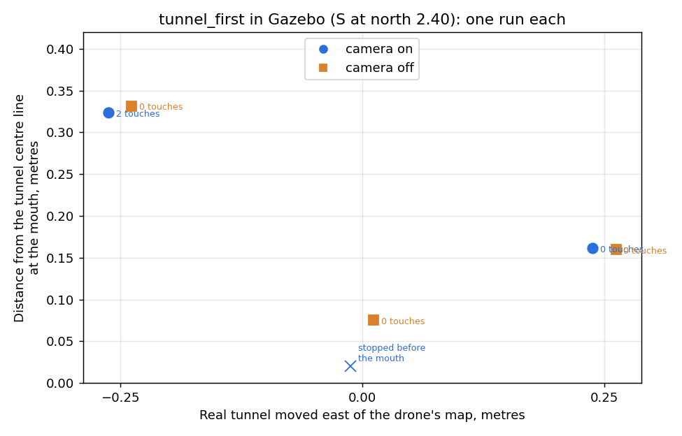

# tunnel_first in the full Gazebo simulator: what the camera LOOK did (Phase 3, 2026-11-08)

SIMULATOR RESULTS. Read "What this cannot show" before quoting any of it.

## How the runs were made

- Worlds: the phone scan with only the tunnel moved east by -0.25, 0 and +0.25 m
  (`simulator/gazebo_full/make_tunnel_shift_worlds.py`). The drone kept its own unchanged map
  (`--map phone_scan_2026-11-06.json`), so the map's tunnel was wrong by the shift.
- Code: commit cc09c3b on soham-tunnel. `TEAM_NAV_MISSION=tunnel_first TEAM_NAV_S_NORTH_METRES=2.40
  TEAM_NAV_TUNNEL_IF_UNSURE=map`, real-drone form of the checks (`--ignore-raw-laser`).
- Camera off: `fly_course_in_gazebo.sh --camera-off` stops the pictures before the flight, so the LOOK
  is always unsure and the drone flies the map's line.
- One run per case, six runs, one at a time.

## Results

Offsets are the tunnel centre's distance to the drone's LEFT (east, with the nose south), measured at
the first LOOK. "Mouth error" is how far east of the tunnel's centre line the drone crossed its mouth.

| Tunnel moved | Camera | Measured (edges / depth) | True | What the drone did | Mouth error | Closest in tunnel | Touches |
|---|---|---|---|---|---|---|---|
| -0.25 m | on | -0.02 / -0.24 m | -0.34 m | methods disagreed -> unsure -> map line; stopped in the tunnel by the height check | +0.32 m | 0.00 m | 2 |
| -0.25 m | off | - | - | map line, through, landed | +0.33 m | 0.13 m | 0 |
| 0 | on | -0.08 / -0.08 m | -0.09 m | accepted, corrected 0.08 m; stopped during the LOOK by the height check | - | never inside | 0 |
| 0 | off | - | - | map line, through, landed | +0.08 m | 0.37 m | 0 |
| +0.25 m | on | edges not found | +0.16 m | unsure -> map line, through, landed | -0.16 m | 0.29 m | 0 |
| +0.25 m | off | - | - | map line, through, landed | -0.16 m | 0.30 m | 0 |

The two "landed" camera-off runs on -0.25 and 0 ended with course_run's exit code 1 after touching
down: PX4 switched the motors off before course_run's touchdown check agreed (a known quirk of the
landing, also seen in the fallback runs).

## What it shows

- When the LOOK accepted, it measured the right side and size: -0.08 m by both methods against a true
  -0.09 m (centred tunnel).
- When the two methods disagreed (-0.25 m case) or the edges were not found (+0.25 m case), the LOOK
  said unsure and the drone flew the map's line, as designed. In these six runs the camera did not
  make any run better than the camera-off run, and did not move the drone the wrong way.
- An earlier version did move the drone the wrong way (a wrong edge pair, 0.17 m clearance, run
  20261108_075405); each frame's edges must now match the depth at their columns.
- Three runs were stopped by the camera-vs-PX4 height check while hovering or in the tunnel, the drone
  truly sinking to 0.36-0.52 m while PX4 believed 0.8-0.95 m. PX4's logs show motion-reading gaps of
  20-36 ms in those runs, which the Gazebo trial found make PX4 believe it climbs (simulator/gazebo_trial/
  README.md, "Results"). The real drone reads its own motion sensor and cannot have those gaps, but we
  have not proved that this was the only cause.

## What this cannot show

- The pictures are Gazebo's: 512 x 320 at about 7 per second in flight (10 on the launch mark), not
  drone 16's 1024 x 640 at 25; no noise, blur or exposure changes. The tunnel is not dark inside.
- The wall and tunnel textures are random blotches chosen so stereo matching works. The real tunnel's
  look, and how strong its edges are, are unknown; the edge finder was tuned on these pictures.
- Camera tracking is pretend: the true position with a little drift. It never loses track, so the
  tunnel's real risk to cuVSLAM is not tested.
- The net is drawn as a solid sheet.
- One run per case: these are examples, not rates.
- At the default S (north 2.14) the tunnel's mouth is wider than the picture, so the LOOK is normally
  unsure there and the flight is Phase 1's. These runs used north 2.40, 0.65 m from the north net.

Path pictures of the two camera-on runs that stopped: `path_20261108_083400.png` (centred tunnel) and
`path_20261108_082830.png` (tunnel moved west). Every run's folder is in
`simulator/generated_files/gazebo_full_runs/` on the Mac that ran them.
