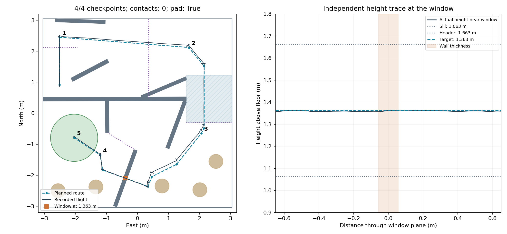
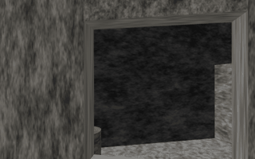

# Sensor-aligned window route

This extends `hardcoded` on the corrected course map. The five main goals remain;
A* supplies intermediate points, and goal 1 to goal 2 stays a straight segment.
The controller stops at each turn, turns its nose, and then travels forward.

## How the window crossing works

1. Approach the window at 0.75 m, stop 0.78 m before its centre plane, and climb
   in place to 1.3626 m above the launch floor.
2. Search a bounded set of camera headings while holding position. Stereo depth
   must show both jambs on the same wall plane. Each accepted wall strip needs
   twelve returns so sparse stereo speckles cannot shrink the apparent gap, and the measured opening width
   within 2.5 cm of the mapped width. Missing depth alone cannot confirm a window.
3. Compare the observed wall plane and aperture centre with the map. Apply a
   filtered correction to the horizontal tracking frame, capped at 1 cm per
   observation and 40 cm total. This uses ordinary stamped camera points and
   matching camera tracking poses, never Gazebo positions.
4. Require five fresh observations within three seconds, each with less than
   1.5 cm residual correction. Measured position must be within 1.5 cm of the
   approach point, height within 2.5 cm, and camera heading within 2 degrees.
5. Turn back perpendicular to the wall at no more than 5 degrees/s and cross
   at 0.10 m/s, with at most 8 cm
   of target lead. Hold translation if measured sideways error exceeds 2.5 cm,
   heading error exceeds 2 degrees, or the existing depth guard detects an
   obstacle or stale picture. After clearing the wall, descend to 0.75 m,
   finish goal 4, then fly to goal 5 and land.

Cruise and all main goals are at **0.75 m**; the two window approach/departure
points are at **1.3626 m**; touchdown is **0 m**. Each run writes the complete
intermediate-point table to `waypoints_with_heights.csv`.

## Calibration and height fixes

Stereo reconstruction is relative to the left eye. The body-frame conversion
now includes half the calibrated stereo baseline to the left, in addition to
its existing forward/up mount offsets. The model uses a 7.515 cm baseline,
so the previously missing lateral offset was 3.7575 cm. This assumes the stereo
midpoint is mounted on the body's centreline; confirm the mounting transform
before transferring this to a different aircraft.

The window controller filters the measured difference between PX4 height and
camera-tracked height instead of accumulating error to the final climb target.
This avoids interpreting normal climb lag as estimator bias or freezing an old
correction that prevents the moving target from advancing. The existing 15 cm
correction bound and the independent height checks remain in place.

The raw-laser height check now includes raised wall surfaces below the aircraft.
Previously it inspected only the first 5 cm above the floor, so the corrected
window wall (whose bottom is 46.3 cm high) was absent from its obstacle list.
During crossing, a valid 29 cm range to the sill was incorrectly compared with
1.37 m height above launch as if the beam hit clear floor. The corrected check
retains the same 40 cm floor-clearance margin and 15 cm / one-second error limits;
the camera/PX4 height comparison remains active everywhere, including over sills.

The map's old 58 cm aperture came from a coarse slice. Exact triangle-plane
intersections through the original corrected OBJ give 60.3936 cm. The map uses
60.38 cm after rounding both edges inward to 0.1 mm. No mesh was widened.
The nominal propeller clearance is approximately 5.3 cm per side. The crossing
uses rectangular jamb geometry; rounded wall-end caps would artificially close
part of this rectangular opening. The map's existing shortened start wall and
omitted tube cradles remain as in the teammate's corrected-map generator.

## Run in Gazebo

From the repository root on a supported Docker/Gazebo setup:

```bash
git fetch origin
git switch hardcoded
git pull --ff-only origin hardcoded
bash simulator/gazebo_full/fly_course_in_gazebo.sh \
  --world drone_code/team_nav/course_maps/real_course_2026-11-08.json \
  --run-mode practice --longest-run-seconds 900 -- \
  practice_flight corrected_course --route through
```

`--route verify-first-two` still flies only the first two goals. `--route over`
still refuses: the required 2.6848 m height exceeds the existing 1.627 m target
ceiling. It is not a working alternative in this course configuration.

## Validation status

**Gazebo run 20261108_154709 passed the full route.** All four checkpoint groups
were recorded, the drone landed on the pad, motors stopped after 338.4 seconds,
and there were zero contacts, boundary violations, or height-estimate failures.
Maximum PX4 height error was **0.077 m** (the existing limit is 0.10 m).

The alignment controller confirmed five fresh observations before crossing.
Independent recorded positions show the aircraft passing through the window plane
at **1.3561–1.3642 m**; the mapped horizontal airframe clearance along this stretch
was at least **0.0478 m**. This calculation uses measured position/yaw and the
motor/propeller footprint, not a simulator position fed to the controller.
The referee labels its Chicane group `Gate B`; the recorded window-plane crossing,
camera clip, and height trace establish the actual through-window route separately.



Actual recorded left-camera images, played at 4× speed:



[Referee result](passing_run/referee_summary.json) ·
[Window measurements](passing_run/window_metrics.json) ·
[Recorded path](passing_run/recorded_path.csv) ·
[Every waypoint and height](passing_run/waypoints_with_heights.csv) ·
[Alignment events](passing_run/alignment_events.json) ·
[Exact source hashes](passing_run/source_hashes.json) ·
[Hashes with LF line endings](passing_run/normalized_source_hashes.json) ·
[Test environment](passing_run/test_environment.json)

The flight-source hashes matched the working tree before committing. This Windows/WSL
run used the previously documented Docker internal-network UDP transport workaround;
PX4 parameters, sensor physics, and the referee were unchanged. The standard command
above remains the entry point for the supported Docker/Gazebo setup.

The complete package regression suite passed: **316 tests**, using
`python3 -m pytest test/ -q` from `drone_code/team_nav` with ROS and the PX4
message package sourced. It covers the opening detector, stale/repeated images,
alignment tolerances, timeout retreat, height correction, raised-sill classification,
and the existing planners and flight checks.

Earlier attempts are retained below and in [machine-readable failed-run evidence](failed_runs.json).

| Gazebo run | Outcome | Contacts | Maximum PX4 height error |
|---|---|---:|---:|
| 20261108_144114 | Neither jamb pair confirmed; alignment timed out and landed before the window | 0 | 0.267 m, failed |
| 20261108_145207 | Unstable alignment; timeout landing contacted an obstacle. The resulting tumble crossed the checkpoint line and is not a successful crossing | 2 | 0.256 m, failed |
| 20261108_150453 | Vertical target stalled against a frozen correction; timeout landing before the window | 0 | 0.086 m |
| 20261108_151342 | Reached crossing height, but scan repeatedly lost both jambs; timeout landing clipped a low obstacle | 1 | 0.145 m, failed |
| 20261108_152136 | Partial alignment, then timeout; checked retreat and clear-floor landing completed | 0 | 0.099 m |
| 20261108_153217 | Alignment confirmed and crossing began; false clear-floor classification caused an abort onto the sill and subsequent contact | 1 | 0.116 m, failed |
| 20261108_153917 | Full course through the window, on-pad landing, motors off; height check failed during the final turn before crossing | 0 | 0.181 m, failed |

The first two failures led to the bounded yaw scan, left-eye offset correction,
stricter width filter, and filtered alignment corrections. The third exposed the
height-target stall and led to the measured height-offset controller. The fourth
led to holding the observed successful camera angle and a checked retreat to clear
floor on an alignment timeout. Critical telemetry, authority, contact, and height
faults keep their existing immediate response; they do not trigger that retreat.
The fifth exposed sparse stereo edge smearing: replaying its camera clouds led to
the denser wall-support requirement, with a regression test for that failure.
The sixth exposed the raised-sill floor-classification bug. The seventh completed
the full route but showed a vertical transient while returning from a 10-degree
inspection angle; inspection and final alignment yaw are now limited to 5 degrees/s.

These are local Gazebo/PX4 tests. Camera images and stereo depth are exercised,
but simulator-provided camera tracking does not qualify real visual odometry.
The independent referee is used only after or alongside the flight for evaluation.
