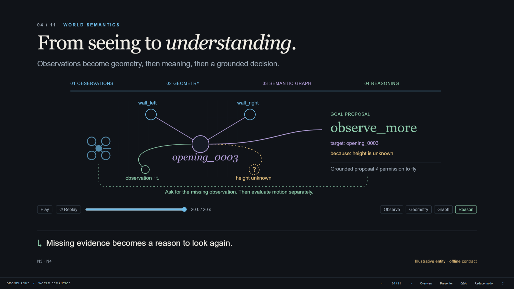

# DroneHacks — From observations to justified actions

An animated, speaker-paced presentation for hackathon and industry judges: 11 main slides, a 600-second pacing plan, and six separate Q&A slides. Built on the GitHub `presentation` branch. All visuals are original SVG illustrations inspired by explanatory mathematical animation; they are not flight telemetry or copied 3Blue1Brown assets.

Slide 4 is the central continuous explanation: the same sensor samples settle into wall geometry, gather into a semantic graph, and support an `observe_more` decision. Its 20-second sequence plays once on entry, then holds. Pause, replay, scrub or choose a stage with the on-slide controls. Arrow keys step through its stages before moving to the next slide. Reduced-motion mode shows the final state and allows static stage selection. Other slides retain restrained, speaker-paced reveals.



## Present

From this directory, run `npm start`, then open **http://127.0.0.1:4173**. Vendored reveal.js assets are committed, so playback and the preview server need no installation or network. Node.js is required for the local server. Opening `index.html` directly also supports audience playback; presenter view requires the server.

| Control | Action |
|---|---|
| Right / Space / Page Down | Next reveal, then next slide |
| Left / Page Up | Previous reveal or slide |
| Home / End | Problem / closing |
| Esc | Slide overview |
| S or Presenter button | Notes, timer, pacing and next-state preview |
| Q or Q&A button | Separate appendix menu |
| F or fullscreen button | Fullscreen |
| Reduce motion | Immediate state changes instead of animation |

The normal forward path stops on slide 11. Use the Q&A menu to visit appendix topics and return to the closing. Source links open separately. No auto-advance or audio; the speaker controls the pace. The OS reduced-motion preference is honored.

## Edit, build and verify

Read `RESEARCH.md` first for evidence boundaries, then `slides.js` for the narrative and pacing. `player.js` supplies audience titles, transitions and reveal.js navigation. `visuals.js` contains one SVG scene function per concept; `style.css` defines the visual language. `appendix.js` holds Q&A material. The renderer uses design pixels, not real course dimensions.

`continuous-scene.js` owns the central scene's deterministic clock and interpolation. Sample identities persist as their coordinates move from observations to fitted geometry to graph nodes. The animation pauses when leaving the slide, opening overview or hiding the tab; it never advances the talk automatically.

```sh
npm ci
npm run build
npm start
# In a second terminal, while the preview is running:
npm test
```

Build produces a self-contained `dist/` directory with local reveal.js 6.0.2 assets and the original shell in `dist/static/`. Tests use Playwright with installed Microsoft Edge. If Edge is unavailable, install it or adapt the browser channel in `verify.cjs`. Tests create screenshots at 1920×1080 and 1366×768, a verification report and two PDFs under ignored `artifacts/`.

`npm run export` runs the same browser checks and regenerates the PDFs. Open `/?static` for all final main-slide states or `/?static&appendix` to include Q&A. Export hides speaker notes. The original dependency-free shell remains at `static/index.html`; it is the earlier content fallback, not the finished design.

## Deliverables and evidence

- [Main presentation PDF](exports/DroneHacks-presentation.pdf)
- [Presentation plus Q&A PDF](exports/DroneHacks-with-appendix.pdf)
- [Implementation brief](IMPLEMENTATION_PROMPT.md)
- [Research and claim ledger](RESEARCH.md)
- [Validation and limitations](VALIDATION.md)

The Notion strategy tracker and taskforce record were refreshed on November 8, 2026; latest fetched entries still describe S0 attempts 001–004 staying disarmed. This deck distinguishes offline evidence, native calibration, the separate Classical Gazebo baseline and future plans. The 10-minute allocation is verified arithmetically, not a measured human rehearsal.

No flight code, nested branch or robotics service was changed. The initial shell was authored in a separate workspace root named `presentaiton`; published development now lives on the correctly spelled `presentation` branch.
