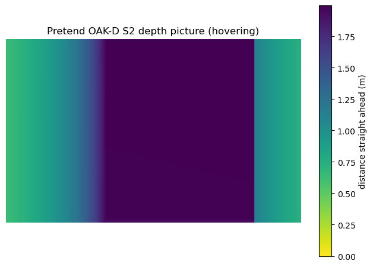

# Gazebo trial: can Gazebo give our simulator a depth camera?

**TRIAL ONLY, SIMULATOR ONLY.** Nothing in this folder runs on the drone, and nothing here changes the normal simulator in `simulator/`. Everything was measured on 2026-11-07 on our M1 Mac, inside Colima with 6 processor cores and 10 GB of memory.

## The answer in short

**Yes, it works.** PX4 1.16.2 flies a drone in Gazebo inside our Docker box on the Mac, and Gazebo draws depth pictures without a graphics card. A depth camera like the one we plan (512 × 320 pixels, 10 pictures per second) runs at full speed and costs about a quarter of one processor core extra. The pictures arrive on ROS 2 Humble topics, and they show the course where the map puts it.

**But we recommend not switching to Gazebo now.** For the job we need it for, which is testing what the drone does when its camera sees a wall that its map lacks, our current simulator already has the important parts: a ray-traced depth camera with stereo-like errors, and the physics we tuned to drone 16. Gazebo would add full-size pictures, real stereo pictures and solid walls. But it needs the Mac to itself: with the processors fully busy, its drone nearly hit the floor. The reasons, and when Gazebo would be worth it, are in [Should we switch?](#should-we-switch-to-gazebo) below.

## Words used here

- **Gazebo** is a free robot simulator. It works out how things move and collide, and it can draw what a camera would see. "Gazebo Harmonic" is the version PX4 1.16 needs.
- **SDF** ("Simulation Description Format") is the text format Gazebo reads a world from. It is XML: a list of shapes with their sizes and positions.
- **A depth picture** holds a distance in every pixel instead of a colour. Our pretend camera gives the distance in metres, measured straight ahead from the camera.
- **Software drawing.** The Docker box on the Mac has no graphics card, so the main processor draws every picture, using a program called Mesa "llvmpipe" (Gazebo's log confirms it: `GL_RENDERER = llvmpipe`). That is much slower than a graphics card, which is why we had to measure it.
- **The message agent** (MicroXRCEAgent) is the program that carries PX4's messages to and from ROS 2. The real drone uses the same one.
- **Simulation speed** means simulated seconds per real second. 1.0 means the simulation keeps up with real time. 0.5 means everything happens in slow motion, at half speed.
- **SIH** is PX4's own built-in, simple physics. Our normal simulator uses it, tuned to drone 16 (see [`../px4_changes/`](../px4_changes/README.md)).
- **x500** is the drone PX4 ships for Gazebo: a 2 kg drone with motors 49 cm apart corner to corner. It is not drone 16.

## How to run it

All commands run on the Mac, from the top folder of the repository. Colima must be running (see [`../README.md`](../README.md)).

Build the normal simulator box first, if you haven't (`simulator/build_simulator_image.sh`). Then build the Gazebo box. It starts from the normal box and leaves it unchanged. It took about 8 minutes and adds about 2.5 GB of disk.

```bash
simulator/gazebo_trial/build_gazebo_image.sh
```

Make a Gazebo world from any course map. The world file appears in `simulator/gazebo_trial/generated/worlds/`.

```bash
docker run --rm --volume "$PWD:/repository" --workdir /repository drone-simulator-gazebo python3 simulator/gazebo_trial/make_gazebo_world.py drone_code/team_nav/course_maps/phone_scan_2026-11-06.json
```

Check the worlds made from every map file. This takes about 30 seconds.

```bash
docker run --rm --volume "$PWD:/repository" --workdir /repository drone-simulator-gazebo python3 simulator/gazebo_trial/check_worlds.py
```

Measure how fast Gazebo draws pictures, for seven camera setups. This takes about 4 minutes. Close other busy programs first, including other simulator runs, or the numbers will be lower.

```bash
docker run --rm --volume "$PWD:/repository" --workdir /repository drone-simulator-gazebo python3 simulator/gazebo_trial/measure_rendering_speed.py
```

Fly a short test: PX4 takes off to 1 m with its own takeoff command, hovers while we measure the camera, and lands. This takes about a minute. Add a map file to fly in that course instead of the organizers' drawing, or `--stay-on-ground` to measure without flying.

```bash
simulator/gazebo_trial/run_px4_in_gazebo.sh
```

The flight test's box has no network connection (`--network none`), so its ROS messages can't mix with those of another simulator on the same Mac. It still shares the Mac's processors, so don't run other heavy programs, such as our normal simulator, at the same time. [What doesn't work](#what-doesnt-work-or-isnt-done) explains both.

Each run saves everything the programs printed, PX4's flight log and the processor load in `simulator/gazebo_trial/generated/last_run/`, and the depth picture in `simulator/gazebo_trial/generated/pictures/`.

## What works

Everything in this list was run and checked on 2026-11-07.

- **Gazebo Harmonic in our box.** Gazebo's own packages exist for the Mac's arm64 processor on Ubuntu 22.04, so no compiling was needed. PX4 1.16.2 was compiled again with its Gazebo link.
- **Worlds from all three map files.** `make_gazebo_world.py` turns each of the three maps in `drone_code/team_nav/course_maps/` into a world: the floor, every wall with its openings cut out (the window), the oval tunnel, the low obstacles as cylinders, and the safety net with its roof. `check_worlds.py` passes on all three. It reads the shapes back out of each world file and tests thousands of points against the map, and Gazebo's own file checker accepts each file. We also checked that the test catches mistakes: a world with every shape turned by 3 degrees, or with one piece of the window wall missing, fails it.
- **Depth pictures without a graphics card.** Gazebo draws them in software with no screen at all.
- **A pretend OAK-D S2 on a drone.** [`models/drone_with_oak_d_s2/`](models/drone_with_oak_d_s2/model.sdf) is PX4's x500 with our camera on its nose. The camera settings come from drone 16's real camera and our depth plan, and the file says where each number comes from.
- **ROS 2 topics.** [`gazebo_camera_to_ros.py`](gazebo_camera_to_ros.py) publishes the pictures as `/simulator_only/oak/depth/image` (`sensor_msgs/Image`, metres) and `/simulator_only/oak/depth/camera_info`. A plain ROS 2 listener received them.
- **PX4 flies the Gazebo drone.** In both the organizers' drawing and the phone scan, PX4 armed, took off to 1 m with its own takeoff command, hovered, landed and disarmed itself. While hovering it held its height within 4 cm and its position within 9 cm, and tilted less than half a degree (read from PX4's flight logs). PX4's messages reached ROS 2 through the same message agent as on the real drone.
- **The picture is right.** Hovering on the launch mark at about 1 m, facing down the first corridor, the camera saw the net about 0.5 m to the left, the maze divider about 0.5 m to the right, and the net about 2 m ahead, as the map says.
- **Walls and the net are solid.** A drone that drifts into them really hits them. We saw this by accident (see below).



Above: a depth picture received on ROS 2 while hovering on the launch mark in the phone-scan world, facing down the first corridor. The left edge is the net (green, 0.6 m, getting farther towards the middle), the right edge is the maze divider (0.6 to 1.1 m), and the dark middle is the net at the far end of the corridor, 2 m away. Each flight run saves a new one in `generated/pictures/`.

## Measured speeds

**Drawing alone**, from `measure_rendering_speed.py`. This is a camera on a fixed stand on the launch mark, at 0.8 m, looking down the first corridor, with no drone and no PX4. "Cores busy" is the processor time Gazebo used; 1.0 is one of the Mac's cores fully busy. We ran it twice. The table shows the second run, during which we checked that no other Docker box was running.

| Camera setup | Pictures per real second | Pictures per simulated second | Simulation speed | Cores busy |
|---|---:|---:|---:|---:|
| No camera, for comparison | – | – | 0.98 | 0.16 |
| **Depth 512 × 320 at 10/s (our depth plan)** | **9.8** | **10.0** | **0.99** | **0.39** |
| Depth 512 × 320 at 30/s | 29.4 | 29.9 | 0.98 | 0.70 |
| Depth 640 × 400 at 15/s (the organizers' lab setting) | 14.8 | 15.0 | 0.99 | 0.65 |
| Depth 1024 × 640 at 30/s (the real camera's picture size) | 29.0 | 30.0 | 0.97 | 1.67 |
| Two black-and-white eyes, 640 × 400 at 15/s | 14.6 | 15.0 | 0.98 | 1.51 |
| Two black-and-white eyes, 1024 × 640 at 30/s (the real camera) | 25.1 | 30.0 | 0.84 | 5.23 |

How to read it: every setup delivers the full number of pictures per *simulated* second, so nothing is ever skipped. When drawing can't keep up, Gazebo slows the whole simulation down instead. Our planned depth camera, and even three times that rate, cost nothing in speed. Drawing the real camera's two full-size eyes 30 times per second slows everything down and uses almost all of the Mac's 6 cores.

The first run gave the same results for the light setups, but much worse ones for the heavy setups: 0.74 speed for full-size depth, and 0.54 for the two full-size eyes. We did not check for other programs during that run, and our normal simulator was being run on the same Mac that morning, so we trust the second run. It does show that the heavy setups are sensitive to anything else running on the Mac.

**The whole thing, flying**, from `run_px4_in_gazebo.sh`: Gazebo, PX4, the message agent and the camera bridge together, with the drone hovering at about 1 m on the launch mark. Nothing else was running, and the box had no network connection. We flew it in the organizers' drawing and in the phone scan; each run took 66 seconds from start to landed.

| What | Organizers' drawing | Phone scan |
|---|---|---|
| Depth pictures arriving on ROS 2, per real second | 9.8 | 9.8 |
| Depth pictures per simulated second | 10.0 | 10.0 |
| Simulation speed while hovering | 0.98 | 0.98 |
| True height while hovering (PX4 aimed for 1.0 m) | 0.92 to 0.96 m | 0.98 to 1.02 m |

Processor use while hovering: Gazebo 0.52 of a core, PX4 0.22, camera bridge 0.03 to 0.05, message agent 0.03. That is under 1 of the 6 cores. Earlier flights, made before the box lost its network, gave the same camera rates.

The hover height varies a little from run to run, and it is not the camera. In this setup PX4 judges height from a pretend air-pressure sensor, as PX4's x500 settings say, and that estimate drifts: one earlier phone-scan run hovered at 0.74 m. Drone 16 uses its bottom laser for height instead, and our normal simulator copies that.

**Flying with the Mac's processors full.** To see how Gazebo copes with other heavy programs, we flew once more in the drawing while a second box kept all 6 cores busy. The camera still delivered 10 pictures per simulated second, at 0.93 simulation speed (9.3 per real second). But the flight was not steady. While PX4 was simply holding its position, the drone sank from 1.0 m to 0.17 m within about 4 seconds, while PX4 believed it was still above 0.6 m. It then climbed back, overshot to 1.23 m, and later landed normally.

The camera bridge first used 0.45 of a core on its own, because ROS's Python library checked every byte of every picture. Handing it the bytes as an array brought that down to 0.03 (see the comment in [`gazebo_camera_to_ros.py`](gazebo_camera_to_ros.py)).

## What doesn't work, or isn't done

- **The drone is PX4's x500, not drone 16.** It is heavier, bigger, and has its motors in a perfect square. Our normal simulator's physics is tuned to drone 16's measured motor positions; this one is not. Building a drone 16 model for Gazebo is possible but not done, and its weight and thrust would still be estimates.
- **PX4 finds its position by pretend GPS here,** which is PX4's x500 default. The real drone has no GPS indoors; it uses camera tracking and the bottom laser. Our normal simulator already pretends to be those, so they could be reused, but that is not done.
- **Gazebo does not wait for PX4.** PX4 follows Gazebo's clock, but Gazebo keeps going if PX4 falls behind. With all 6 cores busy (see [Measured speeds](#measured-speeds)), PX4 lost track of its height and the drone nearly hit the floor. So when using Gazebo, run nothing else heavy at the same time. Our normal simulator doesn't have this weakness, because its physics runs inside PX4 and cannot get out of step with it.
- **Two simulators on one Mac hear each other unless kept apart.** ROS 2 programs find each other automatically, even across Docker boxes on the same Mac. Before we took this box's network away, our normal simulator's referee heard this box's drone. In the other direction, this box's PX4 could hear the normal simulator's pretend remote control, pretend bottom laser and commands. In one early test, the drone hovered steadily for 5 minutes. Then, at about the moment the normal simulator started a flight, it climbed, drifted sideways into the net, and flipped. The cause could be the foreign messages, a lack of processor time, or both; that flight log is gone, so we can't tell. `run_px4_in_gazebo.sh` now starts its box with `--network none`. The flights in the table above and the full-processor test were made that way.
- **The message agent's clock check keeps resetting** ("time jump detected" in PX4's output), probably because PX4 follows Gazebo's simulated clock, which doesn't run at exactly the speed of the computer's clock. Messages still flowed, but time stamps on PX4's ROS messages may be slightly off. We have not looked into it further.
- **The depth is perfect.** The real camera's depth has errors that grow with distance, and holes on plain walls. Gazebo can't produce those by itself; we would have to add them, as [`../ros_packages/course_simulator/course_simulator/pretend_depth_camera.py`](../ros_packages/course_simulator/course_simulator/pretend_depth_camera.py) does.
- **The pictures are plain.** Walls are flat colours with no texture. That is fine for depth, but a stereo-matching or camera-tracking program would find nothing to match on them. Testing those would need photos of the real walls as textures.
- **The net is solid** to the camera and the physics. The real net is a see-through mesh.
- **No ready-made ROS 2 bridge.** The usual Gazebo-to-ROS package isn't published for Humble with Harmonic on arm64, so we wrote [`gazebo_camera_to_ros.py`](gazebo_camera_to_ros.py), which passes on only the depth camera.
- **PX4 needs one setting changed to arm without a ground station** (`NAV_DLL_ACT`, see [`inside_the_box/run_trial.sh`](inside_the_box/run_trial.sh)). Setting it when PX4 starts, the way `drone_16_settings.sh` sets settings, did not work here.

## Should we switch to Gazebo?

The question is what we need the depth camera for. Right now it is this: the drone flies through the real course, its camera sees a wall that the drone's map lacks (or a wall in a different place), and the drone should update its map and plan again. To test that, the simulator needs a "true" course that differs from the drone's map, and a camera that measures distances to the true course.

Our normal simulator already has a depth camera: [`pretend_depth_camera.py`](../ros_packages/course_simulator/course_simulator/pretend_depth_camera.py). Ten times per second it traces a grid of 64 × 40 rays into the course model, with the real OAK-D's field of view (1024 × 640 pixels, focal length 634.5 pixels). It then spoils the result the way stereo depth is spoiled: errors of 4 cm at 1 m that grow with the square of the distance, and 30% of the points missing (both are estimates). It publishes the points (`sensor_msgs/PointCloud2`) on `/simulator_only/depth_points`. Today it reads only the organizers' course model; map-file support is being added (see the table). So the real question is what Gazebo adds beyond this camera.

### What Gazebo would add, and what it costs on the Mac

- **Full-size depth pictures.** Gazebo draws 512 × 320 depth pictures 10 times per second for about a quarter of a core. Our ray tracing takes 12 ms for its 64 × 40 grid but 787 ms for a full 512 × 320 picture, so it cannot give full-size pictures fast enough. This matters only if we want to test our depth code on full pictures. The map-update plan uses about 2,000 points (docs/ARCHITECTURE.md), and 64 × 40 gives 2,560.
- **Real pictures for stereo matching.** Gazebo can draw the camera's two black-and-white eyes, so our own stereo-matching code could run on them, and its failures would come from the pictures instead of from a random 30% loss. Cost: two 640 × 400 eyes at 15 per second used 1.5 cores at 0.98 speed. The real camera's two 1024 × 640 eyes at 30 per second used 5.2 of the 6 cores and slowed everything to 0.84. The catch: our Gazebo walls are flat colours, so stereo matching would find nothing to match. Useful tests would need photos of the real walls as textures, which we don't have.
- **Pictures for camera tracking.** Camera tracking is how drone 16 knows where it is: the organizers' cuVSLAM program follows details from one picture to the next and works out how the drone moved. The same two eyes could feed it, at the same cost. But cuVSLAM needs an NVIDIA graphics processor, like the one in the drone's Jetson computer, and the Mac doesn't have one, so it couldn't run on these pictures on the Mac anyway.
- **Solid walls.** In Gazebo a touch is a real collision, and the drone may crash. In our simulator the referee records each touch and the drone passes through. For testing map updates, counting touches is enough.

| | Switch to Gazebo | Keep our simulator and its ray-cast camera |
|---|---|---|
| Drone physics | PX4's x500. A drone 16 model would have to be built and checked. | Already drone 16's motor positions and settings. |
| Depth camera | Drawn by Gazebo: 512 × 320 at 10/s measured, at full speed, for about a quarter of a core more than no camera. Perfect depth; errors would have to be added. | Already exists: 64 × 40 rays at 10/s, with stereo-like errors and missing points, in 12 ms per picture. Full-size 512 × 320 would take 787 ms per picture. |
| True course from a map file | Done here, for all three maps. | Being added at the same time as this trial (not yet committed on 2026-11-07): `world.py` and `course_mesh_from_map.py` in `../ros_packages/course_simulator/` let the simulator fly in any map file while the drone plans from another. |
| Walls are solid | Yes. A drone that hits a wall crashes. | No. The referee records each touch, and the drone flies through. |
| Camera pictures for stereo matching or camera tracking | Possible: two 640 × 400 eyes at 15/s kept 0.98 speed. Two full-size eyes at 30/s gave 0.84 speed and filled the Mac's processors (0.54 when something else was running). | No pictures at all. |
| Reliability on the Mac | Needs the Mac to itself. With all 6 cores busy, PX4 lost track of its height and the drone sank from 1.0 m to 0.17 m. | Physics runs inside PX4, so it cannot get out of step. |
| Work still needed | A drone 16 model, the pretend camera tracking and bottom laser connected to it, depth errors, our launch and referee moved over. Days, not hours. | Point the existing camera at the true course, which the `world.py` change above does. |

**Recommendation:** keep our current simulator for the map-update work, and don't switch before the competition. A distance measured by tracing rays through the true course is just as true as one drawn by Gazebo, and the errors that matter (noise growing with distance, holes on plain walls) have to be added by hand either way; our camera already adds them. Switching would give us solid walls and pictures, but lose the physics we tuned to drone 16 and take days to rebuild around.

Gazebo becomes worth it later if we want to test the parts that look at **pictures**: our own stereo matching, or, on a computer with an NVIDIA graphics processor, the camera tracking. Both would also need realistic wall textures. Even then, the better plan is probably to use Gazebo only as a camera: keep PX4's SIH physics, and each time PX4 reports the drone's true position, move a camera in Gazebo to the same place and draw the picture. That keeps drone 16's physics and avoids the out-of-step problem. We have not built or tested this. The world generator and camera model in this folder would carry over unchanged.

## Files, in reading order

1. [`make_gazebo_world.py`](make_gazebo_world.py): the command that makes a world from a map. Short; read it first.
2. [`course_world_sdf.py`](course_world_sdf.py): how each map shape becomes Gazebo shapes.
3. [`check_worlds.py`](check_worlds.py): the test that each world matches its map.
4. [`models/oak_d_s2_camera/model.sdf`](models/oak_d_s2_camera/model.sdf) and [`models/drone_with_oak_d_s2/model.sdf`](models/drone_with_oak_d_s2/model.sdf): the pretend camera and the drone that carries it.
5. [`run_px4_in_gazebo.sh`](run_px4_in_gazebo.sh), then [`inside_the_box/run_trial.sh`](inside_the_box/run_trial.sh): the flight test, step by step.
6. [`gazebo_camera_to_ros.py`](gazebo_camera_to_ros.py) and [`save_depth_picture.py`](save_depth_picture.py): passing pictures to ROS 2, and checking them there.
7. [`measure_rendering_speed.py`](measure_rendering_speed.py): the speed test.
8. [`Dockerfile`](Dockerfile) and [`build_gazebo_image.sh`](build_gazebo_image.sh): the box.

`generated/` holds everything the scripts make. Git ignores it, and you can delete it at any time.
