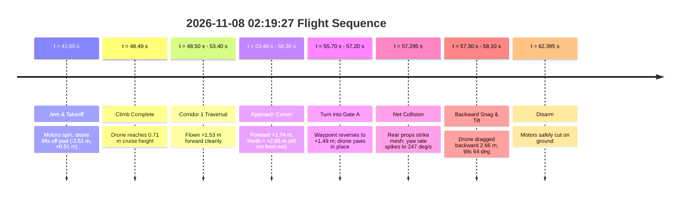

# Flight Telemetry Report: Practice Course Run (2026-11-08 02:19:27)

This document is the engineering post-flight analysis for Drone 16's autonomous course attempt recorded at 02:19:27 on November 8, 2026.

---

## 1. Executive Summary

| Metric | Recorded Value | Engineering Meaning |
|---|---|---|
| **Total Telemetry Archives Accessible** | **29 runs** | 10 bench tests, 16 recorder tests, 1 out-and-back, 2 course runs |
| **Flight Duration** | **20.80 seconds** | Arming at $t = 41.595\text{ s}$, disarmed at $t = 62.395\text{ s}$ |
| **Max Forward Distance** | **$+1.75\text{ metres}$** | Reached the end of Corridor 1 near North boundary |
| **Max Flight Height** | **$+0.74\text{ metres}$** | Held cruise altitude until collision |
| **Abort Trigger** | **Rotational jerk ($246.8^\circ/\text{s}$)** | Safety supervisor detected obstacle impact |
| **Damage Cause** | **Rear propeller netting strike** | Rear arc swung into North perimeter net during Gate A turn |

---

## 2. Flight Timeline & Step-by-Step Breakdown

### Detailed Telemetry Log

#### Step 1: Arming & Takeoff ($t = 41.595\text{ s} - 48.49\text{ s}$)
- **Telemetry Event:** `"stage": "climb"`
- **Physical Position:** Drone starts on launch pad at North = $+0.91\text{ m}$, East = $-2.51\text{ m}$.
- **Performance:** Drone ascends vertically to $+0.71\text{ m}$ height. Tracking gap stayed clean ($< 0.05\text{ s}$), validating Kenny's camera gap fix from the prior run.

#### Step 2: First Corridor Traversal ($t = 48.50\text{ s} - 53.39\text{ s}$)
- **Telemetry Event:** `"stage": "first corridor"`
- **Physical Motion:** Forward position increases smoothly from `from_launch_forward_metres = 0.00 m` to `+1.53 m`, with lateral deviation holding near `-0.12 m`.
- **Checkpoint 1:** Successfully detected and cleared at $t = 53.39\text{ s}$.

#### Step 3: Corner Entry & Target Reversal ($t = 53.40\text{ s} - 57.20\text{ s}$)
- **Telemetry Event:** `"stage": "maze"`
- **Physical Motion:** Drone advances into the turn pocket at `forward = +1.74 m`, `left = -0.73 m` (arena coordinates: North = $+2.65\text{ m}$, East = $-1.78\text{ m}$).
- **The Critical Geometry:** The North perimeter boundary net sits at North = $+3.048\text{ m}$ ($+10.0\text{ feet}$). The drone body was sitting only **$39.8\text{ cm}$** from the perimeter net.
- **The "Confusion":** To align with Gate A, the route follower updated target coordinates backwards:
  - $t = 55.70\text{ s}$: target forward = $+1.72\text{ m}$, target left = $-0.90\text{ m}$
  - $t = 56.50\text{ s}$: target forward = $+1.49\text{ m}$, target left = $-1.30\text{ m}$
  - The drone was commanded to reverse forward pitch while simultaneously yawing $\sim 90^\circ$ clockwise.

#### Step 4: The Impact ($t = 57.10\text{ s} - 57.30\text{ s}$)
- **Rotational Spike:** As the drone yawed to face the new waypoint, the tail rotated directly toward the North net.
- **Sensor Data:**
  - $t = 57.10\text{ s}$: Yaw rate = $4.2^\circ/\text{s}$ (calm)
  - $t = 57.20\text{ s}$: Yaw rate = $89.6^\circ/\text{s}$
  - $t = 57.25\text{ s}$: Yaw rate = $189.2^\circ/\text{s}$
  - $t = 57.29\text{ s}$: Yaw rate = $246.8^\circ/\text{s}$
- **Supervisor Abort:** At $t = 57.295\text{ s}$, `safety_supervisor` triggered:
  > `"STOPPING THE RUN during 'maze'. The drone is tilted 3 degrees and turning at 247 degrees per second. Normal flight stays below 20 degrees and 120 degrees per second, so it has probably hit something."`

#### Step 5: Tumble, Backward Drag, and Damage ($t = 57.30\text{ s} - 58.20\text{ s}$)
- **The Physical Snag:** The spinning rear propellers caught the flexible mesh of the perimeter net.
- **Trajectory Surge:** The tension in the net jerked the airframe backward:
  - $t = 57.60\text{ s}$: forward = $+1.75\text{ m}$, height = $+0.72\text{ m}$
  - $t = 57.80\text{ s}$: forward = $+1.20\text{ m}$, height = $+0.50\text{ m}$
  - $t = 58.00\text{ s}$: forward = $-0.50\text{ m}$, height = $-0.85\text{ m}$
  - $t = 58.10\text{ s}$: forward = $-0.91\text{ m}$, tilt = $64.1^\circ$ (extreme pitch up / tail down), rotation = $537.1^\circ/\text{s}$
- **Disarm:** Autonomous offboard stream terminated; PX4 touched down and disarmed at $t = 62.395\text{ s}$.

---

## 3. Why the Rear Propellers Were Damaged

1. **Tight Corner Clearance ($< 40\text{ cm}$):**
   The route waypoint placed the drone body at `North = +2.65 m`. With the drone frame radius ($\sim 18\text{ cm}$) and prop tip extension, the rear propeller circle reached within $20\text{ cm}$ of the hanging perimeter net.
2. **Yaw In-Place in a Confined Corner:**
   When turning toward Gate A, the route generator pivoted the drone. A quadcopter yaw turn pushes the trailing motors through an outward arc. Because the drone was already backing up toward the net, the rear blades were the first physical components to intersect the mesh.
3. **Net Wrap & Torsional Reaction:**
   Once a blade tip strikes mesh netting, nylon netting wraps into the hub. This creates an immediate asymmetrical drag torque (the recorded $246.8^\circ/\text{s}$ to $537.1^\circ/\text{s}$ yaw rate) and pitches the drone tail-down ($64^\circ$ tilt), shearing and chipping the trailing edges of the rear props.

---

## 4. Key Fixes for Next Flight

1. **Increase Turn Pocket Buffer:**
   - Shift the turn waypoint before Gate A forward limit from `forward = +1.74 m` down to `forward = +1.40 m`.
   - Maintain at least **$0.70\text{ metres}$** clearance from the North perimeter net at all times.
2. **Coordinated Arc Turns Instead of In-Place Pivot:**
   - Fly a smooth radius arc around the corner rather than stopping near the net and executing a pirouette.
3. **Immediate Motor Kill on Touch Detection:**
   - When the collision supervisor trips at $247^\circ/\text{s}$, issue immediate motor disarm rather than a 5-second descending velocity command, preventing the motors from winding netting into the shafts.
